# Blaster — TryHackMe Writeup

**Platform:** TryHackMe | **Difficulty:** Easy | **Target IP:** 10.66.149.91 | **Attacker IP:** 192.168.131.193

## Machine info


## Summary

Blaster is a TryHackMe machine that exposes a Microsoft IIS web server and an RDP service on a Windows Server host. An Nmap scan identifies both ports, and browsing the IIS install reveals a WordPress blog running under a /retro/ directory. A comment left by the blog's author on one of his own posts leaks a password he uses as a note to himself, which turns out to be valid for his Windows account over RDP. After logging in as wade and grabbing the user flag, a hhupd.exe installer found on the desktop is abused through the CVE-2019-1388 UAC bypass, chaining a certificate link inside Internet Explorer's elevated process into a SYSTEM command prompt to read the root flag.

**Attack chain:** Nmap Enumeration → WordPress Comment Leak → RDP Login as wade → CVE-2019-1388 UAC Bypass → SYSTEM

## 1. Nmap Scan — HTTP and RDP Exposed

A full TCP port scan against the target found an IIS web server and RDP exposed, with the RDP certificate leaking the hostname `RetroWeb`.

```
nmap -p- -Pn -sS -sV -sC -vvv -oN scan.txt 10.66.149.91

PORT     STATE SERVICE       REASON          VERSION
80/tcp   open  http          syn-ack ttl 126 Microsoft IIS httpd 10.0
|_http-title: IIS Windows Server
|_http-server-header: Microsoft-IIS/10.0
| http-methods: 
|   Supported Methods: OPTIONS TRACE GET HEAD POST
|_  Potentially risky methods: TRACE
3389/tcp open  ms-wbt-server syn-ack ttl 126 Microsoft Terminal Services
| ssl-cert: Subject: commonName=RetroWeb
| Issuer: commonName=RetroWeb
| Public Key type: rsa
| Public Key bits: 2048
| Signature Algorithm: sha256WithRSAEncryption
| Not valid before: 2026-11-07T20:18:16
| Not valid after:  2027-05-09T20:18:16
| MD5:     c3d7 d81c 8e6b 209e e974 3430 5c58 eb76
| SHA-1:   fe47 9904 1650 88c7 a5ab 57c4 b523 2e6b febb cdf5
| SHA-256: b66b 02a0 8338 c6bb 8ac7 c281 2abb d5bb ebc0 dc07 bf29 391b defb 1fcd 799b 62a0
| -----BEGIN CERTIFICATE-----
| MIIC1DCCAbygAwIBAgIQMYRvYyswaL9EiZOsEOyeKzANBgkqhkiG9w0BAQsFADAT
| MREwDwYDVQQDEwhSZXRyb1dlYjAeFw0yNjExMDcyMDE4MTZaFw0yNzA1MDkyMDE4
| MTZaMBMxETAPBgNVBAMTCFJldHJvV2ViMIIBIjANBgkqhkiG9w0BAQEFAAOCAQ8A
| MIIBCgKCAQEA8SYvuTnnkhvGG+8OYdR74r4Vc0GG4e1etzSYx4hCLFyutNKIiUM9
| PZbnJmVYkMuPAFIY4STqOZXaT/8rEUI8Y9T9cI3g+fjxtaTzR5mxZSs5nFcZx60W
| kbJPBXy+qN9MerOjQAVAOX4sznOTevWRGJM8JmT34ZzZGDUmasf+/KoDTGTodWGC
| 2aeJ6Y4NXQtINs+s8a/LDkW3N6IkSz1Iil2Bpp8HiFb8sIyCqa8Ig2IwSitCWmzv
| m8Zbiz2g3or5G+6O4cbooeYGYck9QaLZD3hGZXMQYajC0E8mNB4ibAf7oVU+W/TV
| UQBwuxZPEW2U91GENyEESMpMbFweXKXZ5wIDAQABoyQwIjATBgNVHSUEDDAKBggr
| BgEFBQcDATALBgNVHQ8EBAMCBDAwDQYJKoZIhvcNAQELBQADggEBAKdRsiAFQoQc
| yObQMhWtjPXmugN2tgaSo/HG6nGM99b3NQ2aA5oexubtdMI66URy2jbj35vCiE9Q
| jYpufNJmQ0wDd0sFBCX3gNvy3UCUbvcrj2Z/n5WG+cazMxQsjgPORJq+h9CTMwdT
| fGNf5XULCIXMvBdaa5lq4K8ioJlGdq0HX3xglThJxvJstWQlJFxr6qv464E3bsfZ
| Rq+CemUxQ1RHbM3MgtFTbqhBZDWAiabi9p/TpgVCo/E9zLjCN0feWH488d4JAbiF
| dfah4t0Wvr74kjXyw3zC/nfUkn55Z4fAa6kyKqkTZXmaBjcckyNcX+b4/aBNotFo
| YwQYCIE/E3E=
|_-----END CERTIFICATE-----
|_ssl-date: 2026-11-08T20:26:49+00:00; 0s from scanner time.
| rdp-ntlm-info: 
|   Target_Name: RETROWEB
|   NetBIOS_Domain_Name: RETROWEB
|   NetBIOS_Computer_Name: RETROWEB
|   DNS_Domain_Name: RetroWeb
|   DNS_Computer_Name: RetroWeb
|   Product_Version: 10.0.14393
|_  System_Time: 2026-11-08T20:26:44+00:00
Service Info: OS: Windows; CPE: cpe:/o:microsoft:windows

Host script results:
|_clock-skew: mean: 0s, deviation: 0s, median: 0s
```

Browsing to the web server on port 80 showed the default IIS splash page, with no custom content at the web root:

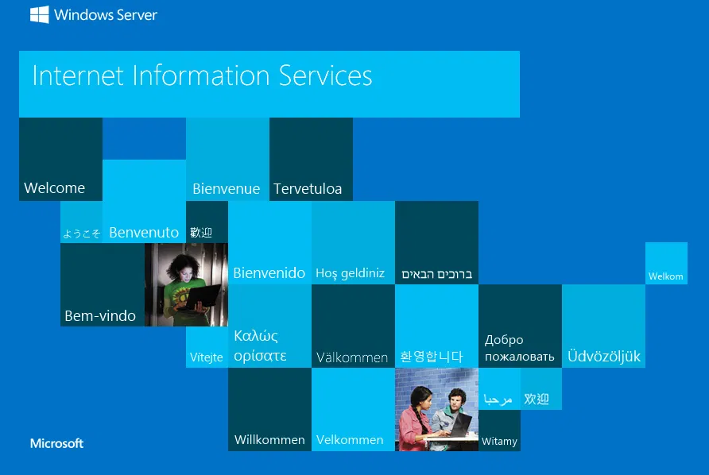

## 2. WordPress Enumeration — Leaking wade's Password

A directory brute force with `gobuster` found a `/retro/` directory redirecting to a WordPress 5.2.1 blog called `Retro Fanatics`.

```
gobuster dir -u http://10.66.149.91/ -w /usr/share/wordlists/dirbuster/directory-list-2.3-medium.txt

retro (Status: 301) [Size: 149] [--> http://10.66.149.91/retro/]
```

Every post on the blog was credited to the same author, `wade`. Browsing his posts turned up a comment he left on his own `Ready Player One` post, apparently reminding himself how to spell his login:

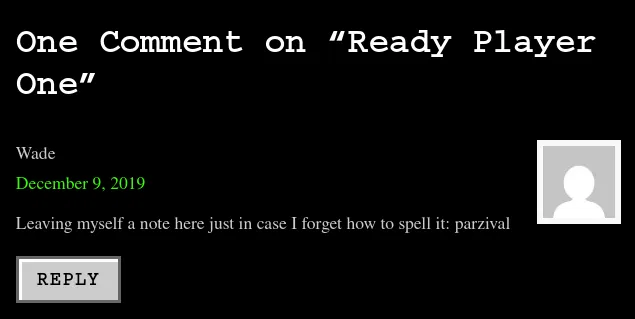

## 3. RDP Access — User Flag

The note pointed to the password `parzival`. Combined with the username `wade`, it worked over RDP:

```
xfreerdp /u:wade /p:parzival /v:10.66.149.91 /cert:ignore /dynamic-resolution
```

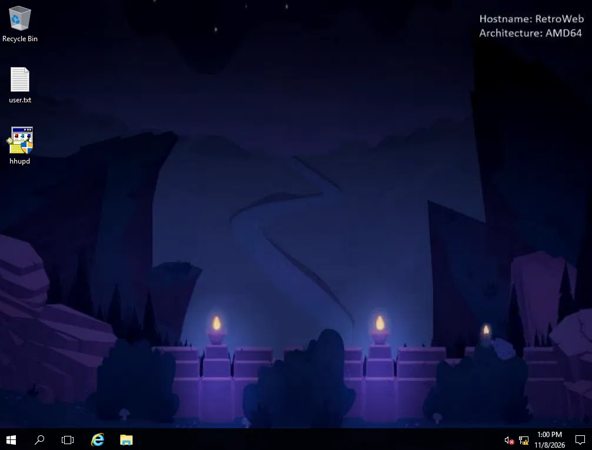

`user.txt` on the desktop held the flag:

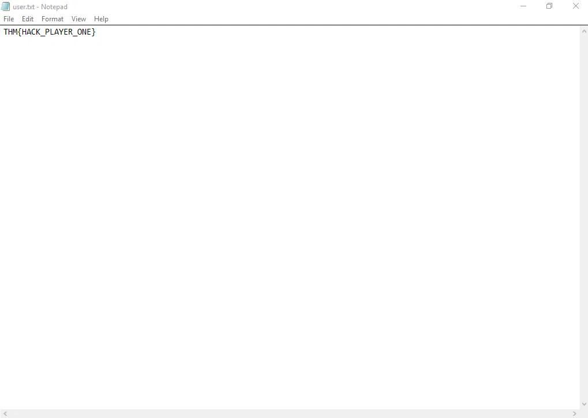

A check of `wade`'s token privileges with `whoami /priv` listed only `SeChangeNotifyPrivilege` (Enabled) and `SeIncreaseWorkingSetPrivilege` (Disabled), ruling out token-based privilege escalation techniques.

## 4. Privilege Escalation to SYSTEM via CVE-2019-1388

A `hhupd.exe` installer found on the desktop is vulnerable to `CVE-2019-1388`, a UAC bypass that reaches a SYSTEM-level process through the certificate-inspection dialog of an elevated installer. Right-clicking it and selecting `Run as administrator` triggered the expected UAC prompt, naming the publisher as `HTML Help ActiveX Control`:

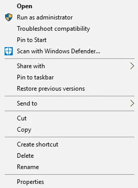

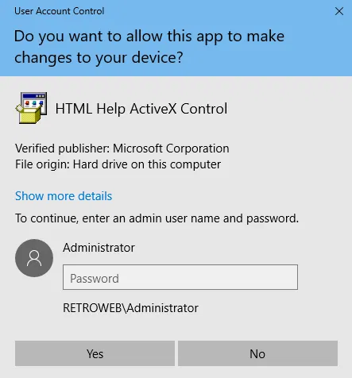

Expanding the prompt with `Show more details` exposed a link to inspect the publisher's certificate:

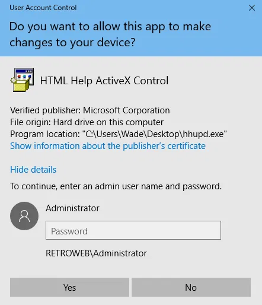

Clicking `Show information about the publisher's certificate` opened a certificate window naming `VeriSign Commercial Software Publishers CA` as the issuer, itself a clickable link:

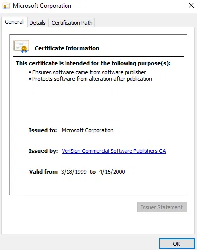

Following that link launched Internet Explorer running as `SYSTEM`, which failed to reach the page since the host has no internet access. From the resulting error page, opening the `File` menu and selecting `Save as...`:

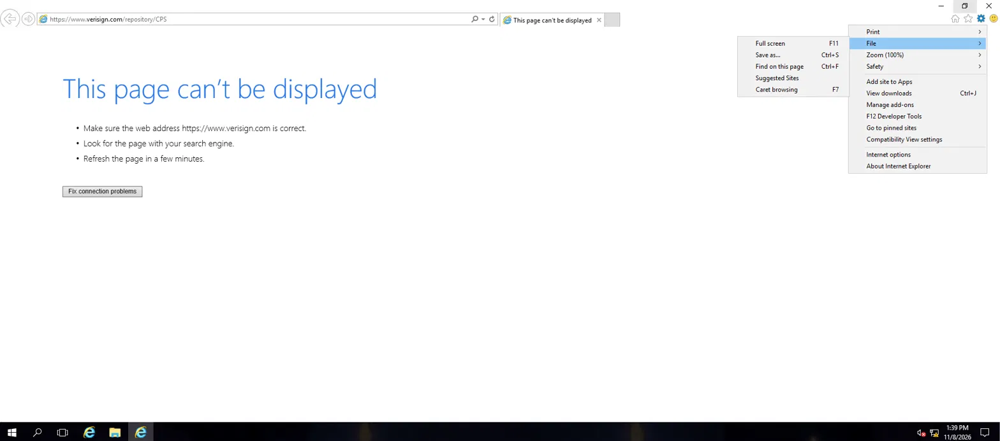

Doing so triggered an error, with the SYSTEM profile's own Desktop location reported as unavailable:

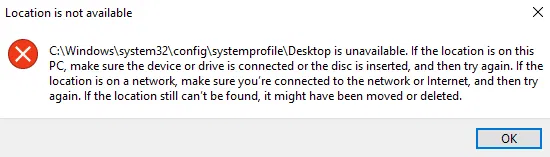

Dismissing it opened the Save Webpage dialog at an accessible `Desktop` location instead:

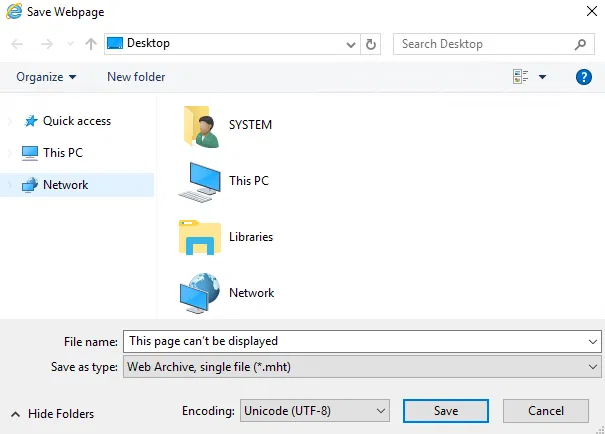

Typing `cmd.exe` into the dialog's address bar and pressing Enter launched a command prompt instead of saving the page:

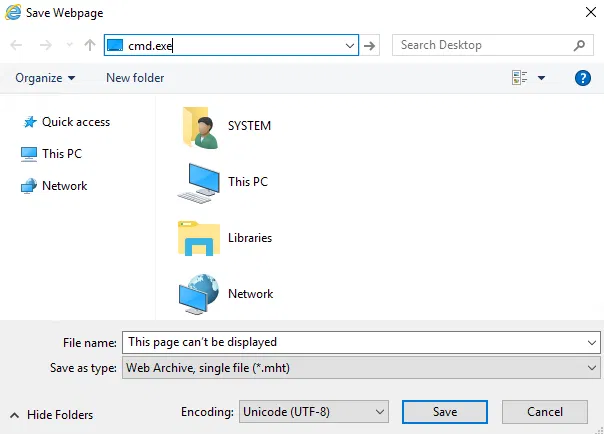

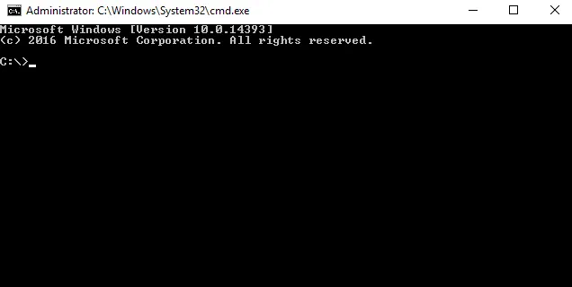

`whoami` confirmed the shell was running with SYSTEM privileges, and `root.txt` on the Administrator's desktop held the flag:

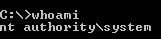

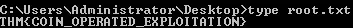

## Root Cause & Remediation

| Issue | Fix |
|---|---|
| WordPress comments are publicly readable, and `wade` left his RDP password as a self-reminder in one | Never store credentials or password hints in public-facing content such as blog comments |
| `wade`'s RDP password (`parzival`) was weak and directly guessable from public content | Enforce strong, unique passwords unrelated to publicly visible hints |
| Legacy `hhupd.exe` installer present and vulnerable to `CVE-2019-1388`, allowing an unprivileged user to reach a SYSTEM process via UAC | Remove unused legacy installers and apply the Windows Update/KB addressing `CVE-2019-1388` |
